# HuntLoop Engine — Architecture & Workflow Diagrams

> Companion to [`HUNTLOOP_ENGINE_EXPLAINED.md`](HUNTLOOP_ENGINE_EXPLAINED.md). All diagrams are Mermaid (render on GitHub, GitBook, VS Code). Every box below corresponds to code that was read; boxes drawn dashed are **implemented but have no producer / unverified** (see the technical document §14).
> Legend — `──►` data/control flow · `[(…)]` database · `{{…}}` external service · dashed = not wired / unverified.

---

## 1. System context — who talks to whom

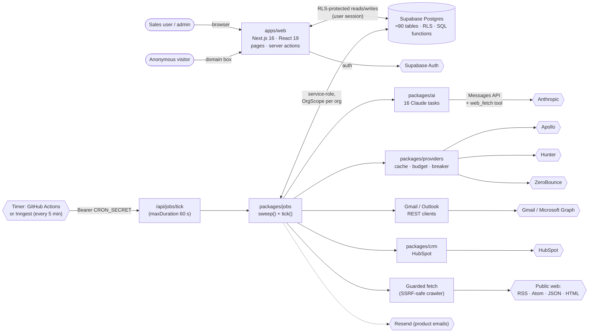

---

## 2. Package / module map

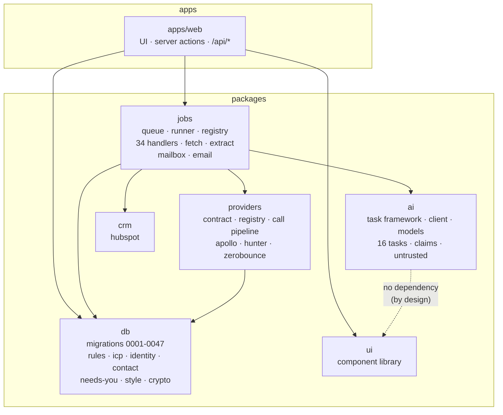

---

## 3. The queue and the heartbeat

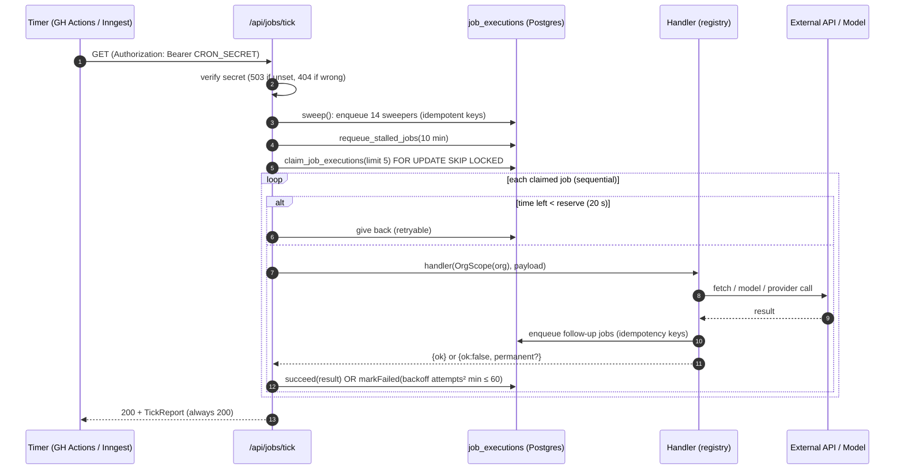

### Job state machine

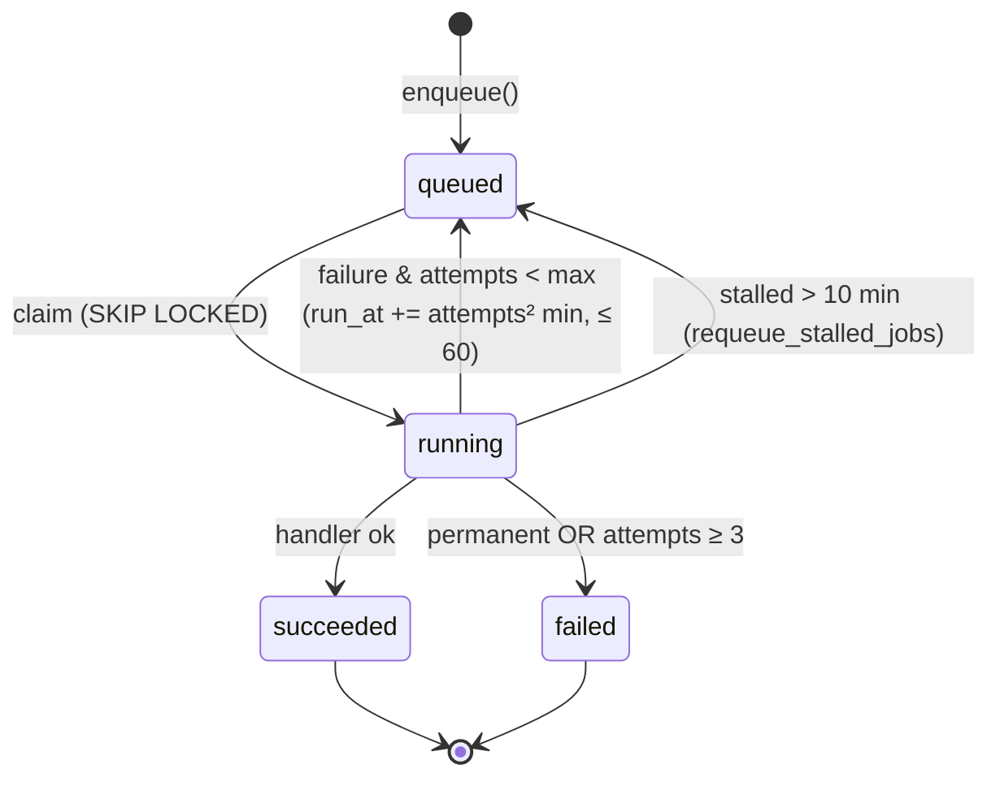

---

## 4. Sweepers → work (the producer map)

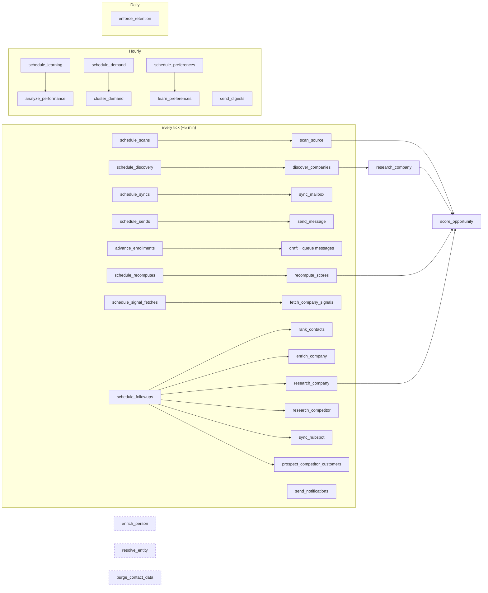
*Dashed: handlers that exist in the registry but have no enqueue site in the source (technical doc §14, F1).*

---

## 5. The main pipeline — input to output

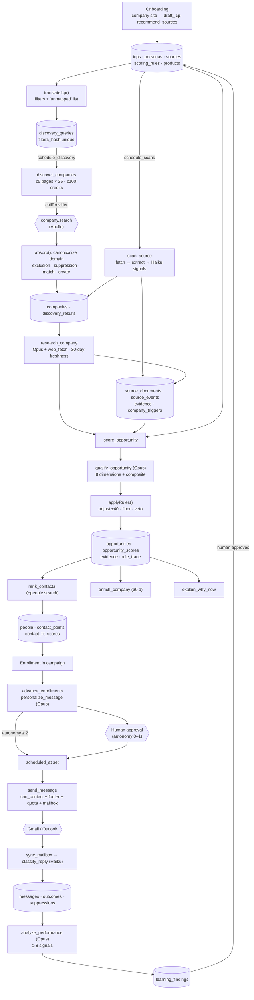

---

## 6. Discovery in detail

```mermaid
flowchart TD
  A[claim_due_discovery_queries<br/>advances next_run_at, skips saturated orgs] --> B[discover_companies]
  B --> C{open/resume discovery_run}
  C -->|already live| X1[skip]
  C --> D[loop: pages < max_pages AND credits < budget]
  D --> E["searchCompanies(filters, cursor, 25)"]
  E --> F{callProvider}
  F -->|breaker open| R1[refused: breaker_open]
  F -->|cache hit| G
  F -->|budget out| R2[refused: budget_exhausted]
  F -->|call ok| G[items]
  G --> H[absorb each item]
  H --> I{outcome}
  I -->|no domain| N1[invalid]
  I -->|ICP exclusion| N2[excluded + reason]
  I -->|on suppression list| N3[suppressed]
  I -->|known company| N4[matched]
  I -->|else| N5[new → companies row]
  N5 --> J["≤25 new → research_company"]
  D -->|cursor saved each page| D
  D --> K[finish_discovery_run<br/>stop_reason: exhausted | page_cap | credit_budget | …]
```

---

## 7. Scanning a source

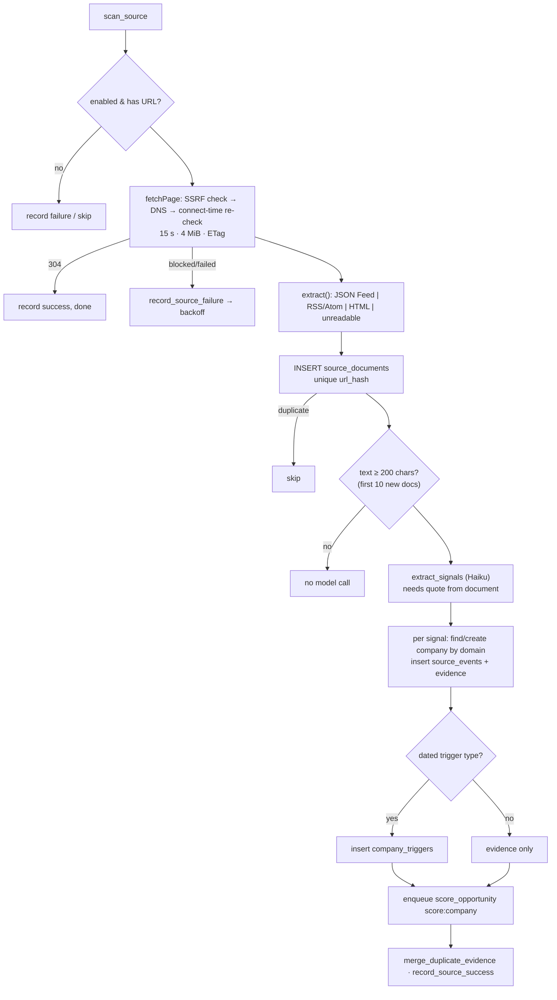

---

## 8. Scoring & ranking logic

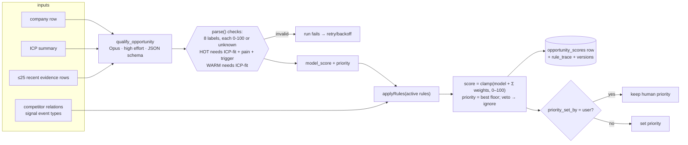

### Priority tiers

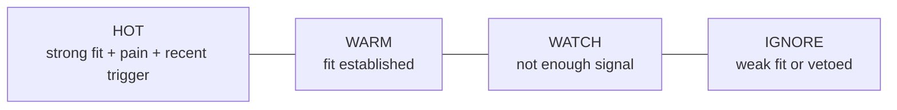

### Contact ranking

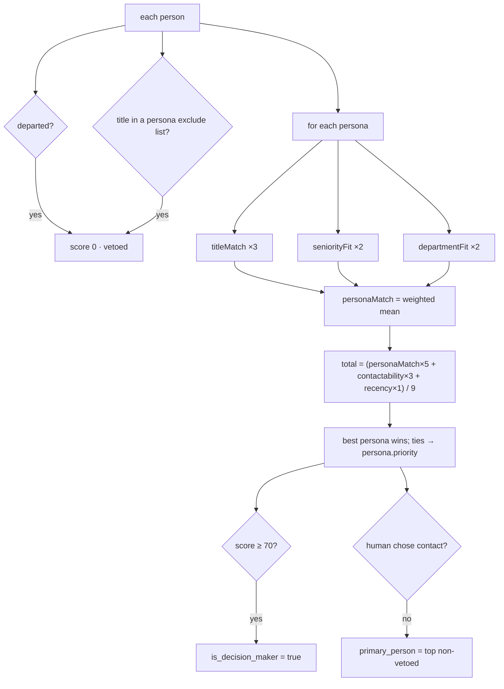

---

## 9. Outreach — gates before an email leaves

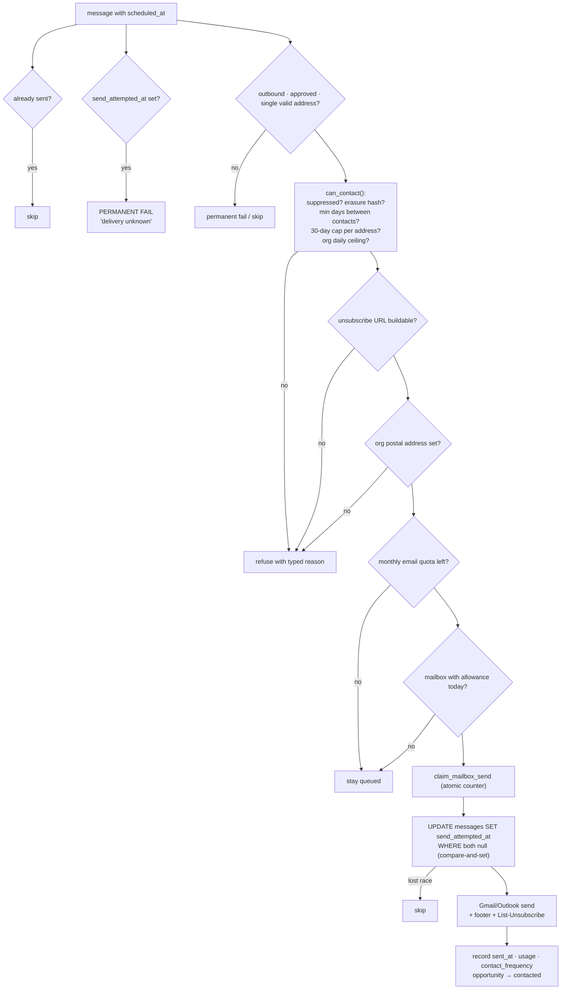

### Reply handling

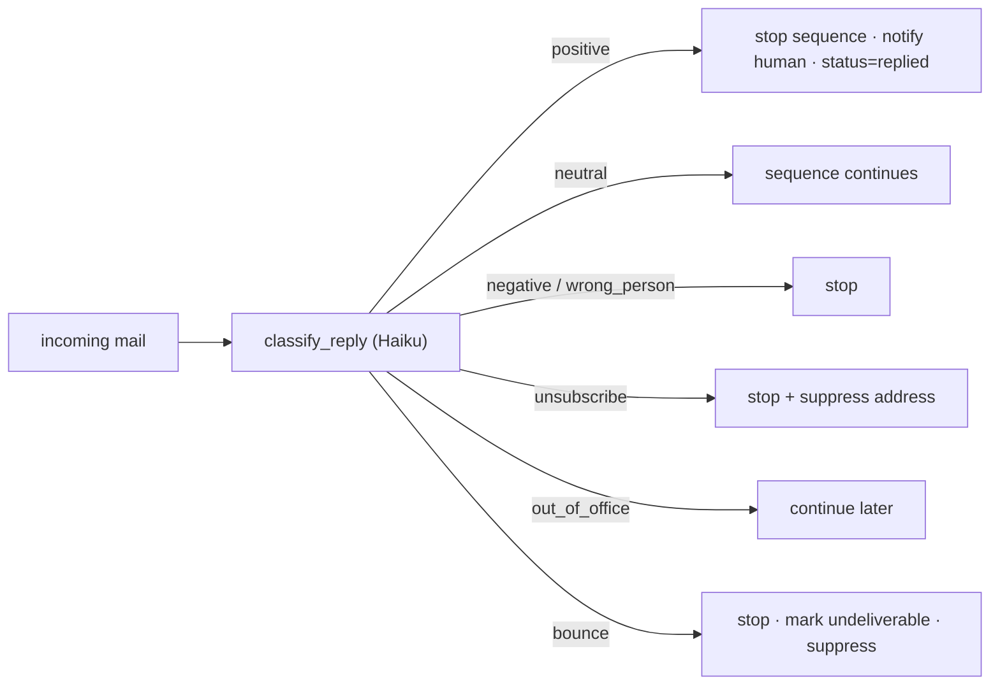

---

## 10. Provider call pipeline

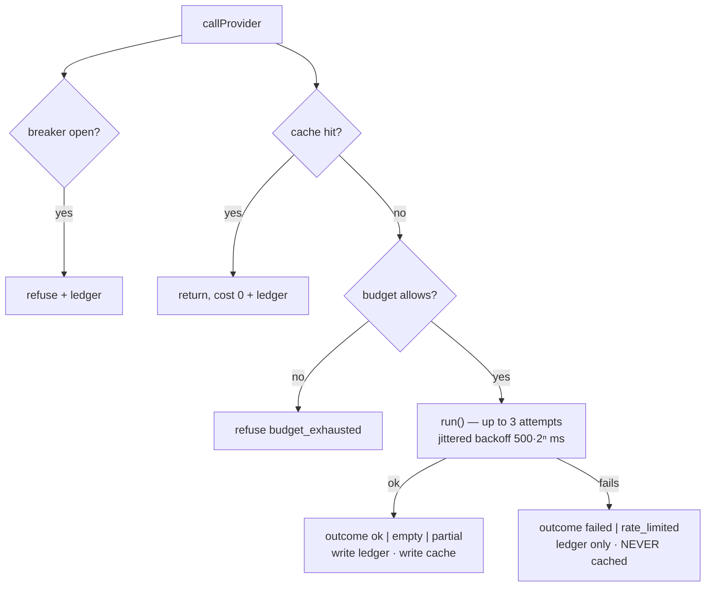

TTL: search 24 h · enrich 30 d · person search 7 d · person match 30 d · verify 90 d · signals 48 h.

---

## 11. Learning loop

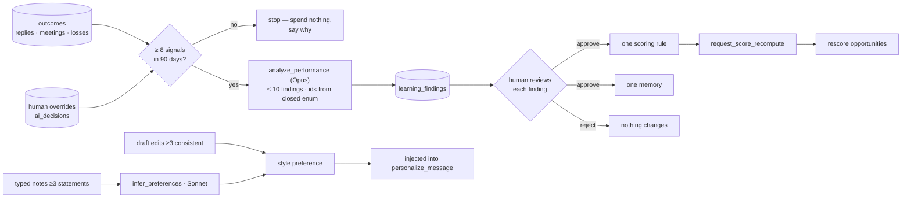

---

## 12. Security & isolation layers

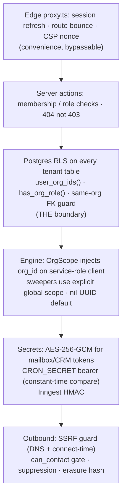

---

## 13. Deployment view (as designed)

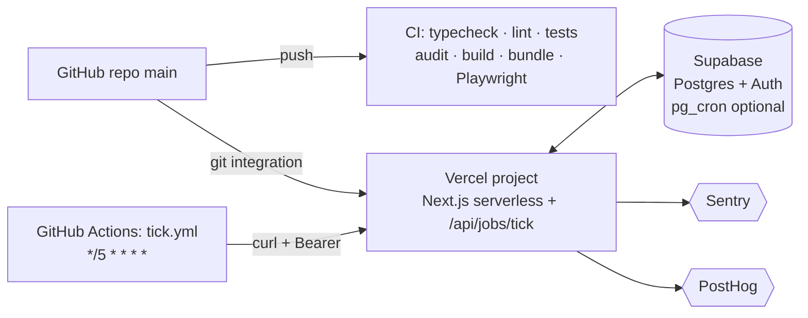
*Notes:* `apps/web/vercel.json` has no `crons` (Hobby plan). Per `AUDIT.md` (2026-10-13), production lacked `CRON_SECRET`, vendor keys and the encryption key at that time — **[UNVERIFIED today]**.
