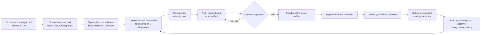
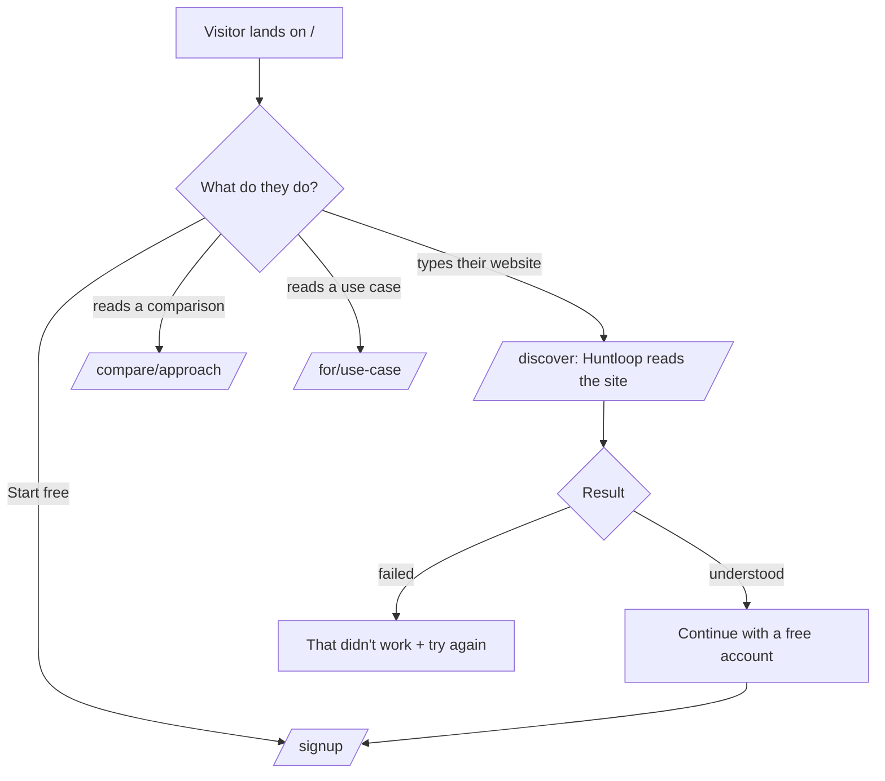
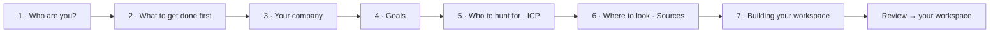
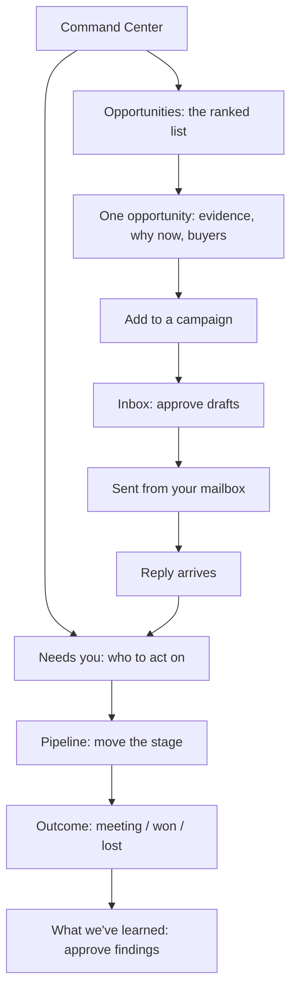
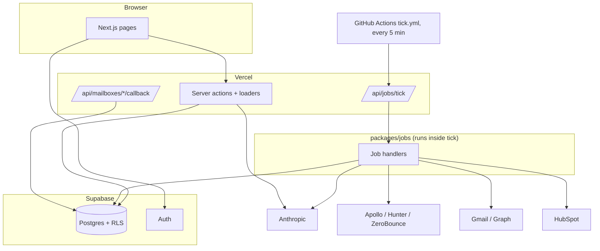
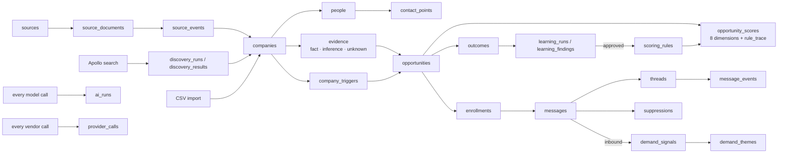
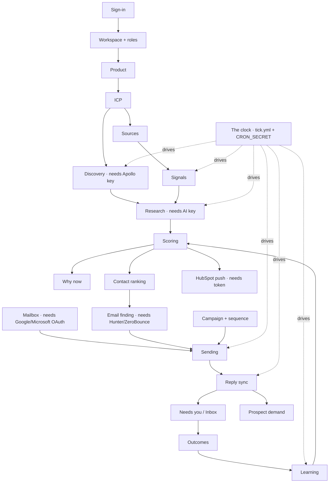

# Huntloop: the master system guide

> **Who this is for:** everyone. Parts 1 to 4 are written so that a 10-year-old
> could follow them. Parts 5 to 9 go screen by screen and button by button.
> Parts 10 to 14 are for developers.
>
> **Written from the code** on branch `feat/pass-15-audit-fixes`, 19 Nov 2026,
> with 54 migrations. Where this guide and the code disagree, the code wins.

### How to read the labels in this guide

| Label | Meaning |
|---|---|
| ✅ **Built** | The code exists and its tests pass on this machine. |
| ⚠️ **Built, not proven live** | The code exists and is tested against stand-ins, but it has not been seen working against the real outside service (Apollo, Anthropic, Gmail, HubSpot and so on), because no keys for them were available. |
| 🟡 **Partial** | Some of it exists; the gap is named. |
| 📝 **Planned** | Written down as a plan. **No code exists.** |

---

## Contents

1. [Huntloop in one page](#part-1--huntloop-in-one-page)
2. [The people in the story](#part-2--the-people-in-the-story)
3. [The big loop](#part-3--the-big-loop)
4. [The engine that works while you sleep](#part-4--the-engine-that-works-while-you-sleep)
5. [Journeys from start to finish](#part-5--journeys-from-start-to-finish)
6. [Every screen, every button](#part-6--every-screen-every-button)
7. [Settings](#part-7--settings)
8. [Emails and notifications](#part-8--emails-and-notifications)
9. [Who may do what](#part-9--who-may-do-what)
10. [Technical architecture](#part-10--technical-architecture)
11. [Data flow](#part-11--data-flow)
12. [Feature dependency map](#part-12--feature-dependency-map)
13. [Testing report](#part-13--testing-report)
14. [Implementation status and inventory](#part-14--implementation-status-and-inventory)
15. [Planned: Huntloop Exchange (B2B and B2C marketplace)](#part-15--planned-huntloop-exchange)

---

## Part 1 · Huntloop in one page

Imagine you run a lemonade stand, but instead of selling to people walking
by, you sell to **other businesses**. There are thousands of businesses. Which
ones actually need lemonade? And which ones need it **right now**?

Huntloop is a helper that answers those two questions.

1. **You tell Huntloop what you sell** and who usually buys it.
2. **Huntloop watches the internet** for clues: a company raised money, is
   hiring, launched something new, or complained about a problem you fix.
3. **It writes down what it found**, and it is careful to say which things it
   *knows* (a fact, with a link), which things it *guessed* (an inference) and
   which things *nobody knows yet* (unknown).
4. **It gives each company a score** and tells you, in plain words, *why* the
   score is what it is and *why now* is a good time.
5. **It helps you write an email** to the right person, and waits for you to
   approve it before anything is sent.
6. **It reads the replies** and tells you who needs your attention.
7. **It learns** from what worked and what didn't, and asks you before it
   changes how it scores.

The short version, which the whole product is built around:

> **SIGNAL → CONTEXT → INTENT → OPPORTUNITY → ENGAGE → LEARN**

Three promises run through everything:

- **Fact, guess and unknown are never mixed up.** Every claim is labelled.
- **Every score explains itself.** Eight named parts, each one shown. A part
  nobody could measure says UNKNOWN, never zero.
- **"Why now" needs a recent reason.** Old news stops counting.

**What Huntloop is today:** a tool for people who **sell to businesses**
(B2B). **What it is not yet:** a marketplace where buyers sign up and say what
they need. That is planned and described in [Part 15](#part-15--planned-huntloop-exchange).
None of it is built.

---

## Part 2 · The people in the story

### People who sign in

Everyone who signs in belongs to one or more **workspaces** (one per company).
Inside a workspace each person has a **role**:

| Role | In plain words | Can they change things? |
|---|---|---|
| **Owner** | The person in charge of the workspace. There is always at least one. | Everything, including deleting the workspace. |
| **Admin** | A helper who runs the workspace. | Everything except deleting the workspace. Invites people, changes settings, connects HubSpot. |
| **Member** | Someone who does the selling. | Works with companies, opportunities, emails and campaigns. Cannot change workspace settings. |
| **Viewer** | Someone who only looks. | Nothing. Every button that would change something tells them "Your role is read-only". |

Onboarding also asks **what kind of work you do**, and Huntloop uses the
answer only to put the most useful things first on your home screen. It never
hides anything because of it.

| Work type | Home screen leads with |
|---|---|
| Founder | Why now |
| GTM generalist | Why now |
| Sales (account executive) | Priority counts |
| SDR (high-volume outbound) | Sending capacity |
| RevOps | The learning loop |
| Marketing | Why now |
| Agency | Priority counts |

### People who never signed in

- **Visitors** to the public website, who can try the free "read my company"
  tool on `/discover` without an account.
- **Prospects**: people at the companies you sell to. They never log in. If
  they get an email from a Huntloop customer, it has an **unsubscribe link**,
  and clicking it stops all future email to them from that workspace.

### The robot helpers

- **The engine** (Part 4): background jobs that scan sources, research
  companies, score them, send approved email and read replies.
- **The AI model** (Anthropic Claude): reads web pages and evidence and writes
  explanations, drafts and summaries. It is never allowed to send anything on
  its own unless a person has turned that on for a campaign.

---

## Part 3 · The big loop



In plain words: Huntloop **finds**, **explains**, **helps you reach out**,
**listens to the answer**, and **gets better**. You stay in charge at every
step that touches another person.

---

## Part 4 · The engine that works while you sleep

### The heartbeat

Huntloop has a list of jobs waiting to be done, kept in a database table
called `job_executions`. Every five minutes a clock knocks on
`/api/jobs/tick`. The clock is a GitHub Actions workflow
(`.github/workflows/tick.yml`), because the Vercel Hobby plan refuses any cron
more frequent than daily. Each knock:

1. **Sweeps**: schedulers look at the clock and add jobs that are due (a
   source that hasn't been scanned for its interval, a follow-up that is due).
2. **Ticks**: a batch of waiting jobs is picked up and run.

If the clock stops, nothing new happens, but nothing breaks either: the jobs
wait. If a job fails, it is retried a few times and then marked "given up on",
where you can see it on the **Engine** screen and retry it.

> ⚠️ The workflow does nothing until the repository has the secret
> `CRON_SECRET` (the same value as on Vercel) and the variable `HUNTLOOP_URL`
> (the production address). GitHub may delay scheduled runs, and pauses them
> on a repository with no activity for 60 days. Moving to a Vercel plan with
> minute-level cron (or to Inngest) retires the workflow.

### The emergency stop (kill switch) ✅ (migration 0053)

An operator can pause **sending**, **AI calls** or **paid provider calls**,
for one workspace or for everyone, by adding one row to `platform_pauses` in
the database. It takes effect on the next send or call, with no deploy.
Runbook: [docs/operations/kill-switch.md](docs/operations/kill-switch.md).

### Every job, in plain words

| Job | What it does | Who starts it |
|---|---|---|
| `schedule_scans` | Finds sources that are due a scan | The clock |
| `scan_source` | Reads one source (a news page, job board, funding feed) and pulls out companies and signals | Scheduler, or **Scan now** |
| `extract signals` (inside scans) | Turns a page into dated, sourced claims | `scan_source` |
| `schedule_discovery` | Decides when to look for new companies that match your ICP | The clock |
| `discover_companies` | Asks a data provider (Apollo) for companies that match | Scheduler, **Hunt now**, onboarding |
| `enrich_company` | Fills in size, industry, location | After discovery |
| `profile_company` | Builds the company profile from its site | After discovery |
| `research_company` | Reads the company's site and writes evidence | Discovery, **Research this** |
| `score_opportunity` | Scores on the eight dimensions, writes the explanation | After research |
| `rank_contacts` | Picks the best people to contact | After scoring |
| `enrich_person` | Finds a person's email and checks it (Hunter, ZeroBounce) | Ranking |
| `resolve_entity` | Spots possible duplicate companies | After imports and discovery |
| `fetch_company_signals` / `schedule_signal_fetches` | Watches known companies for new signals | The clock |
| `recompute_scores` / `schedule_recomputes` | Re-scores after rules or ICP change | **Rescore all**, ICP change |
| `advance_enrollments` | Moves each enrolled contact to the next campaign step and drafts the email | The clock |
| `schedule_sends` / `send_message` | Sends approved email at the right time, within daily caps | The clock |
| `sync_mailbox` / `schedule_syncs` | Reads new replies from Gmail or Outlook | The clock |
| `check_mailbox_domain` | Checks SPF, DKIM and DMARC on the sending domain | Mailbox connect |
| `schedule_followups` | Turns "due" reminders and CRM push requests into jobs | The clock |
| `sync_hubspot` | Pushes an opportunity to HubSpot and records the deal stage as evidence | **Push to HubSpot** |
| `research_competitor` / `resolve_competitor_mentions` / `prospect_competitor_customers` | Learns about competitors and finds their customers | **Research**, the clock |
| `schedule_learning` / `analyze_performance` | Weekly analysis of what worked; produces findings you approve | The clock, **Run an analysis** |
| `schedule_demand` / `cluster_demand` | Groups what prospects asked for into themes | The clock, **Group new statements** |
| `schedule_preferences` / `learn_preferences` | Learns how you like drafts written | The clock |
| `send_notifications` | Emails admins about join requests, and the requester when approved | The clock |
| `send_digests` | Your daily digest email at the hour you choose | The clock |
| `enforce_retention` | Deletes contact data older than your retention setting | The clock |
| `purge_contact_data` | Erases one person on request | **Erase permanently** |

---

## Part 5 · Journeys from start to finish

### 5.1 A visitor finds Huntloop ✅



- **Landing page `/`.** Headline: "Know who needs you before you reach out."
  Buttons: **Start free** (goes to `/signup`), **See what Huntloop finds**
  (scrolls to the example), and a website box.
- **`/discover`.** You type a company website and press **Read**. Behind the
  scenes `discoverAction` checks a cache, then a per-visitor allowance (your IP
  address is stored only as a one-way hash), then runs the `research_company`
  AI task, and saves the result to `public_research`. You see "Here's what we
  understood about …" with **Create a free account** / **Continue with a free
  account**. If the allowance is used up or the site can't be read, you see
  "That didn't work" and why. The page is never indexed by search engines,
  because its URLs contain company names.
- **`/compare/*`** compares *approaches* (list tools, AI SDRs, hiring an SDR,
  doing it by hand), not named products, and every page says when the other
  approach is the better buy. **`/compare` and `/for`** on their own now send
  you to the home page (they used to show a 404).
- **`/privacy`, `/terms`, `/acceptable-use`**: legal pages. ⚠️ Seven legal
  facts (company address and so on) still need to be supplied (`LEGAL-01`);
  until then these pages are hidden from search engines and not linked.

### 5.2 Signing up and signing in ✅

- **`/signup`** → **Create your account** → enter email → Huntloop emails a
  **magic link** (no password). Clicking it opens `/auth/callback`, which signs
  you in and sends you to onboarding.
- **`/login`** works the same way. A **Continue with Google** button appears
  only when the deployment sets `NEXT_PUBLIC_AUTH_GOOGLE=true` (and Google is
  enabled in Supabase Auth).
- **Errors:** an expired or reused link says so and offers a new one.

### 5.3 Onboarding: seven steps ✅

Your progress is saved after every step, so you can stop and continue on
another device.



| Step | Page | What you do | What happens behind the scenes |
|---|---|---|---|
| 1 | `/welcome` "First, who are you?" | Pick your kind of work. **Continue**. | `saveYou` saves it to your profile. |
| 2 | `/welcome/start` "What do you want to get done first?" | Pick one. **Continue**. | Remembered for ordering your home screen. A personal workspace may be created for you (`startFirstJob`). |
| 3 | `/welcome/company` | Type your website → **Research my company**. Check what it read → **Looks right — continue**, or **Start over**. If your colleagues already have a workspace on your company's domain, you can **Ask to join** instead. | `researchCompanyAction` creates the workspace (`create_organization`), reads your site with AI, and drafts your product. A workspace is offered for joining only if one of its owners or admins has a confirmed email at that domain (SEC-302). |
| 4 | `/welcome/goals` "What do you want Huntloop to do?" | Choose goals. **Continue**. | Saved on the workspace. |
| 5 | `/welcome/icp` "Who should we hunt for?" | Huntloop drafts your **ideal customer profile** from your site: who they are, what makes them ready to buy, who to reach, who is never a fit. Edit any field, **Add** items, **Preview what these add**, **Redraft from my website**, or **Build it myself**. **Continue to sources**. | `draftIcpAction` (AI), `estimateReachAction` and `previewLookAlikesAction` (a provider call, limited per day). Saved to `icps`. |
| 6 | `/welcome/sources` "Where should we look?" | Huntloop recommends sources. Keep them, **Add your own source**, or **Carry on without sources**. **Start hunting**. | `recommendSourcesAction` (AI). Saved to `sources`. |
| 7 | `/welcome/building` "Building your workspace…" | Watch five stages run (each shows Running, Done, Skipped or Failed), or **Skip — open my workspace**. | `runStageAction` runs discovery, enrichment, research, scoring and why-now. Each stage can fail on its own without stopping the others. **Continue in background** hands the rest to the engine. |
| — | `/welcome/review` | See what cleared the bar. **Take me to my workspace**, or jump to **Connect a mailbox**, **Import my accounts**, **Invite a teammate**, **Read the proposed rules**. | `finishOnboarding` marks onboarding complete. |

**When something fails:** each AI step shows "We couldn't draft your profile"
(or similar) with the reason. "The model refused" and "AI is not configured"
are reported honestly, never hidden.

### 5.4 A normal working day ✅



### 5.5 A teammate joins ✅

- **Invitation:** an admin goes to **Team → Members → Create invitation**,
  enters an email and a role. Huntloop emails a link (or the admin uses **Copy
  link**). The invitee opens `/invite/[token]` → **Accept invitation**. Seat
  limits from the plan are checked.
- **Join request:** someone at the same company domain finds the workspace in
  onboarding and presses **Ask to join**. Admins get an email and see the
  request on **Members** under "Asking to join" → **Let them in** or
  **Decline**. The requester is emailed when approved.

### 5.6 A prospect unsubscribes ✅

The email has an unsubscribe link → `/unsubscribe/[token]` → **Unsubscribe
me**. `record_unsubscribe` adds them to `suppressions`. From then on
`send_message` refuses to send to that address for that workspace. A
suppression **survives erasure**: deleting someone's data keeps the "don't
contact" record, because otherwise they would become contactable again.

---

## Part 6 · Every screen, every button

The sidebar has seven groups. Below, every screen is described the same way:
**what it's for**, **what you see**, **what each button does**, **what happens
behind the scenes**, and **what can go wrong**.

> Every screen reads from your database. If nothing is there yet, it shows a
> clear "demo figures" banner instead of pretending. There is no third state
> where invented numbers look real.

### HOME

#### Command Center · `/[org]/dashboard` ✅

**For:** your morning view. What changed, what needs you, and how the loop
is doing.

**You see:** counts by priority (Hot, Warm, Watch, Ignore), the funnel
(Discovered → Researched → Contacted → Replied → Meetings → Won), the newest
"why now" cards, signals by type, source performance, learning nudges, and
questions Huntloop wants to ask you.

| Button | What happens |
|---|---|
| **Hunt now** / **Find customers for me** | `huntNowAction` asks the engine to look for new companies against your active ICP now (`discover_companies`). Refused when over the plan's daily limit. |
| **Analyze a URL** | Opens Analyze a URL. |
| **Research a company** | Opens Analyze a URL. |
| **Import a list** | Opens Imports. |
| **Sources** | Opens Sources. |
| **Sharpen my profile** | Opens the ICP editor. |
| **Review or undo** | Opens what the engine did since you last looked. |
| **Dismiss** (on a suggestion) | Hides that suggestion. |
| Question cards → answer / decline | `answerQuestionAction` saves your answer as a memory; `declineQuestionAction` stops asking. |

### HUNT

#### Opportunities · `/[org]/opportunities` ✅

**For:** the ranked list of companies worth your time.

**You see:** a table with priority, score, the reason, the trigger date and
owner. Filters: **Filter by product**, **Filter by priority**.

| Button | What happens |
|---|---|
| Click a row | Opens that opportunity. |
| Tick rows → **Archive** | `archiveOpportunitiesAction` marks them archived (kept, hidden). |
| Tick rows → **Campaign** → add | `enrollOpportunitiesAction` creates `enrollments` in that campaign. Nothing is sent until each draft is approved (unless the campaign's autonomy allows it). |
| **Clear** | Clears the selection. |
| **Analyze a company URL** / **Review sources** (when empty) | Shortcuts. |

#### One opportunity · `/[org]/opportunities/[id]` ✅

**For:** everything Huntloop knows about one company, and what to do next.

**You see, top to bottom:** the next-step bar; the score and its eight parts
(ICP fit, problem severity, evidence strength, trigger strength, trigger
freshness, buying likelihood, product relevance, decision-maker
accessibility); triggers with how fresh they are; **Why now**; potential use
case; outreach angle; why this company; what they do; identified problem;
potential gap; current approach; the evidence list (newest first, each labelled
fact, inference or unknown, with its link); buyers (people to contact); deal
value; activity; the per-opportunity AI agent.

| Button | What happens | Behind the scenes |
|---|---|---|
| **Set next step** / **Edit** / **Done** / **Clear** | Sets or finishes your next step and due date. | `setNextStepAction`, `clearNextStepAction` → `opportunities`, `activities`. |
| **Log activity** → **Log it** | Records a call, meeting, message (channel, who started it, when, summary, optional next step). | `logActivityAction` → `activities`; may advance the stage and record an outcome once. |
| **Disagree** / **Record my correction** | Overrides the priority, with your reason. | `overridePriorityAction` → `record_override`, kept beside the model's own score. |
| **Not a fit** → **They build this in-house** etc. → **Mark not a fit** | Disqualifies with a reason. | `disqualifyAction` → `outcomes`, `opportunities`. |
| **Work out why now** / **Work it out again** *(new in this change)* | Huntloop reads the evidence on file and writes the timing argument, then shows "Written <date>" beside it. Shown only to people allowed to spend AI. | `refreshWhyNowAction` → reads `evidence` from the database (never from the page), runs `explain_why_now`, writes `opportunities.why_now` and `why_now_written_at`. With no AI configured it refuses rather than saving the example. |
| **Research this** | Asks the engine to re-research the company. | `askResearchAction` queues `research_company`. |
| **Save value** / **Clear** | Sets the estimated deal value. | `setDealValueAction`. |
| **Push to HubSpot** | Queues this opportunity for HubSpot. | `requestCrmPushAction` sets `crm_sync_requested_at`; `schedule_followups` turns it into `sync_hubspot`. Refused if HubSpot isn't connected. |
| Owner / Campaign / Priority controls | Assign an owner, add to a campaign. | `assignOpportunityAction` (emails the new owner), `enrollOpportunitiesAction`. |
| Agent box → **Send** | Ask a question about this company. The answer cites only evidence on file. | `askAgentAction` → `conversations`, `conversation_messages`. A failed run stores nothing, not even the question. |

#### Companies · `/[org]/companies` and `/[org]/companies/[id]` ✅

**For:** every company you know, qualified or not.

| Button | What happens |
|---|---|
| **Add a company** → fill name, domain, website, industry, country, region, business model, what they do → **Add company** | `saveCompanyAction` → `companies`. The domain is the identity, so `acme.com`, `www.acme.com` and `acme.com/pricing` are one company. |
| Edit / delete a company | `saveCompanyAction`, `deleteCompanyAction` (soft delete). |
| **Possible duplicates** → choose which to keep → **Confirm merge**, or reject | `mergeCompaniesAction` → `merge_companies_for_org` moves everything onto the survivor; `rejectMergeAction` records "not the same". |

The company page shows its opportunities, history, people on file, funding and
leadership.

#### Analyze a URL · `/[org]/analyze` ✅ ⚠️

**For:** paste any company website and get a verdict now.

| Button | What happens |
|---|---|
| **Analyze** | `analyzeUrlAction` runs `qualify_opportunity` against your ICP: priority, score, the reason, evidence. It is allowed to say **no**. |
| **Check timing** | `whyNowAction` runs `explain_why_now` on that evidence. Shown here, not saved. |
| **Save as an opportunity** | `saveQualificationAction` saves the company, opportunity, score and evidence. Only a verdict Huntloop itself produced (checked by a signature, "seal") can be saved. |
| **Open it** | Opens the saved opportunity. |

**Errors:** "That didn't work" with the reason (site unreadable, model refused,
over budget, AI not configured, which shows a labelled worked example).

#### Imports · `/[org]/imports` ✅

**For:** bring your own list.

**Choose a file** (CSV) → a preview shows rows read, rows with a usable domain,
and skipped rows → import. `importCsvAction` writes `companies`, `people`,
`contact_points`. The summary shows companies added, already on your list,
people added, email addresses. **Clear** resets.

### ENGAGE

#### Needs you · `/[org]/needs-you` ✅

**For:** the short list of people and deals that need you today: replies,
due next steps, stalled deals.

| Button | What happens |
|---|---|
| **Draft** | Opens a draft for that person. |
| **Log touch** → channel, what happened, note → **Log it** | Records a reach-out you made outside Huntloop. |
| Snooze / **Bring them back now** | `snoozeAttentionAction`, `unsnoozeAttentionAction`, `clearSnoozesAction` → `attention_snoozes`. |
| **Whose work** | Switch between yours and the team's. |

#### Outreach · `/[org]/outreach` ✅ ⚠️

**For:** campaigns, sequences, and the mailbox mail goes out from.

| Button | What happens |
|---|---|
| **Connect a mailbox** (Gmail / Outlook) | OAuth at Google or Microsoft → `/api/mailboxes/[provider]/callback` saves the mailbox; `check_mailbox_domain` checks SPF, DKIM and DMARC. A domain that fails gets no cold email. |
| **New campaign** → name, autonomy, status → **Create campaign** | `saveCampaignAction`. **Autonomy** is the one setting that can hurt someone: at levels 0–1 every draft waits for a person. You cannot enrol people and raise autonomy in one step. |
| **Add a sequence** / **Add step** → position, delay, subject, body → **Save step** | `createSequenceAction`, `saveStepAction`; **Remove this step** → `deleteStepAction`. |
| **Show who's enrolled** → pause, stop, remove | `listEnrollmentsAction`, `setEnrollmentStatusAction`. Stopping withdraws any queued email (`withdrawQueuedMail`), so withdrawn mail never sends. |
| **Edit** / delete campaign, **Disconnect** mailbox | `saveCampaignAction`, `deleteCampaignAction`, `disconnectMailboxAction`. |

Header counts: campaigns, active, sending without approval, sent today.

#### Outreach log · `/[org]/outreach/log` ✅

Every reach-out in a period, by channel, person and outcome ("Got a reply").
Read-only. **Open Needs you** is the shortcut.

#### Inbox · `/[org]/inbox` ✅ ⚠️

**For:** conversations, and drafts waiting for approval.

| Button | What happens |
|---|---|
| **Approve** | `approveMessageAction`: you become the approver, and the message is scheduled. The database refuses scheduling a message that nobody approved, and refuses rewriting an approved one (SEC-301, migration 0051). |
| **Edit** → **Save changes** | `editDraftAction` keeps the original and records what you changed (Huntloop learns your style from this). |
| **Redraft with a note** → "What should change?" → **Redraft** | `redraftAction` asks the AI for a new draft. |
| **Reject** → "Why (optional)" → **Reject draft** | `rejectDraftAction`; the enrolment moves on. |
| Your reply → **Queue reply** | `replyToThreadAction` queues it from the thread's mailbox. |
| Assign / status | `assignThreadAction`, `setThreadStatusAction`. |

Filters: waiting for approval, waiting on you, with a delivery failure.

#### Pipeline · `/[org]/pipeline` ✅

A board of stages. Drag or move an opportunity; **Mark lost** asks for a
reason (to whom, detail). `setOpportunityStatusAction` updates the stage,
records the outcome, and withdraws queued mail when a deal closes.

### LEARN

#### Performance · `/[org]/performance` and `/report` ✅

Where replies come from, your pace against goals, reply rate, meeting rate,
time to an answer, pipeline value, why deals ended, stalled deals, and what it
cost. **Set goals** (admins) → `saveGoalsAction`. **Summarise this period** →
`explainPerformanceAction` (AI). The report page has **Print or save as PDF**.

#### Ask Huntloop · `/[org]/assistant` ✅ ⚠️

A chat about your whole workspace. **Ask** → `askAssistantAction`; **What it
can see** explains its limits; **Delete conversation** → **Confirm**.

#### Intelligence · `/[org]/intelligence` ✅

Everything observed, split into facts, inferences, open questions, triggers,
what happened and what was decided. Read-only.

#### What we've learned · `/[org]/learn` ✅

**Run an analysis** → `requestAnalysisAction` queues `analyze_performance`.
Each finding is approved or rejected **one at a time** (`approveFindingAction`
may add a scoring rule or a memory; `rejectFindingAction` records no).
Nothing changes scoring without your yes.

#### Memory · `/[org]/memory` ✅

What Huntloop remembers about your business. **Add a memory** (subject, what
to remember, who it applies to, label, tags) → **Store it**; **Add a document**
from a link or file → `ingestMemoryAction`; **Edit**; **Remove this memory**.
Each memory says whether **you wrote** it or **Huntloop concluded** it.

#### Prospect demand · `/[org]/demand` ✅

"What prospects ask for": needs, objections and blockers from replies, lost
deals and notes, grouped into themes. **Group new statements** (AI), **Accept**
/ **Dismiss** a proposed theme, **Rename**, **Merge**, **Name a theme
yourself**, move a statement. Shipping a theme brings the deals that asked for
it back into Needs you. *This is about your own prospects' replies. It is not
the marketplace demand described in Part 15.*

### COMPANY

#### Sources · `/[org]/sources` ✅ ⚠️

Where Huntloop looks. **Add a source** (name, kind, URL) → **Add source**;
**Suggest sources** (AI, from your ICP); **Scan now** (`scanSourceNowAction`
queues `scan_source`); enable/disable; scan interval; delete and **restore**.

#### Competitors · `/[org]/competitors` and `/[id]` ✅

**Add a competitor** (name, website, how directly) → **Add**. Proposed ones
can be **Accept**ed or **Dismiss**ed (and **Restore**d). The detail page shows
**Research** (queues `research_competitor`), your positioning (where we win,
where they win), where they appear among your prospects, and deals lost to
them.

Product and ICP also sit in this group; see [Part 7](#part-7--settings).

### TEAM

#### Members · `/[org]/team` ✅

Asking to join (**Let them in** / **Decline**), members (change role, remove;
the last owner can't be removed), pending invitations (**Create invitation**,
**Copy link**, resend, revoke), and "What each role may do".

#### Assignments · `/[org]/team/assignments` ✅

Who owns which opportunities: unassigned, assigned, yours.

### OPERATE

#### Engine · `/[org]/ops` ✅

Queued, running and "given up on" jobs, and when the last tick ran. Admins can
**Retry once** or cancel (`retry_job`, `cancel_job`).

#### AI spend · `/[org]/analytics` ✅

Spend by task and model, cache hit rate, failed runs, runs with no outcome.

### Elsewhere

- **`/orgs` "Which workspace?"**: pick a workspace, **Finish setup**, or
  **Create another workspace**.
- **Account menu**: switch workspace, theme, sign out (`/auth/signout`).

---

## Part 7 · Settings

| Page | What you can do | Who | Behind the scenes |
|---|---|---|---|
| **General** `/settings` | Organisation name and postal address (needed in every email by law); voice and limits (tone, competitors, where you sell, backlog limit, follow-up reminder, send-after time, time zone, contact retention); your own email preferences (digest hour, time zone) | Admin; your own email prefs: anyone | `saveOrgProfileAction`, `saveOrgSettingsAction`, `saveNotificationPreferencesAction` |
| **You** `/settings/you` | What you told Huntloop, what it learned from how you work, what teammates shared, and workspace policy. **Add a preference**, **Pause**, **Turn back on**, **Forget this**, **Share with workspace**, **Make it workspace policy** (admin), **Pause learning**, **Reset what it learned**, export | Anyone for their own | `memories`, `preference_signals`, `profiles` |
| **Product** `/settings/product` | **Describe your product** or **Draft from a website** → **Draft it** (AI) → edit name, website, what it does, value propositions, proof points → **Create product** | Member | `products` |
| **ICP** `/settings/icp` | Your ICPs (one active). Segments, company sizes, regions, buying triggers, obviously-right companies, not-a-fit. Personas (title patterns, seniority, pain points). **Preview what these add**. Suggestions from your decisions. **Create ICP**, activate, delete | Member | `icps`, `personas`; changing the active ICP schedules re-scoring |
| **Scoring** `/settings/scoring` | Rules that adjust, veto or set a floor on a score. **Write a rule** (when, test, value, then, points), **Draft from my ICP** (AI), **Turn on**, preview against real opportunities, **Rescore all opportunities** | Member | `scoring_rules`; a rule never touches a dimension, and the trace sits beside the model's own score |
| **Integrations** `/settings/integrations` | **Connect HubSpot** with a private app token; **Disconnect HubSpot** | Admin | `hubspot_connections`; the token is checked before saving |
| **Data & privacy** `/settings/privacy` | Requests from people in your database: export or **Erase permanently** one person (retype the address). Export this workspace. Delete the workspace (owner). Delete your own account (type "delete my account") | Admin; delete workspace: owner | `erase_contact_for_org`, `export_contact_for_org`, `export_organization`, `delete_organization`, `delete_own_account` |

---

## Part 8 · Emails and notifications

| Email | When | Sent by | Needs |
|---|---|---|---|
| Magic sign-in link | Sign up, sign in | Supabase Auth | Auth email configured |
| Invitation | An admin invites you | `inviteMemberAction` | `RESEND_API_KEY` |
| Join request | Someone asks to join | `send_notifications` job | Resend + `NEXT_PUBLIC_SITE_URL` |
| Join approved | Your request is accepted | `send_notifications` job | same |
| Assigned to you | Someone assigns you an opportunity | `assignOpportunityAction` | Resend |
| Daily "Needs you" digest | At your chosen hour, only when something needs you | `send_digests` job | Resend |
| **Outreach email to prospects** | After approval, inside daily caps | `send_message` job, from **your** Gmail/Outlook | A connected mailbox with a passing domain |

In-app notices: the Needs-you count in the sidebar, question cards on the
Command Center, nudges, and "Waiting for you" on Settings → You.

**Safety rules on every outreach email:** suppressed addresses never get mail;
caps on sends per day, per contact per 30 days, contacts per company, and days
between contacts; a domain without SPF/DKIM gets no cold email; an unsubscribe
link and your postal address in every message.

---

## Part 9 · Who may do what

| Action | Viewer | Member | Admin | Owner |
|---|:-:|:-:|:-:|:-:|
| See everything in the workspace | ✅ | ✅ | ✅ | ✅ |
| Change own email preferences, delete own conversations | ✅ | ✅ | ✅ | ✅ |
| Work with companies, opportunities, campaigns, inbox, ICP, rules, sources, memory | ❌ | ✅ | ✅ | ✅ |
| Spend AI (analyze, why now, drafts) | ❌ | ✅ | ✅ | ✅ |
| Invite, change roles, remove members | ❌ | ❌ | ✅ | ✅ |
| Workspace settings, goals, HubSpot, retry jobs | ❌ | ❌ | ✅ | ✅ |
| Erase or export a person, export the workspace | ❌ | ❌ | ✅ | ✅ |
| Delete the workspace | ❌ | ❌ | ❌ | ✅ |

**Someone who isn't a member** of a workspace gets a **404 ("not found")**,
not "forbidden", so nobody can learn which companies use Huntloop by guessing
addresses. The rule is enforced in the database (row-level security), not
only in the app.

---

## Part 10 · Technical architecture

### Stack

| Layer | Choice |
|---|---|
| Web | Next.js 16.4.5 (App Router, Turbopack), React, TypeScript, Tailwind v4 |
| Data | Supabase Postgres with row-level security on all 83 tables; Supabase Auth (magic link) |
| Jobs | A Postgres table (`job_executions`), claimed with `for update skip locked`, driven by `/api/jobs/tick`, called every 5 minutes by a GitHub Actions workflow (`tick.yml`) |
| AI | Anthropic Claude through `packages/ai`, 16 tasks, each with a versioned prompt and a JSON schema; every run is recorded in `ai_runs` |
| Providers | `packages/providers`: Apollo (search, person match), Hunter (email finding), ZeroBounce (verification); budgets reserved before each call |
| Email out | Gmail and Microsoft Graph via OAuth (`packages/jobs`); product email via Resend |
| CRM | HubSpot (`packages/crm`), one-way push |
| Observability | Sentry; server-side analytics only; CSP in report-only mode |

### Monorepo

```
apps/web            Next.js app: pages, server actions, lib/data loaders, lib/ai wrappers
packages/db         54 migrations, PGlite verification suites, doctor, seed, schema reference
packages/jobs       job handlers, queue, scheduler, mailbox adapters, email templates
packages/ai         LLM task definitions, prompt versioning, grounding checks
packages/providers  vendor adapters, budget reservation, caching, circuit breakers
packages/crm        HubSpot adapter
packages/ui         design-system components
e2e                 Playwright suites (app shell, accessibility and more)
scripts             audit.mjs (47 checks), bundle budget, live-check
```

### Rules the architecture enforces

- **RLS is the boundary.** The service-role client is confined to five named
  files (`check-admin-imports`).
- **The AI package never reaches a database client.**
- **At-least-once jobs.** Every handler tolerates running twice.
- **Mechanical checks over conventions.** 47 checks in `scripts/audit.mjs`,
  for example `NAV-01` (no nav item points at a missing route) and
  `SCHEMA-01` (readiness names the newest migration).



---

## Part 11 · Data flow



**Measured, not guessed (new in 0054):** the `org_activation` view gives one
row per workspace with the first warm opportunity, first send, first reply,
first meeting, and 30-day counts of sends, replies, drafts, rejected drafts and
meetings. Activation is a first send within 7 days of signing up.

---

## Part 12 · Feature dependency map



**What this means:** without the clock, the product only does what a person
clicks. Without an AI key, it shows labelled worked examples. Without provider
keys, discovery and email finding say they are not configured. Each one fails
on its own and says so.

---

## Part 13 · Testing report

Run on this machine on 19 Nov 2026, on this branch. Every number below comes
from a command that was actually run.

| Suite | Command | Result |
|---|---|---|
| Typecheck, all workspaces | `npm run typecheck` | ✅ exit 0 |
| Lint | `npm run lint` | ✅ exit 0 |
| Database migrations (PGlite) | `npm run test -w @huntloop/db` | ✅ 435/435 migration checks, plus 9, 59 and 150 in the other db suites; admin-import and schema-reference checks pass |
| Jobs | `npm test -w @huntloop/jobs` | ✅ 485/485 |
| Providers | `npm test -w @huntloop/providers` | ✅ 101/101 |
| AI tasks | `npm test -w @huntloop/ai` | ✅ 243/243 |
| CRM | `npm test -w @huntloop/crm` | ✅ 20/20 |
| Web unit tests (vitest) | `npm test -w @huntloop/web` | ✅ 301/301 in 31 files, including the 5 new `refreshWhyNowAction` tests |
| UI component tests | `npm test -w @huntloop/ui` | ✅ 42/42 in 6 files |
| Site audit | `npm run audit:site` | ✅ 47 checks, 0 failing, 1 warning (`LEGAL-01`, seven legal facts not supplied) |
| Production build | `npm run build` | ✅ (after upgrading Next.js to 16.4.5; see Part 14) |
| Bundle budget | `npm run audit:bundle` | ✅ 201.5 kB of 275 kB |

All of the above ran together as one `npm run verify`, which exited 0. Details
and what changed afterwards: [docs/status/pass-18-status.md](docs/status/pass-18-status.md).

**Not run here, and why:**

- **Playwright end-to-end suites** (`e2e/`): need a running app and browser; run
  in CI and in the pass-17 audit, not in this change.
- **Anything against live vendors** (Apollo, Hunter, ZeroBounce, Anthropic,
  Gmail, Graph, HubSpot): no keys on this machine.
- **Hosted Supabase**: migrations are verified on PGlite (Postgres in WASM,
  one connection). True concurrency and production data sizes are not.

---

## Part 14 · Implementation status and inventory

### What this change did

| Item | Kind | Status |
|---|---|---|
| Pass-15/16 fixes (A11Y-301, FLOW-301, PROV-201/301, PERF-301, SEC-302, kill switch 0053) | Verified with the full suite and committed in five commits | ✅ |
| Next.js 16.4.3 → 16.4.5 | Two moderate advisories in `'use cache'` (not used here); the build refused to run on the affected version | ✅ |
| **"Why now" was never saved on real workspaces** (found in this pass) | Nothing on the live path wrote `opportunities.why_now`. New `refreshWhyNowAction` and **Work out why now** button, reading evidence from the database | ✅ code + tests · ⚠️ not run against a live model |
| TRUST-301: why-now text had no date and could say "three days ago" | `why_now_written_at` (0054), "Written <date>" on the page, both prompts forbid relative time, fixtures fixed | ✅ |
| PERF-302: 142 unindexed foreign keys | 17 hot-path indexes (0054); a ratchet check fails the build if a new unindexed FK appears (ceiling 125) | ✅ |
| ANL-301: nothing measured activation | `org_activation` view (0054), tenant-scoped | ✅ |
| UX-301: `/compare` and `/for` gave 404 | Redirect to the home page | ✅ |
| SEO-302: `/discover` not in the sitemap | **No change, on purpose**: its URLs carry company domains, and `sitemap.ts` records that decision | ✅ decided |
| Exchange demand-test kit | [docs/product/exchange-demand-test.md](docs/product/exchange-demand-test.md) | ✅ written · not run |
| This guide | `HUNTLOOP_MASTER_SYSTEM_GUIDE.md` | ✅ |

### Inventory: built, reused, verified, incomplete

| Area | State |
|---|---|
| Sign-in, workspaces, roles, invitations, join requests | ✅ |
| Onboarding (7 steps, resumable) | ✅ ⚠️ AI and provider steps not proven live |
| Discovery, enrichment, research, scoring, why-now | ✅ ⚠️ not proven live |
| Explainable scoring, rules, learning loop | ✅ |
| Outreach: campaigns, sequences, approvals, sending, reply sync | ✅ ⚠️ not proven live against Gmail/Graph |
| Safety: suppressions, caps, domain checks, approval guard, kill switch | ✅ (0051–0053 must be applied in production) |
| HubSpot push | ✅ ⚠️ not proven live |
| Prospect demand themes, memory, preferences | ✅ |
| Activation metrics | 🟡 view exists; no screen reads it yet |
| Billing | ❌ **No payment path.** Plans are priced and shown; Stripe is not implemented. Deferred by decision (decision log #1). |
| Public API, webhooks | ❌ Deliberately not built (no external consumer yet) |
| Exchange marketplace (B2C/B2B buyers) | 📝 Planned only. See Part 15. |

### Known blockers (need a person, not code)

| # | Blocker | Who |
|---|---|---|
| 1 | Apply migrations 0048 → 0054 to production, then deploy, in that order | Owner with Supabase access |
| 2 | One live run with real keys (Anthropic, Apollo, Hunter, ZeroBounce, Gmail/Graph, HubSpot) | Owner |
| 3 | Set `CRON_SECRET` and `HUNTLOOP_URL` on the GitHub repo so the 5-minute tick workflow runs (or move to a plan with minute cron) | Owner |
| 4 | Seven legal facts for the legal pages (`LEGAL-01`) | Owner / counsel |
| 5 | Billing decision and Stripe keys | Owner |
| 6 | Sentry SDK has moderate advisories that need a major upgrade (`@sentry/nextjs` 11) | Engineering, as its own change |
| 7 | Exchange: run the demand test before any buyer-side code | Founder |

---

## Part 15 · Planned: Huntloop Exchange

> 📝 **Everything in this part is planned. None of it is built.**

Exchange would add a second kind of user, the **buyer**, who signs up and
states what they need ("a CRM for a 6-person startup, under ₹5k a month,
deciding this quarter"). Providers (today's Huntloop customers) would see
**how much demand exists**, and **who is asking only when the buyer allows
it**, at three levels: counted only, anonymised card, or open to intros.

Before any code is written, a hand-run test checks whether buyers will state
needs and accept intros at all:

- Spec: [docs/product/marketplace-spec.md](docs/product/marketplace-spec.md)
- Decisions to make first (EX-1 to EX-5): [docs/decisions/exchange.md](docs/decisions/exchange.md)
- The demand test: [docs/product/exchange-demand-test.md](docs/product/exchange-demand-test.md)

The most important rule in that plan: **what a buyer tells Exchange never goes
through enrichment and never enters cold outreach.**
