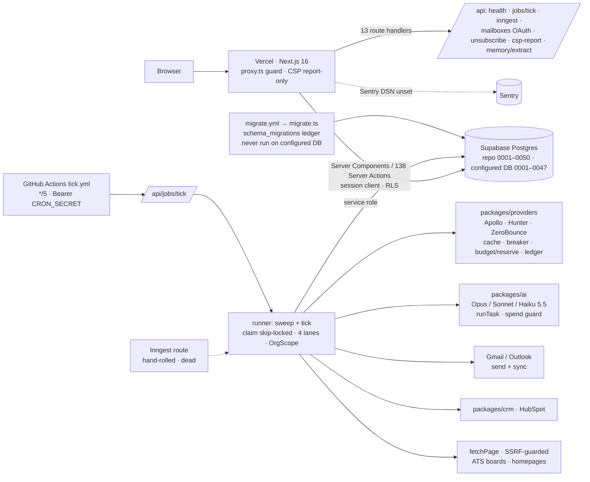
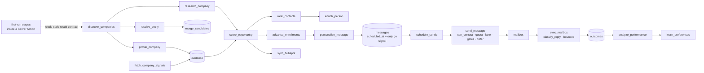
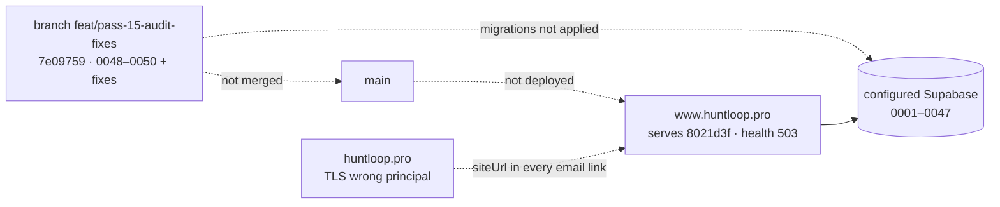

# Pass 16 — system map

Commit `7e09759`. Shapes come from the reviewers' inventories: 13 route handlers and 138 server actions (reviewer A §1), 82 tables and 128 triggers (reviewer B §1–2), the job registry (reviewer D §1) and the provider and AI seams (reviewer C §2–3).

## Architecture

## Core loop data flow (job names)

Two weak points sit on this map. Both are findings:
- `messages.scheduled_at` is the only signal that a message may go. Parent state (enrollment, campaign, opportunity, org) is never re-read at send time. That is **OUT-201**.
- First run calls the stage handlers inline from a request and reads result fields the handlers no longer return. That is **ENG-201**.

## Repo → database → deploy (the theme of this pass)

Safe order for the next deploy: `09_OPS_AND_SCALE.md` § Deploy state.

## Trust boundaries

| Boundary | Enforced by | Weak point |
|---|---|---|
| Browser → app | `proxy.ts`, `mutate`/`currentViewer` org resolution from the slug | none found (reviewer A §8) |
| Session → DB | RLS on all 82 tables; `enforce_same_org_refs`; guard triggers | within a tenant, `FOR ALL member` on safety tables (DB-201) |
| Jobs → DB | service role through `OrgScope` (injects `org_id`) | not covered by the admin-import guard (SEC-205) |
| App → vendors | `packages/providers` seam, SSRF guard | key invalidity never recorded (PROV-204) |
| App → model | prompt wrapping of untrusted input; claim downgrade | grounding is checked by domain, not by fetched page (AI-204, TRUST-202) |
