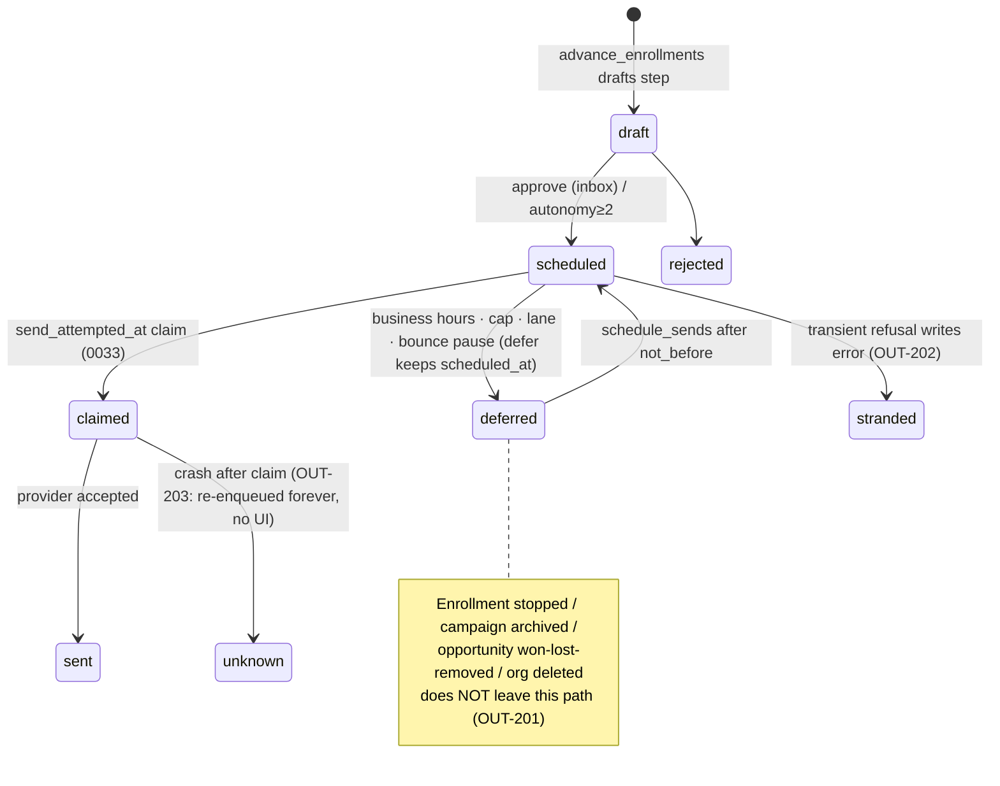
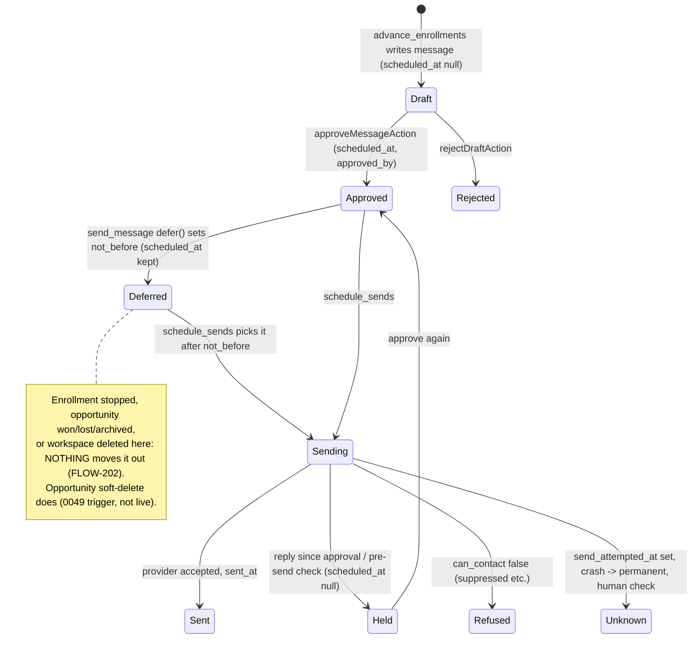
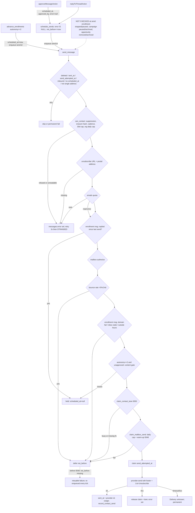

# Pass 16 — flows, routes and state machines

Commit `7e09759`. Flow tables follow the §3a columns and come from reviewer A (`_raw/reviewer-A.md`). The send chain and outreach state machines come from reviewer D, and the DB-enforced state machines from reviewer B. The lead re-traced every Critical and High (`_raw/disprove.md`).

## Headline
- **The core loop is complete in code and proven only against fakes.** No journey that touches a vendor, a mailbox or a real database has run end to end in this pass or any earlier one.
- **Broken transitions:** the parent state → queued mail transition (OUT-201, Critical). A transient refusal → retry (OUT-202). Discovery result → onboarding stage (ENG-201). Mailbox connect after 0049 (DB-203).
- **Missing journeys:** share links (no requirement found), password reset (passwordless by design), import undo/history, locked-out/wrong-org support recovery, billing/plan change (MONEY-201), HubSpot inbound sync.
- **State transitions enforced only in app code:** `opportunities.status`, `enrollments.status` (free text, no CHECK), the `messages` lifecycle, last owner (AUTHZ-201). States with no exit: an ownerless org; a soft-deleted org (LIFE-204).



## Route and action inventory

### 1a. Route handlers (13)

| Route | Methods | Public in `proxy.ts`? | AuthN/Z (file:line) | Validation | Reachable unauthenticated? | Notes |
|---|---|---|---|---|---|---|
| `/api/jobs/tick` | GET, POST | yes (`proxy.ts:107`), also served while not-ready (`:143`) | `Bearer $CRON_SECRET`, constant-time compare `app/api/jobs/tick/route.ts:62`; missing secret → 503 `:49-58` | `?limit` clamped 1..25 `:91-94` | Reaches route; refused 404 without bearer | Runs `sweep()` + `tick()` for all tenants under service role |
| `/api/inngest` | GET, POST | yes (`proxy.ts:108`) | HMAC `x-inngest-signature`, ±300 s window, `route.ts:50`, `verifySignature` | body read as text | 404 when Inngest env unset (`:45`, `:79`) | Hand-rolled signature; SDK not installed (`node_modules` has no `inngest`). GET returns a static function manifest, not the SDK sync protocol. Not live (prod `inngest:false`). See API-204 |
| `/api/health` | GET | yes | none (booleans only) | – | yes (by design) | `ok` requires schema complete + service key + cron secret + encryption key + siteUrl present (`route.ts`); does not check last tick or siteUrl reachability |
| `/api/csp-report` | POST | yes (`proxy.ts:66`) | none (by design) | 8 KB cap `route.ts:52,61`, fields truncated | yes | Writes only to Sentry; always 204 |
| `/api/unsubscribe/[token]` | POST (RFC 8058), GET→303 | yes (`proxy.ts:72`) | token = uuid, `route.ts:49`; `record_unsubscribe` SECURITY DEFINER (final def `0047_security_leads.sql:509`) | `uuidSchema` on POST only; GET redirects raw token into same-origin path | yes (by design) | Error and bad-token both 404 (no oracle) |
| `/api/notifications/unsubscribe` | GET (confirm page), POST | yes (`proxy.ts:75`) | HMAC token `packages/jobs/src/email/digest-token.ts:38`; HKDF from service key | token sliced to 300 chars; uuids checked | yes (by design) | Token never expires; only turns digest off |
| `/api/mailboxes/[provider]/start` | GET | no (`/api` is account prefix, `lib/protected-routes.ts:49`) | `currentViewer` `start/route.ts:73`, `canWrite`, demo refused, encryption key required | provider allowlist `shared.ts isProviderId` | no → 307 /login | 32-byte nonce in `__Host-` cookie, 600 s, SameSite=Lax |
| `/api/mailboxes/[provider]/callback` | GET | no | state cookie + constant-time nonce compare `callback/route.ts:91`, then `currentViewer` + `canWrite` `:116` | provider path must equal cookie provider | no | Upsert on `(org_id,email)` revives a soft-deleted mailbox (`deleted_at:null`); error text from provider echoed into query string |
| `/api/memory/extract` | POST | no | `currentViewer` `route.ts:44`, `canWrite` | `orgSlugSchema`, 4 MB cap (declared + actual), magic-byte sniff | no | Returns text only; persists nothing |
| `/auth/callback` | GET | yes (`/auth`) | Supabase PKCE `exchangeCodeForSession` `route.ts:54` | `safeNextPath` (`lib/safe-next.ts:35-45`) | yes (by design) | `next` validated: rejects `//`, `\`, control chars → no open redirect |
| `/auth/signout` | POST | yes | none needed; `signOut()` `route.ts:23` | `safeNextPath` on `next` | yes | Cross-site POST would not carry SameSite=Lax session cookie → no logout-CSRF |
| `/dev/onboarded` | GET | yes; 404 in production via `HIDDEN_IN_PRODUCTION` (`proxy.ts:148,268`) | `NODE_ENV !== "development"` → 404 `route.ts:30` | – | dev only | Redirects to `resolveDestination()` (demo → `/demo/dashboard`, matches lead's observation) |
| `/[org]/performance/export` | GET | no (workspace section `performance`) | `currentViewer` `export/route.ts:20` | period/table allowlists | no | CSV cells formula-escaped (`lib/csv-write.ts:16-21`); `org` slug interpolated into `content-disposition` unvalidated (bounded by `currentViewer` succeeding, so only real slugs reach it) |

**Why local `/api/jobs/tick` answered 404 "Not found".** Not the proxy. The proxy lists `/api/jobs/tick` as public (`proxy.ts:107`) and its only plain-text "Not found" 404 is for `HIDDEN_IN_PRODUCTION` paths (`proxy.ts:268-270`), which tick is not; an unknown anonymous path is rewritten to `/__not-found` (HTML, `:327-336`), not plain text. The plain-text "Not found" body is the route's own bad-credentials branch (`app/api/jobs/tick/route.ts:61-67`). It fired because `scripts/dev-demo.mjs:27-34` blanks only the Supabase and Anthropic variables and passes the rest of `process.env` through; Next then loads `apps/web/.env.local`, which defines `CRON_SECRET` (64-char value; name only, file is git-ignored by `apps/web/.gitignore:2`). With a secret set and no `Authorization: Bearer …` header the route answers 404 by design. If `CRON_SECRET` were unset the answer would be 503 JSON. So the 404 is correct behaviour, CONFIRMED by code reading (not re-run).

### 1b. Server actions (138 exported actions in 39 `"use server"` modules)

Guard model: almost every workspace action goes through `mutate(orgSlug, caller, run, {minRole})` (`apps/web/lib/data/org.ts`, compiled lines ~27-70): resolves the org **from the slug via the caller's own membership** (`currentViewer`), refuses non-members, refuses `viewer` unless `minRole:"viewer"`, enforces `admin`/`owner`, then runs with the tenant (RLS) client and `orgId` taken from the membership, never from the client. A forged org slug therefore yields "not a member"; a forged row id from another org is filtered by `.eq("org_id", orgId)` (present in 84 of the 138 actions; the rest either touch no row by id, call an RPC that re-checks `org_id`, or insert with `org_id: orgId`) and, independently, by RLS. Server actions get Next's built-in Origin/Host CSRF check; no `serverActions` overrides in `apps/web/next.config.*` (so the default 1 MB body limit applies — see FLOW-206).

Actions that do **not** use `mutate()` (each read; all are guarded another way or public by design):

| Action (file:line) | Guard | Public? | Verdict |
|---|---|---|---|
| `analyzeUrlAction`, `whyNowAction` (`[org]/analyze/actions.ts:52,102`) | slug + url zod; `qualify()`/`whyNow()` → `resolveRecorder` (`lib/ai/recorder.ts:69-101`): org read under RLS + `canSpend(currentViewer)` | no | OK. Viewer cannot spend (SEC-008 fix present) |
| `explainPerformanceAction` (`performance/actions.ts:26`) | period zod; `getPerformance` under RLS; `explain()` → recorder | no | OK (org slug not schema-validated, used only as a bound parameter) |
| `approveFindingAction` (`learn/actions.ts:114`) | uses `mutate` (scanner missed it: generic `mutate<Applied>(`) | no | OK |
| `snoozeAttentionAction`, `clearSnoozesAction`, `unsnoozeAttentionAction` (`needs-you/actions.ts`) | `currentViewer` + member, per-user rows `.eq(user_id)` | no | OK; viewers may snooze (personal state) |
| `draftProductFromWebsiteAction` (`settings/product/actions.ts:40`) | `currentViewer` then AI via recorder | no | OK |
| `approveJoinAction`, `declineJoinAction` (`team/actions.ts:527,539`) | uuid; `lib/data/directory.ts` uses `mutate(minRole:"admin")` + `0027` policy | no | OK |
| `deleteOwnAccountAction` (`settings/privacy/actions.ts:190`) | RPC `delete_own_account` (auth.uid() inside) | no | OK (owned by lifecycle reviewer) |
| `sendMagicLink`, `signInWithGoogle` (`(auth)/actions.ts:62,120`) | email/mode zod, `safeNextPath` | **yes** | See API-201 (enumeration oracle) and FLOW-201 (redirect origin) |
| `discoverAction` (`(marketing)/discover/actions.ts:60`) | url zod, key = canonical domain only, free-mail refused, `reserve_public_research` per-IP-hash/hour + daily ceiling | **yes** | OK for spend (bounded by ceiling). IP from `x-forwarded-for[0]` (`:121-126`) is trustworthy only behind Vercel |
| onboarding `saveYou`, `saveGoals`, `saveIcp`, `saveSources`, `advanceStep`, `finishOnboarding` (`(onboarding)/welcome/actions.ts`) | zod; delegate to `lib/data/onboarding.ts` step writers which resolve membership | no (`/welcome` protected) | OK; see TRUST-201 for `saveIcp` |
| `createWorkspace`, `startFirstJob` (`welcome/actions.ts:230,131`) | `auth.getUser()` + RPC `create_organization` | no | OK |
| `researchCompanyAction`, `saveCompanyAction`, `requestJoinAction` (`welcome/company/actions.ts`), `draftIcpAction` (`welcome/icp/actions.ts:64`), `recommendSourcesAction` | slug + membership in `lib/data/*`, AI via recorder | no | Implemented, unverified (not traced line by line) |
| `acceptInvitationAction` (`invite/[token]/actions.ts:26`) | uuid, `auth.getUser()`, RPC `accept_invitation` (final def `0047_security_leads.sql:743`) | needs session | OK: email-bound, confirmed-email required, expiry, single-use |
| `unsubscribeAction` (`unsubscribe/[token]/actions.ts:24`) | uuid, RPC `record_unsubscribe` | **yes** (by design) | OK |

Admin/owner-gated actions (`minRole`): `retryJobAction`/`cancelJobAction` (admin), `saveGoalsAction`, `saveOrgSettingsAction`, `saveOrgProfileAction`, `connect/disconnectHubspotAction`, all `team/*` membership actions, `erase/exportContactAction` (admin), `exportOrganizationAction` (admin+owner), `deleteOrganizationAction` (owner), `promotePreferenceAction` (admin). `minRole:"viewer"`: `deleteConversationAction`, `saveNotificationPreferencesAction` (personal).

**Unauthenticated-reachable list (complete):** `/`, marketing (`/for`, `/compare`, `/privacy`, `/terms`, `/acceptable-use`, `/discover` + `discoverAction`), `/login`, `/signup` + `sendMagicLink`/`signInWithGoogle`, `/auth/callback`, `/auth/signout`, `/unsubscribe/[token]` + `unsubscribeAction`, `/api/unsubscribe/[token]`, `/api/notifications/unsubscribe`, `/api/csp-report`, `/api/health`, `/api/jobs/tick` (secret), `/api/inngest` (HMAC/404), `/opengraph-image`, `/apple-icon`, `robots.txt`, `sitemap.xml`, `humans.txt`; dev-only `/kitchen-sink`, `/dev/onboarded` (404 in production). Every other path: protected route → 307 `/login?next=<path>` (invite → `/signup`), unknown path → 404 rewrite.

Response-shape consistency: server actions return `ActionResult` (`{ok,data,message}|{ok:false,error,fieldErrors}`) except `analyze` (`AnalyzeState`), `discover` (`DiscoverState`), `unsubscribe` (`UnsubscribeResult`), `explainPerformance` (bespoke union), auth (`AuthFormState`). Route handlers mix JSON `{error}`, plain text and HTML pages. Not a defect on its own (every caller is first-party UI); noted in API-205.

## Flow tables (§3a)

Column order per journey, exactly as §3a: Entry · Trigger · Caller · Route/action · AuthN/Z (file:line) · Validation · Logic · Tables r/w · External calls · Transaction boundary · Idempotent? · Expected · Actual · Failure modes · Edge cases · Status · Verified by. Paths are under `apps/web/` unless they start with `packages/`. "Verified by" names a test that runs the path; demo-mode Playwright proves only the fixture branch.

### 2.1 Sign-up / login (magic link) and logout
| Column | Value |
|---|---|
| Entry | `/signup`, `/login` (`app/(auth)`), proxy redirect `/login?next=` (`proxy.ts:338-354`) |
| Trigger | form submit |
| Caller | UI |
| Route/action | `sendMagicLink` (`app/(auth)/actions.ts:62`) → Supabase OTP → email → `/auth/callback` (`app/auth/callback/route.ts`) → `resolveDestination()`; logout `POST /auth/signout` |
| AuthN/Z | none before; session minted by `exchangeCodeForSession` (`callback/route.ts:54`, PKCE) |
| Validation | `emailSchema` (trim, lowercase, ≤254), `authModeSchema`, `safeNextPath` |
| Logic | `shouldCreateUser = mode==="signup"`; `emailRedirectTo = siteUrl()/auth/callback?next=` |
| Tables | `auth.users` (Supabase); `profiles` via trigger |
| External | Supabase Auth + its mailer |
| Transaction | Supabase-side |
| Idempotent? | yes (new link each time; Supabase rate limits) |
| Expected | same response whether or not the address exists; link lands on this deployment |
| Actual | login with an unknown address returns the error state while a known address returns "sent" (API-201); the link origin is `NEXT_PUBLIC_SITE_URL`, which production sets to the apex that fails TLS (FLOW-201) |
| Failure modes | Supabase down → generic error; missing `code` → `/login?error=missing_code`; bad code → `invalid_link` |
| Edge cases | invitee bounced to `/signup` not `/login` (`proxy.ts:349`); signout preserves `next` for the invite page |
| Status | Implemented, unverified (real backend); demo-only in Playwright |
| Verified by | `lib/safe-next.test.ts` (redirect guard), `lib/protected-routes.test.ts`; no test runs the OTP/callback path |

### 2.2 OAuth sign-in (Google)
| Column | Value |
|---|---|
| Entry / trigger / caller | Google button on auth form · submit · UI |
| Route/action | `signInWithGoogle` (`app/(auth)/actions.ts:120`) → `supabase.auth.signInWithOAuth` → Google → `/auth/callback` |
| AuthN/Z | Supabase PKCE; state handled by Supabase |
| Validation | `safeNextPath` |
| Logic / tables | as 2.1 |
| External | Google OAuth via Supabase |
| Idempotent? | yes |
| Expected / Actual | lands back on the deployment; redirect URL built from `siteUrl()` → same apex problem (FLOW-201); Supabase dashboard redirect allowlist UNVERIFIED |
| Failure modes | `error` → `/login?error=oauth` |
| Status | Implemented, unverified |
| Verified by | none |

### 2.3 Email verify / password reset
Email verification: implicit in magic-link/OAuth (Supabase sets `email_confirmed_at`); `accept_invitation` refuses an unconfirmed address (`0047_security_leads.sql:743`, check after email match). Password reset: **Missing by design** — no password auth exists (no `resetPassword`/`updateUser` call anywhere in `apps/web/app`). Not a defect.

### 2.4 Invite → accept (critical; mermaid below)
| Column | Value |
|---|---|
| Entry | Team screen (`[org]/team`) · invite link `/invite/[token]` |
| Trigger | admin submits invite; invitee opens link |
| Caller | UI (+ email via Resend when configured) |
| Route/action | `inviteMemberAction` (`[org]/team/actions.ts:336`), `resendInvitationAction` (`:439`), `revokeInvitationAction` (`:481`); `acceptInvitationAction` (`invite/[token]/actions.ts:26`) → RPC `accept_invitation` |
| AuthN/Z | `mutate(minRole:"admin")`; DB `invitation_admin` policy (`0007:155`) + `guard_invitation_owner` (`0031`); accept: signed-in, email match, confirmed email (`0047:743`+) |
| Validation | `inviteSchema` (owner not offerable, `lib/validation.ts:396-399`); uuid token |
| Logic | seat quota → already-member check → revoke any pending row for the address → insert → audit → email (idempotency key per minute) |
| Tables | `invitations`, `memberships`, `profiles`, `audit_logs`, `plans/usage` |
| External | Resend (optional) |
| Transaction | accept: single SECURITY DEFINER function (atomic). Invite: revoke + insert are two statements, not one transaction |
| Idempotent? | accept: yes (`on conflict (org_id,user_id) do update`, role = least of live/invited). Invite double-submit: second insert hits `invitations_pending_idx` → shown as Postgres error text |
| Expected | single-use, 14-day, email-bound link |
| Actual | as expected. Invitations to a workspace that was later deleted stay redeemable: `accept_invitation` does not check `organizations.deleted_at`, and `delete_organization` (`0031`) does not revoke invitations; the redirect then lands on a 404 (FLOW-207) |
| Failure modes | wrong account → precise message + signout-with-next; expired → "no longer valid" |
| Edge cases | legacy mixed-case pending email not matched by the exact `.eq("email", email)` revoke (`team/actions.ts:385`) while the unique index is on `lower(email)` → re-invite fails with a duplicate-key message (LIKELY, only for rows written before `emailSchema` lowercased) |
| Status | Working (DB half) / Implemented, unverified (UI + email half) |
| Verified by | `packages/db/scripts/verify-migrations.ts:606-673, 3341-3354` (PGlite: wrong email, expired, single-use, role keep) |

```mermaid
sequenceDiagram
  participant A as Admin (UI)
  participant S as inviteMemberAction
  participant DB as Postgres (RLS)
  participant M as Resend
  participant I as Invitee
  participant P as proxy.ts
  participant X as accept_invitation()
  A->>S: email, role
  S->>DB: checkQuota(seats); memberships? ; update invitations set revoked_at (pending)
  S->>DB: insert invitations (token uuid, expires +14d)
  S->>M: invitation email (url = siteUrl()/invite/token)
  I->>P: GET /invite/token (no session)
  P-->>I: 307 /signup?next=/invite/token
  I->>I: magic link / Google -> /auth/callback -> /invite/token
  I->>X: acceptInvitationAction(token)
  X->>DB: token live? email = auth email? confirmed? upsert membership; accepted_at=now()
  X-->>I: slug -> redirect /slug/dashboard or /welcome
```

### 2.5 Role change / member removal
| Column | Value |
|---|---|
| Entry / caller | Team screen · UI |
| Route/action | `setMemberRoleAction` (`team/actions.ts:49`), `removeMemberAction` (`:132`) |
| AuthN/Z | `mutate(minRole:"admin")`; owner-role changes need owner (`canOwn`) in app and `guard_membership_owner` trigger (`0031_tenant_write_hardening.sql:105-160`) |
| Validation | `memberRoleSchema`, uuid |
| Logic | read target → owner guard → last-owner count → update → audit |
| Tables | `memberships`, `audit_logs` |
| Transaction | none: count-then-update (FLOW-205) |
| Idempotent? | yes for same target role |
| Expected | an org never ends with zero owners |
| Actual | last-owner rule is app-only; two owners demoting/removing each other concurrently both pass `countOwners` (`team/actions.ts:89,159`). Once zero owners exist, the trigger's escape hatch lets any admin self-promote (`0031:133-139`) |
| Failure modes | RLS refusal surfaces as Postgres text |
| Edge cases | removed member loses access at once: `user_org_ids()` (final def `0031_tenant_write_hardening.sql:253-266`, also excludes deleted orgs) and `has_org_role()` (`0001_identity.sql:120-138`) both require `memberships.deleted_at is null` |
| Status | Implemented, unverified (owner trigger: Working, see verify-migrations) |
| Verified by | owner-guard trigger cases in `packages/db/scripts/verify-migrations.ts`; no test for last-owner race |

### 2.6 Org create / switch / delete
| Column | Value |
|---|---|
| Entry | `/welcome` (create), `/orgs` picker + `huntloop.org` cookie (switch), Settings → Privacy (delete) |
| Route/action | `createWorkspace` (`(onboarding)/welcome/actions.ts:230`) → RPC `create_organization`; switch = navigation, cookie set in `proxy.ts:362-371` and `finishOnboarding`; `deleteOrganizationAction` (`[org]/settings/privacy/actions.ts:151`) → RPC `delete_organization` (final def `0031_tenant_write_hardening.sql`) |
| AuthN/Z | `auth.getUser()`; delete: `mutate(minRole:"owner")` + `has_org_role(p_org,'owner')` in the function |
| Validation | url, `orgSlugSchema`, reserved slugs; delete requires typed confirmation |
| Logic (delete) | soft-delete org; archive campaigns; stop enrollments; disable sources and discovery queries |
| Tables | `organizations`, `memberships`, `campaigns`, `enrollments`, `sources`, `discovery_queries` |
| Transaction | delete: one function (atomic) |
| Idempotent? | delete yes (`where deleted_at is null`) |
| Expected | deleted workspace emails nobody and cannot be joined |
| Actual | approved-but-unsent messages are not unscheduled by `delete_organization`, and `schedule_sends`/`send_message`/`can_contact` do not check `organizations.deleted_at` (`packages/jobs/src/handlers/schedule-sends.ts:52-58`, `0017_outreach_safety.sql` `can_contact` reads organizations without a deleted filter) → part of FLOW-202. Pending invitations stay redeemable (FLOW-207) |
| Failure modes | RPC error text shown |
| Edge cases | switch cookie is a pointer, re-checked by `resolveDestination` (comment `proxy.ts:357-361`); `resolveMembership` filters `organizations.deleted_at` (`packages/db/src/server.ts:61`) |
| Status | Implemented, unverified |
| Verified by | `lib/data/destination.test.ts` (destination logic only) |

### 2.7 Onboarding / ICP
| Column | Value |
|---|---|
| Entry | `/welcome/*` steps |
| Route/action | `saveYou`, `saveGoals`, `saveIcp`, `saveSources`, `advanceStep`, `finishOnboarding` (`(onboarding)/welcome/actions.ts`), `draftIcpAction`, `estimateReachAction`, `previewLookAlikesAction`, `runStageAction` |
| AuthN/Z | slug validated, membership resolved inside `lib/data/onboarding.ts` writers; AI via `resolveRecorder` + `canSpend` |
| Validation | zod per step (`youStepSchema`, `icpStepSchema`, …) |
| Logic | writes ICP + persona + sources; reach estimate passed back from the browser |
| Tables | `profiles`, `organizations.settings`, `icps`, `icp_versions`, `personas`, `sources` |
| External | Anthropic (draft ICP), provider count (reach) |
| Idempotent? | step writers upsert |
| Expected | provider-sourced reach stored only from the provider |
| Actual | the browser-supplied `addressableEstimate` is stored as `addressable_source='provider'` (TRUST-201) |
| Status | Implemented, unverified |
| Verified by | `lib/onboarding/icp-step.test.ts` (pure mapping only) |

### 2.8 Discover / search / save (engine side)
`huntNowAction` (`[org]/dashboard/actions.ts:19`), `scanSourceNowAction` (`sources/actions.ts:277`) enqueue jobs; `/api/jobs/tick` runs `discover-companies`, `score-opportunity`. Public `/discover` + `discoverAction` reads a site anonymously (spend capped by `reserve_public_research`). Traced only to the enqueue boundary here; handler internals belong to reviewer C. Status: Implemented, unverified (engine). Verified by: `packages/jobs/scripts/verify-jobs.ts` against scripted fakes.

### 2.9 Company and person views
Server Components under `[org]/companies`, `[org]/opportunities/[id]`; reads under RLS with `currentViewer`. Writes: `saveCompanyAction` (restores a soft-deleted company with the same domain, `companies/actions.ts` ~`:107`), `mergeCompaniesAction` → `merge_companies_for_org`, `deleteCompanyAction` (soft delete, propagates via `0049` trigger — **not live**). Status: Implemented, unverified. Verified by: `merge-actions.test.ts` (action guards), PGlite merge cases.

### 2.10 Qualify / score
| Column | Value |
|---|---|
| Entry | Analyze screen; engine job |
| Route/action | `analyzeUrlAction` → `qualify()` (`lib/ai/qualify.ts:50-140`); `saveQualificationAction` (`analyze/actions.ts:151`) requires the HMAC seal (`lib/ai/seal.ts`); engine `score_opportunity` |
| AuthN/Z | `resolveRecorder` + `canSpend`; save via `mutate` |
| Validation | `urlInputSchema`, `qualificationSchema`, seal verify |
| Logic | budget check → rate limit → model → seal; save upserts opportunity on `(org_id, company_id, icp_id)` and retires old evidence |
| External | Anthropic (web fetch restricted to `fetchDomains`) |
| Idempotent? | save: upsert |
| Expected | only a verdict the server produced can be saved |
| Actual | as expected (seal binds org + verdict) |
| Status | Implemented, unverified (live model); seal Verified |
| Verified by | `lib/ai/seal.test.ts`, `spend-guard.test.ts`, `rate-limit.test.ts` |

### 2.11 Enrich (per provider)
Job-only (`enrich_company`, `find_contacts`, `verify_email`); no user route besides indirect enqueue. Owned by reviewer C. Status here: Implemented, unverified.

### 2.12 List / import / export (critical)
| Column | Value |
|---|---|
| Entry | `[org]/imports` (CSV), `[org]/performance/export` (CSV), Settings → Privacy (org/contact export) |
| Route/action | `importCsvAction` (`[org]/imports/actions.ts:88`); `GET /[org]/performance/export`; `exportOrganizationAction`, `exportContactAction` |
| AuthN/Z | `mutate` (member+); export route `currentViewer`; exports admin/owner |
| Validation | `csvSchema` ≤ 2,000,000 chars (`lib/validation.ts:328`), 1,000 rows, domain required, emails via `emailSchema` |
| Logic | parse in action → select existing companies (live only) → insert new → re-select → dedupe people by email/name → insert people → insert contact_points (`verification_status:'unverified'`, `provider:'import'`) |
| Tables | `companies`, `people`, `contact_points` |
| Transaction | **none** — three independent inserts |
| Idempotent? | companies yes; people/emails no (see Actual) |
| Expected | re-running an import completes what a failed run left out |
| Actual | (1) a domain that belongs to a soft-deleted or merged-away company is treated as new (`.is("deleted_at", null)` at `imports/actions.ts:169`) and the insert violates `unique (org_id, canonical_domain)` (`0003_companies_opportunities.sql:44`); the whole batch fails (FLOW-203). (2) If the `contact_points` insert fails after `people` succeeded, a re-run skips those people by name and their emails are never attached (FLOW-204). (3) CSV over Next's default 1 MB server-action body limit is refused by the framework before `csvSchema` runs (FLOW-206) |
| Failure modes | Postgres message surfaced |
| Edge cases | duplicate domains in one file collapse (first wins) |
| Status | Partial |
| Verified by | `lib/csv.test.ts`, `csv-write.test.ts` (parsing/escaping only); no test runs the action |

### 2.13 Outreach draft → approve → send → reply → unsubscribe (critical; mermaid below)
| Column | Value |
|---|---|
| Entry | Inbox / Needs-you; email client |
| Route/action | engine drafts (`advance_enrollments`); `approveMessageAction` (`[org]/inbox/actions.ts:274`), `editDraftAction`, `rejectDraftAction`, `redraftAction`, `replyToThreadAction`; `schedule_sends` → `send_message`; reply sync; `/unsubscribe/[token]` + `/api/unsubscribe/[token]` |
| AuthN/Z | `mutate` (member+); engine under service role; unsubscribe by token only |
| Validation | uuid; draft state re-read (`readDraft`) |
| Logic | approve sets `scheduled_at`, `approved_by` with `.is("scheduled_at", null)` guard; `send_message` checks sent/attempted/approved/recipient/`can_contact`/reply-since-approval/mailbox readiness/business hours/contact lane |
| Tables | `messages`, `message_events`, `enrollments`, `suppressions`, `contact_frequency`, `message_unsubscribe_tokens` |
| External | Gmail / Graph send |
| Transaction | approve: single update; send: claim + send + mark (owned by reviewer D) |
| Idempotent? | approve yes; send guarded by `send_attempted_at` |
| Expected | nothing sends after the user stops the sequence, closes the deal or deletes the workspace |
| Actual | an approved message deferred by `send_message` (business hours, domain readiness, inbox freshness: `packages/jobs/src/handlers/send-message.ts:372-383`, `defer()` `:609-622` keeps `scheduled_at`) still sends after `setEnrollmentStatusAction('stopped')` (`[org]/outreach/actions.ts:364`), after the opportunity is moved to won/lost/archived (`[org]/pipeline/actions.ts:50`), and after workspace deletion: neither `schedule_sends` (`schedule-sends.ts:52-58`) nor `send_message` reads enrollment or opportunity status (FLOW-202). Unsubscribe and replies are handled (`can_contact`, `repliedSinceLastSend` `:280-296`) |
| Failure modes | refusal reasons written to `messages.error` |
| Edge cases | unsubscribe stops only `active` enrollments (`0047:509+`), but `can_contact` blocks the address for every message, so paused ones cannot send either |
| Status | Implemented, unverified (send); unsubscribe DB half Working |
| Verified by | `verify-jobs.ts` (send/reply fakes), `verify-migrations.ts:909-942` (`record_unsubscribe`) |



### 2.14 Sequence enroll / pause / stop
`enrollOpportunitiesAction` (`[org]/opportunities/actions.ts:94`), `setEnrollmentStatusAction` (`outreach/actions.ts:364`, status guard via `.in("status", …)`), `listEnrollmentsAction`. Stop does not unschedule pending approved messages (FLOW-202). Status: Implemented, unverified. Verified by: none for the actions.

### 2.15 Mailbox connect / disconnect / warm-up (critical; mermaid below)
| Column | Value |
|---|---|
| Entry | Outreach → Connect |
| Route/action | `GET /api/mailboxes/[provider]/start` → provider consent → `GET /api/mailboxes/[provider]/callback`; `disconnectMailboxAction` (`outreach/actions.ts:273`) |
| AuthN/Z | `currentViewer` + `canWrite` on both legs (`start/route.ts:73`, `callback/route.ts:116`); state nonce in `__Host-` cookie, constant-time compare (`callback/route.ts:91`) |
| Validation | provider allowlist; provider-in-path must equal provider-in-cookie |
| Logic | exchange code → encrypt tokens → **session-client upsert** on `(org_id,email)` (`callback/route.ts:163`) |
| Tables | `mailboxes` |
| External | Google / Microsoft OAuth |
| Transaction | single upsert |
| Idempotent? | yes (upsert) |
| Expected | connect works after the pass-15 fixes are applied |
| Actual | `0049_soft_delete_propagation.sql:160-171` revokes SELECT on `oauth_token_enc`/`refresh_token_enc` from `authenticated`; PostgREST's upsert writes `ON CONFLICT … DO UPDATE SET oauth_token_enc = EXCLUDED.oauth_token_enc`, which Postgres refuses without SELECT on that column. Reproduced offline (PGlite): plain insert OK, upsert → `permission denied for table mailboxes`, disconnect-shaped update OK. So once 0049 is applied, **every mailbox connect and reconnect fails** (FLOW-200) |
| Failure modes | provider error text echoed to `?mailbox_error=` |
| Edge cases | reconnect revives a soft-deleted row (`deleted_at:null`); disconnect deletes tokens locally but does not revoke at the provider |
| Status | Broken once 0049 is applied; Implemented, unverified today |
| Verified by | none; the PGlite harness grants blanket SELECT to `authenticated` after migrations (`packages/db/scripts/verify-migrations.ts:322-325`) and has no `service_role`, so 0049's column revoke never takes effect in tests |

```mermaid
sequenceDiagram
  participant U as Member browser
  participant S as /api/mailboxes/gmail/start
  participant G as Google
  participant C as /api/mailboxes/gmail/callback
  participant DB as Postgres as authenticated
  U->>S: GET ?org=slug
  S->>S: currentViewer + canWrite + provider + encryption configured
  S-->>U: Set-Cookie __Host-hl_mailbox_oauth {nonce,org,provider} 600s; 302 Google
  U->>G: consent
  G-->>U: 302 callback?code&state
  U->>C: GET callback
  C->>C: state == cookie nonce; viewer still canWrite
  C->>G: exchangeCode
  C->>DB: upsert mailboxes ON CONFLICT (org_id,email) DO UPDATE SET oauth_token_enc=EXCLUDED...
  DB-->>C: after 0049: permission denied (no SELECT on token column)
  C-->>U: 302 /slug/outreach?mailbox_error=That mailbox could not be saved...
```

### 2.16 CRM connect / sync / disconnect
`connectHubspotAction` (`settings/integrations/actions.ts:28`, admin; token verified with HubSpot then encrypted; upsert `hubspot_connections`), `disconnectHubspotAction` (hard delete row), `requestCrmPushAction` (`opportunities/[id]/actions.ts:339`). Sync job owned by reviewer C. Back-links written to HubSpot fall back to `https://app.huntloop.example` when `NEXT_PUBLIC_SITE_URL` is unset (`packages/jobs/src/handlers/sync-hubspot.ts:125`) — TRUST-204. Status: Implemented, unverified. Verified by: crm tests (86) against fakes.

### 2.17 Notifications (digest)
Job `send_digests` (`packages/jobs/src/handlers/send-digests.ts`), preferences via `saveNotificationPreferencesAction` (`minRole:"viewer"`), off-switch `GET/POST /api/notifications/unsubscribe` (HMAC token, no expiry). Status: Implemented, unverified.

### 2.18 Learning / feedback loop
`requestAnalysisAction`, `approveFindingAction` (write rule inactive then mark finding; documented non-atomic order `learn/actions.ts:105-113`), `rejectFindingAction`, `overridePriorityAction` (`record_override`), pipeline outcomes (`pipeline/actions.ts`). Outcome rows are never removed when a card moves back out of won/lost (FLOW-208). Status: Implemented, unverified.

### 2.19 Share links / public token pages
Share links: **Missing** (no table, route or token for sharing anything; grep for `share_link|share_token|public_share` empty). Public token pages that exist: `/unsubscribe/[token]`, `/invite/[token]`, `/api/notifications/unsubscribe?token=`. Not recommended as a requirement (no doc asks for share links in the files read).

### 2.20 Account / org deletion and data export
`deleteOwnAccountAction` → `delete_own_account`; `deleteOrganizationAction` (2.6); `exportOrganizationAction`, `exportContactAction`, `eraseContactAction`. Owned by lifecycle reviewer; traced here only to the RPC boundary. Status: Implemented, unverified.

### 2.21 Admin / ops actions
`retryJobAction`, `cancelJobAction` (`[org]/ops/actions.ts:25,53`, `minRole:"admin"`, RPCs `retry_job`/`cancel_job`). Status: Implemented, unverified.

### 2.22 Support recovery
Locked out: magic link only; no support path beyond re-request (no admin impersonation, no recovery contact) — **Missing**, manual Supabase dashboard work. Wrong org: `/orgs` picker; wrong-account invite: signout-with-next back to the invite (`auth/signout/route.ts`). Bad import: no undo, no import record to roll back — **Missing** (there is no `imports` table; rows carry `people.source='import'` but companies carry no import marker).

### 2.23 Dead ends / posts-to-nothing / enqueue gaps found
- Invite to a deleted workspace → accept succeeds → redirect 404 (FLOW-207).
- `/api/inngest` GET is not the Inngest SDK sync protocol; the driver cannot register as written (API-204, UNVERIFIED against the vendor).
- No handler-without-enqueuer or enqueuer-without-handler checked here (reviewer D owns `registry.ts`).

## State machines (§3b) — flows (reviewer A)

| Entity | States | Allowed transitions (code) | Enforced by DB | Who triggers | Terminal | Stuck-state recovery |
|---|---|---|---|---|---|---|
| Invitation (`invitations`, `0007:124-147`) | pending (accepted_at, revoked_at null, expires_at > now) · expired (derived) · revoked · accepted | pending→accepted (`accept_invitation`); pending→revoked (`revokeInvitationAction`, invite re-issue); expired→revoked (re-invite) | accept only via SECURITY DEFINER checks; `invitations_pending_idx` one pending per (org, lower(email)) regardless of expiry. Any admin can PATCH `revoked_at`, `expires_at` or `accepted_at` directly through PostgREST (`invitation_admin` is `for all`, `0007:155-157`), e.g. un-revoke or extend — transition enforced only in app | admin; invitee | accepted, revoked | expired rows are revoked on next invite (`team/actions.ts:385`). No sweeper; harmless |
| Organization (`organizations.deleted_at`, onboarding step) | live · deleted (soft) ; onboarding: steps → done | live→deleted (`delete_organization`, owner) | function checks owner; nothing un-deletes; no hard purge path found | owner | deleted | none in product: restoring needs SQL (manual-ops). Pending invites survive (FLOW-207) |
| Import | none | — | — | — | — | **No state machine**: imports are synchronous, unrecorded, not undoable (2.12, 2.22) |
| Run — `job_executions` | queued · running · succeeded · failed · cancelled (+ dead-letter) | claim/finish in `packages/jobs/src/queue.ts`; `retry_job`/`cancel_job` (admin) | RPCs + `0008` lockdown | engine, admin | succeeded, cancelled, failed(after max attempts) | admin retry; reviewer D owns detail |
| Run — `discovery_runs`, `learning_runs`, `ai_runs` | per-table status columns | written by handlers | check constraints (not re-audited here) | engine | — | delegated to reviewers C/D |
| Share link | — | — | — | — | — | **Missing** (does not exist) |
| Opportunity (`opportunity_status`, `0003:14-17`) | discovered · researching · qualified · assigned · contacted · replied · meeting · proposal · won · lost · archived (+ soft-deleted) | **any → any** via `setOpportunityStatusAction` (`pipeline/actions.ts:50`, no transition check); engine moves forward only (`send-message.ts` `advanceOpportunityStatus`, `.in("status", [discovered…assigned])`); reply sync moves to replied | enum only; no transition trigger. Soft delete stops outreach via `0049` trigger (**not live**) | any member (not viewer); engine | none (won/lost can be reopened) | n/a. Side effects: a terminal move does not unschedule approved messages (FLOW-202); moving back out of won/lost leaves the `outcomes` row (FLOW-208) |
| Enrollment (for context) | active · paused · parked · stopped (+ deleted) | `setEnrollmentStatusAction`: parked/paused→active, active/parked/paused→stopped; engine parks/stops | none on transitions; `0049` trigger stops on opportunity soft delete (not live) | member; engine; `record_unsubscribe` | stopped | resume from parked/paused only |
| Message (for context) | draft · approved · deferred · held · sent · refused · delivery-unknown | see diagram 2.13 | `messages_sent_has_provider_id` (per `0017` header), `0035` one message per step | member; engine | sent, delivery-unknown (permanent, manual check) | delivery-unknown needs a human to check the mailbox's Sent folder — manual-ops |

Flags: transitions enforced only in app code — opportunity (all), invitation un-revoke/extend, last-owner. State reachable only by manual SQL — organization restore. States with no exit — none found besides intended terminals.

## Send safety chain

Three producers of a sendable message (`scheduled_at` set): autonomy ≥2 drafting (`advance-enrollments.ts:288,349-356`), `approveMessageAction` (`apps/web/app/(app)/[org]/inbox/actions.ts:274-327`), `replyToThreadAction` (`:136-258`). One consumer: `send_message`. Every gate below is in `packages/jobs/src/handlers/send-message.ts` unless another file is named.



| # | Gate | Enforced where | Unreadable / missing-migration behaviour | Test |
|---|---|---|---|---|
| 1 | Already sent | `:69-73` (`sent_at`); `messages_sent_has_provider_id` CHECK (0004) | — | `verify-jobs.ts:1023-1080` |
| 2 | At-most-once claim | `:75-86` refuses a prior unfinished attempt; `:440-449` conditional update `send_attempted_at IS NULL` (column from 0033, applied) | closed | `verify-jobs.ts:1413-1488` |
| 3 | Human approval | `:92-104` `scheduled_at` required; set only by the three producers above (and DB-level by any member session through `tenant_write` on `messages`, i.e. still a member's act) | closed | `verify-jobs.ts:1023+` |
| 4 | Single recipient | `:113-117` `isSingleAddress` | closed | yes (section "checks that stop a second send") |
| 5 | Suppression (email + domain), erasure hash, unsubscribe | `can_contact` (`0017_outreach_safety.sql:116-221`) → `is_suppressed` (`0008…sql:261-275`), checked at `:130-159` | **closed** — `!verdict` refuses (PROBE-D D: `ok:false`, 0 provider sends) | `verify-jobs.ts:1150-1181`; SQL `verify-migrations.ts:2210-2262` |
| 6 | Cadence (min days), 30-day cap, org daily cap | `can_contact` (same) | closed | `verify-jobs.ts:1183-1269` |
| 7 | Unsubscribe link + one-click header | `:187-200` (token from `message_unsubscribe_tokens`, base `NEXT_PUBLIC_SITE_URL`); footer `:837-869`; header `:482` | closed | `verify-jobs.ts:1490-1532,1585-1654` |
| 8 | Postal address | `:217-229` (`settings.compliance.postalAddress`) | closed | `verify-jobs.ts:1534-1583` |
| 9 | Plan `emails` quota | `:251-267` `check_quota_internal` | **open** on RPC error (PROBE-D C: sent) — deliberate (`:245-250`) | `verify-jobs.ts:1656-1720` |
| 10 | Reply since last send (P0-2) | `:288-298` `repliedSinceLastSend` (`:640-681`), enrollment messages only | **open**: a failed read yields `[]` → "no reply" | `verify-jobs.ts:3748-3815` |
| 11 | Bounce/complaint stop | bounce: `sync-mailbox.ts:286-301` suppresses the thread's last recipient; `:333-343` pauses a mailbox >5 % bounces/14 d. Complaint: **no writer** of `complained` events anywhere (only enum/labels, `0004…sql:167`, `0037…sql:331`) | bounce suppression silently skipped when the DSN does not thread (`bouncedRecipient` needs `threadId`, `sync-mailbox.ts:401-412`); bounce-rate read errors → 0 → **open** | `verify-jobs.ts:3817-3850` |
| 12 | Mailbox connected | `mailbox/index.ts:72-161` `authorize`; `claim_mailbox_send` also requires `status='connected' AND deleted_at IS NULL` | closed | yes |
| 13 | Domain readiness (0048) | `:360-373`, enrollment messages only | **open before 0048**: select of `domain_status` errors, `data` null, gate skipped (PROBE-D A) | `verify-jobs.ts` (P1-4 section) with column present |
| 14 | Inbox freshness / business hours | `:375-383`; zone from company country, 08–18 Mon–Fri, Intl-based (DST-correct, `business-hours.ts`) | freshness closed (null → defer); hours **open** when country unknown/unmapped; US mapped to New York only (08:00 ET = 05:00 PT) | `verify-jobs.ts` business-hours section |
| 15 | Content gate (autonomy ≥2, unapproved) | `:396-408`, `gate.ts` | `autonomyFor` read failure → 0 → gate **skipped** (`:720-730`) | `verify-jobs.ts:3852+` |
| 16 | One in-flight send per address (0050) | `:415-423` `claim_contact_lane` | **closed**: RPC error → defer; before 0048 the defer itself fails → retryable failure (PROBE-D B: `ok:false`, 0 sends). Net effect in the configured DB: **no enrollment or reply message can ever send** until 0050 is applied | `verify-jobs.ts:1271-1290` (unreadable lane case) |
| 17 | Daily cap | `claim_mailbox_send` (0008 version live) | closed | `verify-jobs.ts:1292-1340` |
| 18 | Warm-up ramp (0048) | `mailbox_daily_cap` inside `claim_mailbox_send` (`0048…sql:51-106`); `pickMailbox` mirrors it (`mailbox/index.ts:186-224`) | **open before 0048**: live `claim_mailbox_send` is the 0008 version (`daily_limit` only); new mailboxes have `warmup_started_at` NULL (default `now()` is set by 0048) ⇒ full `daily_limit` from day one | SQL tests in `verify-migrations.ts` (PGlite, column present) |
| 19 | Removed company / opportunity | 0049 triggers `stop_outreach_for_deleted_opportunity`, `propagate_company_removal` (`0049…sql`) — **not live**; `advance-enrollments.ts:152-159` backstop stops the *enrollment* only | **open before 0049** for any message already approved/deferred; `send_message` reads no opportunity/company state (PROBE-D A: sent with opportunity `deleted_at` set) | migration tests for 0049 (PGlite); none at send |
| 20 | Enrollment stopped/paused, campaign paused/archived, opportunity archived/"not a fit" | **nowhere at send time**. `setEnrollmentStatusAction` (`outreach/actions.ts:364-389`), `deleteCampaignAction` (`:110-133`), AI-009 stop (`sync-mailbox.ts:131-145`) and `record_unsubscribe` (0047) change the enrollment only; none touch the enrollment's approved/deferred messages | **open** (PROBE-D A: enrollment `stopped`, campaign `archived` → sent) | none — OUT-201 |
| 21 | Reply detection stopping sequences | `advance-enrollments.ts:143-146` (opportunity status), AI-009 (`sync-mailbox.ts:131-145`), send-time `repliedSinceLastSend` | see #10 | `verify-jobs.ts:3748+` |

Unsubscribe path: footer GET `/unsubscribe/<token>` → confirmation page → POST; header one-click `POST /api/unsubscribe/<token>` (`apps/web/app/api/unsubscribe/[token]/route.ts:44-82`), public in `proxy.ts:71-72`, uuid-validated, 503 without DB, 404 on unknown token → `record_unsubscribe` (`0047_security_leads.sql:509-559`): org-scoped suppression (lower-cased), one `unsubscribed` event, stops every **active** enrollment for that address in the org. Paused/parked enrollments are not stopped, but `can_contact` still blocks any send to the suppressed address. Reply opt-out ("unsubscribe", "remove me" …) is rule-based (`mailbox/preclassify.ts:37-55`) and suppresses `from` (lower-cased by `addressOf`, `provider.ts:207-211`). Tests: `verify-migrations.ts:909-942` (SQL), `verify-jobs.ts` preclassify section. Not run end to end against a real inbox.

Partial failure (send → record):
- Crash after provider accept, before `sent_at`: `send_attempted_at` stays set; any rerun stops at "Delivery unknown" (`:75-86`) → **no duplicate send** (CONFIRMED by code + `verify-jobs.ts:1413-1440`). But the message keeps `error = NULL`, so `schedule_sends` re-enqueues it **every tick forever**, each run failing permanently, and nothing on the message tells the user to check the Sent folder (only the job row does). No reconciler. OUT-203.
- Record update fails after accept (`:498-510`): event `delivered` written, job permanent-fails, message unchanged → same re-enqueue loop.
- Ambiguous provider error (timeout/5xx/no id): `error` = "Delivery unknown — check the Sent folder" (`:571-580`) → not re-swept. Correct.
- Definite 4xx: claim and lane released, `error` set, job retried by its own retry only (`schedule_sends` skips rows with `error`).

## State machines — jobs and outreach (reviewer D)

None of these status columns has a CHECK constraint or transition trigger (`0004_outreach_memory_learning.sql:33,46,88,323` are plain `text` with defaults; no later `*_status_check` for enrollments/campaigns/mailboxes/job_executions). Every transition below is app-code only, and any member session may write `enrollments`/`campaigns`/`messages` directly through `tenant_write` (`0004…sql:337-356`, not dropped for these tables in 0031).

**Message (outbound)** — derived from columns, not a status field.

| State | Columns | Entered by | Exits |
|---|---|---|---|
| draft | `scheduled_at` null, `sent_at` null | advance_enrollments autonomy 0–1 | approve → approved; reject/redraft → soft-deleted (`inbox/actions.ts:431-560`) |
| approved/due | `scheduled_at` set, `error` null | approve, reply, autonomy ≥2 | send_message |
| deferred | + `not_before` (0048), `wait_reason` (0050) | `defer()` `send-message.ts:609-622` | schedule_sends after `not_before`. **Before 0048: no deferred state** — becomes a retryable failure and is re-enqueued every tick |
| held | `scheduled_at` null, `error` set | reply-pending (`:294`), content gate (`:404`), 0049 opportunity trigger | approve (clears `error`) |
| refused-stranded | `scheduled_at` set, `error` set, `sent_at` null | can_contact refusal / unreadable, no unsubscribe URL, no postal address, over quota, 4xx refusal | **none in-app**: `schedule_sends` skips `error IS NOT NULL` (`schedule-sends.ts:56`), `approveMessageAction` refuses `scheduled_at IS NOT NULL` (`inbox/actions.ts:294,321`). Exit = manual SQL. OUT-202 |
| claimed | `send_attempted_at` set | `:440-449` | sent; or "delivery unknown" (terminal for automation) |
| claimed-orphan | `send_attempted_at` set, `error` null, `sent_at` null | crash between claim and record | none; re-enqueued and permanently failed every tick. OUT-203 |
| sent | `sent_at` + `provider_message_id` (CHECK) | `:487-496` | terminal |

**Enrollment** — `active | parked | paused | stopped` (no writer sets `paused` in the code read; accepted as a source state by `setEnrollmentStatusAction`). active → parked (campaign not active, no recipient, exception); active → stopped (replied, removed, archived, finished, suppressed, unsubscribe via `record_unsubscribe`, AI-009, user Stop); parked/paused → active (user Resume). Terminal: stopped (Resume refuses it, `outreach/actions.ts:383`). Stuck: parked with `next_action_at` null waits for a person (by design). **Stopping does not cancel the enrollment's approved/deferred messages** (OUT-201).

**Campaign** — `draft | active | paused | archived`; create forces `draft`, autonomy 0 (`outreach/actions.ts:96`); any member may set any status and autonomy 0–5 through `saveCampaignAction` (`:41-90`, `mutate` default minRole member). Archive = soft delete + `archived`. Pausing/archiving parks enrollments at their next step but does not unschedule approved messages.

**Sequence / steps** — no status; steps soft-deleted; `unique (org_id, sequence_id, position)`; one message per (enrollment, step) (`0035`, index at `0035…sql:17`).

**Mailbox** — `connected | disconnected` + `deleted_at`. connect/reconnect = upsert on `(org_id,email)` restoring `deleted_at=null` (`api/mailboxes/[provider]/callback/route.ts:141-163`); user disconnect wipes tokens + soft-deletes (`outreach/actions.ts:273-305`); revoked grant (400/401) → disconnected (`mailbox/index.ts:128-136`); transient refresh error → `last_error` only (OUT-012 fixed). Reconnect does not restart warm-up.

**Job** — `queued → running → succeeded | queued(retry) | failed`; `running → queued/failed` via stall requeue; `queued → cancelled` by admin (`0019…sql:~265-276`); `running → queued` via `release`. Terminal: succeeded, failed, cancelled. Pruned after 30 d by 0049 (not live).

## DB-enforced state machines (reviewer B)

| Column | States (code) | DB enforcement | Who can transition (session) | Terminal | Stuck-state recovery |
|---|---|---|---|---|---|
| `opportunities.status` | enum `opportunity_status` (11) | enum values only; **no transition rule** | any member, any → any (RLS `ALL:member`) | won/lost/archived (convention) | n/a |
| `memberships.role` | enum `org_role` | `guard_membership_owner` for owner edges only | admin (non-owner edges), owner | — | ownerless org: manual SQL only (AUTHZ-201) |
| `memberships.deleted_at` | active/removed | `guard_membership_owner` (owner rows) | admin; re-activated by `accept_invitation`/`approve_join_request` | — | — |
| `organizations.deleted_at` | live/deleted | `guard_organization_reserved` (sessions cannot touch); `delete_organization` owner-only | owner via RPC | deleted (no restore path, no hard purge) | manual SQL |
| `invitations` (timestamps) | live/accepted/revoked/expired | `accept_invitation` predicate; partial unique on live `(org, lower(email))` | admin (create/revoke), invitee (accept) | accepted/revoked/expired | re-invite |
| `join_requests.status` | pending/approved/declined | CHECK + partial unique pending | admin | approved/declined | — |
| `enrollments.status` | active/parked/stopped/replied/completed (code) | **none: free text, no CHECK** | any member, any → any (incl. stopped → active after unsubscribe) | stopped (convention) | — |
| `mailboxes.status` | connected/disconnected/paused/error (code) | **no CHECK** | any member | — | reconnect |
| `job_executions.status` | queued/running/succeeded/failed/cancelled | **no CHECK**; claim via `for update skip locked` | service role; admins via `retry_job`/`cancel_job` | succeeded/failed/cancelled | `requeue_stalled_jobs` |
| `campaigns.status`, `threads.status`, `threads.classification`, `ai_runs.status`, `subscriptions.status` | free text | **no CHECK** | member (campaigns/threads) | — | — |
| `discovery_runs`, `learning_runs`, `score_recompute_requests`, `merge_candidates`, `learning_findings`, `memories`, `competitors`, `demand_themes`, `user_questions` `.status` | CHECK enumerations | values only; `score_recompute_requests` session may only move pending/running → cancelled (policy `tenant_cancel`) | per table | per CHECK | partial-unique "one live run" indexes |
| `messages` (implicit: draft → approved → scheduled → attempted → sent / rejected / error) | timestamps + `approved_by` | **none** (no CHECK linking `sent_at`/`approved_by`/`rejected_at`) | any member can set/clear any of them | sent | `send_attempted_at` claim (0033) |

Transitions enforced only in app code: all `opportunities.status`, `enrollments.status`, `messages` lifecycle, last-owner. States with no exit: an ownerless org; a soft-deleted org (no restore, no purge).

