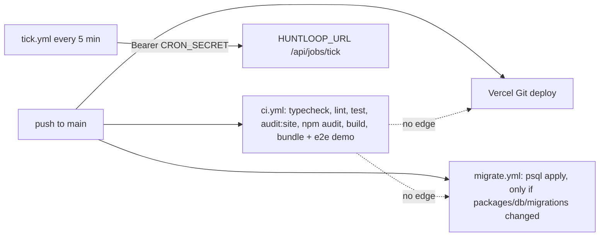

# Pass 16 — operations and scale

## Deploy state (2026-11-14)
| Layer | State |
|---|---|
| Branch audited | `feat/pass-15-audit-fixes` @ `7e09759` (not merged to `main`) |
| Production | `www.huntloop.pro` serves `8021d3f`; health 503; apex fails TLS (PROD-001) |
| Database | configured project: 0001–0047; 0048–0050 missing |
| Engine driver | `tick.yml` every 5 min; prod `cronSecret:false`, so nothing runs |
| Error tracking | Sentry code present; DSN unset in prod (`sentry:false`) |
| CSP | script-src report-only; reports from Chromium dropped (SEC-201) |

**Safe order for the next deploy** (it follows from DB-203 and PROD-201): (1) land the DB-203 callback fix and the PROD-201 probe fix; (2) apply 0048 → 0049 → 0050; (3) set the env (M3, M6) and fix the origin (M4); (4) deploy; (5) confirm health is 200 and the first tick is green. Reversing steps 2 and 4 stalls every send. Applying 0049 before step 1 breaks mailbox connect.

## Scale tiers — what breaks first
Every row is **not measured**: no load test was run (no safe harness; `--no-load` would not change that). Each reason is the code-level bottleneck, with its evidence.

| Tier | What breaks first | Why (evidence) |
|---|---|---|
| 100 users / ~10 orgs | Nothing structural; one busy org delays others' sends | `advance_enrollments` 5 per tick across all orgs; claim ordered by `run_at` only (JOB-202) |
| 1k users | Inbox and assignments pages; PostgREST 1000-row cap truncates silently | unbounded nested selects (PERF-201); no `threads(org_id,last_message_at)` index |
| 10k users | Tick throughput: GitHub cron is best-effort with a 3-min job timeout; global sweeper caps | `tick.yml`; `runner.ts` batches; no fairness |
| 100k users | Provider and AI spend without kill switch or cost ceiling; `job_executions` growth until 0049's prune is live | PROD-207, AI-201, JOB-011 (fixed in repo, not live) |
| 1M users | Single Postgres queue + serverless request limits | architecture; not measured |

## Prod / deploy / CI / parity

### 3a. Pipeline as it actually is

- **What a red CI blocks:** nothing structurally. `docs/operations/deployment.md:119-121` says Vercel deploys on push, and `migrate.yml` has no `needs:` on CI. Blocking depends on branch protection, which I could not verify (§15). `npm run verify` runs the same set as CI, step for step (`package.json` `verify` vs `ci.yml`).
- **Migrations and deploy are unordered** (PROD-202). The schema probe would not catch an out-of-order deploy (PROD-201).
- **Node:** `engines: >=22.6`. CI and migrate use Node 24, local is 22.23.2. Vercel's Node version is unverified (§15).
- **Runtime:** tick, inngest, health, unsubscribe, extract and the mailbox routes are `nodejs`. The proxy runs on edge (uses `crypto.getRandomValues`, `lib/csp.ts:54`).

### 3b. Environment parity

| | Local | Preview | Production (lead's GET) |
|---|---|---|---|
| Supabase | `.env.local` (names present) → project in `db-doctor.log` (0001–0047) | unknown | `database.schema` reports `complete`. That is misleading because the probe stops at 0047 (PROD-201) |
| Commit | `7e09759` | — | `8021d3f` (predates all pass-15 fixes) |
| `NEXT_PUBLIC_SITE_URL` | set | — | `https://huntloop.pro` (apex fails TLS) |
| `CRON_SECRET` / Inngest / `MAILBOX_ENCRYPTION_KEY` | set / set / set | — | false / false / false |
| Provider and AI keys | set (names) | — | all false |
| Demo / dev surfaces | demo when vars are blanked | demo plus `/kitchen-sink` reachable | 503 / 404 |
| Sentry | DSN names present | — | false |

### 3c. Domain migration (`docs/domain-migration-huntloop-pro.md`) against code and prod

| Doc claim | Reality | Evidence |
|---|---|---|
| Canonical is the apex; `www` → 308 → apex | Reversed. www serves, and the apex fails TLS (`SEC_E_WRONG_PRINCIPAL`). `http://huntloop.pro` 308s into the broken https apex | lead's GETs (`prod-get.log`) |
| "Every absolute URL derives from `NEXT_PUBLIC_SITE_URL`" | Partly. Magic link and signup callback (`(auth)/actions.ts:80,125`), invites (`team/actions.ts:327,426`, `lib/data/team.ts:256`), outreach unsubscribe and List-Unsubscribe (`send-message.ts:819`), digests and notifications (`send-digests.ts:83`, `send-notifications.ts:28`) and CRM evidence links (`sync-hubspot.ts:125`) do. **Mailbox OAuth `redirect_uri` uses the request origin** (`api/mailboxes/[provider]/start/route.ts:58,114`, `callback/route.ts:61,125`), as the same doc's "Decisions" section says. So today emails link to the broken apex, while OAuth would send `https://www.huntloop.pro/...` against URIs the checklist registers on the apex → `redirect_uri_mismatch` | — |
| No CORS, no cookie `domain` | True. Cookies are host-only; `__Host-` is used for the OAuth state cookie (`shared.ts`) | — |
| CSP needs no change | True. `connect-src` derives from `NEXT_PUBLIC_SUPABASE_URL` and the Sentry DSN, not the site host | `lib/csp.ts:70-95` |
| Checklist B–E | Every box is still ☐ | — |

This root cause is PROD-001 (still open). I add the OAuth-origin split as a new location, not a new finding.

### 3d. Vercel topology

The doc records two projects. `huntloop-web` sits in team `huntloop` and is Git-connected. A CLI-only duplicate `huntloop-web` sits in `cmbatmans-projects`, and the local `.vercel` links to that duplicate (`docs/domain-migration-huntloop-pro.md` "Findings"). `deployment.md:86-94` records a third, never-built project `huntloop`. That is a split-brain risk: `vercel env pull` and `vercel deploy` from this machine target the wrong project. Unverified, because the dashboard needs team access.

---

## Observability

| Question | Can you tell today? | Evidence |
|---|---|---|
| A job failed, for which org, and why | Only by querying `job_executions` or opening `/[org]/ops` (admin, one org at a time). Not in logs, not in Sentry | runner `markFailed` (`packages/jobs/src/runner.ts:184-191`). No `captureException` anywhere in `packages/` |
| A request errored | Sentry `onRequestError` (`instrumentation.ts`) and the error boundaries (`app/error.tsx:40`, `[org]/error.tsx:29`, `global-error.tsx:27`). **Sentry is unset in prod** | health `sentry:false` |
| Structured logs with request, job and org ids | **No.** 22 `console.error`/`warn` calls with free-text messages and no org or job id (e.g. `packages/providers/src/budget.ts:136`, `ledger.ts:58`, `jobs/src/ai.ts:75`) | grep |
| Tick stopped | `tick.yml` goes red on non-200 or `oldestDueSeconds > 900`. GitHub's failure email goes to whoever owns the workflow, and schedules pause after 60 days without repo activity (`tick.yml` header) | `.github/workflows/tick.yml` |
| Dead-letter growth, spend spike, bounce rate | **No alert exists** | grep for alerting code: none |
| Is the deployment healthy (`/api/health`) | Checks: Supabase reachable, the 0001 and 0047 tables exist via anon PostgREST, presence of env vars. **Does not check** last tick time, queue lag, failed or dead jobs, the migration ledger (`schema_migrations`), or 0048–0050 objects | `apps/web/app/api/health/route.ts`, `lib/schema.ts:38` |
| Heartbeat per `docs/operations/heartbeat.md` | The doc's option A says Vercel Cron is "committed" in `apps/web/vercel.json`. That file has **no `crons`**. The real driver is `tick.yml`. `lastTickAt()` on the Sources screen does read `job_executions` | `apps/web/vercel.json`, `heartbeat.md:70-80`, `observability.md:50-56` |
| Audit trail | `audit_logs` is written, and **nothing reads it** (the doc says so itself) | `docs/operations/observability.md` table. A failed write goes to Sentry (`lib/data/audit.ts:87`) |
| Cross-tenant operator view | None. Every ops surface is per-org and needs a membership | `/[org]/ops` |

---

## DR / backup / rollback

| Item | Documented | Reality |
|---|---|---|
| Backups | Supabase-provided and plan-dependent. The plan, backup type, retention and RPO table in `docs/OPERATIONS.md:245-250` is **empty** | `docs/OPERATIONS.md:24-25`: "A restore has never been rehearsed". `docs/security/privacy.md:139`: "Never rehearsed" |
| PITR | Undecided (`OPERATIONS.md:251-258`) | Unverified, dashboard |
| RPO / RTO | Not stated | — |
| Restore procedure | Written (`OPERATIONS.md:260-279`): stop the tick, restore in place, re-check migrations, rerun isolation | Never executed. The rehearsal checklist (`:280-285`) is all ☐ |
| App rollback | Vercel instant rollback (`deployment.md:112-117`) | Plausible. Older code against a newer schema relies on migrations staying additive, and nothing tests that |
| Migration rollback | Forward-only. "Additive by rule" (`migrations.md:124-135`) | Each file plus its ledger row is one transaction (`packages/db/scripts/migrate.ts:29,95`), so a failed file leaves nothing. A re-run applies nothing (ledger, tested by `verify-migrate.ts`, 9 cases) |
| Bad job batch | `cancel_job`/`retry_job` per job per org (`ops/actions.ts:36,64`) | No bulk cancel, no global pause (PROD-207) |
| Schema drift prod vs repo | `db:doctor` infers from objects; `schema_migrations` is the ledger | Configured DB: 0048–0050 MISSING; the 0006 cron is not visible (`db-doctor.log`) |

## Perf (static only; every item is **not measured**)

| Item | Where | Why it matters |
|---|---|---|
| Inbox loads every thread with every message body and event, unbounded | `apps/web/lib/data/inbox.ts:76-89` | Payload grows with all mail ever exchanged. PostgREST `max-rows` (Supabase default 1000) truncates silently, a correctness problem as well. No `threads (org_id, last_message_at)` index exists (only `threads_provider_idx`) |
| Assignments loads every opportunity, unbounded | `apps/web/lib/data/team.ts:113-122` | Same truncation and size issue; `opportunities_priority_idx` covers the order |
| Dashboard "why now" evidence is unbounded per shortlist | `apps/web/lib/data/dashboard.ts:257-268` | The shortlist is small, but evidence per opportunity is unbounded |
| 53 of 291 `select`s in `lib/data` and `jobs/handlers` have no limit, key or `maybeSingle` | listing produced by a static scan (scratch script); notable ones: `opportunities.ts:159,388` (evidence), `hunt-source.ts:118,152`, `conversation.ts:70`, `analyze-performance.ts:551,561,676`, `send-message.ts:660,672,712` | Most of the rest are small config tables (plans, icps, products, mailboxes) |
| Model calls in the request path | Analyze, research, ICP draft and first-run stages run inside Server Actions (`lib/ai/*.ts`), capped by the 55 s AI timeout (`ai/src/env.ts`) | Latency and serverless limits. Rate-limited |
| Route skeletons | 3 `loading.tsx` for 54 pages; `[org]/loading.tsx` covers the org tree | PERF-001 partially addressed |
| Bundle | 201.7 / 275 kB shared (lead) | Within budget |

