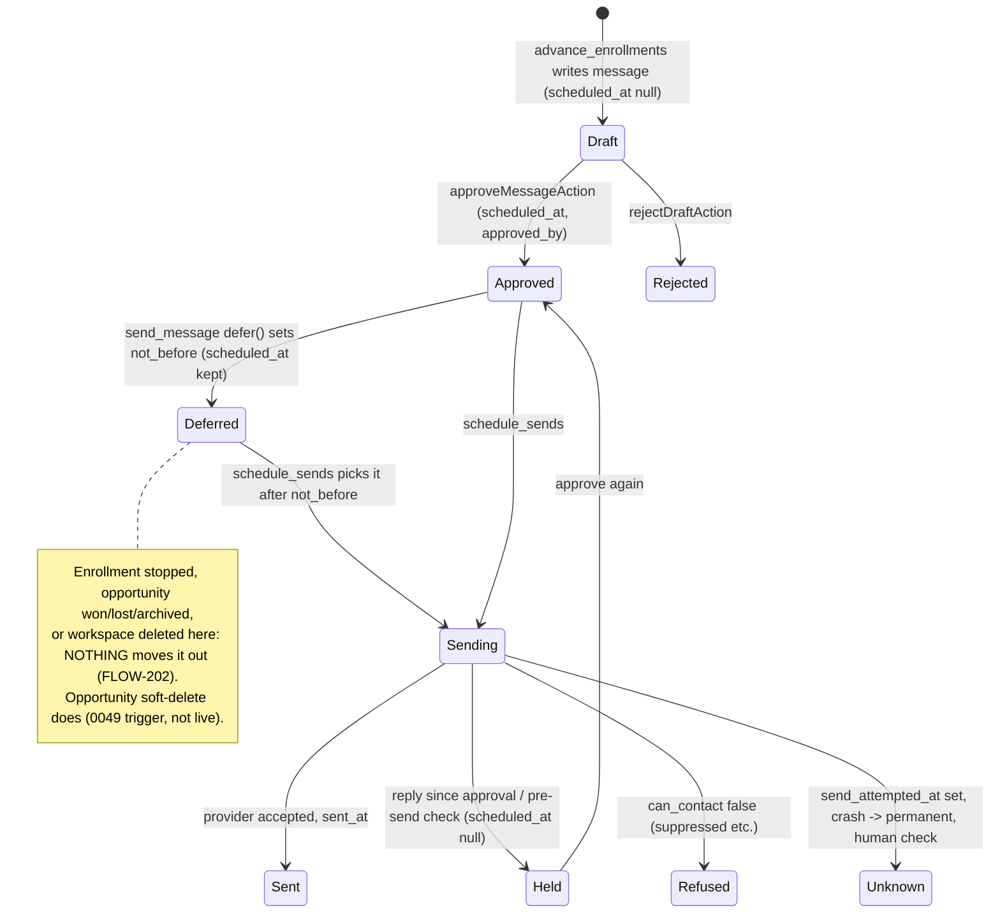

# Pass 16 — Reviewer A: flows · api · trust

Status: COMPLETE — sections 1–9 written. Findings: High 3 · Medium 6 · Low 9.
Audited commit: `7e09759` (feat/pass-15-audit-fixes). Read-only. No servers, no real DB, no network calls. One offline in-memory PGlite script (OS temp dir) reproduced FLOW-200.
Method: read every route handler and every `"use server"` module; static guard scan (node script in OS temp dir: per exported action, presence of `mutate()` / `currentViewer()` / `requireOrgId()` / zod / `minRole`); resolved final SQL definitions for every RPC cited (latest migration wins); traced flows caller → action → lib → DB.

## 1. Route and action inventory

### 1a. Route handlers (13)

| Route | Methods | Public in `proxy.ts`? | AuthN/Z (file:line) | Validation | Reachable unauthenticated? | Notes |
|---|---|---|---|---|---|---|
| `/api/jobs/tick` | GET, POST | yes (`proxy.ts:107`), also served while not-ready (`:143`) | `Bearer $CRON_SECRET`, constant-time compare `app/api/jobs/tick/route.ts:62`; missing secret → 503 `:49-58` | `?limit` clamped 1..25 `:91-94` | Reaches route; refused 404 without bearer | Runs `sweep()` + `tick()` for all tenants under service role |
| `/api/inngest` | GET, POST | yes (`proxy.ts:108`) | HMAC `x-inngest-signature`, ±300 s window, `route.ts:50`, `verifySignature` | body read as text | 404 when Inngest env unset (`:45`, `:79`) | Hand-rolled signature; SDK not installed (`node_modules` has no `inngest`). GET returns a static function manifest, not the SDK sync protocol. Not live (prod `inngest:false`). See API-204 |
| `/api/health` | GET | yes | none (booleans only) | – | yes (by design) | `ok` requires schema complete + service key + cron secret + encryption key + siteUrl present (`route.ts`); does not check last tick or siteUrl reachability |
| `/api/csp-report` | POST | yes (`proxy.ts:66`) | none (by design) | 8 KB cap `route.ts:52,61`, fields truncated | yes | Writes only to Sentry; always 204 |
| `/api/unsubscribe/[token]` | POST (RFC 8058), GET→303 | yes (`proxy.ts:72`) | token = uuid, `route.ts:49`; `record_unsubscribe` SECURITY DEFINER (final def `0047_security_leads.sql:509`) | `uuidSchema` on POST only; GET redirects raw token into same-origin path | yes (by design) | Error and bad-token both 404 (no oracle) |
| `/api/notifications/unsubscribe` | GET (confirm page), POST | yes (`proxy.ts:75`) | HMAC token `packages/jobs/src/email/digest-token.ts:38`; HKDF from service key | token sliced to 300 chars; uuids checked | yes (by design) | Token never expires; only turns digest off |
| `/api/mailboxes/[provider]/start` | GET | no (`/api` is account prefix, `lib/protected-routes.ts:49`) | `currentViewer` `start/route.ts:73`, `canWrite`, demo refused, encryption key required | provider allowlist `shared.ts isProviderId` | no → 307 /login | 32-byte nonce in `__Host-` cookie, 600 s, SameSite=Lax |
| `/api/mailboxes/[provider]/callback` | GET | no | state cookie + constant-time nonce compare `callback/route.ts:91`, then `currentViewer` + `canWrite` `:116` | provider path must equal cookie provider | no | Upsert on `(org_id,email)` revives a soft-deleted mailbox (`deleted_at:null`); error text from provider echoed into query string |
| `/api/memory/extract` | POST | no | `currentViewer` `route.ts:44`, `canWrite` | `orgSlugSchema`, 4 MB cap (declared + actual), magic-byte sniff | no | Returns text only; persists nothing |
| `/auth/callback` | GET | yes (`/auth`) | Supabase PKCE `exchangeCodeForSession` `route.ts:54` | `safeNextPath` (`lib/safe-next.ts:35-45`) | yes (by design) | `next` validated: rejects `//`, `\`, control chars → no open redirect |
| `/auth/signout` | POST | yes | none needed; `signOut()` `route.ts:23` | `safeNextPath` on `next` | yes | Cross-site POST would not carry SameSite=Lax session cookie → no logout-CSRF |
| `/dev/onboarded` | GET | yes; 404 in production via `HIDDEN_IN_PRODUCTION` (`proxy.ts:148,268`) | `NODE_ENV !== "development"` → 404 `route.ts:30` | – | dev only | Redirects to `resolveDestination()` (demo → `/demo/dashboard`, matches lead's observation) |
| `/[org]/performance/export` | GET | no (workspace section `performance`) | `currentViewer` `export/route.ts:20` | period/table allowlists | no | CSV cells formula-escaped (`lib/csv-write.ts:16-21`); `org` slug interpolated into `content-disposition` unvalidated (bounded by `currentViewer` succeeding, so only real slugs reach it) |

**Why local `/api/jobs/tick` answered 404 "Not found".** Not the proxy. The proxy lists `/api/jobs/tick` as public (`proxy.ts:107`) and its only plain-text "Not found" 404 is for `HIDDEN_IN_PRODUCTION` paths (`proxy.ts:268-270`), which tick is not; an unknown anonymous path is rewritten to `/__not-found` (HTML, `:327-336`), not plain text. The plain-text "Not found" body is the route's own bad-credentials branch (`app/api/jobs/tick/route.ts:61-67`). It fired because `scripts/dev-demo.mjs:27-34` blanks only the Supabase and Anthropic variables and passes the rest of `process.env` through; Next then loads `apps/web/.env.local`, which defines `CRON_SECRET` (64-char value; name only, file is git-ignored by `apps/web/.gitignore:2`). With a secret set and no `Authorization: Bearer …` header the route answers 404 by design. If `CRON_SECRET` were unset the answer would be 503 JSON. So the 404 is correct behaviour, CONFIRMED by code reading (not re-run).

### 1b. Server actions (138 exported actions in 39 `"use server"` modules)

Guard model: almost every workspace action goes through `mutate(orgSlug, caller, run, {minRole})` (`apps/web/lib/data/org.ts`, compiled lines ~27-70): resolves the org **from the slug via the caller's own membership** (`currentViewer`), refuses non-members, refuses `viewer` unless `minRole:"viewer"`, enforces `admin`/`owner`, then runs with the tenant (RLS) client and `orgId` taken from the membership, never from the client. A forged org slug therefore yields "not a member"; a forged row id from another org is filtered by `.eq("org_id", orgId)` (present in 84 of the 138 actions; the rest either touch no row by id, call an RPC that re-checks `org_id`, or insert with `org_id: orgId`) and, independently, by RLS. Server actions get Next's built-in Origin/Host CSRF check; no `serverActions` overrides in `apps/web/next.config.*` (so the default 1 MB body limit applies — see FLOW-206).

Actions that do **not** use `mutate()` (each read; all are guarded another way or public by design):

| Action (file:line) | Guard | Public? | Verdict |
|---|---|---|---|
| `analyzeUrlAction`, `whyNowAction` (`[org]/analyze/actions.ts:52,102`) | slug + url zod; `qualify()`/`whyNow()` → `resolveRecorder` (`lib/ai/recorder.ts:69-101`): org read under RLS + `canSpend(currentViewer)` | no | OK. Viewer cannot spend (SEC-008 fix present) |
| `explainPerformanceAction` (`performance/actions.ts:26`) | period zod; `getPerformance` under RLS; `explain()` → recorder | no | OK (org slug not schema-validated, used only as a bound parameter) |
| `approveFindingAction` (`learn/actions.ts:114`) | uses `mutate` (scanner missed it: generic `mutate<Applied>(`) | no | OK |
| `snoozeAttentionAction`, `clearSnoozesAction`, `unsnoozeAttentionAction` (`needs-you/actions.ts`) | `currentViewer` + member, per-user rows `.eq(user_id)` | no | OK; viewers may snooze (personal state) |
| `draftProductFromWebsiteAction` (`settings/product/actions.ts:40`) | `currentViewer` then AI via recorder | no | OK |
| `approveJoinAction`, `declineJoinAction` (`team/actions.ts:527,539`) | uuid; `lib/data/directory.ts` uses `mutate(minRole:"admin")` + `0027` policy | no | OK |
| `deleteOwnAccountAction` (`settings/privacy/actions.ts:190`) | RPC `delete_own_account` (auth.uid() inside) | no | OK (owned by lifecycle reviewer) |
| `sendMagicLink`, `signInWithGoogle` (`(auth)/actions.ts:62,120`) | email/mode zod, `safeNextPath` | **yes** | See API-201 (enumeration oracle) and FLOW-201 (redirect origin) |
| `discoverAction` (`(marketing)/discover/actions.ts:60`) | url zod, key = canonical domain only, free-mail refused, `reserve_public_research` per-IP-hash/hour + daily ceiling | **yes** | OK for spend (bounded by ceiling). IP from `x-forwarded-for[0]` (`:121-126`) is trustworthy only behind Vercel |
| onboarding `saveYou`, `saveGoals`, `saveIcp`, `saveSources`, `advanceStep`, `finishOnboarding` (`(onboarding)/welcome/actions.ts`) | zod; delegate to `lib/data/onboarding.ts` step writers which resolve membership | no (`/welcome` protected) | OK; see TRUST-201 for `saveIcp` |
| `createWorkspace`, `startFirstJob` (`welcome/actions.ts:230,131`) | `auth.getUser()` + RPC `create_organization` | no | OK |
| `researchCompanyAction`, `saveCompanyAction`, `requestJoinAction` (`welcome/company/actions.ts`), `draftIcpAction` (`welcome/icp/actions.ts:64`), `recommendSourcesAction` | slug + membership in `lib/data/*`, AI via recorder | no | Implemented, unverified (not traced line by line) |
| `acceptInvitationAction` (`invite/[token]/actions.ts:26`) | uuid, `auth.getUser()`, RPC `accept_invitation` (final def `0047_security_leads.sql:743`) | needs session | OK: email-bound, confirmed-email required, expiry, single-use |
| `unsubscribeAction` (`unsubscribe/[token]/actions.ts:24`) | uuid, RPC `record_unsubscribe` | **yes** (by design) | OK |

Admin/owner-gated actions (`minRole`): `retryJobAction`/`cancelJobAction` (admin), `saveGoalsAction`, `saveOrgSettingsAction`, `saveOrgProfileAction`, `connect/disconnectHubspotAction`, all `team/*` membership actions, `erase/exportContactAction` (admin), `exportOrganizationAction` (admin+owner), `deleteOrganizationAction` (owner), `promotePreferenceAction` (admin). `minRole:"viewer"`: `deleteConversationAction`, `saveNotificationPreferencesAction` (personal).

**Unauthenticated-reachable list (complete):** `/`, marketing (`/for`, `/compare`, `/privacy`, `/terms`, `/acceptable-use`, `/discover` + `discoverAction`), `/login`, `/signup` + `sendMagicLink`/`signInWithGoogle`, `/auth/callback`, `/auth/signout`, `/unsubscribe/[token]` + `unsubscribeAction`, `/api/unsubscribe/[token]`, `/api/notifications/unsubscribe`, `/api/csp-report`, `/api/health`, `/api/jobs/tick` (secret), `/api/inngest` (HMAC/404), `/opengraph-image`, `/apple-icon`, `robots.txt`, `sitemap.xml`, `humans.txt`; dev-only `/kitchen-sink`, `/dev/onboarded` (404 in production). Every other path: protected route → 307 `/login?next=<path>` (invite → `/signup`), unknown path → 404 rewrite.

Response-shape consistency: server actions return `ActionResult` (`{ok,data,message}|{ok:false,error,fieldErrors}`) except `analyze` (`AnalyzeState`), `discover` (`DiscoverState`), `unsubscribe` (`UnsubscribeResult`), `explainPerformance` (bespoke union), auth (`AuthFormState`). Route handlers mix JSON `{error}`, plain text and HTML pages. Not a defect on its own (every caller is first-party UI); noted in API-205.

## 2. Flow tables (§3a)

Column order per journey, exactly as §3a: Entry · Trigger · Caller · Route/action · AuthN/Z (file:line) · Validation · Logic · Tables r/w · External calls · Transaction boundary · Idempotent? · Expected · Actual · Failure modes · Edge cases · Status · Verified by. Paths are under `apps/web/` unless they start with `packages/`. "Verified by" names a test that runs the path; demo-mode Playwright proves only the fixture branch.

### 2.1 Sign-up / login (magic link) and logout
| Column | Value |
|---|---|
| Entry | `/signup`, `/login` (`app/(auth)`), proxy redirect `/login?next=` (`proxy.ts:338-354`) |
| Trigger | form submit |
| Caller | UI |
| Route/action | `sendMagicLink` (`app/(auth)/actions.ts:62`) → Supabase OTP → email → `/auth/callback` (`app/auth/callback/route.ts`) → `resolveDestination()`; logout `POST /auth/signout` |
| AuthN/Z | none before; session minted by `exchangeCodeForSession` (`callback/route.ts:54`, PKCE) |
| Validation | `emailSchema` (trim, lowercase, ≤254), `authModeSchema`, `safeNextPath` |
| Logic | `shouldCreateUser = mode==="signup"`; `emailRedirectTo = siteUrl()/auth/callback?next=` |
| Tables | `auth.users` (Supabase); `profiles` via trigger |
| External | Supabase Auth + its mailer |
| Transaction | Supabase-side |
| Idempotent? | yes (new link each time; Supabase rate limits) |
| Expected | same response whether or not the address exists; link lands on this deployment |
| Actual | login with an unknown address returns the error state while a known address returns "sent" (API-201); the link origin is `NEXT_PUBLIC_SITE_URL`, which production sets to the apex that fails TLS (FLOW-201) |
| Failure modes | Supabase down → generic error; missing `code` → `/login?error=missing_code`; bad code → `invalid_link` |
| Edge cases | invitee bounced to `/signup` not `/login` (`proxy.ts:349`); signout preserves `next` for the invite page |
| Status | Implemented, unverified (real backend); demo-only in Playwright |
| Verified by | `lib/safe-next.test.ts` (redirect guard), `lib/protected-routes.test.ts`; no test runs the OTP/callback path |

### 2.2 OAuth sign-in (Google)
| Column | Value |
|---|---|
| Entry / trigger / caller | Google button on auth form · submit · UI |
| Route/action | `signInWithGoogle` (`app/(auth)/actions.ts:120`) → `supabase.auth.signInWithOAuth` → Google → `/auth/callback` |
| AuthN/Z | Supabase PKCE; state handled by Supabase |
| Validation | `safeNextPath` |
| Logic / tables | as 2.1 |
| External | Google OAuth via Supabase |
| Idempotent? | yes |
| Expected / Actual | lands back on the deployment; redirect URL built from `siteUrl()` → same apex problem (FLOW-201); Supabase dashboard redirect allowlist UNVERIFIED |
| Failure modes | `error` → `/login?error=oauth` |
| Status | Implemented, unverified |
| Verified by | none |

### 2.3 Email verify / password reset
Email verification: implicit in magic-link/OAuth (Supabase sets `email_confirmed_at`); `accept_invitation` refuses an unconfirmed address (`0047_security_leads.sql:743`, check after email match). Password reset: **Missing by design** — no password auth exists (no `resetPassword`/`updateUser` call anywhere in `apps/web/app`). Not a defect.

### 2.4 Invite → accept (critical; mermaid below)
| Column | Value |
|---|---|
| Entry | Team screen (`[org]/team`) · invite link `/invite/[token]` |
| Trigger | admin submits invite; invitee opens link |
| Caller | UI (+ email via Resend when configured) |
| Route/action | `inviteMemberAction` (`[org]/team/actions.ts:336`), `resendInvitationAction` (`:439`), `revokeInvitationAction` (`:481`); `acceptInvitationAction` (`invite/[token]/actions.ts:26`) → RPC `accept_invitation` |
| AuthN/Z | `mutate(minRole:"admin")`; DB `invitation_admin` policy (`0007:155`) + `guard_invitation_owner` (`0031`); accept: signed-in, email match, confirmed email (`0047:743`+) |
| Validation | `inviteSchema` (owner not offerable, `lib/validation.ts:396-399`); uuid token |
| Logic | seat quota → already-member check → revoke any pending row for the address → insert → audit → email (idempotency key per minute) |
| Tables | `invitations`, `memberships`, `profiles`, `audit_logs`, `plans/usage` |
| External | Resend (optional) |
| Transaction | accept: single SECURITY DEFINER function (atomic). Invite: revoke + insert are two statements, not one transaction |
| Idempotent? | accept: yes (`on conflict (org_id,user_id) do update`, role = least of live/invited). Invite double-submit: second insert hits `invitations_pending_idx` → shown as Postgres error text |
| Expected | single-use, 14-day, email-bound link |
| Actual | as expected. Invitations to a workspace that was later deleted stay redeemable: `accept_invitation` does not check `organizations.deleted_at`, and `delete_organization` (`0031`) does not revoke invitations; the redirect then lands on a 404 (FLOW-207) |
| Failure modes | wrong account → precise message + signout-with-next; expired → "no longer valid" |
| Edge cases | legacy mixed-case pending email not matched by the exact `.eq("email", email)` revoke (`team/actions.ts:385`) while the unique index is on `lower(email)` → re-invite fails with a duplicate-key message (LIKELY, only for rows written before `emailSchema` lowercased) |
| Status | Working (DB half) / Implemented, unverified (UI + email half) |
| Verified by | `packages/db/scripts/verify-migrations.ts:606-673, 3341-3354` (PGlite: wrong email, expired, single-use, role keep) |

```mermaid
sequenceDiagram
  participant A as Admin (UI)
  participant S as inviteMemberAction
  participant DB as Postgres (RLS)
  participant M as Resend
  participant I as Invitee
  participant P as proxy.ts
  participant X as accept_invitation()
  A->>S: email, role
  S->>DB: checkQuota(seats); memberships? ; update invitations set revoked_at (pending)
  S->>DB: insert invitations (token uuid, expires +14d)
  S->>M: invitation email (url = siteUrl()/invite/token)
  I->>P: GET /invite/token (no session)
  P-->>I: 307 /signup?next=/invite/token
  I->>I: magic link / Google -> /auth/callback -> /invite/token
  I->>X: acceptInvitationAction(token)
  X->>DB: token live? email = auth email? confirmed? upsert membership; accepted_at=now()
  X-->>I: slug -> redirect /slug/dashboard or /welcome
```

### 2.5 Role change / member removal
| Column | Value |
|---|---|
| Entry / caller | Team screen · UI |
| Route/action | `setMemberRoleAction` (`team/actions.ts:49`), `removeMemberAction` (`:132`) |
| AuthN/Z | `mutate(minRole:"admin")`; owner-role changes need owner (`canOwn`) in app and `guard_membership_owner` trigger (`0031_tenant_write_hardening.sql:105-160`) |
| Validation | `memberRoleSchema`, uuid |
| Logic | read target → owner guard → last-owner count → update → audit |
| Tables | `memberships`, `audit_logs` |
| Transaction | none: count-then-update (FLOW-205) |
| Idempotent? | yes for same target role |
| Expected | an org never ends with zero owners |
| Actual | last-owner rule is app-only; two owners demoting/removing each other concurrently both pass `countOwners` (`team/actions.ts:89,159`). Once zero owners exist, the trigger's escape hatch lets any admin self-promote (`0031:133-139`) |
| Failure modes | RLS refusal surfaces as Postgres text |
| Edge cases | removed member loses access at once: `user_org_ids()` (final def `0031_tenant_write_hardening.sql:253-266`, also excludes deleted orgs) and `has_org_role()` (`0001_identity.sql:120-138`) both require `memberships.deleted_at is null` |
| Status | Implemented, unverified (owner trigger: Working, see verify-migrations) |
| Verified by | owner-guard trigger cases in `packages/db/scripts/verify-migrations.ts`; no test for last-owner race |

### 2.6 Org create / switch / delete
| Column | Value |
|---|---|
| Entry | `/welcome` (create), `/orgs` picker + `huntloop.org` cookie (switch), Settings → Privacy (delete) |
| Route/action | `createWorkspace` (`(onboarding)/welcome/actions.ts:230`) → RPC `create_organization`; switch = navigation, cookie set in `proxy.ts:362-371` and `finishOnboarding`; `deleteOrganizationAction` (`[org]/settings/privacy/actions.ts:151`) → RPC `delete_organization` (final def `0031_tenant_write_hardening.sql`) |
| AuthN/Z | `auth.getUser()`; delete: `mutate(minRole:"owner")` + `has_org_role(p_org,'owner')` in the function |
| Validation | url, `orgSlugSchema`, reserved slugs; delete requires typed confirmation |
| Logic (delete) | soft-delete org; archive campaigns; stop enrollments; disable sources and discovery queries |
| Tables | `organizations`, `memberships`, `campaigns`, `enrollments`, `sources`, `discovery_queries` |
| Transaction | delete: one function (atomic) |
| Idempotent? | delete yes (`where deleted_at is null`) |
| Expected | deleted workspace emails nobody and cannot be joined |
| Actual | approved-but-unsent messages are not unscheduled by `delete_organization`, and `schedule_sends`/`send_message`/`can_contact` do not check `organizations.deleted_at` (`packages/jobs/src/handlers/schedule-sends.ts:52-58`, `0017_outreach_safety.sql` `can_contact` reads organizations without a deleted filter) → part of FLOW-202. Pending invitations stay redeemable (FLOW-207) |
| Failure modes | RPC error text shown |
| Edge cases | switch cookie is a pointer, re-checked by `resolveDestination` (comment `proxy.ts:357-361`); `resolveMembership` filters `organizations.deleted_at` (`packages/db/src/server.ts:61`) |
| Status | Implemented, unverified |
| Verified by | `lib/data/destination.test.ts` (destination logic only) |

### 2.7 Onboarding / ICP
| Column | Value |
|---|---|
| Entry | `/welcome/*` steps |
| Route/action | `saveYou`, `saveGoals`, `saveIcp`, `saveSources`, `advanceStep`, `finishOnboarding` (`(onboarding)/welcome/actions.ts`), `draftIcpAction`, `estimateReachAction`, `previewLookAlikesAction`, `runStageAction` |
| AuthN/Z | slug validated, membership resolved inside `lib/data/onboarding.ts` writers; AI via `resolveRecorder` + `canSpend` |
| Validation | zod per step (`youStepSchema`, `icpStepSchema`, …) |
| Logic | writes ICP + persona + sources; reach estimate passed back from the browser |
| Tables | `profiles`, `organizations.settings`, `icps`, `icp_versions`, `personas`, `sources` |
| External | Anthropic (draft ICP), provider count (reach) |
| Idempotent? | step writers upsert |
| Expected | provider-sourced reach stored only from the provider |
| Actual | the browser-supplied `addressableEstimate` is stored as `addressable_source='provider'` (TRUST-201) |
| Status | Implemented, unverified |
| Verified by | `lib/onboarding/icp-step.test.ts` (pure mapping only) |

### 2.8 Discover / search / save (engine side)
`huntNowAction` (`[org]/dashboard/actions.ts:19`), `scanSourceNowAction` (`sources/actions.ts:277`) enqueue jobs; `/api/jobs/tick` runs `discover-companies`, `score-opportunity`. Public `/discover` + `discoverAction` reads a site anonymously (spend capped by `reserve_public_research`). Traced only to the enqueue boundary here; handler internals belong to reviewer C. Status: Implemented, unverified (engine). Verified by: `packages/jobs/scripts/verify-jobs.ts` against scripted fakes.

### 2.9 Company and person views
Server Components under `[org]/companies`, `[org]/opportunities/[id]`; reads under RLS with `currentViewer`. Writes: `saveCompanyAction` (restores a soft-deleted company with the same domain, `companies/actions.ts` ~`:107`), `mergeCompaniesAction` → `merge_companies_for_org`, `deleteCompanyAction` (soft delete, propagates via `0049` trigger — **not live**). Status: Implemented, unverified. Verified by: `merge-actions.test.ts` (action guards), PGlite merge cases.

### 2.10 Qualify / score
| Column | Value |
|---|---|
| Entry | Analyze screen; engine job |
| Route/action | `analyzeUrlAction` → `qualify()` (`lib/ai/qualify.ts:50-140`); `saveQualificationAction` (`analyze/actions.ts:151`) requires the HMAC seal (`lib/ai/seal.ts`); engine `score_opportunity` |
| AuthN/Z | `resolveRecorder` + `canSpend`; save via `mutate` |
| Validation | `urlInputSchema`, `qualificationSchema`, seal verify |
| Logic | budget check → rate limit → model → seal; save upserts opportunity on `(org_id, company_id, icp_id)` and retires old evidence |
| External | Anthropic (web fetch restricted to `fetchDomains`) |
| Idempotent? | save: upsert |
| Expected | only a verdict the server produced can be saved |
| Actual | as expected (seal binds org + verdict) |
| Status | Implemented, unverified (live model); seal Verified |
| Verified by | `lib/ai/seal.test.ts`, `spend-guard.test.ts`, `rate-limit.test.ts` |

### 2.11 Enrich (per provider)
Job-only (`enrich_company`, `find_contacts`, `verify_email`); no user route besides indirect enqueue. Owned by reviewer C. Status here: Implemented, unverified.

### 2.12 List / import / export (critical)
| Column | Value |
|---|---|
| Entry | `[org]/imports` (CSV), `[org]/performance/export` (CSV), Settings → Privacy (org/contact export) |
| Route/action | `importCsvAction` (`[org]/imports/actions.ts:88`); `GET /[org]/performance/export`; `exportOrganizationAction`, `exportContactAction` |
| AuthN/Z | `mutate` (member+); export route `currentViewer`; exports admin/owner |
| Validation | `csvSchema` ≤ 2,000,000 chars (`lib/validation.ts:328`), 1,000 rows, domain required, emails via `emailSchema` |
| Logic | parse in action → select existing companies (live only) → insert new → re-select → dedupe people by email/name → insert people → insert contact_points (`verification_status:'unverified'`, `provider:'import'`) |
| Tables | `companies`, `people`, `contact_points` |
| Transaction | **none** — three independent inserts |
| Idempotent? | companies yes; people/emails no (see Actual) |
| Expected | re-running an import completes what a failed run left out |
| Actual | (1) a domain that belongs to a soft-deleted or merged-away company is treated as new (`.is("deleted_at", null)` at `imports/actions.ts:169`) and the insert violates `unique (org_id, canonical_domain)` (`0003_companies_opportunities.sql:44`); the whole batch fails (FLOW-203). (2) If the `contact_points` insert fails after `people` succeeded, a re-run skips those people by name and their emails are never attached (FLOW-204). (3) CSV over Next's default 1 MB server-action body limit is refused by the framework before `csvSchema` runs (FLOW-206) |
| Failure modes | Postgres message surfaced |
| Edge cases | duplicate domains in one file collapse (first wins) |
| Status | Partial |
| Verified by | `lib/csv.test.ts`, `csv-write.test.ts` (parsing/escaping only); no test runs the action |

### 2.13 Outreach draft → approve → send → reply → unsubscribe (critical; mermaid below)
| Column | Value |
|---|---|
| Entry | Inbox / Needs-you; email client |
| Route/action | engine drafts (`advance_enrollments`); `approveMessageAction` (`[org]/inbox/actions.ts:274`), `editDraftAction`, `rejectDraftAction`, `redraftAction`, `replyToThreadAction`; `schedule_sends` → `send_message`; reply sync; `/unsubscribe/[token]` + `/api/unsubscribe/[token]` |
| AuthN/Z | `mutate` (member+); engine under service role; unsubscribe by token only |
| Validation | uuid; draft state re-read (`readDraft`) |
| Logic | approve sets `scheduled_at`, `approved_by` with `.is("scheduled_at", null)` guard; `send_message` checks sent/attempted/approved/recipient/`can_contact`/reply-since-approval/mailbox readiness/business hours/contact lane |
| Tables | `messages`, `message_events`, `enrollments`, `suppressions`, `contact_frequency`, `message_unsubscribe_tokens` |
| External | Gmail / Graph send |
| Transaction | approve: single update; send: claim + send + mark (owned by reviewer D) |
| Idempotent? | approve yes; send guarded by `send_attempted_at` |
| Expected | nothing sends after the user stops the sequence, closes the deal or deletes the workspace |
| Actual | an approved message deferred by `send_message` (business hours, domain readiness, inbox freshness: `packages/jobs/src/handlers/send-message.ts:372-383`, `defer()` `:609-622` keeps `scheduled_at`) still sends after `setEnrollmentStatusAction('stopped')` (`[org]/outreach/actions.ts:364`), after the opportunity is moved to won/lost/archived (`[org]/pipeline/actions.ts:50`), and after workspace deletion: neither `schedule_sends` (`schedule-sends.ts:52-58`) nor `send_message` reads enrollment or opportunity status (FLOW-202). Unsubscribe and replies are handled (`can_contact`, `repliedSinceLastSend` `:280-296`) |
| Failure modes | refusal reasons written to `messages.error` |
| Edge cases | unsubscribe stops only `active` enrollments (`0047:509+`), but `can_contact` blocks the address for every message, so paused ones cannot send either |
| Status | Implemented, unverified (send); unsubscribe DB half Working |
| Verified by | `verify-jobs.ts` (send/reply fakes), `verify-migrations.ts:909-942` (`record_unsubscribe`) |



### 2.14 Sequence enroll / pause / stop
`enrollOpportunitiesAction` (`[org]/opportunities/actions.ts:94`), `setEnrollmentStatusAction` (`outreach/actions.ts:364`, status guard via `.in("status", …)`), `listEnrollmentsAction`. Stop does not unschedule pending approved messages (FLOW-202). Status: Implemented, unverified. Verified by: none for the actions.

### 2.15 Mailbox connect / disconnect / warm-up (critical; mermaid below)
| Column | Value |
|---|---|
| Entry | Outreach → Connect |
| Route/action | `GET /api/mailboxes/[provider]/start` → provider consent → `GET /api/mailboxes/[provider]/callback`; `disconnectMailboxAction` (`outreach/actions.ts:273`) |
| AuthN/Z | `currentViewer` + `canWrite` on both legs (`start/route.ts:73`, `callback/route.ts:116`); state nonce in `__Host-` cookie, constant-time compare (`callback/route.ts:91`) |
| Validation | provider allowlist; provider-in-path must equal provider-in-cookie |
| Logic | exchange code → encrypt tokens → **session-client upsert** on `(org_id,email)` (`callback/route.ts:163`) |
| Tables | `mailboxes` |
| External | Google / Microsoft OAuth |
| Transaction | single upsert |
| Idempotent? | yes (upsert) |
| Expected | connect works after the pass-15 fixes are applied |
| Actual | `0049_soft_delete_propagation.sql:160-171` revokes SELECT on `oauth_token_enc`/`refresh_token_enc` from `authenticated`; PostgREST's upsert writes `ON CONFLICT … DO UPDATE SET oauth_token_enc = EXCLUDED.oauth_token_enc`, which Postgres refuses without SELECT on that column. Reproduced offline (PGlite): plain insert OK, upsert → `permission denied for table mailboxes`, disconnect-shaped update OK. So once 0049 is applied, **every mailbox connect and reconnect fails** (FLOW-200) |
| Failure modes | provider error text echoed to `?mailbox_error=` |
| Edge cases | reconnect revives a soft-deleted row (`deleted_at:null`); disconnect deletes tokens locally but does not revoke at the provider |
| Status | Broken once 0049 is applied; Implemented, unverified today |
| Verified by | none; the PGlite harness grants blanket SELECT to `authenticated` after migrations (`packages/db/scripts/verify-migrations.ts:322-325`) and has no `service_role`, so 0049's column revoke never takes effect in tests |

```mermaid
sequenceDiagram
  participant U as Member browser
  participant S as /api/mailboxes/gmail/start
  participant G as Google
  participant C as /api/mailboxes/gmail/callback
  participant DB as Postgres as authenticated
  U->>S: GET ?org=slug
  S->>S: currentViewer + canWrite + provider + encryption configured
  S-->>U: Set-Cookie __Host-hl_mailbox_oauth {nonce,org,provider} 600s; 302 Google
  U->>G: consent
  G-->>U: 302 callback?code&state
  U->>C: GET callback
  C->>C: state == cookie nonce; viewer still canWrite
  C->>G: exchangeCode
  C->>DB: upsert mailboxes ON CONFLICT (org_id,email) DO UPDATE SET oauth_token_enc=EXCLUDED...
  DB-->>C: after 0049: permission denied (no SELECT on token column)
  C-->>U: 302 /slug/outreach?mailbox_error=That mailbox could not be saved...
```

### 2.16 CRM connect / sync / disconnect
`connectHubspotAction` (`settings/integrations/actions.ts:28`, admin; token verified with HubSpot then encrypted; upsert `hubspot_connections`), `disconnectHubspotAction` (hard delete row), `requestCrmPushAction` (`opportunities/[id]/actions.ts:339`). Sync job owned by reviewer C. Back-links written to HubSpot fall back to `https://app.huntloop.example` when `NEXT_PUBLIC_SITE_URL` is unset (`packages/jobs/src/handlers/sync-hubspot.ts:125`) — TRUST-204. Status: Implemented, unverified. Verified by: crm tests (86) against fakes.

### 2.17 Notifications (digest)
Job `send_digests` (`packages/jobs/src/handlers/send-digests.ts`), preferences via `saveNotificationPreferencesAction` (`minRole:"viewer"`), off-switch `GET/POST /api/notifications/unsubscribe` (HMAC token, no expiry). Status: Implemented, unverified.

### 2.18 Learning / feedback loop
`requestAnalysisAction`, `approveFindingAction` (write rule inactive then mark finding; documented non-atomic order `learn/actions.ts:105-113`), `rejectFindingAction`, `overridePriorityAction` (`record_override`), pipeline outcomes (`pipeline/actions.ts`). Outcome rows are never removed when a card moves back out of won/lost (FLOW-208). Status: Implemented, unverified.

### 2.19 Share links / public token pages
Share links: **Missing** (no table, route or token for sharing anything; grep for `share_link|share_token|public_share` empty). Public token pages that exist: `/unsubscribe/[token]`, `/invite/[token]`, `/api/notifications/unsubscribe?token=`. Not recommended as a requirement (no doc asks for share links in the files read).

### 2.20 Account / org deletion and data export
`deleteOwnAccountAction` → `delete_own_account`; `deleteOrganizationAction` (2.6); `exportOrganizationAction`, `exportContactAction`, `eraseContactAction`. Owned by lifecycle reviewer; traced here only to the RPC boundary. Status: Implemented, unverified.

### 2.21 Admin / ops actions
`retryJobAction`, `cancelJobAction` (`[org]/ops/actions.ts:25,53`, `minRole:"admin"`, RPCs `retry_job`/`cancel_job`). Status: Implemented, unverified.

### 2.22 Support recovery
Locked out: magic link only; no support path beyond re-request (no admin impersonation, no recovery contact) — **Missing**, manual Supabase dashboard work. Wrong org: `/orgs` picker; wrong-account invite: signout-with-next back to the invite (`auth/signout/route.ts`). Bad import: no undo, no import record to roll back — **Missing** (there is no `imports` table; rows carry `people.source='import'` but companies carry no import marker).

### 2.23 Dead ends / posts-to-nothing / enqueue gaps found
- Invite to a deleted workspace → accept succeeds → redirect 404 (FLOW-207).
- `/api/inngest` GET is not the Inngest SDK sync protocol; the driver cannot register as written (API-204, UNVERIFIED against the vendor).
- No handler-without-enqueuer or enqueuer-without-handler checked here (reviewer D owns `registry.ts`).

## 3. State machines (§3b)

| Entity | States | Allowed transitions (code) | Enforced by DB | Who triggers | Terminal | Stuck-state recovery |
|---|---|---|---|---|---|---|
| Invitation (`invitations`, `0007:124-147`) | pending (accepted_at, revoked_at null, expires_at > now) · expired (derived) · revoked · accepted | pending→accepted (`accept_invitation`); pending→revoked (`revokeInvitationAction`, invite re-issue); expired→revoked (re-invite) | accept only via SECURITY DEFINER checks; `invitations_pending_idx` one pending per (org, lower(email)) regardless of expiry. Any admin can PATCH `revoked_at`, `expires_at` or `accepted_at` directly through PostgREST (`invitation_admin` is `for all`, `0007:155-157`), e.g. un-revoke or extend — transition enforced only in app | admin; invitee | accepted, revoked | expired rows are revoked on next invite (`team/actions.ts:385`). No sweeper; harmless |
| Organization (`organizations.deleted_at`, onboarding step) | live · deleted (soft) ; onboarding: steps → done | live→deleted (`delete_organization`, owner) | function checks owner; nothing un-deletes; no hard purge path found | owner | deleted | none in product: restoring needs SQL (manual-ops). Pending invites survive (FLOW-207) |
| Import | none | — | — | — | — | **No state machine**: imports are synchronous, unrecorded, not undoable (2.12, 2.22) |
| Run — `job_executions` | queued · running · succeeded · failed · cancelled (+ dead-letter) | claim/finish in `packages/jobs/src/queue.ts`; `retry_job`/`cancel_job` (admin) | RPCs + `0008` lockdown | engine, admin | succeeded, cancelled, failed(after max attempts) | admin retry; reviewer D owns detail |
| Run — `discovery_runs`, `learning_runs`, `ai_runs` | per-table status columns | written by handlers | check constraints (not re-audited here) | engine | — | delegated to reviewers C/D |
| Share link | — | — | — | — | — | **Missing** (does not exist) |
| Opportunity (`opportunity_status`, `0003:14-17`) | discovered · researching · qualified · assigned · contacted · replied · meeting · proposal · won · lost · archived (+ soft-deleted) | **any → any** via `setOpportunityStatusAction` (`pipeline/actions.ts:50`, no transition check); engine moves forward only (`send-message.ts` `advanceOpportunityStatus`, `.in("status", [discovered…assigned])`); reply sync moves to replied | enum only; no transition trigger. Soft delete stops outreach via `0049` trigger (**not live**) | any member (not viewer); engine | none (won/lost can be reopened) | n/a. Side effects: a terminal move does not unschedule approved messages (FLOW-202); moving back out of won/lost leaves the `outcomes` row (FLOW-208) |
| Enrollment (for context) | active · paused · parked · stopped (+ deleted) | `setEnrollmentStatusAction`: parked/paused→active, active/parked/paused→stopped; engine parks/stops | none on transitions; `0049` trigger stops on opportunity soft delete (not live) | member; engine; `record_unsubscribe` | stopped | resume from parked/paused only |
| Message (for context) | draft · approved · deferred · held · sent · refused · delivery-unknown | see diagram 2.13 | `messages_sent_has_provider_id` (per `0017` header), `0035` one message per step | member; engine | sent, delivery-unknown (permanent, manual check) | delivery-unknown needs a human to check the mailbox's Sent folder — manual-ops |

Flags: transitions enforced only in app code — opportunity (all), invitation un-revoke/extend, last-owner. State reachable only by manual SQL — organization restore. States with no exit — none found besides intended terminals.

## 4. Trust and provenance (§8 engine/trust; every factual statement leaving the backend)

Enforcement layers found: (a) DB — `evidence_fact_needs_source` and `evidence_unknown_has_no_confidence` (`0002_icp_sources_evidence.sql:134-142`), `claim_kind` enum, `contact_points.verification_status` vocabulary (`0032`, TRUST-004), `addressable_source in ('provider','manual')` (`0013_icp_v2.sql:93-94`); (b) AI parse — `assertValidClaim` (`packages/ai/src/claims.ts`), per-task grounding; (c) UI — `aiGenerated` badges and inference counts (e.g. `[org]/dashboard/page.tsx:168-201`, `inbox/InboxView.tsx:350-361`, `opportunities/[id]/page.tsx:237`).

| Statement surfaced | Where it leaves the backend | Class | Label / grounding enforced where | Gap |
|---|---|---|---|---|
| Company facts (what they sell, buyers, problem, trigger) | evidence rows → company/opportunity pages; agent context | Fact = Provider-sourced or site-observed; else AI-inferred | DB fact-needs-URL; `research_company` downgrades off-domain "facts" to inference (`packages/ai/src/tasks/research-company.ts:232-239`, AI-002b) | URL is checked at domain level, not page level (a fabricated path on the company's own domain passes) — residual, P3, noted not filed |
| Competitor profile findings | `competitor_profiles`/`competitor_evidence` → competitor screen; drafts read competitors (`send-message.ts:662-672`) | Fact / AI-inferred | `assertValidClaim` only (`research-competitor.ts:277`); pricing inference → unknown | **no off-domain check**: a "fact" may cite any URL (TRUST-202) |
| Qualification verdict, priority, score, dimensions | Analyze screen; `opportunities`, `opportunity_scores` | AI-inferred (model) + Calculated (rules: `score` vs `model_score`, `rule_trace`) | `qualify_opportunity` rejects a fact citing an unread off-domain URL (`qualify-opportunity.ts:583-600`); seal binds what is saved (`lib/ai/seal.ts`); unmeasured dimensions are `unknown`, never 0 | none found |
| Why now | Analyze screen (not persisted) | AI-inferred over client-supplied claims | `explain_why_now` maps each cited claim to a supplied one (`explain-why-now.ts:305-310`) | by design the claims come from the browser; not persisted, so no reach beyond the caller |
| Agent / assistant answers | opportunity agent, workspace assistant | AI-inferred prose + cited claims/refs | `citedClaims` enum from evidence (`sales-agent.ts:253-265`); assistant citations filtered to known refs (`workspace-assistant.ts:238-258`) | prose itself unconstrained (inherent) |
| Outbound email body | the prospect's inbox (third party) | AI-inferred | `personalize_message` constrains citation ids to supplied evidence, refuses citing `unknown`; gate checks links/addresses/HTML only (`packages/jobs/src/gate.ts:31-66`) | the body's claims are not checked against the cited evidence; at autonomy ≥2 nobody reads it (TRUST-203) |
| Hiring / job-posting signals | evidence → scorer, drafts | Provider-sourced (`reliability:'provider_attested'`) | fact only with a posting URL, else inference (`fetch-company-signals.ts:118-128`); board ownership/host checks (TRUST-102) | contract comment says `postedAt → observed_at` (`packages/providers/src/contract.ts:271`) while code maps provider date → `event_date` (code is right; doc stale) |
| Homepage technology detectors | evidence | Site-observed fact or inference | embed-only patterns, vendor scripts as inference (`packages/jobs/src/handlers/profile-company.ts:26-40`) | none found |
| Source-event signals (news etc.) | `source_events` | Fact/inference about the document | excerpt must appear in the document; model domain must appear in text (`extract-signals.ts:280-305`) | none found |
| Contact email + status | people pages, send path | Provider-sourced (finder) → Verified (verifier `deliverable`) / User-provided (import: `verification_status:'unverified'`, `provider:'import'`, `imports/actions.ts` contact rows) | one vocabulary enforced (`0032`); FLOW-108 no downgrade | none found |
| Addressable-market estimate (ICP) | stored on `icps` | labelled **Provider-sourced** | DB allows only provider/manual | value comes from the browser (`welcome/actions.ts:409-411` → `lib/data/onboarding.ts:688-694`) and is stored as `'provider'` (TRUST-201); never read back today |
| Performance figures | Performance screen, CSV export | Calculated | deterministic `lib/performance/compute.ts`; CSV formula-escaped | none found |
| Performance narrative | Performance screen | AI-inferred over Calculated facts | every number must appear in a cited fact (`explain-performance.ts:16-22`) | none found |
| Public `/discover` reading | anonymous visitor; cached per domain and claimed at sign-up | AI-inferred (or example when no key) | cache key = canonical domain only; example flagged `isLive:false` and shown with a banner (`discover/*.tsx:144`), never cached | the cached reading is shown to later visitors with `researchedAt`; staleness bounded by the purge cron (`0047` purge-expired-research) |
| Learning findings / proposed rules | Learn screen | AI-inferred | approved rule created inactive (`learn/actions.ts:156-176`) | sample-size guards owned by reviewer C |
| HubSpot deal properties | customer's CRM (third party) | `huntloop_score` (AI+Calculated), `huntloop_why_now` (AI-inferred), `huntloop_evidence_url` | property labels "Huntloop — why now" (`packages/crm/src/hubspot.ts:41`) | no AI marker; back-link falls back to `https://app.huntloop.example` (`sync-hubspot.ts:125`) (TRUST-204) |
| Digest / notification emails | team members' inboxes | Calculated counts + links | links from `NEXT_PUBLIC_SITE_URL`; skipped when unset (`send-digests.ts:83-91`) | origin problem shared with FLOW-201 |
| Unscored opportunity | lists, map | Unknown | `null`, sorts last (`lib/data/opportunity-map.ts:53,99,353`, TRUST-008) | none |

## 5. Findings

Severity counts: **High 3 · Medium 6 · Low 9** (18 total). Disprove attempts are stated per High.

### [High] FLOW-200: Applying 0049 breaks every mailbox connect and reconnect
- Confidence: CONFIRMED (offline PGlite reproduction of the privilege rule; the PostgREST statement shape is inferred from its documented `merge-duplicates` upsert, not captured from a live request)
- Where: `apps/web/app/api/mailboxes/[provider]/callback/route.ts:161-163` (session-client `.upsert(row, { onConflict: "org_id,email" })`); `packages/db/migrations/0049_soft_delete_propagation.sql:160-171` (revoke table SELECT, re-grant every column except `oauth_token_enc`, `refresh_token_enc`)
- Evidence: scratch script (OS temp, not in repo) against `node_modules/@electric-sql/pglite`, role `authenticated` with the same column grants: `plain insert` OK · `insert … on conflict (org_id,email) do update set oauth_token_enc = excluded.oauth_token_enc` → `permission denied for table mailboxes` · `update … set oauth_token_enc = null … returning email` OK. Postgres requires SELECT on a target column whose EXCLUDED value is read.
- Trace/repro: Outreach → Connect → `/start` (cookie, nonce) → provider → `/callback` → `getDb()` (tenant client, `apps/web/lib/data/source.ts:47-63`) → upsert → 42501 → redirect `?mailbox_error=That mailbox could not be saved: permission denied…`
- Disproved alternatives: the callback does not use the service role (it uses `getDb()`); no `.select()` follows, so the failure is the ON CONFLICT read, not RETURNING; disconnect (`outreach/actions.ts:273-293`) is unaffected. Not caught by tests: `packages/db/scripts/verify-migrations.ts:322-325` creates `authenticated` after migrations with a blanket table grant, and the 0049 DO block aborts on the missing `service_role` (`exception when undefined_object`), so the revoke never holds in PGlite.
- Impact: outreach stage unusable on the first deployment that applies the pass-15 fixes; no mailbox can be connected or re-authorised (a mailbox disconnected after a revoked grant, OUT-012, can never come back)
- Root cause: a column-level revoke was added to a table whose only session-side writer is an upsert that names that column.
- Fix: write the mailbox row through a SECURITY DEFINER RPC (e.g. `connect_mailbox(...)` checking `has_org_role(p_org,'member')`), or do the write from `packages/jobs` under the service role after the membership check the route already makes. Do not re-grant SELECT on the token columns.
- Acceptance criteria: with 0049 applied and Supabase grants in place, connecting a new mailbox and reconnecting an existing one both store encrypted tokens; a session still cannot `select oauth_token_enc`.
- Test to add: `packages/db/scripts/verify-migrations.ts` — "as authenticated, after 0049 grants, the mailbox connect path succeeds and `select oauth_token_enc` is denied" (create `service_role` in the harness; stop the blanket re-grant for `mailboxes`).
- Effort: S · Depends on: — · Mechanizable: yes (harness case; `audit.mjs` check that no session-side `.upsert(` targets `mailboxes`)
- Status vs last pass: New (introduced by the SEC-102 fix, which is itself "Fixed in repo, not live")

### [High] FLOW-201: Every link the product mails out points at an origin that fails TLS
- Confidence: CONFIRMED (code + lead's production probe: `siteUrl: https://huntloop.pro`, apex `SEC_E_WRONG_PRINCIPAL`)
- Where: `apps/web/lib/site-url.ts:22-33` (used by `app/(auth)/actions.ts:80,125` magic link and Google redirect; `[org]/team/actions.ts:327,426` and `lib/data/team.ts:256` invite links); `packages/jobs/src/handlers/send-message.ts:819` (unsubscribe link in every outbound email); `send-digests.ts:83`, `send-notifications.ts:28`, `sync-hubspot.ts:125`
- Evidence: all external URLs derive from `NEXT_PUBLIC_SITE_URL`; production reports the apex, which fails certificate validation.
- Trace/repro: outbound email → recipient clicks unsubscribe → TLS error → unsubscribe not recorded (the RFC 8058 POST from mail clients fails the same way).
- Disproved alternatives: `http://huntloop.pro` 308s to the same apex (lead); `/api/health` treats any non-empty `siteUrl` as OK, so health cannot catch it.
- Impact: legal (dead unsubscribe link in commercial email); sign-in and invites dead on arrival. Masked today because production is 503 and sends nothing.
- Root cause: deployment config (apex certificate or env value) — PROD-001, still open outside the repo.
- Fix: issue the apex certificate on Vercel or set `NEXT_PUBLIC_SITE_URL=https://www.huntloop.pro`; add a TLS reachability probe of `siteUrl` to `scripts/live-check.ts` (or health).
- Acceptance criteria: an unsubscribe URL from a real send returns 200 over valid TLS; the probe fails when it does not.
- Test to add: `scripts/live-check.ts` — "siteUrl answers over TLS with a valid certificate".
- Effort: S · Depends on: PROD-001 · Mechanizable: yes (live-check)
- Status vs last pass: Still open (PROD-001), restated for its flow impact; merge with PROD-001 at synthesis

### [High] FLOW-202: An approved message still sends after the sequence is stopped, the deal is closed or the workspace is deleted
- Confidence: CONFIRMED by trace (not run; no test covers it)
- Where: `apps/web/app/(app)/[org]/outreach/actions.ts:364-390` (stop updates the enrollment only); `apps/web/app/(app)/[org]/pipeline/actions.ts:50` (status change only); `packages/db/migrations/0031_tenant_write_hardening.sql` `delete_organization` (stops enrollments, leaves `messages.scheduled_at`); `packages/jobs/src/handlers/schedule-sends.ts:52-58` (approved unsent messages, no join to enrollment/opportunity/org); `packages/jobs/src/handlers/send-message.ts:48-160` (no enrollment, opportunity or org status check), `:372-383` + `defer()` `:609-622` (deferral keeps `scheduled_at`)
- Evidence: `defer()` only sets `not_before`/`wait_reason`. The only paths that clear `scheduled_at` are reply-since-approval (`send-message.ts:280-296`), the pre-send gate (`:404`) and the 0049 opportunity-soft-delete trigger (`0049:33-64`, not live). `can_contact` (`0017`) checks suppression/cadence/caps and reads `organizations` without a `deleted_at` filter.
- Trace/repro: approve step N on Friday evening for a recipient outside business hours → `send_message` defers to Monday → user presses Stop (UI: "Stopped.") or moves the deal to Won/Lost after a call → Monday tick: `schedule_sends` re-enqueues, `send_message` passes every check, mail goes out.
- Disproved alternatives: `advance_enrollments` checks opportunity status (`advance-enrollments.ts:143-156`) but only before drafting the next step; `can_contact` knows nothing of enrollment state; no trigger on `enrollments.status` exists (grep of `create trigger` across 0001–0050).
- Impact: email sent against the user's explicit instruction to a prospect mid-deal, or from a deleted workspace
- Root cause: "should this still go out?" is decided once, at approval; stop/close/delete do not withdraw pending approvals and the sender does not re-ask.
- Fix: one guard in `send_message` before the lane claim: for a message with an enrollment require `enrollments.status='active'`, opportunity not won/lost/archived, org live (`scope.organization()`); otherwise clear `scheduled_at` with a reason. Optionally mirror in a trigger on `enrollments` and in `delete_organization`, as 0049 does for soft delete.
- Acceptance criteria: after Stop, Won/Lost/Archive or workspace deletion, no pending approved message for that enrollment/org is sent; the inbox says why it was withdrawn.
- Test to add: `packages/jobs/scripts/verify-jobs.ts` — "a deferred approved message whose enrollment was stopped is withdrawn, not sent".
- Effort: S · Depends on: — · Mechanizable: yes (verify-jobs case)
- Status vs last pass: New (sibling of SEC-101/FLOW-101, which covered soft delete only)

### [Medium] FLOW-203: A CSV containing a removed or merged-away company's domain fails the whole import
- Confidence: CONFIRMED by code (not run)
- Where: `apps/web/app/(app)/[org]/imports/actions.ts:165-185` (lookup filters `.is("deleted_at", null)`, then inserts the rest); `packages/db/migrations/0003_companies_opportunities.sql:44` (`unique (org_id, canonical_domain)`, not partial); `merge_companies` (final def `0049`) soft-deletes the loser and keeps its `canonical_domain`
- Evidence: a soft-deleted/merged domain is absent from `known`, goes into `toInsert`, the bulk insert raises 23505, and the action fails every row.
- Trace/repro: merge A into B (or remove A) → import a CSV listing A's domain plus 500 others → nothing is imported.
- Impact: import unusable for any list overlapping past clean-up. Same root cause: `saveQualificationAction`'s company upsert (`analyze/actions.ts`, `onConflict: "org_id,canonical_domain"`) attaches a new opportunity to a soft-deleted company row.
- Root cause: writers disagree on what a soft-deleted row holding the same unique key means; only `saveCompanyAction` handles it (FLOW-105).
- Fix: look up all rows for the domains (deleted included), map merged rows to `merged_into_id`, restore or skip plain deleted rows; share the helper with analyze-save.
- Acceptance criteria: a file with merged and removed domains imports the rest and reports those rows as mapped/restored/skipped.
- Test to add: `apps/web/lib/data/import.test.ts` (fake db) — "a merged domain maps to the survivor; the batch still succeeds".
- Effort: S · Depends on: — · Mechanizable: yes
- Status vs last pass: New (FLOW-105 fixed this for manual add only)

### [Medium] FLOW-204: Import is three unrelated writes; a retry never attaches the emails a failed run dropped
- Confidence: CONFIRMED by code
- Where: `apps/web/app/(app)/[org]/imports/actions.ts:180` (companies), `:313` (people), `:353` (contact_points); name-key dedupe `:296-305`
- Evidence: if the `contact_points` insert fails after `people` succeeded, re-running finds those people by `(company_id, first, last)` and skips them; their emails are never inserted.
- Impact: silent loss of contact emails; the user believes the retry fixed it
- Root cause: no transaction, and a dedupe rule that treats "person exists" as "person complete".
- Fix: one RPC (`import_rows(p_org, jsonb)`) so the write is atomic, or attach missing emails to existing people on re-run.
- Acceptance criteria: a contact insert failure leaves no new people, or a re-run adds the missing emails.
- Test to add: `apps/web/lib/data/import.test.ts` — "contact insert failure then retry yields people with emails".
- Effort: M · Depends on: FLOW-203 · Mechanizable: yes
- Status vs last pass: New

### [Medium] FLOW-205: The last-owner rule lives only in app code and races
- Confidence: LIKELY (race reasoned from code; not reproduced)
- Where: `apps/web/app/(app)/[org]/team/actions.ts:89,159` (`countOwners` then update); `packages/db/migrations/0031_tenant_write_hardening.sql:105-160` (`guard_membership_owner`, with the self-promotion escape hatch when no owner exists, `:133-139`)
- Evidence: two owners demoting/removing each other concurrently each see two owners; both updates succeed; nothing in the DB requires one live owner.
- Impact: zero-owner org; owner-only actions blocked; any admin can then self-promote through the escape hatch, bypassing owner-grants-owner
- Root cause: an aggregate invariant checked before the write, without a lock.
- Fix: in `guard_membership_owner`, on demote/remove of an owner, lock the org's owner rows (`for update`) and raise if no other live owner remains.
- Acceptance criteria: concurrent demotion of the last two owners leaves exactly one owner.
- Test to add: verify-migrations — "demoting the only remaining owner is refused by the database".
- Effort: S · Depends on: — · Mechanizable: yes
- Status vs last pass: New

### [Medium] API-201: Magic-link login tells an unknown address from a known one
- Confidence: LIKELY (the two outcomes are in the code; Supabase's error for `shouldCreateUser:false` + unknown user is stated in the code's own comment, `app/(auth)/actions.ts:95-97`, not observed live)
- Where: `apps/web/app/(auth)/actions.ts:82-109`
- Evidence: unknown address on `/login` → Supabase error → `{status:"error"}` ("That didn't work…"); known address → `{status:"sent"}` and the check-your-email screen. The comment at `:26-30` claims the responses are identical.
- Impact: anyone can test whether a person or company is a Huntloop customer
- Root cause: success and "no such account" take different branches with different UI states.
- Fix: in login mode map Supabase's "signups not allowed" error to the `sent` state; keep the generic error for rate limit/malformed only.
- Acceptance criteria: `/login` renders identically for registered and unregistered addresses.
- Test to add: `apps/web/app/(auth)/actions.test.ts` (mock client) — "unknown address in login mode returns status sent".
- Effort: S · Depends on: — · Mechanizable: yes
- Status vs last pass: New (doc/code disagreement)

### [Medium] TRUST-202: `research_competitor` "facts" accept any source URL
- Confidence: CONFIRMED by code
- Where: `packages/ai/src/tasks/research-competitor.ts:257-282` (only `assertValidClaim`); compare `research-company.ts:232-239` (AI-002b downgrade) and `qualify-opportunity.ts:583-600` (rejects)
- Evidence: the fetch tool is limited to the competitor's domains (`research-competitor.ts:215`), yet a `kind:"fact"` citing any other host is stored as a fact.
- Impact: unread or invented pages shown as cited facts on the competitor screen and fed into drafts (`send-message.ts:662-672`)
- Root cause: the AI-002b fix was applied per task, not in the shared claim check.
- Fix: apply the same allowed-domain check → downgrade to inference, ideally as a shared helper in `packages/ai/src/claims.ts` used by every research task.
- Acceptance criteria: a competitor fact citing an off-domain URL is stored as inference/low.
- Test to add: `packages/ai` tests — "research_competitor downgrades an off-domain fact".
- Effort: S · Depends on: — · Mechanizable: yes
- Status vs last pass: New (sibling of AI-002b, Fixed for `research_company`)

### [Medium] TRUST-203: An unreviewed email's claims are not checked against the evidence it cites
- Confidence: LIKELY (path is clear; how often the model writes uncited claims is not measured)
- Where: `packages/ai/src/tasks/personalize-message.ts:1-19` (comment: a claim without evidence is "unrepresentable"), parse `:389-470` (constrains citation ids only); `packages/jobs/src/gate.ts:31-66` (links, addresses, HTML, length, merge tags); `send-message.ts:395-407` (gate is the only check at autonomy ≥2); autonomy up to 5 reachable (`apps/web/lib/validation.ts:337`, `0004:48`)
- Evidence: the body is free text; nothing compares its sentences with `evidence_ids`.
- Impact: at autonomy ≥2 an inferred or invented specific claim reaches a third party as fact
- Root cause: attribution is constrained, content is not; the comment overstates the guarantee.
- Fix: correct the comment; for autonomy ≥2 hold sends whose body carries figures or proper nouns absent from the cited claims (lexical check like `explain_performance`'s number rule).
- Acceptance criteria: an autonomy-2 draft containing a number absent from its cited evidence is held for approval.
- Test to add: verify-jobs — "unreviewed draft with an uncited figure is held".
- Effort: M · Depends on: — · Mechanizable: partly
- Status vs last pass: New (AI-007 covered links/addresses only)

### [Low] FLOW-206: CSV imports between 1 MB and 2 MB fail in the framework, not with the app's message
- Confidence: LIKELY (Next's default `serverActions.bodySizeLimit` is 1 MB; none configured in `apps/web/next.config.*`)
- Where: `apps/web/lib/validation.ts:328` (`csvSchema` max 2,000,000 chars); `[org]/imports/ImportForm.tsx:91` sends the whole CSV to the action
- Impact: opaque failure for mid-size files · Root cause: two limits that disagree
- Fix: set `csvSchema` below the body limit with a clear sentence, or raise `serverActions.bodySizeLimit` to match
- Acceptance criteria: a 1.5 MB CSV yields the app's own message · Test to add: `lib/validation.test.ts` — "csvSchema limit ≤ server-action body limit"
- Effort: S · Mechanizable: yes · Status vs last pass: New

### [Low] FLOW-207: Invitations survive workspace deletion; accepting one dead-ends on a 404
- Confidence: CONFIRMED by code
- Where: `0031_tenant_write_hardening.sql` `delete_organization` (no invitation revoke); `0047_security_leads.sql:743+` `accept_invitation` (no `organizations.deleted_at` check); `packages/db/src/server.ts:61` (membership resolution hides deleted orgs)
- Impact: invitee joins a deleted org and lands on 404; a membership row is created for a deleted org
- Fix: revoke pending invitations in `delete_organization`; refuse in `accept_invitation` when the org is deleted
- Acceptance criteria: after deletion the link says "no longer valid" · Test to add: verify-migrations — "accept_invitation refuses a deleted org"
- Effort: S · Mechanizable: yes · Status vs last pass: New

### [Low] FLOW-208: Opportunity stage moves are unconstrained and reopening leaves the outcome
- Confidence: CONFIRMED by code
- Where: `apps/web/app/(app)/[org]/pipeline/actions.ts:25-80` (any → any; outcome row inserted once per kind, never removed)
- Impact: a won deal moved back to `proposal` still counts as won in outcomes and learning
- Root cause: outcomes are append-only with no retraction on reopen
- Fix: on a move out of won/lost, mark the matching outcome retracted and have readers ignore it
- Test to add: action test with fake db — "won → proposal retracts the won outcome"
- Effort: S · Mechanizable: yes · Status vs last pass: New

### [Low] API-202: Digest off-switch token never expires and acts for non-members
- Confidence: CONFIRMED by code
- Where: `packages/jobs/src/email/digest-token.ts:17-48` (HMAC over org+user, key HKDF'd from the service key, no timestamp); `packages/jobs/src/handlers/send-digests.ts:229-235` (`disableDigest` upserts without a membership check)
- Impact: low by design (only turns a digest off); rotating the service key silently invalidates every link in sent emails; a removed user gets a preference row recreated
- Fix: dedicated signing secret; skip the upsert when the membership is gone
- Effort: S · Mechanizable: no · Status vs last pass: New

### [Low] API-203: Internal error text is returned to the browser
- Confidence: CONFIRMED by code
- Where: `apps/web/lib/data/org.ts` `mutate` catch (returns `e.message`) and many `fail(\`…: ${error.message}\`)`; `apps/web/app/api/mailboxes/[provider]/callback/route.ts` puts provider exception text and Postgres text into the `mailbox_error` query string
- Impact: table/constraint names and provider responses exposed; query-string copies land in history and referrers
- Fix: keep product-rule constraint messages, map the rest to a generic sentence and log the original (as `publicAiError` does for AI)
- Effort: M · Mechanizable: yes (grep for `error.message` in returned strings) · Status vs last pass: New (pass 15 fixed this for AI errors only)

### [Low] API-204: The Inngest driver is hand-rolled and cannot be confirmed against the vendor
- Confidence: UNVERIFIED (settle with a signed request from an Inngest dev server, or by comparing with the SDK's signing code)
- Where: `apps/web/app/api/inngest/route.ts` (`verifySignature`: HMAC key = hex-decoded tail of the signing key, data = timestamp then body; GET returns a static manifest)
- Evidence: no `inngest` package in `node_modules`; GET is not the SDK sync protocol; replay inside 300 s accepted (tick is idempotent, so harmless)
- Impact: the alternative driver may never authenticate or register; prod reports `inngest:false`
- Fix: use the SDK's `serve()`, or delete the route and document cron as the only driver
- Effort: S · Mechanizable: no · Status vs last pass: Still open (JOB-012 "Inngest dead path")

### [Low] API-205: Response shapes differ across actions and routes
- Confidence: CONFIRMED
- Where: `ActionResult` vs `AnalyzeState`, `DiscoverState`, `UnsubscribeResult`, `explainPerformanceAction`'s union, `AuthFormState`; routes mix JSON `{error}`, plain text and HTML
- Impact: maintainability only (all callers are first-party) · Fix: adopt `ActionResult` for new actions
- Effort: S · Mechanizable: no · Status vs last pass: New

### [Low] TRUST-201: A browser-supplied market estimate is stored as provider-sourced
- Confidence: CONFIRMED by code
- Where: `apps/web/app/(onboarding)/welcome/actions.ts:398-411`; `apps/web/lib/data/onboarding.ts:688-694` (`addressable_source: "provider"`); invariant stated in `0013_icp_v2.sql:85-94` and `packages/jobs/src/reach.ts:10-28`
- Evidence: `addressableEstimate` is any integer 0..1e9 from the client (`lib/validation.ts:904`); the code comment admits it. Nothing reads `addressable_estimate` today (only the writer references it).
- Impact: latent; becomes High (unsourced number shown as fact) the day a screen or report shows it
- Fix: re-derive server-side from the cached provider count for the same query, or store `addressable_source = null`
- Effort: S · Mechanizable: yes · Status vs last pass: New

### [Low] TRUST-204: CRM pushes carry AI text unlabelled and a fake fallback link
- Confidence: CONFIRMED by code
- Where: `packages/crm/src/hubspot.ts:41` (`huntloop_why_now`); `packages/jobs/src/handlers/sync-hubspot.ts:125` (`|| "https://app.huntloop.example"`)
- Impact: inferred text and a dead link written into the customer's system of record
- Fix: label the property as AI-inferred; omit the evidence URL when the site URL is unset
- Effort: S · Mechanizable: yes · Status vs last pass: New

## 6. Feature status (my areas)

| Feature | Status | Evidence / test |
|---|---|---|
| Route guard (`proxy.ts`) | Verified | `lib/protected-routes.test.ts`, `lib/safe-next.test.ts`, Playwright `e2e/routing.spec.ts` (demo) |
| Server-action guard `mutate` | Implemented, unverified (real DB) | no test runs `mutate` against RLS; RLS itself Verified in PGlite (`verify-migrations.ts` tenant isolation) |
| Magic-link / Google sign-in | Implemented, unverified | — |
| Invite / accept | Working (DB function) · Implemented, unverified (action + email) | `packages/db/scripts/verify-migrations.ts:606-673, 3341-3354` |
| Role change / removal | Implemented, unverified (owner trigger Verified) | verify-migrations owner-guard cases |
| Org create / switch | Implemented, unverified | `lib/data/destination.test.ts` |
| Org delete | Implemented, unverified | — |
| Onboarding / ICP | Implemented, unverified | `icp-step.test.ts` |
| Analyze → save (seal) | Implemented, unverified (seal Verified) | `seal.test.ts` |
| CSV import | Partial | FLOW-203, FLOW-204, FLOW-206 |
| Performance export | Implemented, unverified | `csv-write.test.ts` (escaping) |
| Outreach approve → send | Implemented, unverified | `verify-jobs.ts` (scripted fakes) |
| Unsubscribe (link + one-click) | Working (DB half) · Broken in prod (origin, FLOW-201) | `verify-migrations.ts:909-942` |
| Digest off-switch | Implemented, unverified | — |
| Mailbox connect | Broken once 0049 is applied (FLOW-200) · Implemented, unverified today | PGlite reproduction (this pass) |
| Mailbox disconnect | Implemented, unverified | same reproduction: update shape OK |
| HubSpot connect / disconnect | Implemented, unverified | crm tests (fakes) |
| Memory document extract | Implemented, unverified | `document-text.test.ts` |
| Public `/discover` | Implemented, unverified | — |
| Job tick route | Implemented, unverified (auth branch by reading) | local 404 explained in §1 |
| Inngest route | Dead (built, not connected) | API-204 |
| Share links | Missing (no requirement found in files read) | — |
| Password reset | Missing by design (passwordless) | — |
| Import undo / import history | Missing, recommended | §2.22 |
| Support recovery (locked out) | Missing, recommended | §2.22 |
| Provenance enforcement | Verified (DB constraints) · Partial (task-level grounding, TRUST-202/203) | verify-migrations evidence checks; ai tests |

## 7. Baseline diff (pass 15, my areas; checked in code, not in the fix table)

| Pass-15 ID | Status now | Proof |
|---|---|---|
| SEC-101 / FLOW-101 | Fixed in repo, not live | `0049_soft_delete_propagation.sql:33-117` triggers; 0049 not applied (db:doctor). Stop/close/delete gap → FLOW-202 (new) |
| FLOW-102 | Fixed in repo, not live | `0049:86-87` evidence moves/retires on merge |
| TRUST-101 | Fixed | `packages/jobs/src/handlers/profile-company.ts:26-40` |
| TRUST-102 / TRUST-103 / PROV-016 | Fixed | `fetch-company-signals.ts:126-128, 199, 212, 248` (stale doc comment at `packages/providers/src/contract.ts:271`) |
| FLOW-103 | Fixed | `score-opportunity.ts:490-497` per-family balance |
| FLOW-104 | Fixed | `fetch-company-signals.ts:95-97` |
| DB-102 / FLOW-105 | Fixed for manual add only | `companies/actions.ts` restore → survivor; import and analyze-save lack it → FLOW-203 |
| FLOW-106 | Fixed in repo, not live | `0050_atomic_spend_and_send_lanes.sql:215` trigger |
| UX-001 / FLOW-107 | Not re-audited (UI, out of scope) | — |
| FLOW-108 | Fixed | `packages/jobs/src/handlers/enrich-person.ts:144` |
| TRUST-008 | Fixed | `apps/web/lib/data/opportunity-map.ts:53,99,353` |
| AI-002b (trust) | Fixed for `research_company`; open for `research_competitor` → TRUST-202 | `research-company.ts:232-239` |
| SEC-102 | Fixed in repo, not live — and breaks mailbox connect when applied → FLOW-200 | `0049:160-171` |
| PROD-001 | Still open | lead's prod probe; FLOW-201 |
| JOB-012 (Inngest dead path) | Still open | API-204 |
| Raw SDK errors to the browser | Fixed for AI; Postgres/provider errors still returned → API-203 | `publicAiError` vs `mutate` catch |

## 8. Checked, nothing found

- **Open redirect:** every `next` passes `safeNextPath` (`lib/safe-next.ts:35-45`: rejects non-`/`, `//`, `\`, control chars); proxy puts only the path in `next` (`proxy.ts:350-353`); `/api/unsubscribe/[token]` GET redirects to a same-origin path only. Read every redirect site in route handlers and auth actions.
- **Forged org id in actions:** the org comes from the slug through the caller's membership (`mutate` / `currentViewer`); no action takes an `orgId` from the client (scanned all 138 exports with a script). Cross-org foreign keys are refused by `enforce_same_org_refs` triggers (`0047_security_leads.sql:125-275`) and by RLS.
- **Removed member access:** `user_org_ids()` (final def `0031:253-266`) and `has_org_role()` (`0001:120-138`) require a live membership; `resolveMembership` (`packages/db/src/server.ts:49-70`) goes through `org_read` RLS and filters deleted orgs.
- **Tick secret:** missing secret fails closed (503); wrong secret 404; constant-time compare; `?limit` clamped.
- **Mailbox OAuth state:** 32-byte nonce, `__Host-` cookie on https, HttpOnly, SameSite=Lax, 600 s, cleared on every exit, provider bound to the cookie, membership re-checked on return.
- **Auth callback login-CSRF:** PKCE verifier cookie required by `exchangeCodeForSession`; a cross-site signout POST would not carry Lax cookies.
- **Invite token:** uuid v4, 14-day expiry, single-use, email-bound, confirmed email required; tested in PGlite.
- **Unsubscribe token:** unreadable by any session (`message_unsubscribe_tokens`, policy `using (false)`, `0047:436-470`); no oracle (bad token and server error both 404); event written once per message.
- **CSV export injection:** `lib/csv-write.ts:16-21` escapes formula-leading cells; tested.
- **Pagination / sort:** `listEnrollmentsAction` `.limit(200)`; export tables are bounded aggregates; no user-supplied sort or filter column names in actions.
- **Body limits on public routes:** csp-report 8 KB; memory extract 4 MB (declared and actual); digest token sliced to 300 chars.
- **Public spend:** `discoverAction` bounded by per-IP-hash hourly + daily ceiling via `reserve_public_research`, failing closed (`packages/jobs/src/public-research.ts:131-160`).
- **Viewer spending AI:** `resolveRecorder` refuses viewers on every model path (`lib/ai/recorder.ts:92-101`).
- **`"use server"` export leaks:** `lib/csv.ts`, `lib/domain.ts`, `lib/slug.ts`, `lib/onboarding/icp-step.ts` only mention the directive in comments.
- **Approve double-click:** guarded by `.is("scheduled_at", null)`.
- **Secrets:** none found in tracked files read; `apps/web/.env.local` (holds `CRON_SECRET` and others, names only) is git-ignored (`apps/web/.gitignore:2`). History not scanned by this reviewer.

## 9. Not verified (and what would settle it)

| Item | Why not | Exact access or action |
|---|---|---|
| FLOW-200 against real Supabase/PostgREST | no DB access allowed | apply 0049 to a staging Supabase project, connect a test Gmail mailbox, read the PostgREST log for the upsert |
| API-201 enumeration | no network calls | `signInWithOtp({shouldCreateUser:false})` for an unregistered address on a staging project; compare responses |
| Supabase Auth redirect allowlist and Site URL | dashboard | Supabase → Authentication → URL Configuration |
| Inngest signature/manifest compatibility (API-204) | vendor | `npx inngest-cli dev` against a local build, or compare with the SDK source |
| FLOW-202 end to end | no DB, no sends | the verify-jobs case proposed in FLOW-202, or staging with a sandbox mailbox |
| Actions not traced line by line: `welcome/company/*`, `draftIcpAction`, `recommendSourcesAction`, `runStageAction`, `lib/data/directory.ts`, `lib/data/onboarding.ts` writers | time | read those modules, or one action test per module asserting refusal for a non-member slug |
| Session `select('*')` on `mailboxes` outside `apps/web` and `packages/jobs` (e.g. realtime) after 0049 | not searched | grep remaining `packages/*` and the Supabase realtime config |
| Any production flow | prod is 503; only GET `/api/health` allowed | fix PROD-001, apply 0048–0050 on staging, drive the journeys |
