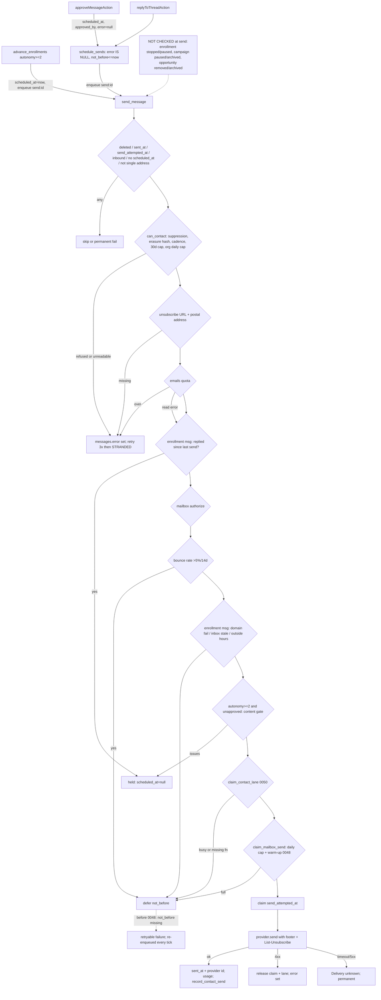

# Pass 16 — Reviewer D: jobs, outreach, money

status: complete

Audited commit: `7e09759` (`feat/pass-15-audit-fixes`). Read-only. DB state per lead: 0001–0047 applied, **0048/0049/0050 missing** in the configured Supabase project; production runs `8021d3f` (pre-pass-15).

Method: read every file on the §1 start paths end to end; resolved final SQL definitions across all migrations (`claim_job_executions`/`requeue_stalled_jobs` 0008; idempotency index 0008→0031; `can_contact`/`record_contact_send` 0017; `is_suppressed` 0008; `claim_mailbox_send` 0008→0048; `record_unsubscribe` 0008→0047; `check_quota_internal`/`increment_usage_internal` 0009; `usage_limit` 0007; `provider_budget_state` 0011→0033→0047; `reserve_provider_credit`, `claim_contact_lane` 0050). Ran one offline probe (scratch, outside the repo) against `sendMessage` with a scripted PostgREST fake copied from `packages/jobs/scripts/verify-jobs.ts:113-188` — results quoted in §3 and §7 as "PROBE-D". It proves code paths only, not Gmail/Graph or Postgres behaviour.

---

## 1. Job inventory

Defaults (all jobs unless stated): `max_attempts` 3 (`queue.ts:136`); backoff `min(attempts², 60)` min → +1, +4 min, then `failed` (`queue.ts:230-244`); no per-job timeout — only the invocation deadline (`maxDuration` 60 s, deadline −5 s, reserve 20 s: `apps/web/app/api/jobs/tick/route.ts:45,80`, `runner.ts:79,130`); a worker killed mid-job is recovered by `requeue_stalled_jobs` after 10 min (`0008_engine_columns.sql:338-356`). Idempotency index: `(job_name, idempotency_key, org_id) NULLS NOT DISTINCT WHERE status IN ('queued','running')` (`0031_tenant_write_hardening.sql:70-73`) — i.e. collapses only while queued/running.

Sweepers (org_id null, enqueued by `sweep()` on every tick, `maxAttempts: 1`, key = name or name:hour/day; `runner.ts:219-361`): `schedule_scans`, `schedule_syncs`, `schedule_sends`, `advance_enrollments`, `schedule_learning`(H), `schedule_discovery`, `enforce_retention`(D), `schedule_recomputes`, `schedule_signal_fetches`, `schedule_followups`, `send_notifications`, `send_digests`(H), `schedule_demand`(H), `schedule_preferences`(H).

| Job | Handler | Enqueuer (path:line) | Idempotency key | Side effects | Notes |
|---|---|---|---|---|---|
| schedule_sends | `handlers/schedule-sends.ts` | `runner.ts:359` | `schedule_sends` | enqueues send_message (≤50/tick, oldest approval first) | skips any message with `error` set (`:56`) — see OUT-202/203 |
| send_message | `handlers/send-message.ts` | `advance-enrollments.ts:350`, `schedule-sends.ts:83` | `send:<messageId>` | **outbound email** via Gmail/Graph; writes messages, message_events, threads, usage, contact_frequency, opportunities.status | at-most-once claim `send_attempted_at` (`:440-449`) |
| advance_enrollments | `handlers/advance-enrollments.ts` | `runner.ts:359` | `advance_enrollments` | AI draft (`runForOrg`), messages insert, enqueue send at autonomy ≥2 | **5 enrollments per tick, globally** (`:50`) |
| schedule_syncs | `schedule-syncs.ts` | sweep | `schedule_syncs` | enqueues sync_mailbox (`sync:<mbx>`, `:72-74`), check_mailbox_domain (`domain:<mbx>`, `:95-97`) | ≤50/tick |
| sync_mailbox | `sync-mailbox.ts` | `schedule-syncs.ts:72` | `sync:<mailboxId>` | reads inbox, stores inbound, AI classify, suppressions on bounce/unsubscribe, stops enrollments | |
| check_mailbox_domain | `check-mailbox-domain.ts` | `schedule-syncs.ts:95` | `domain:<mailboxId>` | DNS MX/SPF/DMARC/DKIM; writes `mailboxes.domain_*` (0048 columns — fails before 0048) | |
| schedule_scans / scan_source | `schedule-scans.ts` / `scan-source.ts` | sweep / `schedule-scans.ts:121`; UI via `sources.next_scan_at` (`lib/data/engine.ts:52-80`) | `scan:<sourceId>` | fetch pages, AI extract, enqueue score_opportunity, resolve_competitor_mentions | |
| research_company | `research-company.ts` | `discover-companies.ts:287`, `prospect-competitor-customers.ts:184`, `schedule-followups.ts:130,156` | **two spellings**: `research:<org>:<company>` vs `research:<company>` | AI + web fetch | JOB-205 |
| score_opportunity | `score-opportunity.ts` | scan-source:370, research-company:188, resolve-competitor-mentions:296, recompute-scores:124 | `score:<companyId>` | AI | |
| enrich_person | `enrich-person.ts` | `rank-contacts.ts:213` | `enrich:<personId>` | provider credits | |
| schedule_discovery / discover_companies | `schedule-discovery.ts` / `discover-companies.ts` | sweep / `schedule-discovery.ts:54` | `discover:<query>:<hour>` | provider credits; enqueues research/resolve/profile | ≤10/tick |
| enrich_company, rank_contacts, sync_hubspot, research_competitor, prospect_competitor_customers | respective handlers | `schedule-followups.ts:53,75,105,179,210` | `crm:`, `contacts:`, `enrich:`, `competitor:` … | provider credits / HubSpot writes / AI | |
| resolve_entity, profile_company | respective handlers | `discover-companies.ts:300,308`; 0050 trigger `enqueue_company_followups` (`0050…sql:~190-215`, **not live**) | `resolve:company:<id>`, `profile:<id>` | DB merge suggestions / homepage fetch | |
| resolve_competitor_mentions | handler | `scan-source.ts:382` | `competitors:<companyId>` | DB | |
| recompute_scores / schedule_recomputes | handlers | `schedule-recomputes.ts:50`, self-chain `recompute-scores.ts:169` | `recompute:<req>` / `recompute:<icp>:<last>` | enqueues score jobs | |
| schedule_signal_fetches / fetch_company_signals | handlers | sweep / `schedule-signal-fetches.ts:70` | `signals:<company>:<day>` | ATS fetches | ≤25/tick |
| schedule_learning / analyze_performance | handlers | sweep(H) / `schedule-learning.ts:148,214` | `learn:<org>:<isoWeek>`, `learn-run:<id>` (maxAttempts 1) | AI | |
| schedule_demand / cluster_demand | handlers | sweep(H) / `schedule-demand.ts:54` | `cluster_demand:<org>` | AI | |
| schedule_preferences / learn_preferences | handlers | sweep(H) / `schedule-preferences.ts:54` | `learn_preferences:<org>:<user>` | AI | |
| enforce_retention | handler | sweep(D) | `enforce_retention:<day>` | deletes stale contacts; calls `prune_job_executions` (0049, **not live** → error reported in result, `enforce-retention.ts:54`) | |
| send_notifications / send_digests | handlers | sweep / sweep(H) | `join-request:…`, `digest:<org>:<user>:<date>` | product email via Resend | |
| purge_contact_data | `purge-contact-data.ts` | **none** (only a test insert, `packages/db/scripts/verify-migrations.ts:3222`) | — | erasure | **orphan handler**, documented as "no producer by design" (`docs/security/outreach-compliance.md` Gaps table) |

Orphans: handler-without-enqueuer = `purge_contact_data` only (documented). Enqueuer-without-handler: impossible by type (`registry.ts:77` total map over the `JobName` union, `queue.ts:37-95`); legacy rows fail permanently (`runner.ts:153-158`). Sessions cannot insert jobs: `tenant_write` on `job_executions` dropped in `0031_tenant_write_hardening.sql:54-60` (read-only for members). The 0050 company trigger is the only SQL producer.

## 2. Queue mechanics

| Property | Implementation | Verdict |
|---|---|---|
| Claim | `claim_job_executions`: `UPDATE … WHERE id IN (SELECT … WHERE status='queued' AND run_at<=now() ORDER BY run_at LIMIT n FOR UPDATE SKIP LOCKED)`; increments attempts (`0008…sql:308-331`) | Correct for disjoint claims across workers. Execute revoked from anon/authenticated (`:363-380`). Tested only against fakes (`verify-jobs.ts`), no concurrent-claim test against Postgres. |
| Visibility timeout | `requeue_stalled_jobs('10 minutes')` at the start of every tick (`runner.ts:97`); exhausted → `failed` with "Abandoned" | OK. A job killed by the 60 s platform limit sits `running` ≥10 min and is charged an attempt. |
| Completion fencing | `succeed`/`markFailed` update by `id` only — no `status='running' AND locked_by=worker` guard (`queue.ts:199-209,233-245`) | LIKELY harmless today (60 s platform cap ≪ 10 min stall window, so no zombie can outlive its lease), but nothing enforces it — JOB-206 (P3). |
| Retries/backoff | +1, +4 min, then failed; `permanent` skips; thrown errors keep retries (`runner.ts:186-194`) | No jitter (fine at this scale). For send_message, retryable refusals that also write `messages.error` exhaust in ~5 min and strand the message — OUT-202. |
| Dead letter | `status='failed'` rows, `error` text; `/[org]/ops` board and `queue_pressure` view (0019). Pruned after 30 days by `prune_job_executions` (0049, not live). | No alert on failed-job growth; the only alert is tick.yml (non-200, or oldest due > 900 s). JOB-203. |
| Fairness | `ORDER BY run_at` globally; 0019 documents the starvation risk and explicitly defers round-robin (`0019_ops_views.sql:279-290`). Sweepers also pick globally oldest-first with small global caps (advance_enrollments 5/tick, schedule_sends 50/tick, schedule_syncs 50/tick). | **Not fair.** JOB-202. |
| Throughput | `TICK_DEFAULTS {limit 12, concurrency 4, batches 5}` → ≤60 jobs per tick (`runner.ts:63`); tick every 5 min from GitHub Actions → ≤720 jobs/h across all tenants, ~16 of each tick's slots go to sweepers. | Not measured. advance_enrollments ceiling = 60 enrollment-steps/hour platform-wide. |
| Tick chain | `.github/workflows/tick.yml` (cron `*/5`, `concurrency: engine-tick`, no cancel) → `GET ${HUNTLOOP_URL}/api/jobs/tick` with `Authorization: Bearer $CRON_SECRET` → `proxy.ts:107,143` lets it through without a session and while schema is not ready → route: no `CRON_SECRET` ⇒ 503 (`route.ts:48-58`); wrong bearer ⇒ 404 (`:61-67`, constant-time compare) → `sweep()` → `tick()`. `apps/web/vercel.json` has no `crons`. | Correct and fail-closed. Local demo 404 on GET (lead's observation) is the route's own wrong-bearer answer: `apps/web/.env.local` defines `CRON_SECRET`, the probe sent none. Prod `cronSecret:false` ⇒ prod tick answers 503 ⇒ nothing runs in prod (UNVERIFIED that the GH workflow is even configured — needs repo Settings). |
| Inngest | `/api/inngest`: 404 unless `INNGEST_EVENT_KEY`+`INNGEST_SIGNING_KEY`; hand-rolled HMAC (`route.ts:102-136`) and a hand-written GET "introspection" shape (`:78-93`); no SDK, no PUT/sync handler. | **Dead** (prod `inngest:false`). Whether a real Inngest app could register/sign against this hand-rolled protocol is UNVERIFIED (likely not: no PUT registration; HMAC key/ordering not checked against vendor docs). JOB-207 (P3). |
| Deadline | stops claiming new batches at deadline−reserve; un-started jobs in hand are `release`d without penalty (`runner.ts:130-136`, `queue.ts:258-270`) | JOB-010 fixed (`release` restores attempts). |
| Missed ticks | GitHub schedule is best-effort and pauses after 60 days of repo inactivity (tick.yml:23-25). Work is state-driven (`next_action_at`, `scheduled_at`, `not_before`), so missed ticks delay, never lose. Hourly/daily sweepers keyed by UTC hour/day: a missed hour is skipped, not caught up (by design, `runner.ts:279-283`). | OK. |
| Overlapping ticks | Workflow concurrency group serialises GH runs; a manual `workflow_dispatch` or a second driver (Inngest) overlapping is safe: claims are SKIP LOCKED, sweepers collapse on their key. | OK (code reading). |
| Heartbeat/observability | tick.yml fails on non-200 and on `oldestDueSeconds > 900`; `jq '.oldestDueSeconds // 0'` turns an unreadable probe (`null`) into 0 = green (`tick.yml:63`), contradicting `queue.ts:174-178` "a failed probe never reads as healthy". `/api/health` reports config booleans only — no queue lag, last tick, or failed-job count. `lastTickAt` reads the org's newest *created* job (`lib/data/engine.ts:239-250`), so any UI- or trigger-enqueued job reads as "driven". | JOB-203. Tick report body (first 2000 bytes, incl. `send_message` results `{to, from}`) is printed to the Actions log (`tick.yml:57`) — JOB-204. |

## 3. Send safety chain

Three producers of a sendable message (`scheduled_at` set): autonomy ≥2 drafting (`advance-enrollments.ts:288,349-356`), `approveMessageAction` (`apps/web/app/(app)/[org]/inbox/actions.ts:274-327`), `replyToThreadAction` (`:136-258`). One consumer: `send_message`. Every gate below is in `packages/jobs/src/handlers/send-message.ts` unless another file is named.

| # | Gate | Enforced where | Unreadable / missing-migration behaviour | Test |
|---|---|---|---|---|
| 1 | Already sent | `:69-73` (`sent_at`); `messages_sent_has_provider_id` CHECK (0004) | — | `verify-jobs.ts:1023-1080` |
| 2 | At-most-once claim | `:75-86` refuses a prior unfinished attempt; `:440-449` conditional update `send_attempted_at IS NULL` (column from 0033, applied) | closed | `verify-jobs.ts:1413-1488` |
| 3 | Human approval | `:92-104` `scheduled_at` required; set only by the three producers above (and DB-level by any member session through `tenant_write` on `messages`, i.e. still a member's act) | closed | `verify-jobs.ts:1023+` |
| 4 | Single recipient | `:113-117` `isSingleAddress` | closed | yes (section "checks that stop a second send") |
| 5 | Suppression (email + domain), erasure hash, unsubscribe | `can_contact` (`0017_outreach_safety.sql:116-221`) → `is_suppressed` (`0008…sql:261-275`), checked at `:130-159` | **closed** — `!verdict` refuses (PROBE-D D: `ok:false`, 0 provider sends) | `verify-jobs.ts:1150-1181`; SQL `verify-migrations.ts:2210-2262` |
| 6 | Cadence (min days), 30-day cap, org daily cap | `can_contact` (same) | closed | `verify-jobs.ts:1183-1269` |
| 7 | Unsubscribe link + one-click header | `:187-200` (token from `message_unsubscribe_tokens`, base `NEXT_PUBLIC_SITE_URL`); footer `:837-869`; header `:482` | closed | `verify-jobs.ts:1490-1532,1585-1654` |
| 8 | Postal address | `:217-229` (`settings.compliance.postalAddress`) | closed | `verify-jobs.ts:1534-1583` |
| 9 | Plan `emails` quota | `:251-267` `check_quota_internal` | **open** on RPC error (PROBE-D C: sent) — deliberate (`:245-250`) | `verify-jobs.ts:1656-1720` |
| 10 | Reply since last send (P0-2) | `:288-298` `repliedSinceLastSend` (`:640-681`), enrollment messages only | **open**: a failed read yields `[]` → "no reply" | `verify-jobs.ts:3748-3815` |
| 11 | Bounce/complaint stop | bounce: `sync-mailbox.ts:286-301` suppresses the thread's last recipient; `:333-343` pauses a mailbox >5 % bounces/14 d. Complaint: **no writer** of `complained` events anywhere (only enum/labels, `0004…sql:167`, `0037…sql:331`) | bounce suppression silently skipped when the DSN does not thread (`bouncedRecipient` needs `threadId`, `sync-mailbox.ts:401-412`); bounce-rate read errors → 0 → **open** | `verify-jobs.ts:3817-3850` |
| 12 | Mailbox connected | `mailbox/index.ts:72-161` `authorize`; `claim_mailbox_send` also requires `status='connected' AND deleted_at IS NULL` | closed | yes |
| 13 | Domain readiness (0048) | `:360-373`, enrollment messages only | **open before 0048**: select of `domain_status` errors, `data` null, gate skipped (PROBE-D A) | `verify-jobs.ts` (P1-4 section) with column present |
| 14 | Inbox freshness / business hours | `:375-383`; zone from company country, 08–18 Mon–Fri, Intl-based (DST-correct, `business-hours.ts`) | freshness closed (null → defer); hours **open** when country unknown/unmapped; US mapped to New York only (08:00 ET = 05:00 PT) | `verify-jobs.ts` business-hours section |
| 15 | Content gate (autonomy ≥2, unapproved) | `:396-408`, `gate.ts` | `autonomyFor` read failure → 0 → gate **skipped** (`:720-730`) | `verify-jobs.ts:3852+` |
| 16 | One in-flight send per address (0050) | `:415-423` `claim_contact_lane` | **closed**: RPC error → defer; before 0048 the defer itself fails → retryable failure (PROBE-D B: `ok:false`, 0 sends). Net effect in the configured DB: **no enrollment or reply message can ever send** until 0050 is applied | `verify-jobs.ts:1271-1290` (unreadable lane case) |
| 17 | Daily cap | `claim_mailbox_send` (0008 version live) | closed | `verify-jobs.ts:1292-1340` |
| 18 | Warm-up ramp (0048) | `mailbox_daily_cap` inside `claim_mailbox_send` (`0048…sql:51-106`); `pickMailbox` mirrors it (`mailbox/index.ts:186-224`) | **open before 0048**: live `claim_mailbox_send` is the 0008 version (`daily_limit` only); new mailboxes have `warmup_started_at` NULL (default `now()` is set by 0048) ⇒ full `daily_limit` from day one | SQL tests in `verify-migrations.ts` (PGlite, column present) |
| 19 | Removed company / opportunity | 0049 triggers `stop_outreach_for_deleted_opportunity`, `propagate_company_removal` (`0049…sql`) — **not live**; `advance-enrollments.ts:152-159` backstop stops the *enrollment* only | **open before 0049** for any message already approved/deferred; `send_message` reads no opportunity/company state (PROBE-D A: sent with opportunity `deleted_at` set) | migration tests for 0049 (PGlite); none at send |
| 20 | Enrollment stopped/paused, campaign paused/archived, opportunity archived/"not a fit" | **nowhere at send time**. `setEnrollmentStatusAction` (`outreach/actions.ts:364-389`), `deleteCampaignAction` (`:110-133`), AI-009 stop (`sync-mailbox.ts:131-145`) and `record_unsubscribe` (0047) change the enrollment only; none touch the enrollment's approved/deferred messages | **open** (PROBE-D A: enrollment `stopped`, campaign `archived` → sent) | none — OUT-201 |
| 21 | Reply detection stopping sequences | `advance-enrollments.ts:143-146` (opportunity status), AI-009 (`sync-mailbox.ts:131-145`), send-time `repliedSinceLastSend` | see #10 | `verify-jobs.ts:3748+` |

Unsubscribe path: footer GET `/unsubscribe/<token>` → confirmation page → POST; header one-click `POST /api/unsubscribe/<token>` (`apps/web/app/api/unsubscribe/[token]/route.ts:44-82`), public in `proxy.ts:71-72`, uuid-validated, 503 without DB, 404 on unknown token → `record_unsubscribe` (`0047_security_leads.sql:509-559`): org-scoped suppression (lower-cased), one `unsubscribed` event, stops every **active** enrollment for that address in the org. Paused/parked enrollments are not stopped, but `can_contact` still blocks any send to the suppressed address. Reply opt-out ("unsubscribe", "remove me" …) is rule-based (`mailbox/preclassify.ts:37-55`) and suppresses `from` (lower-cased by `addressOf`, `provider.ts:207-211`). Tests: `verify-migrations.ts:909-942` (SQL), `verify-jobs.ts` preclassify section. Not run end to end against a real inbox.

Partial failure (send → record):
- Crash after provider accept, before `sent_at`: `send_attempted_at` stays set; any rerun stops at "Delivery unknown" (`:75-86`) → **no duplicate send** (CONFIRMED by code + `verify-jobs.ts:1413-1440`). But the message keeps `error = NULL`, so `schedule_sends` re-enqueues it **every tick forever**, each run failing permanently, and nothing on the message tells the user to check the Sent folder (only the job row does). No reconciler. OUT-203.
- Record update fails after accept (`:498-510`): event `delivered` written, job permanent-fails, message unchanged → same re-enqueue loop.
- Ambiguous provider error (timeout/5xx/no id): `error` = "Delivery unknown — check the Sent folder" (`:571-580`) → not re-swept. Correct.
- Definite 4xx: claim and lane released, `error` set, job retried by its own retry only (`schedule_sends` skips rows with `error`).

## 4. State machines

None of these status columns has a CHECK constraint or transition trigger (`0004_outreach_memory_learning.sql:33,46,88,323` are plain `text` with defaults; no later `*_status_check` for enrollments/campaigns/mailboxes/job_executions). Every transition below is app-code only, and any member session may write `enrollments`/`campaigns`/`messages` directly through `tenant_write` (`0004…sql:337-356`, not dropped for these tables in 0031).

**Message (outbound)** — derived from columns, not a status field.

| State | Columns | Entered by | Exits |
|---|---|---|---|
| draft | `scheduled_at` null, `sent_at` null | advance_enrollments autonomy 0–1 | approve → approved; reject/redraft → soft-deleted (`inbox/actions.ts:431-560`) |
| approved/due | `scheduled_at` set, `error` null | approve, reply, autonomy ≥2 | send_message |
| deferred | + `not_before` (0048), `wait_reason` (0050) | `defer()` `send-message.ts:609-622` | schedule_sends after `not_before`. **Before 0048: no deferred state** — becomes a retryable failure and is re-enqueued every tick |
| held | `scheduled_at` null, `error` set | reply-pending (`:294`), content gate (`:404`), 0049 opportunity trigger | approve (clears `error`) |
| refused-stranded | `scheduled_at` set, `error` set, `sent_at` null | can_contact refusal / unreadable, no unsubscribe URL, no postal address, over quota, 4xx refusal | **none in-app**: `schedule_sends` skips `error IS NOT NULL` (`schedule-sends.ts:56`), `approveMessageAction` refuses `scheduled_at IS NOT NULL` (`inbox/actions.ts:294,321`). Exit = manual SQL. OUT-202 |
| claimed | `send_attempted_at` set | `:440-449` | sent; or "delivery unknown" (terminal for automation) |
| claimed-orphan | `send_attempted_at` set, `error` null, `sent_at` null | crash between claim and record | none; re-enqueued and permanently failed every tick. OUT-203 |
| sent | `sent_at` + `provider_message_id` (CHECK) | `:487-496` | terminal |

**Enrollment** — `active | parked | paused | stopped` (no writer sets `paused` in the code read; accepted as a source state by `setEnrollmentStatusAction`). active → parked (campaign not active, no recipient, exception); active → stopped (replied, removed, archived, finished, suppressed, unsubscribe via `record_unsubscribe`, AI-009, user Stop); parked/paused → active (user Resume). Terminal: stopped (Resume refuses it, `outreach/actions.ts:383`). Stuck: parked with `next_action_at` null waits for a person (by design). **Stopping does not cancel the enrollment's approved/deferred messages** (OUT-201).

**Campaign** — `draft | active | paused | archived`; create forces `draft`, autonomy 0 (`outreach/actions.ts:96`); any member may set any status and autonomy 0–5 through `saveCampaignAction` (`:41-90`, `mutate` default minRole member). Archive = soft delete + `archived`. Pausing/archiving parks enrollments at their next step but does not unschedule approved messages.

**Sequence / steps** — no status; steps soft-deleted; `unique (org_id, sequence_id, position)`; one message per (enrollment, step) (`0035`, index at `0035…sql:17`).

**Mailbox** — `connected | disconnected` + `deleted_at`. connect/reconnect = upsert on `(org_id,email)` restoring `deleted_at=null` (`api/mailboxes/[provider]/callback/route.ts:141-163`); user disconnect wipes tokens + soft-deletes (`outreach/actions.ts:273-305`); revoked grant (400/401) → disconnected (`mailbox/index.ts:128-136`); transient refresh error → `last_error` only (OUT-012 fixed). Reconnect does not restart warm-up.

**Job** — `queued → running → succeeded | queued(retry) | failed`; `running → queued/failed` via stall requeue; `queued → cancelled` by admin (`0019…sql:~265-276`); `running → queued` via `release`. Terminal: succeeded, failed, cancelled. Pruned after 30 d by 0049 (not live).

## 5. Compliance-doc claim table (`docs/security/outreach-compliance.md`)

| Claim | Verdict | Evidence |
|---|---|---|
| "Every control here is enforced at the database, not in the sending handler" | **False** | Postal address, unsubscribe-URL, quota, reply-pending, bounce pause, domain, business hours, content gate are all handler code (`send-message.ts:187-408`); only `can_contact`, `claim_mailbox_send`, CHECK on sent are DB |
| Four frequency policies incl. `max_contacts_per_company` (default 3) "stops the email-nine-people pattern"; flowchart "company saturated → Refused" | **False for `max_contacts_per_company`** | Column exists (`0017…sql:92-93`); no reader anywhere (grep: only the migration). `can_contact` has no company check (`0017…sql:116-221`). OUT-204 |
| `min_days_between_contacts`, `max_sends_per_contact_30d`, `max_sends_per_day` | True | `can_contact` `0017…sql:160-210`; test `verify-jobs.ts:1183+`, `verify-migrations.ts:2210+` |
| `can_contact` "called by every send path" | True (one send path) | `send-message.ts:130` is the only sender |
| `record_contact_send` after provider accepts | True | `send-message.ts:540-543` |
| Sent requires provider id (CHECK) | True | `messages_sent_has_provider_id` (0004) |
| "Same message never sent twice; `sent_at` is the proof" | True, stronger now | plus `send_attempted_at` claim (0033) |
| Mailbox cannot exceed daily allowance (atomic) | True | `claim_mailbox_send` conditional UPDATE |
| No send at autonomy 0–1 without approval | True as stated (`scheduled_at` required); note approval is "any member" and `scheduled_at` is member-writable via `tenant_write` | `send-message.ts:92-104` |
| List-Unsubscribe + One-Click + footer on every message | True when `NEXT_PUBLIC_SITE_URL` set; send refuses otherwise | `send-message.ts:193-200,456-482`; `provider.ts` buildMime (headers) — prod `siteUrl` is the apex that fails TLS (lead fact), so prod links would be dead if prod sent |
| POST acts, GET does not; no session | True | `api/unsubscribe/[token]/route.ts:44-96`; `proxy.ts:71-72` |
| Suppression survives erasure | True | `can_contact` checks `value_hash` (`0017…sql:~140-147`) |
| `erase_contact` admin-gated | True | `erase_contact_for_org` `0017…sql:~490-500` |
| Retention daily, NULL default, `prune_stale_contacts` spares messaged contacts | Plausible; not audited here (lifecycle reviewer) | `runner.ts:306` daily key |
| No way to enrol and raise autonomy in one call; create accepts no autonomy | True | `outreach/actions.ts:96`; enrol action inserts enrollments only (`opportunities/actions.ts:171-183`) |
| `emails` plan limit ✅ checked before every send | True, **fails open** on read error | `send-message.ts:251-267`; PROBE-D C |
| `purge_contact_data` has no producer by design | True | §1 |
| Removed or merged companies ✅ 0049 stops sequences and unschedules mail | **Fixed in repo, not live** (0049 missing in configured DB); also covers opportunity soft-delete only, not stop/pause/archive | §3 #19–20 |
| "No deliverability tooling (warm-up, rotation, seed lists)" | **Stale** | warm-up ramp (0048) and multi-mailbox spreading (`pickMailbox`) exist |
| Lawful basis / DPAs / CAN-SPAM content | Doc says open; agree | No consent/lawful-basis column anywhere; no region rules in code |
| Bounces "stop every future send to it, across every campaign" (code comment `sync-mailbox.ts:284-285`) | Partly | Only when the DSN threads to our message; complaints never recorded |

## 6. Money

**Billing: `Missing`.** No Stripe/Razorpay/Paddle/checkout/webhook code anywhere (grep over `packages/`, `apps/web/app`, `apps/web/lib`; hits are only schema/scripts/comments). Schema stubs exist since `0001_identity.sql:48-77`: `plans`, `subscriptions` (`stripe_sub_id`, unused), `usage_counters`. `STRIPE_*` env vars are declared and read by nothing (docs agree: `docs/product/plans-and-quotas.md` "There is no payment path at all"; `docs/status/roadmap.md:92` lists "Decide Stripe" as an open decision). Intent is undecided, so no billing design is proposed here.

**Plan assignment is manual SQL.** `organizations.plan_id` defaults to `free` (`0007_profiles_invites_accounting.sql:375-377`); no application code writes `plan_id` (grep: only reads in `lib/data/organization.ts:49,70`). The seeded Free plan has `emails: 0` (`0007…sql:370-373`), and `send_message` enforces it (`send-message.ts:251-267`, `check_quota_internal` `0009…sql:54-71`: `0 < 0` is false). Consequence: every self-serve workspace's outreach is refused until an operator edits `plan_id` or `usage_counters."limit"` in SQL, and each refused message is stranded (OUT-202). MONEY-201.

**Substitutes audited:**

| Control | Where | Atomic with spend? | Fails | Live in configured DB? |
|---|---|---|---|---|
| Plan quotas (`opportunities`, `ai_runs`, `emails`, `enrich`, `seats`) | `usage_limit` (0007), `check_quota_internal`/`increment_usage_internal` (0009) | No — check-then-act; increment after success | open on read error (`ai.ts:127-131`, `send-message.ts:259`) | yes |
| AI monthly quota | `packages/jobs/src/ai.ts:122-183` | No; counts **successful** runs only; failed-but-billed runs are never counted (`:115-120`), so a task that keeps failing has no quota ceiling — only retry/sweeper caps | open | yes |
| AI per-request rate limits (request path) | `apps/web/lib/rate-limit.ts:122-154` per user + per org per hour, consumed via `consume_rate_limit` (0005) | yes (DB counter) | open when the table is missing (`:182`) | yes |
| Provider budget per org per provider | `provider_budget_state` (final 0047: account cap may only lower the plan's `enrich`) | **Before 0050 no**: `reserveCredit` falls back to `budgetAllows` (check-then-call) (`packages/providers/src/budget.ts:89-100`); with 0050, advisory-locked reserve | open on read error (`budget.ts:47-49`) | reserve **not live** (0050) |
| Per-mailbox daily cap | `claim_mailbox_send` | yes | closed | yes (warm-up part not live) |
| Org daily send ceiling | `organizations.max_sends_per_day` (default NULL = none) via `can_contact` | No (counts sent rows) | closed | yes |
| Queue load per org | none — no per-org job cap; `job_executions` unbounded per org; fairness absent | — | — | — |
| Global kill switch | **none** in code or runbooks (grep "kill switch", "pause engine", "disable send" → nothing; `docs/operations/*` has no stop-sending procedure). De-facto levers: unset `CRON_SECRET` (tick 503s), disable the GitHub workflow, disconnect mailboxes per org | — | — | — |
| Platform-wide $ ceiling on shared Anthropic / provider keys | none; all caps are per-org counts, not currency | — | — | — |

Can one org drive unbounded spend? Provider credits: bounded per org per provider per month by the Free/Growth/Scale `enrich` figure (25/1000/10000) — per provider, so the effective ceiling is that × number of providers; before 0050 concurrent lanes can overshoot by up to the tick concurrency (4) per race. AI: bounded by the `ai_runs` count for successful runs; failed runs and token-heavy runs (web_fetch continuations) are uncapped in currency. Request-path AI is rate-limited per hour. I found no loop that re-enqueues paid work without a staleness guard in the jobs I read (each scheduler sets a marker or uses period keys), but the quota-fails-open + count-not-cost design means "bounded" depends on the counters being readable. MONEY-202 (P2). Not P0: every paid path has a per-org ceiling when the DB is healthy.

## 7. Findings

Severity counts: P0 0 · P1 4 · P2 9 · P3 4 (17 total). No URGENT item (no secret, no tenant break, no send-after-unsubscribe found).

Disprove notes for P1s are inline. No P0 survived: I looked specifically for send-after-unsubscribe/suppression (blocked by `can_contact`, fail-closed, re-checked at send; PROBE-D D), duplicate send after crash (blocked by `send_attempted_at`), and unbounded spend (every paid path has a per-org ceiling when the DB is readable).

### [P1] OUT-201: Stopping a sequence, pausing/archiving a campaign or closing an opportunity does not stop its approved or deferred emails
- Confidence: CONFIRMED (code + PROBE-D A: enrollment `stopped`, campaign `archived`, opportunity `deleted_at` set → `ok:true`, provider `send` called once; handler made no read of enrollment or campaign status)
- Where: `packages/jobs/src/handlers/send-message.ts:48-583` (reads only `messages`, tokens, org settings, mailbox, opportunity country, campaign autonomy); `apps/web/app/(app)/[org]/outreach/actions.ts:364-389` (`setEnrollmentStatusAction` → `stopped`, messages untouched), `:110-133` (`deleteCampaignAction`); `packages/jobs/src/handlers/sync-mailbox.ts:131-145` (AI-009 stop); `record_unsubscribe` `0047_security_leads.sql:543-556`; `schedule-sends.ts:50-69` (sweeps by message columns only)
- Evidence: `scheduled_at` is the only "go" signal; nothing clears it when the enrollment/campaign/opportunity changes, except 0049's opportunity soft-delete trigger, which is not applied and does not cover stop/pause/archive/"not a fit".
- Trace/repro: autonomy-2 campaign drafts step → `scheduled_at=now`, enqueued (`advance-enrollments.ts:288,349`) → send defers (outside business hours, daily cap → next UTC midnight, bounce pause 6 h, inbox stale 15 min) → user presses Stop ("Stopped.") or pauses the campaign → `schedule_sends` re-enqueues after `not_before` → sent. Same at autonomy 0–1 for any approved-but-not-yet-sent message.
- Impact: email sent after the operator withdrew it (legal/reputational; the lead may reasonably rate this P0 under "sent without consent"). Unsubscribe itself is still honoured (suppression is checked at send), so the recipient's opt-out is not bypassed.
- Root cause: send eligibility is a property of the message row alone; parent state is never consulted at send time and stopping a parent does not propagate to children.
- Fix: in `send_message`, after the `scheduled_at` check, when `enrollment_id` is set, read enrollment status + campaign status + opportunity `deleted_at/status` and refuse (hold: `scheduled_at=null`, reason) unless enrollment `active`, campaign `active`, opportunity live and not archived. Also unschedule unsent messages in `setEnrollmentStatusAction(stopped)`, `deleteCampaignAction`, and in 0049's trigger for status changes. Touches `send-message.ts`, `outreach/actions.ts`, a new trigger or the 0049 function.
- Acceptance criteria: stopping an enrollment, pausing/archiving its campaign, or archiving/removing its opportunity leaves no message of that enrollment with `scheduled_at` set and unsent; a send job for such a message ends without calling the provider.
- Test to add: `packages/jobs/scripts/verify-jobs.ts` — "send_message holds a message whose enrollment is stopped / campaign paused / opportunity archived" (three cases, assert no `gmail.send`).
- Effort: S · Depends on: — · Mechanizable: yes (test)
- Status vs last pass: New (extends SEC-101/FLOW-101, whose fix covers opportunity soft-delete only)

### [P1] OUT-202: A retryable send refusal strands the message permanently; the UI says it "stays queued"
- Confidence: CONFIRMED (code)
- Where: `send-message.ts:146-158` (can_contact `too_soon`/`frequency_cap`/`org_daily_cap`/`unavailable`), `:197-199` (no unsubscribe URL), `:226-228` (no postal address), `:260-266` (over email quota; copy "stays queued and sends when the allowance resets, or when the plan changes"), `:571-576` (4xx refusal); `schedule-sends.ts:56` (`.is("error", null)`); `apps/web/app/(app)/[org]/inbox/actions.ts:294,321` (approve refuses when `scheduled_at` is set)
- Evidence: each branch writes `messages.error` and returns a retryable failure; the job's own 3 attempts run at +1/+4 min and exhaust within ~5 min; afterwards `schedule_sends` never selects the row and no action can re-approve it.
- Trace/repro: Free-plan workspace approves a draft → quota 0 → `error` set → job fails ×3 → message never sends even after `plan_id` is changed; or a 2-day cadence `too_soon` refusal → stranded although the cadence clears in 2 days.
- Impact: approved outreach silently never leaves; the copy promises the opposite. With MONEY-201 this is every message of every self-serve workspace. Retry guarantee on a send path is missing (P1 per §9).
- Root cause: `messages.error` doubles as "permanent, do not sweep" and as a display reason for transient refusals.
- Fix: for transient refusals use `defer()` (set `not_before` + `wait_reason`, leave `error` null) with a sensible horizon (cadence → `lastSentAt + minDays`; daily cap → next UTC day; quota → first of next month / plan change; config → 1 h); reserve `error` for permanent outcomes. Or add an in-app "Retry" that clears `error` for unsent, unclaimed messages.
- Acceptance criteria: after the blocking condition clears, the message sends without manual SQL; the inbox shows the wait reason meanwhile.
- Test to add: `verify-jobs.ts` — "a `too_soon` refusal defers to lastSentAt+minDays and leaves `error` null"; "over-quota defers, not errors".
- Effort: S · Depends on: 0048 (`not_before`) applied · Mechanizable: yes (test)
- Status vs last pass: New (DB-101 fixed the same defect for the mailbox cap only)

### [P1] OUT-205: HEAD's send path and inbox depend on 0048–0050, nothing detects that they are missing, and the gates that depend on them fail open
- Confidence: CONFIRMED (code + PROBE-D A/B); inbox throw LIKELY (not run)
- Where: `send-message.ts:415-423` (`claim_contact_lane`, 0050), `:609-621` (`not_before` 0048, `wait_reason` 0050), `:361-373` (`domain_status` 0048); `claim_mailbox_send` live version `0008…sql:144-164` (no warm-up); 0049 triggers absent; `apps/web/lib/data/inbox.ts:79-91` selects `not_before, wait_reason` and throws on error; `apps/web/lib/schema.ts:38` `LATEST_TABLE = "message_unsubscribe_tokens"` (0047) so `proxy.ts` treats a 0047 DB as "complete"
- Evidence: PROBE-D B with the lane RPC and `not_before` missing → `{"ok":false,"error":"Another message to this address is being sent."}`, 0 sends; with `not_before` missing `schedule_sends` falls back to the un-deferred query (`schedule-sends.ts:72-74`) and re-enqueues the message every tick.
- Trace/repro: deploy `7e09759` against the configured DB (0047) → every send_message for any message fails closed forever (queue churn: one job per due message per tick, 3 attempts each); meanwhile warm-up (gate 18), domain readiness (13) and removed-company propagation (19) are silently absent; Inbox loader errors.
- Impact: Reach Out stage dead on that combination; no false send (fails closed), but nothing tells an operator why; deploy order is the only protection. Production today runs `8021d3f`, so this is the next deploy's risk.
- Root cause: code and migrations shipped together with no applied-migration gate, and the schema probe's "latest" marker was not advanced.
- Fix: bump `LATEST_TABLE` (or probe `migration_0050_applied()`) so production serves the not-ready page and the tick refuses until migrated; or make `send_message` check `migration_0050_applied` once per tick and skip with a clear job error. Apply 0048–0050 before the next deploy (runbook step).
- Acceptance criteria: against a 0047 DB, `/api/health` and the tick report "migrations pending" and no send job is enqueued; against a 0050 DB the probe reads complete.
- Test to add: `apps/web` schema test — "LATEST_TABLE / probe tracks the newest migration file" (mechanical: compare against `packages/db/migrations` max).
- Effort: S · Depends on: — · Mechanizable: yes (`scripts/audit.mjs`: latest migration referenced by schema probe)
- Status vs last pass: New

### [P1] MONEY-201: No billing and no in-app plan change; the default Free plan's `emails: 0` blocks all outreach until an operator edits SQL
- Confidence: CONFIRMED (code)
- Where: `0007_profiles_invites_accounting.sql:370-377` (plans seed, default `free`); no writer of `organizations.plan_id` in app code; `send-message.ts:251-267`; `0009_service_role_surface.sql:54-71`
- Evidence: `check_quota_internal(org,'emails')` → `allowed = 0 < 0 = false` for every Free org; refusal strands the message (OUT-202).
- Trace/repro: sign up → connect mailbox → enrol → approve → "Not sent: this workspace has used 0 of its 0 emails this month" → stranded.
- Impact: Reach Out unusable for self-serve workspaces; plan changes are a manual-operations item (`update organizations set plan_id=…` or `usage_counters."limit"`).
- Root cause: quotas enforce a commercial model whose purchase path does not exist (`docs/status/roadmap.md:92` open decision).
- Fix: product decision first (docs already ask it). Smallest code-side mitigation: an operator-only path (service-role script or admin action) to set `plan_id`, and outreach UI that states the Free plan sends nothing before a user approves.
- Acceptance criteria: an operator can change a workspace's plan without SQL; a Free workspace sees "your plan includes no emails" before approving.
- Test to add: `verify-jobs.ts` — "Free plan send is refused with the plan reason and is re-attempted after the plan changes" (with OUT-202 fix).
- Effort: S (mitigation) / L (billing) · Depends on: decision #1 · Mechanizable: no
- Status vs last pass: Still open (docs: billing missing; pass-15 did not file it as a finding)

### [P2] OUT-203: A send that crashed after its claim is re-enqueued every tick forever and never shows "delivery unknown" to the user
- Confidence: CONFIRMED (code)
- Where: `send-message.ts:75-86` (permanent fail, writes nothing to the message), `:498-510` (record failure, writes nothing); `schedule-sends.ts:50-59` (no `send_attempted_at` filter)
- Impact: no duplicate send (good), but one failing job per orphan per tick indefinitely; the person never learns the email may have gone.
- Root cause: the orphan state (`send_attempted_at` set, `error` null) is neither excluded from the sweep nor surfaced.
- Fix: in the `:75` branch write `error = "Delivery unknown — check the Sent folder"` (best effort); add `.is("send_attempted_at", null)` to `schedule_sends`.
- Acceptance criteria: an orphan produces exactly one failed job and a visible message error.
- Test to add: `verify-jobs.ts` — "a claimed, unrecorded message is not re-swept and carries a delivery-unknown error".
- Effort: S · Mechanizable: yes · Status vs last pass: New

### [P2] OUT-204: `max_contacts_per_company` is documented and enforced nowhere
- Confidence: CONFIRMED (grep: only `0017_outreach_safety.sql:92-93`)
- Where: `docs/security/outreach-compliance.md` (policy table and flowchart "company saturated → Refused"); `can_contact` `0017…sql:116-221`
- Impact: the "email nine people at once" protection the doc promises does not exist; in practice bounded only because an enrollment targets one recipient per opportunity, but one company can be in several campaigns/opportunities.
- Root cause: column added without a reader.
- Fix: count distinct active-enrollment recipients at the company in `can_contact` (or in `advanceOne` before drafting), or delete the column and the doc claim.
- Acceptance criteria: a fourth concurrent sequence at one company is refused with reason `company_cap`.
- Test to add: `verify-migrations.ts` — "can_contact refuses beyond max_contacts_per_company".
- Effort: S · Mechanizable: yes · Status vs last pass: New

### [P2] OUT-206: Several send gates fail open when their read fails
- Confidence: CONFIRMED (code; quota and domain via PROBE-D A/C)
- Where: reply-pending `send-message.ts:648-667` (errors → `[]` → "no reply"); bounce rate `:691-717` (errors → 0); content-gate autonomy `:720-730` (error → 0 → gate skipped for an unapproved autonomous draft); domain `:361-366`; quota `:259` (deliberate)
- Impact: a transient DB error lets a sequence step land on top of an unread reply, or an unreviewed autonomous draft skip its content check.
- Root cause: `rows()`/`?? 0` defaults treat "could not read" as "nothing found".
- Fix: check `error` on each of those reads and `defer()` (15 min) instead of proceeding; keep quota fail-open if that is policy.
- Acceptance criteria: each read error yields a deferral, not a send.
- Test to add: `verify-jobs.ts` — "reply/bounce/autonomy read errors defer".
- Effort: S · Mechanizable: yes · Status vs last pass: New

### [P2] OUT-207: No emergency stop for sending (per org or global) and no runbook
- Confidence: CONFIRMED (grep code and `docs/operations/*`)
- Impact: stopping a bad batch means unsetting `CRON_SECRET` (stops all engine work) or disconnecting mailboxes one by one; campaign pause does not stop approved mail (OUT-201).
- Fix: an org-level `outreach_paused` (and a global env flag) checked first in `send_message`; a runbook section.
- Acceptance criteria: flipping the flag makes the next tick send nothing, with a clear job result.
- Test to add: `verify-jobs.ts` — "paused org sends nothing". · Effort: S · Mechanizable: yes · Status: New

### [P2] OUT-208: Complaints are never recorded and bounce suppression depends on the DSN threading
- Confidence: CONFIRMED (code)
- Where: no writer of `message_events.kind='complained'` (`0004…sql:167` enum only); `sync-mailbox.ts:286-301,401-412` (`bouncedRecipient` returns null without `threadId`)
- Impact: a bounce notice that arrives as a new thread suppresses nothing; the address is mailed again until the mailbox-level 5 % pause trips.
- Fix: fall back to parsing the DSN's `Final-Recipient`/`Original-Recipient` (or the original Message-ID in the body) when unthreaded.
- Test to add: `verify-jobs.ts` — "unthreaded DSN suppresses the failed recipient". · Effort: M · Mechanizable: yes · Status: New

### [P2] JOB-202: No per-tenant fairness; global sweeper caps let one org starve all others
- Confidence: CONFIRMED (code); impact not measured
- Where: `claim_job_executions` `ORDER BY run_at` (`0008…sql:325-327`; risk acknowledged and deferred at `0019_ops_views.sql:279-290`); `advance-enrollments.ts:50,63-71` (5 enrollments per tick, oldest first, all orgs); `schedule-sends.ts:43,69` (50); `schedule-syncs.ts:34`
- Impact: one org with a large backlog (import, discovery fan-out, 0050's per-company trigger) delays every other tenant's sends/syncs/sequence steps by hours. advance_enrollments ceiling is ~60 steps/hour platform-wide at a 5-minute tick.
- Root cause: oldest-first global ordering with small global limits.
- Fix: round-robin by org in `claim_job_executions` (e.g. `row_number() over (partition by org_id order by run_at)` then order by that rank) and the same in the three sweepers.
- Acceptance criteria: with org A holding 1,000 due jobs and org B 1, B's job is claimed in the first batch.
- Test to add: `packages/db/scripts/verify-migrations.ts` — "claim interleaves orgs". · Effort: M · Mechanizable: yes · Status: Still open (0019 note; pass-15 not filed)

### [P2] JOB-203: Failed ticks are alerted, failed jobs and an unreadable lag are not
- Confidence: CONFIRMED (code)
- Where: `.github/workflows/tick.yml:63` (`jq '.oldestDueSeconds // 0'` turns `null` into green, against `queue.ts:174-178`); `apps/web/app/api/health/route.ts` (config booleans only, no lag/last tick/failed count); `apps/web/lib/data/engine.ts:239-250` (`lastTickAt` = newest job *created*)
- Impact: dead-letter growth, a broken lag probe, or a queue that only receives UI-enqueued jobs all look healthy.
- Fix: treat `null` lag as failure in tick.yml; add `failed` count (last hour) and lag to the tick report and fail the workflow above a threshold; `lastTickAt` from `max(started_at)`.
- Test to add: workflow lint or a unit test on the jq expression. · Effort: S · Mechanizable: yes · Status: New

### [P2] JOB-204: Tick reports with recipient addresses are printed into GitHub Actions logs
- Confidence: LIKELY (repo visibility UNVERIFIED — check repo Settings → General)
- Where: `tick.yml:57` (`head -c 2000 body.json`); `runner.ts:181` (`detail: JSON.stringify(outcome.result)`); `send-message.ts:552-559` (`{to, from, …}`)
- Impact: prospect email addresses (personal data) retained in CI logs (90 days default), readable by anyone with repo read access — public if the repo is public.
- Fix: print counts only (`claimed/succeeded/failed/oldestDueSeconds`), e.g. `jq '{claimed,succeeded,failed,oldestDueSeconds}'`.
- Test to add: none (workflow) — mechanizable grep. · Effort: S · Mechanizable: yes (check tick.yml never prints `.jobs`) · Status: New

### [P2] MONEY-202: Spend ceilings are counts, fail open, and are not atomic in the configured DB
- Confidence: CONFIRMED (code)
- Where: `packages/jobs/src/ai.ts:115-131,170-183` (only successful runs counted; read error → allowed); `packages/providers/src/budget.ts:47-49,89-100` (fail-open; reserve falls back to check-then-call before 0050); no global/platform ceiling
- Impact: failed-but-billed model calls and token-heavy runs are uncapped in money; concurrent lanes can overshoot provider budgets until 0050 lands; a counter outage removes every ceiling.
- Fix: count every billed run (or tokens/cost) against the AI quota; apply 0050; add an env-level platform daily ceiling checked in `runForOrg` and `callProvider`.
- Test to add: `verify-jobs.ts` — "a failed run consumes AI quota". · Effort: M · Depends on: 0050 · Mechanizable: partly · Status: Still open (PROV-015 fixed in repo, not live)

### [P3] OUT-209: Business-hours window is skipped for unknown countries and uses one zone per country
- Where: `send-message.ts:380-383`; `business-hours.ts` (`us` → `America/New_York`, `au` → Sydney…) · CONFIRMED · Impact: 05:00 sends on the US west coast, any-hour sends where country is unknown. Fix: fall back to the mailbox owner's zone; per-state zones when available. Test: business-hours unit. Effort S · New

### [P3] JOB-205: `research_company` is enqueued under two key spellings, so the same company can be researched twice
- Where: `discover-companies.ts:291`, `prospect-competitor-customers.ts:186` (`research:<org>:<company>`) vs `schedule-followups.ts:132,158` (`research:<company>`) · CONFIRMED · Impact: duplicate AI spend. Fix: one helper for the key. Mechanizable: yes (grep for `research:` keys) · Effort S · New

### [P3] JOB-206: Job completion is not fenced to the claiming worker
- Where: `queue.ts:199-209,233-245` (update by `id` only) · LIKELY harmless (60 s platform cap vs 10 min stall) · Fix: add `.eq("status","running").eq("locked_by", worker)`. Effort S · New

### [P3] JOB-207: The Inngest route is dead and its hand-rolled protocol is unverified
- Where: `apps/web/app/api/inngest/route.ts:44-136` (no PUT registration, custom GET shape, custom HMAC); prod `inngest:false` · UNVERIFIED against Inngest's current serve protocol (settle by registering against an Inngest dev server) · Fix: verify or delete; tick.yml is the real driver. Effort S · Still open (pass-15 JOB-012 note)

## 8. Feature status (§6 vocabulary)

| Feature | Status | Evidence / why not higher |
|---|---|---|
| Job queue (enqueue, claim, retry, stall requeue, release) | Implemented, unverified | Traced; `verify-jobs.ts` runs runner/queue against a scripted client (`:587` JOB-010 etc.), SQL claim tested in PGlite migrations suite; no concurrent-claim test against real Postgres; not run in prod (prod tick 503) |
| Tick driver (GitHub Actions → `/api/jobs/tick`) | Implemented, unverified | Route fail-closed verified by reading; whether the repo has `CRON_SECRET`/`HUNTLOOP_URL` set is UNVERIFIED; prod `cronSecret:false` ⇒ not running |
| Inngest driver | Dead (built, not connected) | 404 without keys; protocol unverified |
| Sweepers / periodic work | Implemented, unverified | — |
| Dead letter / ops visibility | Partial | failed rows + ops board; no alerting (JOB-203) |
| Per-tenant fairness | Missing, recommended | JOB-202 |
| Draft → approve → send | Partial | Works in fake-backed tests; stranding (OUT-202), parent-state gap (OUT-201); blocked by Free plan (MONEY-201); blocked entirely in configured DB at HEAD (OUT-205) |
| At-most-once send | Verified (code path, fakes) | `verify-jobs.ts:1413-1488`; not vendor-verified |
| Suppression / unsubscribe gate at send | Verified (code path) | `verify-jobs.ts:1150`, `verify-migrations.ts:909-942,2210-2262` |
| One-click unsubscribe endpoint | Implemented, unverified | route traced; no route test found; e2e `routing.spec.ts` mentions unsubscribe (demo mode) |
| Reply detection stops sequence | Implemented, unverified | AI-009 + send-time hold; fail-open on read error (OUT-206) |
| Bounce handling | Partial | threaded DSNs only (OUT-208) |
| Complaint handling | Missing, recommended | OUT-208 |
| Per-mailbox daily cap | Verified (code path) | `verify-jobs.ts:1292-1340` |
| Warm-up ramp | Implemented, unverified — not live | 0048 missing |
| Domain readiness check | Implemented, unverified — not live | 0048 missing |
| Per-address send lane | Implemented, unverified — not live (and blocks all sends while missing) | 0050 |
| Removed-company stop | Implemented, unverified — not live | 0049 |
| Stop/pause propagation to queued mail | Missing, recommended | OUT-201 |
| Business-hours window | Implemented, unverified | partial coverage (OUT-209) |
| `max_contacts_per_company` | Dead (built, not connected) | OUT-204 |
| Emergency stop | Missing, recommended | OUT-207 |
| Billing / payments / plan change | Missing (decision open, `docs/status/roadmap.md:92`) | MONEY-201 |
| Plan quotas | Implemented, unverified | fail-open, count-based (MONEY-202) |
| Provider budget (atomic reserve) | Implemented, unverified — not live | 0050 |
| AI request-path rate limits | Implemented, unverified | `lib/rate-limit.ts` |

## 9. Baseline diff (pass-15, my areas)

| Pass-15 ID | Now | Proof |
|---|---|---|
| PROD-001 (engine has no driver/keys) | Still open | lead: prod `cronSecret:false`, `inngest:false`; tick returns 503 without the secret (`tick/route.ts:48-58`) |
| SEC-101 / FLOW-101 (removal doesn't stop outreach) | Fixed in repo, not live; incomplete | 0049 triggers + `advance-enrollments.ts:152-155` backstop; 0049 missing; stop/pause/archive not covered → OUT-201 |
| AI-009 (failed classification never stops) | Fixed | `sync-mailbox.ts:131-145`; but queued mail of the stopped enrollment still sends (OUT-201) |
| DB-101 / OUT-010 (cap hit churns) | Fixed in repo, not live | `send-message.ts:426-434` defers to UTC midnight; `pickMailbox` uses `dailyCap` (`mailbox/index.ts:202-224`); `defer()` needs 0048 `not_before` — before it, retryable failure + every-tick re-enqueue |
| OUT-011 (approval can't release gate hold) | Fixed | `send-message.ts:396` `!message.approved_by` |
| OUT-012 (refresh failure disconnects) | Fixed | `mailbox/index.ts:124-136`, `isRevokedGrant`; test `verify-jobs.ts:1313-1318` |
| OUT-013 (can_contact→record not atomic) | Fixed in repo, not live | 0050 `claim_contact_lane`; while missing, sends fail closed (OUT-205) |
| OUT-014 (deferrals invisible) | Fixed in repo, not live | 0050 `wait_reason`, inbox reads it (`lib/data/inbox.ts:82`) — and that select breaks the inbox before 0050 |
| JOB-010 (deadline hand-back burns attempt) | Fixed | `runner.ts:130-136`, `queue.ts:258-270`; test `verify-jobs.ts:587` |
| JOB-011 / DB-104 (no prune, unindexed key) | Fixed in repo, not live | 0049 `prune_job_executions` + indexes; called from `enforce-retention.ts:54` (errors reported until 0049) |
| JOB-012 (tick ceiling; Inngest drift) | Fixed (ceiling); Inngest still dead | `runner.ts:63,99-107`; both routes use `TICK_DEFAULTS`; JOB-207 |
| PROV-015 (budget check-then-call) | Fixed in repo, not live | 0050 `reserve_provider_credit`; fallback `budget.ts:97-99` |
| SEC-103 (members rewrite send-safety columns) | Fixed in repo, not live | 0049 `guard_mailbox_safety` |
| SEC-102 (token ciphertext readable) | Fixed in repo, not live | 0049 column-level grant |
| DB-103 (UI shows daily_limit not cap) | Likely fixed, not re-verified | loaders now select `warmup_*` (`lib/data/dashboard.ts:318`, `outreach.ts:93`) |
| COMP-001 / MAP-101 (purge has no producer; doc stale) | Obsolete (accepted by design, doc updated) | compliance doc Gaps table |
| (not filed) billing missing | Still open → MONEY-201 | — |
| (0019 note) fairness | Still open → JOB-202 | — |

New this pass: OUT-201, OUT-202, OUT-203, OUT-204, OUT-205, OUT-206, OUT-207, OUT-208, OUT-209, JOB-203, JOB-204, JOB-205, JOB-206, MONEY-202 (and MONEY-201/JOB-202/JOB-207 as first filings of known gaps).

## 10. Checked, nothing found

- Send after unsubscribe/suppression: `can_contact` is the only gate, called on every send, fails closed on any unreadable verdict (PROBE-D D), lower-cases both sides (`0017…sql:124`, `0008…sql:271`; writers lower-case: `record_unsubscribe`, `addressOf`, bounce path). Erasure leaves a hash that still blocks (`0017…sql:~140`). Function execute revoked from anon/authenticated (`0017…sql:503-521`) — no cross-tenant probe of suppression state.
- Duplicate send on retry/crash/double click: `send:<id>` key collapses enqueues; `send_attempted_at` conditional claim (0033, applied) makes the provider call at-most-once; approve is conditional on `scheduled_at IS NULL` (double click safe); `unique (org_id, campaign_id, opportunity_id)` on enrollments and one message per (enrollment, step) (0035).
- Unsubscribe token exposure: tokens in `message_unsubscribe_tokens` with deny-all RLS (0047:446-467); route validates uuid and returns 404 for unknown tokens; GET never mutates.
- Tick auth: secret required, constant-time compare, 404 on mismatch, `?limit` clamped 1–25 (`tick/route.ts:90-94`); Inngest HMAC has a 5-minute window.
- Session access to the queue: `tenant_write` dropped on `job_executions` (0031:54-60); claim/requeue/prune RPCs service-role only.
- Missing footer/header: send refuses without `NEXT_PUBLIC_SITE_URL`, token or postal address; HTML part gets the footer too, address HTML-escaped (`send-message.ts:856-877`).
- Sweeper tenancy: `OrgScope` injects `org_id` on every write; sweepers read via `OrgScope.global()` and fan out per org; null-org non-sweeper jobs fail permanently (`runner.ts:165-169`).
- Business-hours DST: Intl-based (`business-hours.ts` `localParts`), correct across DST by construction.
- "Today" boundaries: mailbox cap, usage period and `can_contact` org daily cap all use UTC (`0008…sql:150`, `0009…sql:34`, `0017…sql:~200` `date_trunc('day', now())` with Supabase's UTC session TZ). Consistent, not per-org local — acceptable, undocumented.
- Campaign autonomy can be raised by any member (`saveCampaignAction`, minRole member). No doc requires admin, so not filed (product decision).

## 11. Not verified (and what would settle it)

| Item | Access needed |
|---|---|
| Whether the GitHub repo has `CRON_SECRET` / `HUNTLOOP_URL`, recent tick runs, and whether the repo is public (JOB-204 severity) | GitHub repo Settings → Secrets/Variables, Actions run history, General → visibility |
| Real concurrent claims / lane / reserve behaviour in Postgres | A disposable Postgres or Supabase branch with 0001–0050 applied; N parallel `claim_job_executions` / `claim_contact_lane` calls |
| Gmail/Graph send, threading of bounce DSNs, List-Unsubscribe rendering and one-click POST from Gmail | A test Google Workspace / M365 mailbox in a sandbox org |
| Inbox page behaviour on a 0047 DB (OUT-205 inbox half) | Run the app (non-demo) against a DB at 0047 |
| Inngest protocol compatibility | An Inngest dev server registration attempt |
| Throughput / fairness numbers (JOB-202) | Local DB with seeded multi-org backlog; time ticks |
| DB-103 UI cap rendering | Read `lib/data/dashboard.ts`/`outreach.ts` mapping in full or render the outreach screen |
| Prod send behaviour | Nothing runs in prod (tick 503); re-check after deploy + migrations |

status: COMPLETE — all sections 1–11 written.
