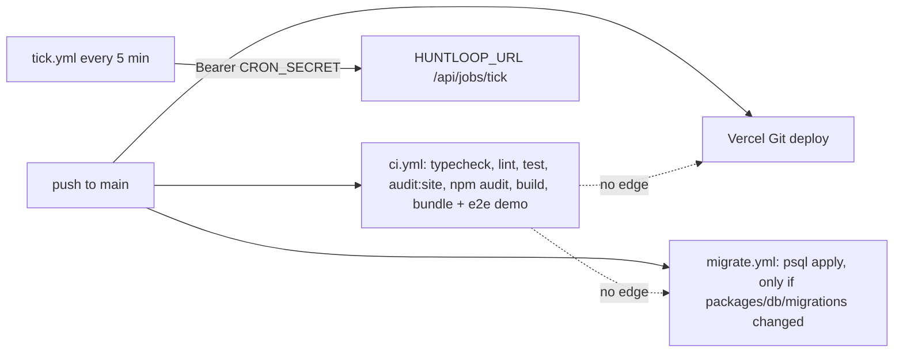

# Pass 16: Reviewer E (security · prod · perf · tests · debt)

status: complete

Audited commit `7e09759` on `feat/pass-15-audit-fixes`. Read-only. No DB, network, vendor, AI or mail calls, and no dev servers. Mechanical results are the lead's (see brief), with logs in `audit/pass-16/_raw/`. `.env.local` values were never opened. I read only variable **names**, using `grep -oE '^[A-Z_]+'`.

Severity totals (this reviewer): **Critical 0 · High 2 · Medium 11 · Low 7** (20 new or carried findings, §11). **No URGENT item.** I found no secret in tracked files or in git history.

---

## 1. Security

Method: I traced all 13 route handlers (`apps/web/app/**/route.ts`), all of `apps/web/proxy.ts`, the SSRF guard in `packages/jobs/src/fetch.ts`, the AI URL path (`packages/ai/src/url.ts` → `client.ts`), every secret comparison, and every `.or(` filter built from a template string. I also searched for every XSS sink.

### 1a. Confirmed controls (traced in code)

| Control | Result | Evidence |
|---|---|---|
| Cron route auth | Fails closed: 503 when `CRON_SECRET` is unset. Constant-time compare. 404 on mismatch | `apps/web/app/api/jobs/tick/route.ts:55-75,122-127` |
| Local demo `GET /api/jobs/tick` → 404 | **Expected, not a bug.** `apps/web/.env.local` defines a `CRON_SECRET` (name only checked). `scripts/dev-demo.mjs:27-33` clears only the Supabase and Anthropic vars, so the request reaches the secret check and an unauthenticated GET gets 404. Not the proxy: `/api/jobs/tick` is in `PUBLIC_PREFIXES` (`proxy.ts:118`) | — |
| Inngest route auth | Fails closed (404 without keys). 5-minute timestamp window. `timingSafeEqual` | `apps/web/app/api/inngest/route.ts` `verifySignature`. Protocol compatibility: SEC-202 |
| Digest-unsubscribe token | HMAC-SHA256 with an HKDF key, `timingSafeEqual`, UUIDs validated | `packages/jobs/src/email/digest-token.ts:38-48`, test `packages/jobs/scripts/verify-jobs.ts:3583` |
| Prospect unsubscribe | Token is UUID-validated. `record_unsubscribe` RPC. 404 on an unknown token, 503 with no DB | `apps/web/app/api/unsubscribe/[token]/route.ts`. Replay is idempotent, tested at `verify-migrations.ts:909-942` |
| Open redirect | `safeNextPath` rejects anything not starting with `/`, `//`, `\` and control characters. The proxy writes a path only. The callback and signout routes use it | `apps/web/lib/safe-next.ts`, `proxy.ts:338-343`, `app/auth/callback/route.ts`, `app/auth/signout/route.ts`. Test `apps/web/lib/safe-next.test.ts` |
| SSRF (crawler) | http/https only. DNS is resolved and **every** address checked. IPv6 is expanded first (v4-mapped, NAT64 64:ff9b::/96, 6to4). Redirects are manual and re-checked on each hop (max 5). A **connect-time lookup** in `guardedAgent` closes DNS rebinding. 4 MB cap, 15 s timeout | `packages/jobs/src/fetch.ts` (`isPrivateAddress`, `assertFetchable`, `guardedAgent`, `fetchPage`). Test `verify-jobs.ts:254`. Small gaps (Low, unexploitable without a hostile resolver): Teredo `2001::/32` and NAT64 local-use `64:ff9b:1::/48` are not decoded |
| SSRF (AI) | `normalizeUrl` has no private-range check. The URL only goes to Anthropic's server-side `web_fetch` with `allowed_domains`, so HuntLoop infrastructure never fetches it | `packages/ai/src/url.ts`, `packages/ai/src/client.ts:101-113` |
| XSS | Zero `dangerouslySetInnerHTML`, `innerHTML`, markdown renderers or `srcDoc` in `apps/` or `packages/`. React 19.2.8 escapes text and blocks `javascript:` hrefs (e.g. `BriefSections.tsx:130` renders model-sourced URLs). Inbound reply HTML is stripped to text (`mailbox/gmail.ts:339-345`). Product-email templates escape every value (`email/templates.ts:16`, test `verify-jobs.ts:3605`). The outreach HTML footer escapes the address and URL (`send-message.ts:856-877`). The digest-unsubscribe page puts only a verified, URI-encoded token in markup | grep over `apps packages` |
| Email header injection | The unsubscribe URL is regex-checked. Addresses must be a single address. Header text is stripped of control characters | `packages/jobs/src/mailbox/provider.ts:140-190`, test `verify-jobs.ts:1088` |
| CSRF | Server Actions carry Next's Origin check. The only cookie-auth route handlers that mutate are `POST /auth/signout` (logout only) and `POST /api/memory/extract`, which returns text and writes nothing. `@supabase/ssr` cookies default to `SameSite=Lax`. OAuth `start` is a GET that only sets a state cookie | route files above |
| CSV injection | `toCsv` neutralises formula prefixes | `apps/web/lib/csv-write.ts:9`, test `csv-write.test.ts` |
| PostgREST filter strings | All 10 template `.or()` filters interpolate server-generated values (ISO timestamps, DB uuids). The one user-derived filter strips `%_,()` and runs on the tenant client under RLS plus `.eq("org_id")` | `apps/web/lib/ai/workspace-context.ts:138`, `packages/jobs/src/handlers/schedule-*.ts` |
| Raw SQL | App code builds no dynamic SQL. The one `format('%s')` builds a column list from catalog names, not user input | `packages/db/migrations/0049_soft_delete_propagation.sql:169` |
| Rate limiting | Every model task and every credit-spending action goes through `consume_rate_limit`, per user then per org. It fails closed in production with no DB or a missing function | `apps/web/lib/rate-limit.ts:180-280` (23 call sites), test `rate-limit.test.ts`. Anonymous `/discover`: 5 per IP per hour plus 200 per day globally (`packages/jobs/src/public-research.ts`) |
| Dev surfaces in prod | `/kitchen-sink` and `/dev/onboarded` return 404 when `VERCEL_ENV=production` (`proxy.ts:221-223`). `/dev/onboarded` also returns 404 unless `NODE_ENV=development` (`app/dev/onboarded/route.ts:30`). `DEV_BYPASS` is a literal `false` in builds (`IcpStep.tsx:37-39`). **On preview deployments `/kitchen-sink` is reachable**, but it is fixtures only and imports no data layer (`app/kitchen-sink/page.tsx` imports) | — |
| Demo in prod | Production with no Supabase or a partial schema serves 503, not fixtures (`proxy.ts:228-247`). Its precision is limited by PROD-201 | — |
| Static headers | HSTS (no preload), nosniff, XFO DENY, frame-ancestors, Referrer-Policy, Permissions-Policy, `poweredByHeader:false` | `apps/web/next.config.ts`. The lead confirmed them live on www |

### 1b. Confirmed weaknesses (details in §11)

- **SEC-201.** CSP is report-only, and its report channel cannot see Chromium reports. The policy emits both `report-uri` and `report-to` (`lib/csp.ts:173-176`). Chromium prefers `report-to` and posts Reporting-API JSON: an array of `{type:"csp-violation", body:{effectiveDirective,…}}`. The handler reads only `csp-report` or kebab-case keys (`app/api/csp-report/route.ts`, `report["effective-directive"]`). Those reports fall through `if (!directive) return done()`. Sentry is also off in production (`sentry:false` from health). The "enforce after a quiet week" gate (`lib/csp.ts:24-31`, `SETUP.md:456`) therefore measures silence by construction.
- **SEC-202.** The Inngest verifier and registration endpoint are hand-rolled with no SDK. It signs the timestamp, then the body. The GET returns a home-made function manifest. It fails closed, so the risk is a dead alternative driver rather than an open door.
- **SEC-203.** There is no rotation procedure, and the Supabase service key is the root of three other secrets. HKDF derives from it: the analyze-verdict seal (`apps/web/lib/ai/seal.ts`), the digest-unsubscribe HMAC (`digest-token.ts:4-8`), and the public-research IP salt (`public-research.ts:250-262`). Rotating the service key silently invalidates every digest-unsubscribe link already sent and every stored IP hash. `MAILBOX_ENCRYPTION_KEY` has no key version, so rotating it forces every mailbox and CRM to reconnect (`docs/developer/environment-variables.md:86`).
- **SEC-204.** Workflows are pinned by tag (`actions/checkout@v4`, `setup-node@v4`, `upload-artifact@v4`) and have no `permissions:` block. `migrate.yml` holds the production `DATABASE_URL`.
- **SEC-205.** `check-admin-imports.ts` (`FORBIDDEN` = `createAdminClient` / `db/admin`) does not see the service role reached through `@huntloop/jobs` exports. `apps/web` imports `estimateReach`, `expandWithLookAlikes`, `stage*`, `disableDigest`, `reserveAnonymousResearch`/`recordPublicResearch`/`lookupPublicResearch`, `tick`, `sweep`. Each of them uses `adminClient()` (`packages/jobs/src/{reach,look-alike,first-run,public-research,scope}.ts`). I spot-checked `runStageAction`: membership and rate limit run before `stage*` (`welcome/building/actions.ts:134-184`). Full caller authz is reviewer B's scope.

### 1c. Needs verification

| Item | Why it is open | What settles it |
|---|---|---|
| Session cookie flags in prod (`Secure`, `SameSite`, lifetime) | Library default (`@supabase/ssr` 0.5.2); the repo does not set them | DevTools → Application → Cookies on a signed-in www session |
| Auth abuse controls (signup and magic-link rate limits, CAPTCHA) | Dashboard setting | Supabase → Authentication → Rate Limits / Attack Protection |
| `x-forwarded-for` trust for the per-IP limit | Correct only on Vercel, which overwrites the header | Confirm hosting stays on Vercel |
| Leaked-password / MFA policy | Not in repo | Supabase → Authentication → Providers / MFA |
| Every web → service-role caller re-checks membership | SEC-205 | Reviewer B trace |

---

## 2. Supply chain and secrets

| Check | Result | Evidence |
|---|---|---|
| `npm audit --omit=dev` | 5 moderate, 0 high/critical. All are build-time: `@sentry/nextjs` → `@sentry/bundler-plugins`/`webpack-plugin` → `glob`/`minimatch`. The fix is a semver-major bump to 11.12.0 | `audit/pass-16/_raw/npm-audit.json` (prod 175 / total 626 deps) |
| CI advisory gate | `npm audit --audit-level=high`. Blocks on main, non-blocking on PRs | `.github/workflows/ci.yml` "Audit — dependency advisories" |
| Lockfile | v3, 626 packages, **all have `integrity`**, and every `resolved` is on `registry.npmjs.org` (612). CI uses `npm ci` | `package-lock.json` (scanned with node) |
| Install scripts | `@sentry/cli` (downloads a binary at install) and `fsevents` (optional, macOS) | lockfile `hasInstallScript` |
| `.npmrc` | none | — |
| GitHub Actions pinning | **By tag, not SHA** (SEC-204) | `ci.yml`, `migrate.yml` |
| Workflow `permissions:` | **Absent in all three workflows**, so the token gets the repo default. A default of `write-all` would give the `migrate` job a writable token next to the prod DB secret | `ci.yml`, `migrate.yml`, `tick.yml`. The repo default needs GitHub settings access (§15) |
| `.env.local` tracked? | No. `.env.local` and `apps/web/.env.local` exist on disk and both are ignored (`.gitignore:28 .env*`, `apps/web/.gitignore:2`). `git ls-files` shows only `.env.example` plus docs/env.ts | `git check-ignore -v` |
| `.vercel/` tracked? | No. Ignored (`.gitignore:27`) | — |
| Key files tracked | No `*.pem`, `*.key`, `id_rsa`, `*.p12` | `git ls-files` |
| `NEXT_PUBLIC_*` contents | `SUPABASE_URL`, `SUPABASE_PUBLISHABLE_KEY`/`ANON_KEY` (RLS-bound by design), `SITE_URL`, `FEEDBACK_URL`, `HELP_URL`, `AUTH_GOOGLE` (flag), `SENTRY_DSN` (public by design), `POSTHOG_KEY`/`HOST` (used **server-side only**, `lib/analytics.ts:111`; the public prefix is unnecessary but harmless), `STRIPE_PUBLISHABLE_KEY` (unused), `HUNTLOOP_DEV_BYPASS` (flag), `VERCEL_ENV`. None is a secret | grep |
| Git-history secret scan (114 commits, `git log --all -G`) | **Nothing found.** I searched for these patterns: Anthropic `sk-ant-`, Supabase `sb_secret_`/`sb_publishable_`, HS256 JWTs, AWS `AKIA`, GitHub `gh[pousr]_`, Stripe `sk_live_`/`sk_test_`/`whsec_`, Google `GOCSPX-`, Slack `xox`, PostHog `phc_`, Inngest `signkey-`, PEM private keys, `postgres://user:pass@`. The Resend-shaped pattern `re_…_…` matched 8 commits, but anchored with `\b` it matches nothing at HEAD. The hits are substrings of identifiers (e.g. `…re_xxx_yyy`), so they are false positives. A follow-up history-wide listing of the matched strings was refused by the sandbox (see §15) | — |
| Service-role blast radius | Server-only through `packages/db/src/env.ts` `supabaseSecretKey()`. It is used by `packages/db/src/admin.ts`, `packages/jobs/src/scope.ts` and through `jobs` by 5 web-reachable modules (SEC-205). It is also HKDF root material for 3 other secrets (SEC-203). Leaking it means full RLS bypass for every tenant **and** lets an attacker forge analyze seals and digest-unsubscribe tokens | — |
| Rotation procedure | **None written** for any key. Only the encryption-key consequence is documented (`environment-variables.md:86`) | SEC-203 |

---

## 3. Prod / deploy / CI / parity

### 3a. Pipeline as it actually is

- **What a red CI blocks:** nothing structurally. `docs/operations/deployment.md:119-121` says Vercel deploys on push, and `migrate.yml` has no `needs:` on CI. Blocking depends on branch protection, which I could not verify (§15). `npm run verify` runs the same set as CI, step for step (`package.json` `verify` vs `ci.yml`).
- **Migrations and deploy are unordered** (PROD-202). The schema probe would not catch an out-of-order deploy (PROD-201).
- **Node:** `engines: >=22.6`. CI and migrate use Node 24, local is 22.23.2. Vercel's Node version is unverified (§15).
- **Runtime:** tick, inngest, health, unsubscribe, extract and the mailbox routes are `nodejs`. The proxy runs on edge (uses `crypto.getRandomValues`, `lib/csp.ts:54`).

### 3b. Environment parity

| | Local | Preview | Production (lead's GET) |
|---|---|---|---|
| Supabase | `.env.local` (names present) → project in `db-doctor.log` (0001–0047) | unknown | `database.schema` reports `complete`. That is misleading because the probe stops at 0047 (PROD-201) |
| Commit | `7e09759` | — | `8021d3f` (predates all pass-15 fixes) |
| `NEXT_PUBLIC_SITE_URL` | set | — | `https://huntloop.pro` (apex fails TLS) |
| `CRON_SECRET` / Inngest / `MAILBOX_ENCRYPTION_KEY` | set / set / set | — | false / false / false |
| Provider and AI keys | set (names) | — | all false |
| Demo / dev surfaces | demo when vars are blanked | demo plus `/kitchen-sink` reachable | 503 / 404 |
| Sentry | DSN names present | — | false |

### 3c. Domain migration (`docs/domain-migration-huntloop-pro.md`) against code and prod

| Doc claim | Reality | Evidence |
|---|---|---|
| Canonical is the apex; `www` → 308 → apex | Reversed. www serves, and the apex fails TLS (`SEC_E_WRONG_PRINCIPAL`). `http://huntloop.pro` 308s into the broken https apex | lead's GETs (`prod-get.log`) |
| "Every absolute URL derives from `NEXT_PUBLIC_SITE_URL`" | Partly. Magic link and signup callback (`(auth)/actions.ts:80,125`), invites (`team/actions.ts:327,426`, `lib/data/team.ts:256`), outreach unsubscribe and List-Unsubscribe (`send-message.ts:819`), digests and notifications (`send-digests.ts:83`, `send-notifications.ts:28`) and CRM evidence links (`sync-hubspot.ts:125`) do. **Mailbox OAuth `redirect_uri` uses the request origin** (`api/mailboxes/[provider]/start/route.ts:58,114`, `callback/route.ts:61,125`), as the same doc's "Decisions" section says. So today emails link to the broken apex, while OAuth would send `https://www.huntloop.pro/...` against URIs the checklist registers on the apex → `redirect_uri_mismatch` | — |
| No CORS, no cookie `domain` | True. Cookies are host-only; `__Host-` is used for the OAuth state cookie (`shared.ts`) | — |
| CSP needs no change | True. `connect-src` derives from `NEXT_PUBLIC_SUPABASE_URL` and the Sentry DSN, not the site host | `lib/csp.ts:70-95` |
| Checklist B–E | Every box is still ☐ | — |

This root cause is PROD-001 (still open). I add the OAuth-origin split as a new location, not a new finding.

### 3d. Vercel topology

The doc records two projects. `huntloop-web` sits in team `huntloop` and is Git-connected. A CLI-only duplicate `huntloop-web` sits in `cmbatmans-projects`, and the local `.vercel` links to that duplicate (`docs/domain-migration-huntloop-pro.md` "Findings"). `deployment.md:86-94` records a third, never-built project `huntloop`. That is a split-brain risk: `vercel env pull` and `vercel deploy` from this machine target the wrong project. Unverified, because the dashboard needs team access.

---

## 4. Observability

| Question | Can you tell today? | Evidence |
|---|---|---|
| A job failed, for which org, and why | Only by querying `job_executions` or opening `/[org]/ops` (admin, one org at a time). Not in logs, not in Sentry | runner `markFailed` (`packages/jobs/src/runner.ts:184-191`). No `captureException` anywhere in `packages/` |
| A request errored | Sentry `onRequestError` (`instrumentation.ts`) and the error boundaries (`app/error.tsx:40`, `[org]/error.tsx:29`, `global-error.tsx:27`). **Sentry is unset in prod** | health `sentry:false` |
| Structured logs with request, job and org ids | **No.** 22 `console.error`/`warn` calls with free-text messages and no org or job id (e.g. `packages/providers/src/budget.ts:136`, `ledger.ts:58`, `jobs/src/ai.ts:75`) | grep |
| Tick stopped | `tick.yml` goes red on non-200 or `oldestDueSeconds > 900`. GitHub's failure email goes to whoever owns the workflow, and schedules pause after 60 days without repo activity (`tick.yml` header) | `.github/workflows/tick.yml` |
| Dead-letter growth, spend spike, bounce rate | **No alert exists** | grep for alerting code: none |
| Is the deployment healthy (`/api/health`) | Checks: Supabase reachable, the 0001 and 0047 tables exist via anon PostgREST, presence of env vars. **Does not check** last tick time, queue lag, failed or dead jobs, the migration ledger (`schema_migrations`), or 0048–0050 objects | `apps/web/app/api/health/route.ts`, `lib/schema.ts:38` |
| Heartbeat per `docs/operations/heartbeat.md` | The doc's option A says Vercel Cron is "committed" in `apps/web/vercel.json`. That file has **no `crons`**. The real driver is `tick.yml`. `lastTickAt()` on the Sources screen does read `job_executions` | `apps/web/vercel.json`, `heartbeat.md:70-80`, `observability.md:50-56` |
| Audit trail | `audit_logs` is written, and **nothing reads it** (the doc says so itself) | `docs/operations/observability.md` table. A failed write goes to Sentry (`lib/data/audit.ts:87`) |
| Cross-tenant operator view | None. Every ops surface is per-org and needs a membership | `/[org]/ops` |

---

## 5. DR / backup / rollback

| Item | Documented | Reality |
|---|---|---|
| Backups | Supabase-provided and plan-dependent. The plan, backup type, retention and RPO table in `docs/OPERATIONS.md:245-250` is **empty** | `docs/OPERATIONS.md:24-25`: "A restore has never been rehearsed". `docs/security/privacy.md:139`: "Never rehearsed" |
| PITR | Undecided (`OPERATIONS.md:251-258`) | Unverified, dashboard |
| RPO / RTO | Not stated | — |
| Restore procedure | Written (`OPERATIONS.md:260-279`): stop the tick, restore in place, re-check migrations, rerun isolation | Never executed. The rehearsal checklist (`:280-285`) is all ☐ |
| App rollback | Vercel instant rollback (`deployment.md:112-117`) | Plausible. Older code against a newer schema relies on migrations staying additive, and nothing tests that |
| Migration rollback | Forward-only. "Additive by rule" (`migrations.md:124-135`) | Each file plus its ledger row is one transaction (`packages/db/scripts/migrate.ts:29,95`), so a failed file leaves nothing. A re-run applies nothing (ledger, tested by `verify-migrate.ts`, 9 cases) |
| Bad job batch | `cancel_job`/`retry_job` per job per org (`ops/actions.ts:36,64`) | No bulk cancel, no global pause (PROD-207) |
| Schema drift prod vs repo | `db:doctor` infers from objects; `schema_migrations` is the ledger | Configured DB: 0048–0050 MISSING; the 0006 cron is not visible (`db-doctor.log`) |

---

## 6. Environment inventory (names only)

Sources: `.env.example` (40 names), every `process.env.*` in `apps/` and `packages/` (non-test), `packages/{db,ai}/src/env.ts`, `apps/web/vercel.json` (no env, no crons), and the workflows. "Loud" means it refuses or reports. "Silent" means it degrades without telling anyone.

| Name | Req? | Read in | What dies without it | Loud/silent |
|---|---|---|---|---|
| `NEXT_PUBLIC_SUPABASE_URL` | Required | `db/src/env.ts`, `lib/schema.ts`, `lib/csp.ts`, `lib/data/source.ts`, `AuthForm.tsx` | Whole app (demo off-prod, 503 in prod) | Loud |
| `NEXT_PUBLIC_SUPABASE_PUBLISHABLE_KEY` (alias `…_ANON_KEY`) | Required | same | same | Loud |
| `SUPABASE_SECRET_KEY` (alias `SUPABASE_SERVICE_ROLE_KEY`) | Required | `db/src/env.ts`, `lib/ai/seal.ts`, `digest-token.ts`, `public-research.ts` | Jobs, seals, digest unsubscribe; the IP salt falls back to a public constant only with no DB | Loud (health 503) |
| `DATABASE_URL` | Required for migrate | `packages/db/scripts/*`, `migrate.yml` | Migrations | Loud (`migrate.yml` exit 1) |
| `MIGRATIONS_BASELINE` | First run only | `migrate.ts:110`, `migrate.yml` | The first ledger run on a hand-migrated DB refuses | Loud |
| `NEXT_PUBLIC_SITE_URL` | Required | `lib/site-url.ts`, `health`, `send-message.ts:819`, `send-digests.ts:83`, `send-notifications.ts:28`, `sync-hubspot.ts:125` | Absolute links. Outreach refuses to send (loud). Digests and notifications skip (`ok:true, skipped`). **HubSpot pushes `https://app.huntloop.example`** (silent, DEBT-201). Site URL falls back to `VERCEL_PROJECT_PRODUCTION_URL`, then localhost | Mixed |
| `CRON_SECRET` | Required | `jobs/src/index.ts:108`, `lib/data/engine.ts`, `tick.yml` | Whole engine (tick 503) | Loud |
| `MAILBOX_ENCRYPTION_KEY` | Required to connect | `db/src/crypto.ts:81` | Mailbox and CRM connect refused | Loud |
| `ANTHROPIC_API_KEY` | Optional | `ai/src/env.ts` | AI screens show a labelled worked example | Loud (stated) |
| `HUNTLOOP_AI_TIMEOUT_MS` | Optional (default 55 s) | `ai/src/env.ts` | — | — |
| `APOLLO_API_KEY` | Optional | `providers/src/registry.ts` | Discovery and reach | Stated in UI |
| `ENRICHMENT_API_KEY` | Optional | `providers/src/registry.ts` | Person enrichment; vendor picked by key shape | Stated |
| `EMAIL_VERIFICATION_API_KEY` | Optional | `providers/src/registry.ts` | Verification | Stated |
| `GOOGLE_CLIENT_ID` / `_SECRET` | Optional | `jobs/src/mailbox/provider.ts`, `gmail.ts:368` | Gmail connect | Loud |
| `MICROSOFT_CLIENT_ID` / `_SECRET` | Optional | `provider.ts`, `outlook.ts:242` | Outlook connect | Loud |
| `RESEND_API_KEY`, `EMAIL_FROM` | Optional (both) | `jobs/src/email/resend.ts` | Invites, join requests, digest emails | `isEmailConfigured()`. Invites return the link instead |
| `EMAIL_REPLY_TO` | Optional | `resend.ts` | — | — |
| `INNGEST_EVENT_KEY`, `INNGEST_SIGNING_KEY` | Optional (alternative driver) | `jobs/src/index.ts`, `api/inngest`, `lib/data/engine.ts` | Inngest route returns 404 | Loud |
| `SENTRY_DSN`, `NEXT_PUBLIC_SENTRY_DSN` | Optional | sentry configs, `lib/csp.ts` | All error tracking, CSP reports | **Silent** (OBS-201) |
| `SENTRY_ORG`, `SENTRY_PROJECT`, `SENTRY_AUTH_TOKEN` | Optional, build | `next.config.ts` | Source-map upload | Silent by design |
| `NEXT_PUBLIC_POSTHOG_KEY`, `NEXT_PUBLIC_POSTHOG_HOST` | Optional | `lib/analytics.ts` | Analytics | Silent by design |
| `CSP_ENFORCE` | Optional | `lib/csp.ts:43` | CSP stays report-only | Silent (SEC-201) |
| `NEXT_PUBLIC_AUTH_GOOGLE` | Optional flag | `AuthForm.tsx` | Google sign-in button | — |
| `NEXT_PUBLIC_FEEDBACK_URL`, `NEXT_PUBLIC_HELP_URL` | Optional | `OrgShell.tsx`, `AccountMenu.tsx` | Menu links | — |
| `PUBLIC_RESEARCH_ENABLED`, `_DAILY_LIMIT` (200), `_SALT` | Optional | `public-research.ts` | Anonymous `/discover` research | Loud |
| `NEXT_PUBLIC_HUNTLOOP_DEV_BYPASS` | Dev only | `IcpStep.tsx:39` | — | — |
| `STRIPE_SECRET_KEY`, `STRIPE_WEBHOOK_SECRET`, `NEXT_PUBLIC_STRIPE_PUBLISHABLE_KEY` | **No reader in code** | `.env.example` only | nothing | Dead names (DEBT-203) |
| `VERCEL_ENV`, `VERCEL_GIT_COMMIT_SHA`, `VERCEL_PROJECT_PRODUCTION_URL`, `VERCEL_REGION`, `NEXT_PUBLIC_VERCEL_ENV` | Platform | `lib/schema.ts:76`, health, `site-url.ts`, tick route, `instrumentation-client.ts` | `VERCEL_ENV` alone decides the prod-only protections | — |
| `NODE_ENV`, `NEXT_RUNTIME`, `CI`, `PORT`, `DEMO_PORT`, `DEMO_PROD_PORT` | Platform/dev | various | — | — |
| GitHub: secret `CRON_SECRET`, var `HUNTLOOP_URL` | Required for heartbeat | `tick.yml` | Engine never ticks | Loud (red run) |
| GitHub: secret `DATABASE_URL`, var `MIGRATIONS_BASELINE` | Required for migrate | `migrate.yml` | Migrations | Loud |
| `VERCEL_OIDC_TOKEN` | Present in `apps/web/.env.local` (name only) | no reader | — | From `vercel env pull`; harmless |

Local `.env.local` files hold names that `.env.example` also lists. One parity note: `NEXT_PUBLIC_HUNTLOOP_DEV_BYPASS`, `PUBLIC_RESEARCH_*`, `EMAIL_*`, `RESEND_API_KEY` and `APOLLO_API_KEY` are absent from both local files, so `/discover` research and product email are off locally.

---

## 7. Perf (static only; every item is **not measured**)

| Item | Where | Why it matters |
|---|---|---|
| Inbox loads every thread with every message body and event, unbounded | `apps/web/lib/data/inbox.ts:76-89` | Payload grows with all mail ever exchanged. PostgREST `max-rows` (Supabase default 1000) truncates silently, a correctness problem as well. No `threads (org_id, last_message_at)` index exists (only `threads_provider_idx`) |
| Assignments loads every opportunity, unbounded | `apps/web/lib/data/team.ts:113-122` | Same truncation and size issue; `opportunities_priority_idx` covers the order |
| Dashboard "why now" evidence is unbounded per shortlist | `apps/web/lib/data/dashboard.ts:257-268` | The shortlist is small, but evidence per opportunity is unbounded |
| 53 of 291 `select`s in `lib/data` and `jobs/handlers` have no limit, key or `maybeSingle` | listing produced by a static scan (scratch script); notable ones: `opportunities.ts:159,388` (evidence), `hunt-source.ts:118,152`, `conversation.ts:70`, `analyze-performance.ts:551,561,676`, `send-message.ts:660,672,712` | Most of the rest are small config tables (plans, icps, products, mailboxes) |
| Model calls in the request path | Analyze, research, ICP draft and first-run stages run inside Server Actions (`lib/ai/*.ts`), capped by the 55 s AI timeout (`ai/src/env.ts`) | Latency and serverless limits. Rate-limited |
| Route skeletons | 3 `loading.tsx` for 54 pages; `[org]/loading.tsx` covers the org tree | PERF-001 partially addressed |
| Bundle | 201.7 / 275 kB shared (lead) | Within budget |

---

## 8. Tests by risk

| Risk | Test exists? | Path | Caveat |
|---|---|---|---|
| Tenant isolation / RLS | **Yes** | `packages/db/scripts/verify-migrations.ts:316` (cross-tenant as non-superuser), `:1636`, `:3021` (every tenant table has RLS on), `:3184` (write hardening) | PGlite, not hosted Supabase. Does not cover service-role code paths (SEC-205) |
| Send idempotency | **Yes (fakes)** | `verify-jobs.ts:1023`, `:1413` ("OUT-001: at most once"), `:1292`; DB `verify-migrations.ts:3474` (one message per step) | Scripted fakes prove the path, not Gmail or Outlook |
| Per-address lane | Yes, sequential | `verify-migrations.ts:1772`, `verify-jobs.ts:1271` | Single connection (TEST-202) |
| Spend cap | Yes, sequential | `verify-migrations.ts:1735` (0050 reserve), `apps/web/lib/ai/spend-guard.test.ts`, `budget.test.ts` | Not concurrent (TEST-202) |
| Rate limit | Yes | `verify-migrations.ts:396`, `rate-limit.test.ts` | — |
| Webhook / unsubscribe replay | Partial | `record_unsubscribe` twice (`verify-migrations.ts:909-942`). No inbound vendor webhooks exist. **Inngest signature: no test** | — |
| Migrations apply, twice | Yes | `verify-migrations.ts:116` (all in order), `verify-migrate.ts` (ledger, baseline, re-run) | Not against a hosted DB |
| Job retry / claim / deadline | Yes (fakes) | `verify-jobs.ts:499` ("claim, dispatch, record, and stop before being killed"), `:453`, `:721`; DB queue `verify-migrations.ts:1201` | `skip locked` is never exercised by two connections |
| Cron auth / route handlers / proxy prod branch | **No** | — | TEST-201 |
| Open redirect | Yes | `apps/web/lib/safe-next.test.ts` | — |
| SSRF | Yes | `verify-jobs.ts:254` | — |
| Header injection, escaping | Yes | `verify-jobs.ts:1088`, `:3605` | — |

**What e2e (demo mode, 316 passed) does NOT assert:** anything with a database, real auth or RLS. Any send, enqueue or tick. The production branch of the proxy (`VERCEL_ENV=production`: the 503 not-ready page, the 404 on `/kitchen-sink` and `/dev/onboarded`). CSP in enforcing mode (only by hand, `SETUP.md:463`). Reporting-API CSP bodies (`e2e/csp.spec.ts:100-125` posts only the legacy `application/csp-report` shape). Mailbox OAuth. Unsubscribe against a DB. Health semantics. The 4 skips are viewport-conditional (`app-shell.spec.ts:93,268,476,498`).

### The 10 missing tests that would catch the most damage

1. `apps/web/test/tick-route.test.ts`: tick returns 503 with no `CRON_SECRET`, 404 for a wrong or prefix bearer, and runs `sweep`/`tick` only for an exact match.
2. `apps/web/test/proxy-production.test.ts`: with `VERCEL_ENV=production`, no Supabase → 503 on `/demo/dashboard`; `/kitchen-sink` → 404; `/api/health` is still served.
3. `packages/db/scripts/verify-migrations.ts`: **the schema probe tracks the newest required object.** It fails when any migration creates a table or function the app calls and `LATEST_TABLE` (`lib/schema.ts:38`) is not bumped (PROD-201).
4. `packages/jobs/scripts/verify-jobs.ts`: `send_message` against a DB **without** `claim_contact_lane` (42883) neither defers forever nor reports ok. It must fail loudly (PROD-201).
5. `packages/db/scripts/verify-concurrency.ts` (real Postgres, two connections): two concurrent `reserve_provider_credit` calls with one credit left → exactly one allowed. Two `claim_contact_lane` calls → one winner. Two `claim_jobs` calls → disjoint sets (TEST-202).
6. `apps/web/test/csp-report.test.ts`: a Reporting-API array body (`type: "csp-violation"`, camelCase `body`) reaches Sentry with its directive (SEC-201).
7. `apps/web/test/inngest-route.test.ts`: a request signed by the official Inngest SDK verifies; a stale timestamp or altered body is refused (SEC-202).
8. `apps/web/test/mailbox-oauth.test.ts`: the callback refuses a missing or mismatched state cookie, a provider mismatch, and a viewer role. `redirect_uri` equals the registered origin (PROD-001).
9. `packages/jobs/scripts/verify-jobs.ts`: `sync_hubspot` with `NEXT_PUBLIC_SITE_URL` unset refuses to push rather than writing a placeholder host (DEBT-201).
10. `apps/web/test/health.test.ts`: `/api/health` returns 503 when the last tick is older than N minutes or a required migration (0050) is missing (OBS-202).

---

## 9. Debt register and counts

Counts were taken over non-test source in `apps/web/{app,lib}` and `packages/*/src`:

| Marker | Count | Note |
|---|---|---|
| `as any` | **101** | `scripts/audit.mjs:445` caps it at 104 (ratchet) |
| `: any` / `any[]` annotations | **94** | **Not capped** (DEBT-202) |
| `as unknown as` | 11 | e.g. `fetch.ts` (undici types) |
| `@ts-ignore` / `@ts-expect-error` | 0 / 0 | — |
| `eslint-disable` | 73 (76 with tests) | 45 file-wide `@typescript-eslint/no-explicit-any` across **35 files**, 15 line-level `no-explicit-any`, 6 `no-control-regex`, 5 `jsx-a11y` |
| TODO / FIXME / HACK / XXX | 0 / 0 / 0 / 0 | — |

**tsconfig strictness:** every package has `strict: true` and `noUncheckedIndexedAccess: true`. `apps/web/tsconfig.json` has `strict: true` but **no `noUncheckedIndexedAccess`**, and it has `allowJs: true`. All use `skipLibCheck: true`. There are no generated DB types: `packages/db/src/types.ts` is "maintained by hand" (`docs/operations/migrations.md:117`). That is the root cause of the `any` casts.

| Debt | Where | Kind |
|---|---|---|
| Placeholder CRM link host | `packages/jobs/src/handlers/sync-hubspot.ts:125` | Hardcoded fallback (DEBT-201) |
| `any` ratchet blind spot | `scripts/audit.mjs:438-459` | DEBT-202 |
| Dead env names (Stripe ×3) | `.env.example` | DEBT-203 |
| Ops docs contradicting code | `heartbeat.md:70-96`, `migrations.md:10,59`, `deployment.md:62,74`, `SETUP.md:24`, `tick/route.ts:6` ("see vercel.json"), domain doc | PROD-203 |
| Hand-rolled Inngest protocol | `apps/web/app/api/inngest/route.ts` | SEC-202 |
| Unused but kept | `ActionRail` (kitchen-sink only); Toast mounted at root | Pass-15 DEBT-001: by design, accepted |
| `/kitchen-sink` on previews | `proxy.ts:58,221` | Pass-15 DEBT-002 withdrawn; still true that it is reachable on previews, fixtures only (Info) |
| Duplicate `escapeHtml` | `send-message.ts:871` vs `email/templates.ts:16` | Minor duplication (Info) |

---

## 10. Manual-operations register

Every on-call action that today needs a dashboard, manual SQL, or a human outside the app:

| # | Action | How today | Who / access | Risk |
|---|---|---|---|---|
| M1 | **Apply 0048, 0049, 0050** to the configured DB | Run `migrate.yml` by `workflow_dispatch` with `MIGRATIONS_BASELINE=0047` (`first-live-run.md:30-45`), or paste into the Supabase SQL editor (`migrations.md:59`, doctor output). The docs disagree. Not automatic, because the push trigger fires only on `main` and these sit on the branch | GitHub admin (secret) or Supabase SQL editor | Until applied, every pass-15 fix in 0048–0050 is not live. Deploying HEAD first stalls sends (PROD-201) |
| M2 | Confirm the 0006 `pg_cron` prune schedule | `select * from cron.job` in the SQL editor (`db-doctor.log`) | Supabase SQL editor | Retention or prune silently not running |
| M3 | Set prod env (`CRON_SECRET`, `MAILBOX_ENCRYPTION_KEY`, provider and AI keys, Sentry) | Vercel → Settings → Environment Variables, then redeploy | Team `huntloop` owner | Engine is dead in prod (health) |
| M4 | Fix the apex TLS, or switch `NEXT_PUBLIC_SITE_URL` to www | Vercel Domains + GoDaddy DNS | Team owner + registrar | PROD-001 |
| M5 | Register OAuth redirect URIs (Google, Entra) and Supabase Site/Redirect URLs | Three dashboards (domain doc §D) | Each console owner | OAuth mismatch |
| M6 | Set GitHub `CRON_SECRET` secret and `HUNTLOOP_URL` variable; `DATABASE_URL` | Repo settings | Repo admin | No heartbeat or migrations |
| M7 | Stop all sending / AI / provider spend in an emergency | No switch. Unset `CRON_SECRET` (halts **all** jobs) and redeploy, or disable `tick.yml`, or SQL `update` on `job_executions`/`messages` | Vercel/GitHub admin, or SQL | PROD-207 |
| M8 | Cross-tenant triage (which org's jobs are failing, dead letters across orgs) | SQL on `job_executions`; `/ops` shows only orgs you belong to | Supabase SQL editor | OBS-203 |
| M9 | Bulk-cancel a bad job batch | Per job `cancel_job` in `/ops`, or SQL | Org admin or SQL | — |
| M10 | Restore from backup | Supabase dashboard; procedure `OPERATIONS.md:260-279`; never rehearsed | Supabase owner | PROD-206 |
| M11 | Rotate any key | No procedure. Encryption-key rotation forces reconnects; service-key rotation breaks digest links, seals and IP hashes | Vercel + Supabase | SEC-203 |
| M12 | Grant a plan, quota or provider credit limit to an org | No billing. `provider_accounts.monthly_credit_limit` and plan rows are set by SQL or seed (`verify-migrations.ts:1739` shows the shape) | SQL editor | Spend controls depend on hand-set rows (money detail: reviewer D) |
| M13 | Read the audit trail | SQL on `audit_logs` (no reader) | SQL editor | — |
| M14 | Clean up the duplicate Vercel projects | Dashboard (`deployment.md:86-94`) | Both team owners | Split-brain deploys |
| M15 | Enforce CSP | Set `CSP_ENFORCE=true` and redeploy, after reports that cannot arrive (SEC-201) | Vercel | — |

---

## 11. Findings

### [High] PROD-201: The readiness probe stops at 0047, and HEAD stalls every send on a database without 0050
- Confidence: CONFIRMED (code trace; not run against a live DB)
- Where: `apps/web/lib/schema.ts:38` (`LATEST_TABLE = "message_unsubscribe_tokens"`, 0047); `packages/db/migrations/0050_atomic_spend_and_send_lanes.sql:85` (`create table contact_send_lanes`); `packages/jobs/src/handlers/send-message.ts:415-422`, `:609-621`; `apps/web/app/api/health/route.ts`; `proxy.ts:240-247`
- Evidence: `if (laneError || lane !== true) { … return defer(ctx, messageId, soon, "address_busy", …) }`. `defer` returns `{ ok: true, result: { deferred } }`, and its `wait_reason` write (an 0050 column) is best-effort. `budget.ts:97` has a pre-0050 fallback; the lane claim has none.
- Trace: deploy HEAD (or `main` after merge) → `db:doctor` shows 0048–0050 missing (lead) → `probeSchema` still sees 0001 and 0047 tables → `complete` → proxy serves the app and health returns 200 if the env is set → every `send_message` calls the missing `claim_contact_lane` → error → deferred 15 min, `ok:true` → repeats forever. Nothing fails or alerts, and the inbox reason write also fails.
- Disproved? I checked for a 42883 fallback (none), whether health probes 0050 (no), and whether `migrate.yml` would apply 0050 before the deploy. It runs in parallel with Vercel on push to `main` only, with no ordering (PROD-202), and the branch has not been merged.
- Impact: outreach (core-loop "Reach Out") silently dead while the deployment reports healthy. Fails safe (no wrong sends).
- Root cause: the readiness probe is one hand-bumped table name, and the rule "bump when a migration adds a required table" (`schema.ts:30-37`) was not applied in 0050.
- Fix: bump `LATEST_TABLE` to `contact_send_lanes`, or better, probe the ledger (`schema_migrations` max) or `migration_0050_applied()`. Make `send_message` fail (not defer) on 42883 from `claim_contact_lane`.
- Acceptance criteria: on a DB at 0047, health returns 503 `schema: partial` and production proxy returns 503. `send_message` records a failure naming the missing migration.
- Test to add: `verify-migrations.ts`: probe target equals the newest table created by any migration. `verify-jobs.ts`: lane RPC 42883 → `ok:false`.
- Effort S · Depends on: M1 · Mechanizable: yes (`audit.mjs`: newest `create table` in migrations == `LATEST_TABLE`)
- Status vs last pass: Still open (OPS-101/PROD-002, second half: "health can't see column-only migrations"). Now sharper, because 0050 does add a table and the probe was not bumped.

### [High] PROD-001: The production canonical origin fails TLS; prod runs pre-pass-15 code with no engine keys
- Confidence: CONFIRMED (lead's GETs; code)
- Where: apex `https://huntloop.pro` (`SEC_E_WRONG_PRINCIPAL`); www health 503, commit `8021d3f`, `siteUrl: https://huntloop.pro`, `cronSecret/inngest/credentialEncryption:false`. New location: the mailbox OAuth `redirect_uri` comes from the request origin (`api/mailboxes/[provider]/start/route.ts:58,114`, `callback/route.ts:61,125`), while every emailed link comes from `NEXT_PUBLIC_SITE_URL` (`(auth)/actions.ts:80,125`, `send-message.ts:819`). The domain doc registers apex URIs, but users can only reach www.
- Impact: magic links, invites and unsubscribe links point at a host browsers reject. OAuth would mismatch. Nothing runs or sends.
- Root cause: domain cutover reversed and half done; env not set.
- Fix: either attach a certificate to the apex and 308 www → apex (per the doc), or set `NEXT_PUBLIC_SITE_URL=https://www.huntloop.pro` and register the www URIs. Then set M3 and M6 and redeploy HEAD after M1.
- Acceptance criteria: strict-TLS GET of `siteUrl` succeeds; health returns 200 with commit ≥ `7e09759`.
- Test to add: health includes a strict-TLS self-check of `siteUrl` (or a CI smoke step).
- Effort S (config) · Depends on: Vercel, DNS and console access · Mechanizable: yes
- Status vs last pass: **Still open** (PROD-001)

### [Medium] SEC-201: CSP report channel drops Chromium's reports, and Sentry is off, so the enforce gate is blind
- Confidence: CONFIRMED (code). The Chromium behaviour (prefers `report-to`, sends `application/reports+json` arrays) is LIKELY from browser docs and was not run here.
- Where: `apps/web/lib/csp.ts:173-176`; `apps/web/app/api/csp-report/route.ts` (`parsed["csp-report"] ?? parsed`, `report["effective-directive"] ?? report["violated-directive"]`); health `sentry:false`; `e2e/csp.spec.ts:100-125` posts only the legacy shape
- Impact: CSP stays report-only. `script-src` gives no XSS protection in prod, and the "quiet week" evidence for enforcing it is empty by construction.
- Root cause: the handler parses only the deprecated report format, and the destination (Sentry) is not configured.
- Fix: accept array bodies (`type === "csp-violation"`, camelCase `body.effectiveDirective/blockedURL/documentURL`) and set the Sentry DSNs.
- Acceptance criteria: a Reporting-API body produces a Sentry event with its directive.
- Test to add: `apps/web/test/csp-report.test.ts` (missing test 6).
- Effort S · Mechanizable: yes · Status: New

### [Medium] SEC-203: No key-rotation procedure; the service key is HKDF root for three other secrets
- Confidence: CONFIRMED
- Where: `apps/web/lib/ai/seal.ts` (key comment), `packages/jobs/src/email/digest-token.ts:4-8`, `packages/jobs/src/public-research.ts:250-262`, `packages/db/src/crypto.ts:80-90` (no key version), `docs/developer/environment-variables.md:86`
- Impact: rotating after a leak breaks every digest-unsubscribe link already emailed, resets IP-hash rate limits, and voids in-flight analyze seals. Encryption-key rotation disconnects every mailbox and CRM. No one has written down the steps.
- Root cause: derived secrets share the root, and keys carry no version id.
- Fix: write a rotation runbook per key. Optionally give the digest and seal keys their own env names with fallback to the derivation. Add a key id prefix to ciphertexts.
- Acceptance criteria: a runbook exists, and a service-key rotation leaves already-sent digest links working (or the doc says they lapse).
- Test to add: `verify-jobs.ts`: token issued under key A verifies under the A+B rotation window.
- Effort M · Mechanizable: no · Status: New

### [Medium] PROD-202: Migrations and deploys are unordered, and nothing ties either to CI
- Confidence: CONFIRMED (workflows) / UNVERIFIED (branch protection)
- Where: `.github/workflows/migrate.yml` (`on: push: main, paths: migrations/**`, no `needs`), `ci.yml`, `docs/operations/deployment.md:119-121` ("Nothing deploys from CI — Vercel deploys on push")
- Impact: code can go live before its migration (PROD-201), and a migration can apply from a commit whose CI is red.
- Root cause: three independent push triggers.
- Fix: make Vercel's deploy depend on CI (Vercel "Ignored Build Step" checking CI status, or deploy from Actions after `verify` and `migrate`). Run `migrate` with `needs: verify` via `workflow_run`.
- Acceptance criteria: a red CI on `main` deploys nothing and migrates nothing.
- Test to add: n/a (pipeline). Check: `audit.mjs` asserts `migrate.yml` is gated on CI.
- Effort M · Depends on: Vercel and GitHub admin · Mechanizable: partly · Status: New

### [Medium] PROD-203: Operations docs contradict each other and the code
- Confidence: CONFIRMED
- Where: `docs/operations/heartbeat.md:70-80` (Vercel Cron "committed") vs `apps/web/vercel.json` (no `crons`) and `tick.yml`; `tick/route.ts:6` ("see `vercel.json`"); `migrations.md:10,59` and `deployment.md:62,74` ("by hand", "28 migrations") vs `migrate.yml` and `first-live-run.md:30-45` (ledger runner); `SETUP.md:24` ("0001–0010 applied"); domain doc (apex canonical; "every absolute URL from `NEXT_PUBLIC_SITE_URL`") vs prod and mailbox OAuth
- Impact: an on-call engineer following the docs applies migrations a different way than CI does, looks for a cron that does not exist, and registers the wrong OAuth URIs.
- Root cause: docs updated per feature, never reconciled.
- Fix: one source of truth per procedure (heartbeat → `tick.yml`; migrations → `migrate.yml`); delete the stale tables.
- Acceptance criteria: `grep -r "by hand" docs/operations` is empty; heartbeat.md names `tick.yml` as the active driver.
- Test to add: `audit.mjs` check that `heartbeat.md`'s "committed" driver matches `vercel.json`/workflows.
- Effort S · Mechanizable: partly · Status: New

### [Medium] PROD-206: Backups never rehearsed; RPO, RTO and PITR undecided
- Confidence: CONFIRMED (docs say so). Plan and retention are UNVERIFIED (Supabase → Project Settings → Database → Backups).
- Where: `docs/OPERATIONS.md:24-25,235-285`, `docs/security/privacy.md:139`
- Impact: recovery from data loss is a belief, not a capability. There are no tenants yet, which is why this is not High.
- Root cause: rehearsal checklist never executed.
- Fix: fill the plan table, decide PITR, restore once into a throwaway project, record the measured RTO.
- Acceptance criteria: table filled; dated rehearsal note with measured RTO.
- Test to add: n/a (drill).
- Effort S–M · Depends on: Supabase owner · Mechanizable: no · Status: New for this lens (pass-15 did not list it)

### [Medium] PROD-207: No global kill switch for sends, AI or provider spend
- Confidence: CONFIRMED (absence: grep for kill/pause flags in code and migrations found nothing; `ops/actions.ts` only does per-job `retry_job`/`cancel_job`)
- Impact: stopping a runaway send or spend loop means unsetting `CRON_SECRET` and redeploying (halts every job for every tenant), or writing SQL.
- Root cause: no operator-level switch exists.
- Fix: a `platform_flags` row (or env var read per tick) checked by `send_message`, `runTask` and `callProvider`, with three independent switches.
- Acceptance criteria: setting the send switch makes the next `send_message` defer with reason "paused by operator" while other jobs run.
- Test to add: `verify-jobs.ts`: send switch on → no provider send call.
- Effort M · Mechanizable: no · Status: New

### [Medium] OBS-201: Job failures never reach error tracking or alerting; logs carry no ids
- Confidence: CONFIRMED
- Where: `packages/jobs/src/runner.ts:184-191` (failures only to `job_executions`); no `captureException` in `packages/`; 22 free-text `console.error`/`warn` calls (e.g. `providers/src/budget.ts:136`, `ledger.ts:58`, `jobs/src/ai.ts:75`); Sentry unset in prod; the only alert is `tick.yml` (non-200 or lag > 900 s)
- Impact: a handler failing for every org (bad key, vendor 4xx, missing migration) is invisible unless someone opens `/ops` per org.
- Root cause: no logging contract; errors end in a table no one watches.
- Fix: one `logEvent({org_id, job_id, job_name, level, msg})` helper emitting JSON. `captureException` on permanent failures and on attempts ≥ N, tagged with org and job. Set the Sentry DSNs.
- Acceptance criteria: a forced handler error yields one Sentry event tagged `org_id`/`job_name`, and a JSON log line.
- Test to add: `verify-jobs.ts` with a fake reporter: permanent failure → reporter called once with the tags.
- Effort M · Mechanizable: yes (`audit.mjs`: no bare `console.error` in `packages/*/src`) · Status: New

### [Medium] OBS-202: `/api/health` is shallow: no tick recency, queue lag, failures or migration ledger
- Confidence: CONFIRMED
- Where: `apps/web/app/api/health/route.ts` (`ok` = schema complete ∧ service key ∧ cron secret ∧ encryption key ∧ site URL)
- Impact: an uptime monitor shows green while the tick has not run for days or the queue is dead-lettering.
- Root cause: health was designed as a config check.
- Fix: add `lastTickAt`, `oldestDueSeconds` and failed-in-last-hour counts (via a service-role RPC returning aggregates only), plus `schema_migrations` max. Return 503 on thresholds.
- Acceptance criteria: with no tick in 30 min, health returns 503 `jobs.stale: true`.
- Test to add: `apps/web/test/health.test.ts` (missing test 10).
- Effort S–M · Depends on: PROD-201 · Mechanizable: yes · Status: New

### [Medium] PERF-201: Inbox and assignments load unbounded nested sets (not measured)
- Confidence: LIKELY (code). Latency not measured.
- Where: `apps/web/lib/data/inbox.ts:76-89` (all threads × all messages incl. `body_text` × events); `apps/web/lib/data/team.ts:113-122`; no `threads (org_id, last_message_at)` index (only `threads_provider_idx`)
- Impact: page cost grows with lifetime mail volume. Past PostgREST `max-rows`, rows are **silently truncated** (oldest threads vanish).
- Root cause: list loaders without pagination.
- Fix: `.limit(50)` plus a cursor on `last_message_at`; list view without `body_text`; index `(org_id, last_message_at desc) where deleted_at is null`.
- Acceptance criteria: the inbox query has a limit; EXPLAIN uses the index.
- Test to add: `audit.mjs` check: list loaders in `lib/data` have `.limit(`.
- Effort S–M · Mechanizable: yes · Status: New

### [Medium] TEST-201: Route handlers and the production proxy branch are untested
- Confidence: CONFIRMED (test inventory: no test imports `api/jobs/tick`, `api/inngest`, `api/health`, mailbox routes or `proxy.ts`; e2e runs with `VERCEL_ENV` unset)
- Impact: the auth gate of the engine endpoint, OAuth state checks and the prod-only protections could regress unnoticed.
- Root cause: vitest covers `lib/`, and e2e covers demo mode only.
- Fix: route-level tests (missing tests 1, 2, 7, 8, 10).
- Acceptance criteria: those five files exist and run in `npm test`.
- Effort M · Mechanizable: yes · Status: New

### [Medium] TEST-202: Concurrency guarantees are proven only sequentially
- Confidence: CONFIRMED (`verify-migrations.ts:100` uses a single `new PGlite()` connection; the 0050 reserve and lane tests at `:1735-1800` call twice in sequence; `for update skip locked` in `0008_engine_columns.sql:329` is never raced)
- Impact: the at-most-one-spend and one-lane-per-address claims (pass-15 PROV-015 and OUT-013 fixes) hold by reasoning, not by test.
- Root cause: the test harness has no second session.
- Fix: a real-Postgres CI service (or two PGlite instances over one data dir, if supported) with two connections racing.
- Acceptance criteria: the missing-test-5 suite runs in CI.
- Effort M · Mechanizable: yes · Status: New

### [Low] SEC-202: Hand-rolled Inngest signature and registration, likely incompatible
- Confidence: UNVERIFIED (settle with an Inngest Dev Server signed request against `/api/inngest`)
- Where: `apps/web/app/api/inngest/route.ts` (`update(timestamp).update(body)`; hex-decoded key suffix; the GET returns a home-made manifest; no Inngest SDK in `package-lock.json`)
- Impact: the documented "recommended on Hobby" driver (`heartbeat.md:98`) probably cannot run. It fails closed.
- Fix: use the official SDK `serve()` or match its signing exactly; or delete the route and the doc option.
- Acceptance criteria: an SDK-signed request verifies.
- Effort S · Mechanizable: no · Status: New (pass-15 JOB-012 called it a "dead path")

### [Low] SEC-204: Actions pinned by tag; no `permissions:` in any workflow
- Confidence: CONFIRMED (repo default token permission UNVERIFIED: Settings → Actions → General → Workflow permissions)
- Where: `.github/workflows/{ci,migrate,tick}.yml`
- Fix: `permissions: contents: read` at the top of each workflow; pin the actions by SHA (Dependabot keeps them fresh).
- Acceptance criteria: an `audit.mjs` check fails a workflow without `permissions:` or with `uses: …@v`.
- Effort S · Mechanizable: yes · Status: New

### [Low] SEC-205: The admin-import guard does not see service-role reach through `@huntloop/jobs`
- Confidence: CONFIRMED (scope of the check). Exploitability is UNVERIFIED (reviewer B).
- Where: `packages/db/scripts/check-admin-imports.ts` (`FORBIDDEN`); web imports of `estimateReach`, `expandWithLookAlikes`, `stage*`, `disableDigest`, the public-research functions, `tick`, `sweep`
- Fix: allow-list the web modules that may import service-role-backed `jobs` exports, and mark those exports (e.g. a `/service` subpath) so the check can see them.
- Acceptance criteria: a new web import of a service-role export fails `npm test`.
- Effort S · Mechanizable: yes · Status: New

### [Low] DEBT-201: CRM sync writes a placeholder host into the customer's HubSpot when the site URL is unset
- Confidence: CONFIRMED
- Where: `packages/jobs/src/handlers/sync-hubspot.ts:125` (`|| "https://app.huntloop.example"`)
- Impact: dead "evidence" links persisted in a third-party system, silently. The send and digest paths refuse instead.
- Fix: skip or refuse the sync, as `send-digests.ts:91` does.
- Acceptance criteria: unset → `skipped` with reason, no HubSpot write.
- Test to add: missing test 9.
- Effort S · Mechanizable: yes (grep `\.example"` in `packages/*/src`) · Status: New

### [Low] DEBT-202: The `any` ratchet counts only `as any`
- Confidence: CONFIRMED
- Where: `scripts/audit.mjs:438-459` (101 ≤ 104); 94 uncapped `: any`/`any[]`; 35 files with file-wide `no-explicit-any` disables; `apps/web/tsconfig.json` lacks `noUncheckedIndexedAccess`; hand-maintained `packages/db/src/types.ts`
- Fix: extend the ratchet to annotations and file-wide disables. Generate DB types (`supabase gen types`) and type the clients, which is the root cause of most of the casts.
- Acceptance criteria: the ratchet counts all three markers; the count goes down.
- Effort S (ratchet) / L (types) · Mechanizable: yes · Status: Still open (DEBT-003, partly addressed)

### [Low] DEBT-203: Dead env names in `.env.example`
- Confidence: CONFIRMED (`STRIPE_SECRET_KEY`, `STRIPE_WEBHOOK_SECRET`, `NEXT_PUBLIC_STRIPE_PUBLISHABLE_KEY` have no reader; billing is not built)
- Fix: remove them, or mark them "reserved, unused".
- Effort S · Mechanizable: yes (`audit.mjs`: every `.env.example` name has a reader) · Status: New

### [Low] OBS-203: No cross-tenant operator view; `audit_logs` has no reader
- Confidence: CONFIRMED (`docs/operations/observability.md` ledger table; `/[org]/ops` requires membership)
- Fix: a service-role, operator-only `/admin/engine` aggregate view (counts by job and status across orgs, no row content), gated by an operator allow-list.
- Effort M · Mechanizable: no · Status: New

(Info, not counted: PERF-202, the 53 unbounded selects in §7; PERF-001 route skeletons, partially addressed.)

---

## 12. Ops-readiness table

| Capability | Status (§6 vocabulary) | Evidence |
|---|---|---|
| Engine heartbeat (`tick.yml`) | Implemented, unverified (GitHub `HUNTLOOP_URL` unset per domain doc; prod `cronSecret:false`) | `tick.yml` |
| Inngest driver | Dead (built, not connected); likely incompatible | SEC-202 |
| Vercel Cron driver | Obsolete (removed; docs still say committed) | PROD-203 |
| Migration pipeline | Implemented, unverified (never run; 0048–0050 missing) | `migrate.yml`, `db-doctor.log` |
| Readiness probe / health | Partial (stale probe, shallow) | PROD-201, OBS-202 |
| Error tracking | Implemented, not configured in prod | OBS-201 |
| Alerting | Partial (tick red only) | OBS-201 |
| Structured logging | Missing, recommended | OBS-201 |
| Backups / restore | Planned, not built (never rehearsed) | PROD-206 |
| App rollback | Implemented, unverified (Vercel) | `deployment.md:112` |
| Migration rollback | Forward-only by design | `migrations.md:124` |
| Kill switch | Missing, recommended | PROD-207 |
| Secret rotation | Missing, recommended | SEC-203 |
| CSP | Partial (report-only, blind) | SEC-201 |
| Rate limiting | Verified (unit and PGlite tests) | `rate-limit.test.ts`, `verify-migrations.ts:396` |
| SSRF guard | Verified (tests) | `verify-jobs.ts:254` |
| Dependency gate | Verified (CI step) | `ci.yml` |
| Domain / TLS | Broken | PROD-001 |
| Env inventory documented | Implemented (`docs/developer/environment-variables.md`); 3 dead names | DEBT-203 |

---

## 13. Baseline diff (pass-15 findings in my areas)

| ID | Pass-15 claim | Now | Proof |
|---|---|---|---|
| PROD-001 | Open | **Still open** (plus a new location: OAuth origin split) | lead's GETs; §3c |
| OPS-101 / PROD-002 (a): `migrate.yml` green with no secret | Fixed | **Fixed** | `migrate.yml` `exit 1` when `DATABASE_URL` is empty |
| OPS-101 / PROD-002 (b): health blind to new migrations | not addressed | **Still open, worse** (0050 adds a table, probe not bumped) | PROD-201 |
| PERF-001 (3 `loading.tsx`) | Open / "covered by `[org]/loading.tsx`" | Partially addressed; still 3 for 54 pages | `find apps/web/app -name loading.tsx` |
| PERF-002 (merge loader filters client-side) | Fixed | **Fixed** | `apps/web/lib/data/merge-candidates.ts:22-25` (`.is("a.deleted_at",null)`, `.limit(50)`) |
| TEST-001 (merge actions untested) | Fixed | **Fixed** | `apps/web/lib/data/merge-actions.test.ts` |
| DEBT-001 (Toast/ActionRail) | Kept by design | Obsolete (accepted) | `app/layout.tsx` mounts Toast; ActionRail only in kitchen-sink |
| DEBT-002 (kitchen-sink relies on proxy) | Withdrawn | Obsolete for prod; still reachable on previews (Info) | `proxy.ts:221` |
| DEBT-003 (`as any` untriaged) | Triaged, capped at 104 | **Still open (partly)**: 101 `as any` capped, 94 annotations uncapped | DEBT-202 |
| Raw SDK errors to browser | Fixed | Fixed in the AI wrappers (`lib/ai/outcome.ts:76` logs the original). Not re-traced per wrapper | — |
| Legacy env aliases undocumented | Withdrawn | Obsolete: aliases handled in `db/src/env.ts`, `lib/schema.ts` | — |
| JOB-012 (Inngest dead path) | Fixed (TICK_DEFAULTS shared) | Defaults shared (`inngest/route.ts`), but the protocol is likely incompatible | SEC-202 |
| Fixes living in 0048–0050 (SEC-102/103, DB-101, PROV-015, OUT-013, FLOW-106, JOB-011, …) | Fixed | **Fixed in repo, not live** (`db-doctor.log`: 0048–0050 MISSING; prod at `8021d3f`) | lead |

---

## 14. Checked, nothing found

- **Tracked secrets:** `git ls-files` for env, key and pem files → only `.env.example` and docs. `.env.local` and `.vercel` are ignored.
- **History secret patterns:** 17 vendor patterns over 114 commits with `git log --all -G` → no real hit (one identifier false positive, explained in §2).
- **XSS sinks:** grep for `dangerouslySetInnerHTML|innerHTML|react-markdown|marked|rehype-raw|srcDoc` → none.
- **Open redirect:** every redirect builder in the route handlers uses `safeNextPath` or a fixed path. `refuse()` in the mailbox routes takes server-chosen paths.
- **Timing-unsafe secret compares:** cron (custom constant-time), Inngest and digest (`timingSafeEqual`). No `===` on a secret found.
- **Fail-open when a secret is unset:** cron 503, Inngest 404, digest returns null, seal refuses, encryption refuses.
- **SQL injection:** no dynamic SQL from the app. The `.or()` interpolations are server values or sanitised terms under RLS.
- **Lockfile tampering:** every package has an integrity hash and comes from one registry.
- **Dev bypasses in production:** `/kitchen-sink`, `/dev/onboarded`, `DEV_BYPASS`, the marketing dev link (`(marketing)/page.tsx:353`): all gated.
- **CORS:** no CORS headers or allow-lists in the app; same-origin only.
- **Upload handling:** `/api/memory/extract` has membership plus write-role check, a 4 MB declared and actual cap, magic-byte type detection, and writes nothing.
- **Email header and body injection:** controls stripped, addresses single-only, footers escaped.
- **TODO/FIXME/HACK:** zero.

---

## 15. Not verified (and the exact access that settles each)

| Item | Access needed |
|---|---|
| Branch protection on `main` (does a red CI block merge?) | GitHub → Settings → Branches / Rulesets (repo admin) |
| Default `GITHUB_TOKEN` permission | GitHub → Settings → Actions → General → Workflow permissions |
| Whether `HUNTLOOP_URL`, `CRON_SECRET` and `DATABASE_URL` are set in Actions; last `tick.yml` / `migrate.yml` runs | GitHub → Settings → Secrets and variables → Actions; Actions tab |
| Vercel project topology (which project serves www; duplicates; Node version; env per environment; whether the Git deploy waits for checks) | Vercel team `huntloop` → `huntloop-web` → Settings (General, Domains, Environment Variables, Git) |
| Apex certificate and DNS | Vercel Domains + GoDaddy DNS for `huntloop.pro` |
| Supabase backups, PITR, retention; Auth rate limits, CAPTCHA, MFA; Site URL and Redirect URLs | Supabase project → Database → Backups; Authentication → URL Configuration / Rate Limits / Attack Protection |
| `pg_cron` prune job (0006) present | Supabase SQL editor: `select * from cron.job` |
| Prod session cookie flags | Browser DevTools on a signed-in www session |
| OAuth redirect URIs registered | Google Cloud Console → Credentials; Microsoft Entra → App registrations |
| Sentry alert rules and project | Sentry org (not configured per health) |
| Inngest signature compatibility | Inngest Dev Server sending a signed request to a local build |
| Real concurrency of 0050 functions and job claims | A disposable real Postgres with two sessions (not prod) |
| History-wide listing of the `re_…` false-positive match strings | The sandbox refused the `git log -p` extraction. A maintainer can run `git log --all -p -G're_[A-Za-z0-9]{8,}_[A-Za-z0-9]{8,}' \| grep -oE '\bre_[A-Za-z0-9]{8,}_[A-Za-z0-9]{8,}'` locally to confirm nothing is printed |
| All perf items | Local DB with realistic row counts, `EXPLAIN ANALYZE`, timed loaders (not measured in this pass) |
