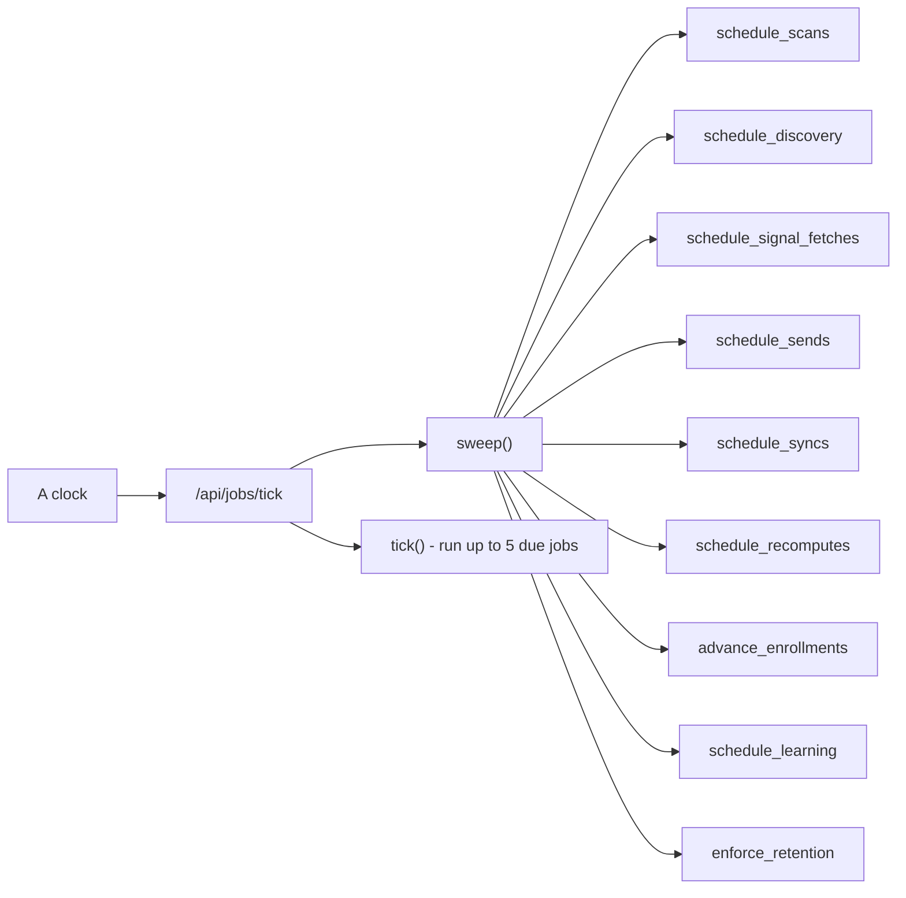

# The heartbeat


**Current state (re-checked 19 Nov 2026).** The committed driver is
`.github/workflows/tick.yml`: GitHub Actions calls `/api/jobs/tick` every five
minutes. It does nothing until the repository has the secret `CRON_SECRET` and
the variable `HUNTLOOP_URL`. `apps/web/vercel.json` has no `crons` block
(Vercel Cron was removed in `59f7942` because Hobby refuses it). Whether
production is actually being ticked can only be read from production: see
[Verifying it actually runs](#verifying-it-actually-runs).



> **Layer:** Internal · **Audience:** operations, engineering, leadership

Every scheduled behaviour (discovery re-runs, source scans, reply sync,
sequence advancement, retention enforcement, signal fetches) depends on
`/api/jobs/tick` being called by a clock. Until September 2026 none was
configured in any deployment, so the engine has never been observed running on
a schedule.

## What depends on it



Without it:

| Nothing… | Which means |
|---|---|
| scans a source | No new signals from monitored places |
| re-runs discovery | **Discovery runs once per workspace, during onboarding, and never again** |
| fetches company signals | No hiring or funding triggers |
| advances an enrollment | Sequences never step |
| sends an approved message | Approved drafts sit forever |
| reads a mailbox | Replies are never seen, so no outcomes, so no learning |
| recomputes a score | New rules never apply to existing opportunities |
| enforces retention | Retention policies do nothing |

Discovery also has an in-app trigger: **Hunt now** on the Command Center, for
members who may spend. Everything else in the table waits for the clock.

## Ways to drive it

Pick one.

### A — GitHub Actions (committed, the default)

`.github/workflows/tick.yml` runs every five minutes and calls the tick the way
Vercel Cron did: `GET /api/jobs/tick` with `Authorization: Bearer $CRON_SECRET`.

Needs, under the repository's **Settings → Secrets and variables → Actions**:

* Secret **`CRON_SECRET`**: the same value as on the Vercel project.
* Variable **`HUNTLOOP_URL`**: the production origin.

GitHub may delay scheduled runs under load, and pauses schedules on a
repository with no activity for 60 days. Each tick catches up, so that is
acceptable for a heartbeat; a paused schedule is not, so check the workflow's
run history if the engine goes quiet. It can also be run by hand
(`workflow_dispatch`).

### B — Inngest (free; keeps a run history)

Set **both** `INNGEST_EVENT_KEY` and `INNGEST_SIGNING_KEY`, and
`NEXT_PUBLIC_SITE_URL`. Then sync the app in the Inngest dashboard at
`https://<your domain>/api/inngest` (or send that URL a `PUT`). It registers one
function, **Run one engine tick**, every five minutes. `/api/inngest` serves the
identical tick, and the queue is in Postgres either way.


The sync and signature code was rewritten to Inngest's SDK spec on 19 Nov 2026
(the earlier version could not have worked) and has not yet been run against a
live Inngest account. After the first sync, confirm the function is listed in
Inngest, and that within five minutes a run appears in its history whose
output is the tick report (jobs claimed, completed, failed).


Inngest keeps a run history, retries the invocation itself, and can be paused —
worth having once the engine is spending money on a customer's behalf. A plain
cron is one timer with no memory: a dropped invocation simply did not happen,
and nothing anywhere records that it did not. If you switch to Inngest, disable
`tick.yml` so the engine is not driven twice (harmless, since claiming is
`skip locked`, but it doubles the invocations).

One without the other is a half-wired integration that fails at the first
invocation, so the app treats either-alone as **not configured** and the route
returns 404.

### C — Vercel Cron (paid plans only)

Put a `crons` block back in `apps/web/vercel.json` and retire `tick.yml`:

```json
{
  "$schema": "https://openapi.vercel.sh/vercel.json",
  "crons": [{ "path": "/api/jobs/tick", "schedule": "*/5 * * * *" }]
}
```

Vercel then sends `Authorization: Bearer $CRON_SECRET` itself.


**A Hobby account will refuse to deploy this file:** Hobby is limited to daily
cron jobs. A deployment that does not deploy is worse than any scheduling
problem, which is why it was removed.


### D — Any external scheduler

`/api/jobs/tick` is an ordinary HTTP endpoint with a bearer token. A cron box
or an uptime pinger works as well as GitHub Actions.

```bash
curl -H "Authorization: Bearer $CRON_SECRET" https://your-app/api/jobs/tick
```

## Why a daily tick is not a slow engine

It is a **stalled** one, and the arithmetic is short.

`tick()` claims `limit` jobs (5 by default). The route sets `maxDuration = 60`
and the runner keeps a 20-second reserve, so it stops claiming with 20 seconds
left. Every job either fetches a page or calls a model, and both take tens of
seconds. **One invocation therefore completes somewhere between one and four
jobs.**

Once per day, that is a handful of jobs against a queue fed by every enabled
source, every connected mailbox and every active enrollment. The queue would
grow without bound, `job_executions` would fill with work that never runs, and
**the deployment would look correctly configured the whole time.**

That is why a daily cron was never committed as a compromise: a scheduled cron
in `vercel.json` reads as a working engine to anyone reviewing the repository.

## Verifying it actually runs


**`CRON_SECRET` being set means the endpoint *would* accept a caller. It never
means one exists.** These are different facts and the second is the one that
matters.


```sql
-- Rows that were claimed AND finished, not merely queued.
select job_name, status, count(*)
from job_executions
where created_at > now() - interval '1 hour'
group by 1, 2
order by 1;
```

| What you see | What it means |
|---|---|
| `succeeded` rows | The engine is running |
| Only `queued` rows | Something enqueued work; nothing is claiming it |
| No rows at all | Nothing is sweeping. Check the driver |
| Growing `failed` count | Read `job_executions.error` and the Engine screen |

**From outside:** `GET /api/health` carries `jobs.queue`. It reads
`stalled` (and the response is 503) once a due job has waited more than 15
minutes, the same threshold `tick.yml` uses. The tick can only raise that
alarm when it runs; an uptime monitor on `/api/health` raises it when the
tick has stopped arriving at all.

In the product, `/[org]/ops` — the **Engine** screen — shows job and provider
health and offers retry and cancel. The Sources screen shows the last tick time
and states plainly when nothing is reading sources on a timer.

## The tick report

```jsonc
{
  "claimed": 5,
  "succeeded": 4,
  "failed": 1,
  "requeued": 0,
  "stoppedEarly": false,   // true = the deadline stopped it with work still queued
  "jobs": [ /* one entry per job */ ]
}
```

`stoppedEarly: true` repeatedly means the tick cadence is too slow for the
queue depth, not that anything is broken.

## Historical note

From git: `3bff281` (19 Aug 2026) added a Vercel cron in `apps/web/vercel.json`;
`59f7942` (20 Aug) removed it after Hobby refused the deploy; `dd67aff`
(27 Sep) re-created the file with only `$schema`. `tick.yml` is the driver
since. Older pages that say a one-minute cron was committed on 2026-09-15
describe nothing that is in the history.
`docs/OPERATIONS.md`'s section *"What drives the tick, and why no cron is
committed"* is accurate again on that question. Its reasoning about Hobby limits
and about why a daily cron is a lie is reproduced above.

## Related

* [The engine](../architecture/engine.md)
* [Deployment](deployment.md)
* [Troubleshooting](../developer/troubleshooting.md#nothing-is-happening)
