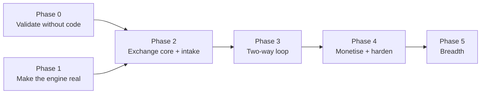
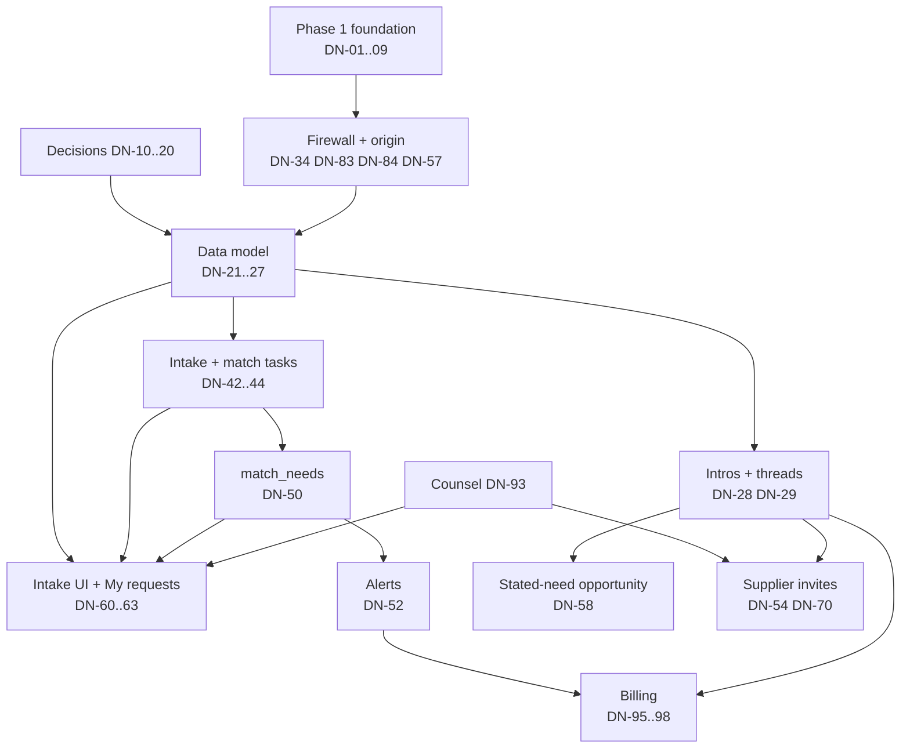

# Discovery network: build plan

> **Layer:** Engineering + product · **Status:** 📝 Plan. **Nothing here is built or decided.**
> Written 2026-11-23 from branch `feat/pass-19-debt` (migrations through `0057`).
> Builds on: [discovery-network-exploration.md](discovery-network-exploration.md) (the *why*),
> [marketplace-spec.md](marketplace-spec.md) (Exchange), [decisions/exchange.md](../decisions/exchange.md).

## How to read this

Every work item has an ID (`DN-xx`) and these fields:

| Field | Values |
|---|---|
| **Action** | **BUILD** (new) · **MODIFY** (change existing code or schema) · **INTEGRATE** (outside service or person) · **IMPROVE** (exists but not good enough) |
| **Priority** | **P0** blocks everything after it · **P1** needed for the phase exit · **P2** should have · **P3** later or optional |
| **Size** | **S** ≤ 2 days · **M** ≤ 1 week · **L** ≤ 3 weeks · **XL** > 3 weeks (one engineer, rough) |
| **Phase** | 0–5, see [§3](#3-phased-implementation-plan) |

Sizes are rough and assume one engineer who knows the repo. They are for ordering the
work, not for promising dates.

---

## 1. Summary

The vision needs **11 decisions and 97 work items across 6 phases**. 44 of the 97
(45%) modify, integrate with or improve something that already exists, rather than
build something new. That proportion is the main point: most of the machinery
exists, and the work is mostly connecting it to new entry points safely.

| Area | Build | Modify | Integrate | Improve | Total |
|---|---|---|---|---|---|
| Foundation (make today's product real) | 0 | 1 | 5 | 3 | 9 |
| Data model | 13 | 7 | 1 | 0 | 21 |
| AI tasks | 5 | 2 | 0 | 1 | 8 |
| Jobs | 6 | 4 | 0 | 0 | 10 |
| Product surfaces (UI + actions) | 12 | 5 | 0 | 0 | 17 |
| Notifications and communication | 3 | 3 | 0 | 0 | 6 |
| Trust, safety, privacy, legal | 6 | 4 | 2 | 0 | 12 |
| Billing | 2 | 2 | 1 | 0 | 5 |
| Quality gates, tests, observability | 6 | 2 | 0 | 1 | 9 |
| **Total** | **53** | **30** | **9** | **5** | **97** |

(DN-35 is listed as a MODIFY but is a deliberate "no change", kept for the record.)

**Critical path:** Foundation (Phase 1) → firewall and data model (Phase 2) → intake and
matching (Phase 2) → alerts and intros (Phase 3) → billing (Phase 4). Phase 0 (no code)
runs in parallel with Phase 1.

---

## 2. Complete work catalogue

### 2.1 Foundation: make today's product real

These come before any new feature. Today most of the engine is 🟡 (built, not proven
live; master guide Part 14). Building a two-sided network on an unproven first side
doubles the risk.

| ID | Action | Item | Detail | Pri | Size | Phase |
|---|---|---|---|---|---|---|
| DN-01 | INTEGRATE | Apply migrations to production | **Update 2026-11-23:** production `/api/health` reports schema complete through `0056`. Only `0057` remains, and the `migrate.yml` workflow applies it on merge to `main` (`DATABASE_URL` secret is set) | P0 | S | 1 |
| DN-02 | INTEGRATE | Live run with real keys | Anthropic, Apollo, Hunter, ZeroBounce, Gmail/Graph, HubSpot. Use `npm run live-check` | P0 | M | 1 |
| DN-03 | INTEGRATE | Turn on the tick | Set `CRON_SECRET` and `HUNTLOOP_URL` for `.github/workflows/tick.yml` (5-minute cron), or move to a host with minute-level cron | P0 | S | 1 |
| DN-04 | INTEGRATE | Fix or delete the stray `huntloop` Vercel project | Master guide blocker #7 | P2 | S | 1 |
| DN-05 | IMPROVE | Tick latency | A 5-minute GitHub cron (delayed under load) is fine for discovery, but too slow for "instant" supplier alerts. Decide: Inngest event triggers (already a dependency, `apps/web/app/api/inngest`) or a minute cron | P1 | M | 1 |
| DN-06 | IMPROVE | Close the pass-20 audit findings that break live data | **Update 2026-11-23:** `COMMAND.md` §14 has no open mismatches; the real list is `audit/pass-20/06_PLAN.md`. P0 (PANEL-301–303, 401) and PANEL-101, 406, 102, 115 are merged; the rest of P1 (PANEL-201/103/210/207/212, 202/203/211, 313) plus check C1 are fixed on `feat/pass-20-p1`. P2 and P3 of that plan remain | P1 | M | 1 |
| DN-07 | MODIFY | Billing decision recorded (decision log #1) | Needed before Phase 4. Stripe or not, which plans | P1 | S | 1 |
| DN-08 | INTEGRATE | Legal facts for the legal pages (`LEGAL-01`) | Master guide blocker #4. Exchange privacy notices depend on them | P0 | S | 1 |
| DN-09 | IMPROVE | Production monitoring baseline | Sentry exists. Add alerts for job failure rate, queue depth (`0055` status checks) and AI spend per day | P1 | S | 1 |

### 2.2 Decisions that block code

These are decisions, not code, but each one changes the schema or the routing. Each needs
an owner and a date.

| ID | Decision | Blocks | Recommendation (from the exploration) |
|---|---|---|---|
| DN-10 | **EX-1** Buyer brand and domain | `proxy.ts` host routing, email sender, privacy title | Same app, separate buyer domain behind a host check |
| DN-11 | **EX-2** Launch region and currency | Budget columns, privacy notice, residency | India-first, `currency` stored per need from day one |
| DN-12 | **EX-3** Free provider claims for non-customers | `provider_profiles.org_id` nullability, plans | Yes, free with limits |
| DN-13 | **EX-4** Verified domain for level 3 | Intro acceptance, demand weighting | Required for level 3 |
| DN-14 | **EX-5** First 1–2 categories and their attributes | `categories` seed, question templates | From existing seller customers' products, only leaves with ≥ 5 providers |
| DN-15 | **EX-6** Buyer is a personal workspace? | Auth and RLS for Exchange tables | Yes (`workspace_kind = 'personal'`, `0044:44-50`) |
| DN-16 | **EX-7** Verifying providers without a domain | Freelancer offerings | Verified email + evidence, distinct badge |
| DN-17 | **EX-8** Contacting unregistered suppliers | Supplier invites | Buyer-initiated, capped, business address only, after counsel review |
| DN-18 | **EX-9** Intent threshold for instant alerts | Alert routing | ≥ 3 stated facts out of 5 |
| DN-19 | **EX-10** Regulated categories | Category flags, verification | Flag-driven: verified buyers only, no anonymous cards |
| DN-20 | Lawful basis (GDPR/DPDP) for stated needs and supplier invites | Phase 2 launch | Get counsel review before Phase 2 goes to real users |

### 2.3 Data model

**New tables** (Exchange tables have no `org_id` and are read through security-definer
functions, as in spec §7):

| ID | Action | Table | Key columns / notes | Pri | Size | Phase |
|---|---|---|---|---|---|---|
| DN-21 | BUILD | `categories` | `slug, parent_id, name, attributes jsonb, question_template jsonb, regulated bool, active bool`. Seeded as data, so changes need no migration | P0 | S | 2 |
| DN-22 | BUILD | `intake_sessions`, `intake_messages` | `user_id, org_id, direction (buy/sell/partner), category_id, requirement jsonb, status, turns, created_need_id, created_offering_id, ai_run_ids`. Can't reuse `conversations`, because `opportunity_id` is `not null` there (`0004:181`) | P0 | M | 2 |
| DN-23 | BUILD | `needs` | Spec §7, plus `quantity, unit, deliver_to, must_haves jsonb, intent_dimensions jsonb, intent_band, last_confirmed_at, visibility 0–3, status`. Each field carries fact/inference/unknown inside `attributes` | P0 | M | 2 |
| DN-24 | BUILD | `provider_profiles` | `org_id null` until claimed, `domain, name, claimed_at, verified_at, kind (company/individual), source` | P0 | S | 2 |
| DN-25 | BUILD | `offerings` | `provider_id, category_id, attributes, price_model, price_from/to, currency, moq, capacity, availability jsonb (+as_of), regions[], ships_to[], size_bands[], product_id null` (links to existing `products`) | P0 | M | 2 |
| DN-26 | BUILD | `offering_evidence` | Same shape as `evidence` (`claim_kind`, citations, freshness). Holds authorised-partner proof, pricing pages | P1 | S | 2 |
| DN-27 | BUILD | `matches` (+ history) | `need_id, offering_id, score, dimensions jsonb, explanation, cited_evidence_ids, computed_at, buyer_state, provider_state` | P0 | M | 2 |
| DN-28 | BUILD | `intro_requests` | Spec §8 state machine. `direction, state, message, decided_at`, with a check constraint on transitions | P1 | M | 3 |
| DN-29 | BUILD | `exchange_threads`, `exchange_messages` | Two-party in-app messages. Contact details shared only on the buyer's choice | P1 | M | 3 |
| DN-30 | BUILD | `exchange_outcomes` | Both sides report, and disagreements are kept. Also written into the existing `outcomes` for the seller org | P1 | S | 3 |
| DN-31 | BUILD | `supplier_invites` | `need_id, domain, contact_address, invited_by, sent_at, state`. Caps: 5 per need, 1 per domain per 30 days | P2 | S | 3 |
| DN-32 | BUILD | `exchange_reports` | Trust and safety queue: `reporter, subject_type, subject_id, reason, state` | P1 | S | 3 |
| DN-33 | BUILD | `reveal_log` (or reuse `audit_logs`) | Every identity reveal: need, org, level, when. Prefer `audit_logs` if its shape fits | P0 | S | 2 |

**Changes to existing tables:**

| ID | Action | Table | Change | Why | Pri | Size | Phase |
|---|---|---|---|---|---|---|---|
| DN-34 | MODIFY | `people`, `opportunities` (+ `contact_points`) | Add `origin text check (origin in ('engine','import','exchange'))`, default `'engine'` | The firewall's anchor (spec §6) | P0 | S | 2 |
| DN-35 | MODIFY | `evidence.subject_type` check (`0002:113-114`) | Not extended. A stated-need opportunity uses `subject_type = 'opportunity'` with `kind = 'fact'` | Keeps the existing contract | — | — | 2 |
| DN-36 | MODIFY | `notification_preferences` (`0040:44-52`) | Add `exchange_alerts ('off','digest','instant')`, `alert_category_ids uuid[]`, `instant_quiet_hours` | Per-category opt-in | P1 | S | 3 |
| DN-37 | MODIFY | `organizations` | Add `purpose ('seller','buyer','both')` or derive it from usage, so analytics and plans can tell buyer workspaces apart (if EX-6 = personal workspace) | Analytics, quotas | P2 | S | 2 |
| DN-38 | MODIFY | `plans.limits` (`0001:48-54`) + `check_quota_internal` | New metered quotas: `intro_requests`, `instant_alerts`, `supplier_invites`, `needs_open` | Abuse limits, monetisation | P1 | S | 3 |
| DN-39 | MODIFY | `suppressions` | Allow a domain-level row for supplier invites (suppress `*@acme.com` after an unsubscribe) | Compliant invites | P2 | S | 3 |
| DN-40 | MODIFY | Retention and erase (`enforce_retention`, `purge_contact_data`, `0029`) | Cover `needs`, `intake_*`, `exchange_messages`. Tombstone seller-side `origin='exchange'` people on buyer deletion | DPDP/GDPR | P0 | M | 2 |
| DN-41 | INTEGRATE | Postgres `pg_trgm` + full-text indexes | Supabase extension. GIN indexes on `offerings` text and `needs.summary` | Matching recall without vectors | P1 | S | 2 |

### 2.4 AI tasks (`packages/ai`)

Each new task is added to the `TaskName` union and `ROUTES` (`packages/ai/src/models.ts:33-106`).
The union makes a missing route a type error, so the routing can't be forgotten.

| ID | Action | Task | Model / effort | Contract | Pri | Size | Phase |
|---|---|---|---|---|---|---|---|
| DN-42 | BUILD | `intake_classify` | Haiku / low | Free text → `{direction, category_id from a closed list, confidence}`. The schema is limited to the active category ids | P0 | S | 2 |
| DN-43 | BUILD | `intake_turn` | Sonnet / low–medium | `{template, requirement so far, profile context, last answer}` → `{extracted fields with kind, next_question, quick_replies[], ready_suggested}`. Code (not the model) decides when the requirement is complete | P0 | M | 2 |
| DN-44 | BUILD | `explain_match` | Sonnet / medium | Top-20 rerank → dimensions + a one-line reason, citing evidence ids from a closed set (same pattern as `draft-icp.ts`) | P0 | M | 2 |
| DN-45 | BUILD | `verify_supplier` | Opus / high | Reads a supplier site with allow-listed `web_fetch` → authorised-partner evidence, regions, capabilities. Fields it can't support are omitted | P1 | M | 3 |
| DN-46 | BUILD | `draft_offering` | Opus / high, or reuse `research_company` output | Product page → offering attributes with citations (the seller side of intake) | P1 | S | 2 |
| DN-47 | MODIFY | `workspace_assistant` context | Allow "what open needs match us?" for providers. Records go through the §5 visibility functions only | P2 | S | 3 |
| DN-48 | MODIFY | `personalize_message` input guard | Refuse any input that comes from intake or a need. A buyer's chat must never become cold-email copy | P0 | S | 2 |
| DN-49 | IMPROVE | Task eval fixtures | Add 50 real Phase 0 transcripts as scripted-client fixtures in `packages/ai/scripts/verify-tasks.ts`, so prompt changes are tested without spending money | P1 | M | 2 |

**No second LLM provider is in this plan.** It's added only if Phase 2 data shows a cost,
latency or quality gap. The seam is `packages/ai/src/client.ts:46-48`.

### 2.5 Background jobs (`packages/jobs`)

| ID | Action | Job | Trigger | Detail | Pri | Size | Phase |
|---|---|---|---|---|---|---|---|
| DN-50 | BUILD | `match_needs` | Need created or changed, offering created or changed, daily sweep | Hard filters → `pg_trgm`/FTS recall (top 50) → `explain_match` (top 20) → upsert `matches` | P0 | L | 2 |
| DN-51 | BUILD | `score_intent` | Need created or edited | Deterministic intent dimensions (no LLM except the urgency inference) → `intent_band` | P1 | S | 2 |
| DN-52 | BUILD | `send_exchange_alerts` | After `match_needs` | Instant for HOT needs that meet EX-9 and the supplier's preference. Everything else waits for the digest. Throttled per supplier per day | P1 | M | 3 |
| DN-53 | BUILD | `expire_needs` / `reconfirm_needs` | Daily | A one-tap re-confirm email at 50% of the time to decide-by. Expire at decide-by + 14 days if not re-confirmed | P1 | S | 3 |
| DN-54 | BUILD | `send_supplier_invite` | Buyer clicks Invite | One email to a published business address. Checks caps and domain suppression. Never touches Apollo or Hunter | P2 | M | 3 |
| DN-55 | BUILD | `aggregate_demand` | Hourly or daily | Market demand counts per category × region × size band, k ≥ 10 enforced in SQL. Groups below k are widened or hidden | P1 | M | 3 |
| DN-56 | MODIFY | `send_digests` | | Add a "matched needs" section, behind the new preference | P1 | S | 3 |
| DN-57 | MODIFY | `enrich_person`, `send_message`, `advance_enrollments`, `sync_hubspot` | | Refuse `origin = 'exchange'` rows (firewall). HubSpot push only for intros in the accepted state | P0 | S | 2 |
| DN-58 | MODIFY | `score_opportunity` / opportunity creation | Intro accepted | Create the opportunity with `origin='exchange'` and a fact evidence row ("buyer stated this need on …"). A "Stated need" badge ranks it above signal-based opportunities when scores tie | P1 | M | 3 |
| DN-59 | MODIFY | `finishOnboarding` hook | A new seller finishes onboarding | Queue `match_needs` for that org's offerings, so new supply is matched straight away | P2 | S | 3 |

### 2.6 Product surfaces (routes, server actions, data layer)

All new pages read through `apps/web/lib/data/*` and show `DemoFigures` when there is no
data (README rule). New nav items must pass `NAV-01` (`scripts/audit.mjs:201`).

| ID | Action | Surface | Detail | Pri | Size | Phase |
|---|---|---|---|---|---|---|
| DN-60 | MODIFY | Onboarding first step (`apps/web/lib/onboarding/steps.ts:215-245`) | Add the intent categories (Find products / services / suppliers / customers / buyers / partners, Sell, Describe your need) next to the existing research / import / explore / hunt jobs. "Find customers" maps to the existing `hunt` flow | P0 | M | 2 |
| DN-61 | BUILD | Intake chat UI | Category chips, one question at a time, quick-reply chips, Skip and Not sure, a progress hint, and a summary card where every field can be edited. Renders as a plain form when AI is off or refuses | P0 | L | 2 |
| DN-62 | BUILD | Visibility picker | Shows exactly what a supplier would see at each level, using the user's own data | P0 | M | 2 |
| DN-63 | BUILD | **My requests** (buyer) | Each need with its matches, shortlist, compare view (dimensions + evidence links), pending intros, edit, pause, withdraw, re-confirm | P0 | L | 2 |
| DN-64 | BUILD | **Compare** | Offerings side by side on the match dimensions. UNKNOWN is shown as UNKNOWN | P1 | M | 3 |
| DN-65 | BUILD | **Exchange profile** (provider, under Settings) | Claim and verify, offerings (prefilled from `products`), evidence, regions, MOQ, availability with an "as of" date | P0 | L | 2 |
| DN-66 | BUILD | **Matched needs** (provider) | Level-2/3 anonymous cards, a Request intro action, filters | P1 | M | 3 |
| DN-67 | BUILD | **Market demand** (provider) | Aggregates with k ≥ 10. Named differently from the existing `/demand` page (which is prospect themes) | P1 | M | 3 |
| DN-68 | BUILD | **Intros and messages** | Thread view for both sides, a "Share my contact details" button, an outcome prompt | P1 | L | 3 |
| DN-69 | BUILD | **Privacy centre** (buyer) | Every need's level, who has seen what (from the reveal log), export, delete | P0 | M | 2 |
| DN-70 | BUILD | Supplier invite flow | A "not on HuntLoop yet" public suppliers list on a need, with an **Invite to quote** button (capped). Phase 3 | P2 | M | 3 |
| DN-71 | BUILD | Claim-your-listing landing page | Public token page (follows the existing `/invite`, `/unsubscribe` pattern). Verifies the domain via SEC-302 | P2 | M | 3 |
| DN-72 | MODIFY | Opportunities list and detail | "Stated need" badge, a filter, origin shown, and outreach actions disabled for `origin='exchange'` | P1 | S | 3 |
| DN-73 | MODIFY | `apps/web/proxy.ts` | Buyer-domain host routing (EX-1), CSP for the new routes, public-route allow-list | P1 | S | 2 |
| DN-74 | MODIFY | Marketing site (`(marketing)/discover`, `for/[useCase]`) | A buyer-side landing page and an anonymous "describe what you need" entry, reusing the existing anonymous research rate limits (`0025`) | P2 | M | 3 |
| DN-75 | BUILD | Admin: trust and safety queue | Reports, suspensions (via platform pause `0053`), category management, regulated flags | P1 | M | 3 |
| DN-76 | MODIFY | Sidebar and `destination.ts` | New nav destinations (My requests, Matched needs, Market demand, Intros), kept consistent with the NAV-01 gate | P1 | S | 2 |

### 2.7 Notifications and communication

| ID | Action | Item | Detail | Pri | Size | Phase |
|---|---|---|---|---|---|---|
| DN-77 | BUILD | Email templates (`packages/jobs/src/email/templates.ts`) | New-match alert, intro requested, intro accepted, new message, re-confirm need, supplier invite, claim-your-listing. Every one has a one-click unsubscribe | P1 | M | 3 |
| DN-78 | BUILD | In-app notification centre | Today notices are counts, question cards and nudges. Intros and messages need a feed with read/unread state | P1 | M | 3 |
| DN-79 | BUILD | Notification settings UI for the Exchange | Off / digest / instant, per category, quiet hours | P1 | S | 3 |
| DN-80 | MODIFY | Sender identity | Buyer-domain sender for buyer-facing mail (EX-1). Separate Resend domain with SPF/DKIM | P1 | S | 3 |
| DN-81 | MODIFY | Unsubscribe route (`apps/web/app/unsubscribe`) | Handle exchange alert types and domain-level supplier opt-outs | P1 | S | 3 |
| DN-82 | MODIFY | `needs-you` | Intros waiting for a decision and unanswered buyer messages appear here for providers | P2 | S | 3 |

### 2.8 Trust, safety, privacy, legal

| ID | Action | Item | Detail | Pri | Size | Phase |
|---|---|---|---|---|---|---|
| DN-83 | BUILD | **Firewall enforcement** | `origin='exchange'` refused in `packages/providers/src/call.ts` (the guard at `:9-13`) and in the send, sequence and CRM paths (DN-57). Security-definer read functions apply the visibility levels | P0 | M | 2 |
| DN-84 | BUILD | **Firewall CI gate (FW-01)** | Added to `scripts/audit.mjs` next to NAV-01, plus an e2e spec that tries each forbidden path with an Exchange row and expects a refusal. **Phase 3 doesn't start until it's green** | P0 | M | 2 |
| DN-85 | BUILD | Visibility read functions | `get_need_card(need, viewer_org)` widens bands when a group has fewer than k needs. Free text hidden below level 3 | P0 | M | 2 |
| DN-86 | BUILD | Rate limits | Needs per account per day, intake turns per session (8), intro requests per provider per week, invites per need. Reuses `consume_rate_limit()` (`0005`) | P0 | S | 2 |
| DN-87 | BUILD | Fake-buyer and spam controls | Verified email to create a need; domain verification for level 3 (EX-4); unverified needs weighted lower in aggregates; decline-rate throttle on providers | P1 | M | 3 |
| DN-88 | BUILD | Regulated category handling | `categories.regulated` → no anonymous cards, verified buyers only, an explicit notice (export-controlled GPUs, medical, chemicals) | P1 | S | 2 |
| DN-89 | MODIFY | Privacy notice and terms | Purpose-specific notice at need creation; intermediary terms (HuntLoop isn't party to any deal); acceptable use for providers | P0 | M | 2 |
| DN-90 | MODIFY | Data export | Extend "export my data" to needs, intake transcripts, intros and messages | P1 | S | 2 |
| DN-91 | MODIFY | `audit_logs` / Activity log | Log reveals, intro decisions, visibility changes, reports. Shown in Settings → Activity | P0 | S | 2 |
| DN-92 | MODIFY | Prompt-injection handling | Wrap user intake text and supplier pages with `wrapUntrusted` (`packages/ai/src/untrusted.ts:22`) in every new task | P0 | S | 2 |
| DN-93 | INTEGRATE | Counsel review | Lawful basis, invite policy, intermediary terms, record of processing, per launch region | P0 | M | 2 |
| DN-94 | INTEGRATE | Authorised-partner sources | Brand partner-locator pages per launch category, read by `verify_supplier`. Manual list first, no scraping at scale. Check each site's terms | P2 | M | 3 |

### 2.9 Billing

| ID | Action | Item | Detail | Pri | Size | Phase |
|---|---|---|---|---|---|---|
| DN-95 | INTEGRATE | Stripe | Checkout, customer portal, webhooks → `subscriptions` (the table exists, `0001`) | P1 | L | 4 |
| DN-96 | BUILD | Provider plans | A free claimed profile (EX-3), plus a paid tier with demand analytics, a monthly intro allowance, and overage per **accepted** intro (never per view) | P1 | M | 4 |
| DN-97 | MODIFY | `plans-and-quotas.md` + plan seeds | Add Exchange quotas (DN-38) and the free provider plan | P1 | S | 4 |
| DN-98 | MODIFY | Quota UI | "You've used 18/20 intro requests" with honest copy (that doc's rule about quotas) | P2 | S | 4 |
| DN-99 | BUILD | Promoted listings (optional) | A separate, labelled slot. Never changes `score` | P3 | M | 5 |

### 2.10 Quality gates, tests, observability

| ID | Action | Item | Detail | Pri | Size | Phase |
|---|---|---|---|---|---|---|
| DN-100 | BUILD | Unit tests per task and job | Scripted-client tests (no key, no network), same as the existing tasks | P0 | M | 2 |
| DN-101 | BUILD | e2e journeys | Buyer intake → need → match → intro → outcome; provider claim → offering → alert → intro. Added to `e2e/` | P1 | L | 3 |
| DN-102 | BUILD | RLS tests for Exchange tables | A seller org can't select needs directly. Only the functions return rows, at the right level | P0 | M | 2 |
| DN-103 | BUILD | Exchange metrics | Need capture, match coverage, time to first match, intro acceptance, qualified intros per need, outcome rate (spec §14). Shown in Ops | P1 | M | 3 |
| DN-104 | BUILD | Intake funnel analytics | Drop-off per question, skip and not-sure rates, turns to complete, AI fallback rate | P1 | S | 2 |
| DN-105 | BUILD | Cost dashboard per need | AI cost per intake and per match from `ai_runs`, with an alert above budget | P2 | S | 2 |
| DN-106 | MODIFY | `npm run verify` / CI (`.github/workflows/ci.yml`) | Add FW-01 and the Exchange RLS tests to the required checks | P0 | S | 2 |
| DN-107 | MODIFY | Generated docs (`docs/spec/generated/schema-reference.md`, `COMMAND.md`, master guide, CHANGELOG) | `COMMAND.md`'s maintenance rule requires same-commit updates for new routes and actions | P1 | S | all |
| DN-108 | IMPROVE | `db:doctor` / `verify-migrations` | Check the new tables, functions and extensions exist, and that RLS is on | P1 | S | 2 |

---

## 3. Phased implementation plan

### Phase 0 · Validate without code (2–3 weeks, parallel with Phase 1)

**Goal:** find out whether buyers will state needs through a conversation and accept intros,
and whether providers will pay. Nothing gets built if this fails.

| Step | Detail |
|---|---|
| Decide DN-10 (working name) and DN-14 (one category) | The minimum needed to run the test |
| Run [exchange-demand-test.md](exchange-demand-test.md), with the form replaced by a person-run chat | One Claude prompt with the requirement schema, run by the founder. Transcripts saved |
| Recruit 5–8 providers in the category | Ask whether they'd pay, and how much |
| Hand-match within 48 hours | The written "why" per match becomes the eval set for `explain_match` |

**Exit:** the demand test's pass bar, **plus** a median of ≤ 6 turns to a complete
requirement, **plus** ≥ 3 of 5 providers saying they'd pay.
**If it fails:** stop, or switch to the shortlist-only fallback the demand test describes.

### Phase 1 · Make the engine real (2–4 weeks)

Items: **DN-01 – DN-09**, plus decisions DN-11 – DN-13 and DN-15 – DN-20 started.

**Exit:** one full live loop in production (discover → research → score → approve → send →
reply sync). Tick running. Monitoring alerts in place. Migrations current.

### Phase 2 · Exchange core + conversational intake (8–12 weeks)

The largest phase. Order inside it:

1. **Safety first:** DN-34, DN-83, DN-84, DN-85, DN-86, DN-102, DN-106, DN-48, DN-57, DN-92. *The firewall exists before any buyer data does.*
2. **Data model:** DN-21 – DN-27, DN-33, DN-37, DN-40, DN-41.
3. **AI:** DN-42, DN-43, DN-44, DN-46, DN-49, DN-100.
4. **Jobs:** DN-50, DN-51.
5. **Surfaces:** DN-60, DN-61, DN-62, DN-63, DN-65, DN-69, DN-73, DN-76.
6. **Legal and privacy:** DN-88, DN-89, DN-90, DN-91, DN-93.
7. **Measure:** DN-104, DN-105, DN-108.

**Exit:** 50 real open needs in the launch category; ≥ 80% have at least one eligible match;
the firewall e2e is green in CI; intake median ≤ 6 turns; AI cost per need ≤ $0.10.
**Not in this phase:** supplier alerts, intros, messages, billing. Buyers get a shortlist and
the founder makes the intros by hand. That keeps the Phase 0 loop going while the
software catches up.

### Phase 3 · The two-way loop (6–10 weeks)

Items: DN-28 – DN-32, DN-36, DN-38, DN-39, DN-45, DN-47, DN-52 – DN-59, DN-64,
DN-66 – DN-68, DN-70 – DN-72, DN-74, DN-75, DN-77 – DN-82, DN-87, DN-94, DN-101, DN-103.

Recommended order: intros + threads (DN-28, DN-29, DN-68) → opportunity creation (DN-58,
DN-72) → alerts and notification settings (DN-36, DN-52, DN-77 – DN-81) → matched needs
and market demand (DN-55, DN-66, DN-67) → trust and safety (DN-32, DN-75, DN-87) → supplier
invites last (DN-31, DN-54, DN-70, DN-71), and only after counsel signs off on DN-17.

**Exit:** 20 accepted intros; outcomes reported for ≥ 50%; alert unsubscribe rate < 5%;
no firewall violations.

### Phase 4 · Monetise and harden (4–6 weeks)

Items: DN-95 – DN-98, plus load testing of `match_needs` and the alert fan-out, a security
review of the visibility functions, and penetration testing of the public token pages.

**Exit:** the first paying providers; billing reconciled against `subscriptions`.

### Phase 5 · Breadth (only when the metrics say so)

Each item is decided separately against Phase 3–4 data:

| Item | Condition to start |
|---|---|
| More categories | A category has ≥ 5 active providers and buyer demand from Phase 3 |
| Freelancers and individual providers (EX-7) | Services categories show demand |
| Services for individual consumers | A B2B services category succeeded first |
| RFQ-lite (one need, many structured quotes) | Needs routinely get > 3 responses |
| `pgvector` semantic recall | Measured recall gap, or > 5–10k offerings |
| Buyer teams, CRM push of intros, public API and webhooks | Asked for by paying customers |
| Second LLM provider | Measured cost, latency or quality gap |
| Promoted listings (DN-99) | Enough supply that ranking matters |
| Multilingual intake | A launch region needs it |

**Not planned at any phase:** checkout, payments between buyers and suppliers, inventory
sync, escrow, logistics, retail consumer products, and inferring individuals' buying intent.

---

## 4. Dependencies

### 4.1 Between work items

### 4.2 External dependencies

| Dependency | Status | Needed by | Risk if late |
|---|---|---|---|
| Anthropic API key + budget | Exists | Phase 1 | Intake falls back to the form |
| Supabase (prod access, `pg_trgm`) | Exists | Phase 1–2 | Blocks everything |
| Resend + a second sending domain | Resend exists; domain is new | Phase 3 | No buyer-side mail |
| Stripe | Not started | Phase 4 | No revenue; Phase 3 can run free |
| Legal counsel | Not engaged | Phase 2 launch | Can't take real buyer data |
| Brand partner-locator data | Not started | Phase 3 | The Authenticity dimension stays UNKNOWN |
| Real buyers and providers (people) | Phase 0 | Phase 0 | The plan has nothing to validate |

---

## 5. Risks

| # | Risk | Likelihood | Impact | Mitigation | Owner |
|---|---|---|---|---|---|
| R1 | Buyer data reaches enrichment or cold email | Medium | Fatal to trust | Firewall + FW-01 gate before any buyer data (Phase 2 step 1) | Engineering |
| R2 | Cold start: too few providers per category | High | High | One or two categories; seed from existing customers; founder hand-matches in Phase 2 | Founder |
| R3 | Building on an unproven engine | High | High | Phase 1 before Phase 2 | Owner |
| R4 | Legal exposure from invites or consumer data | Medium | High | Counsel (DN-93); invites last and capped; no consumer retail | Counsel |
| R5 | Supplier data stale or wrong (stock, price, authorised status) | High | Medium | UNKNOWN by default; "as of" dates; evidence-only badges | Engineering |
| R6 | Alerts feel like spam, so suppliers unsubscribe | Medium | High | Intent threshold (EX-9), digest by default, per-category opt-in | Product |
| R7 | Scope creep toward e-commerce or "universal" breadth | High | High | The Phase 5 start conditions; the "not planned" list | Product |
| R8 | Intake is annoying (too many questions) | Medium | Medium | The template caps required slots at 3–6; the code decides when to stop; funnel analytics (DN-104) | Product |
| R9 | AI cost per need grows | Low | Medium | Sonnet/Haiku routing, turn caps, cost alerts (DN-105) | Engineering |
| R10 | Export-controlled or counterfeit goods | Medium | High | Regulated category flags (DN-88); verified buyers only | Counsel + T&S |
| R11 | Billing undecided, so Phase 4 slips | Medium | Medium | Phase 3 runs free; the decision is due in Phase 1 (DN-07) | Owner |
| R12 | One engineer, many phases | High | Medium | Strict phase gates; Phase 2 has no messaging or billing | Owner |
| R13 | Brand trust: buyers who got a cold email from a HuntLoop customer | Medium | Medium | EX-1: a separate buyer domain | Product |
| R14 | The tick is too slow for instant alerts | Medium | Low | DN-05: Inngest events or a minute cron | Engineering |

---

## 6. Gaps and things we may have overlooked

**Gaps in the current plan or spec**

1. **No in-app notification feed exists.** Today's notices are counts and cards. Intros and
   messages need a real feed (DN-78).
2. **No two-party messaging.** `threads` are email threads tied to a mailbox and one org
   (`0004:115-127`). Exchange threads are a new system, not a modification.
3. **`conversations` can't hold intake** because `opportunity_id` is required (`0004:181`).
4. **Notification preferences are digest-only** (`0040:44-52`). There's no per-type setting yet.
5. **Rate limits and quotas don't know about the Exchange.** Every new action needs its own
   limit (DN-38, DN-86).
6. **No "regulated goods" concept** anywhere in the code or the spec.
7. **No availability or "as of" model.** Nothing in the schema expresses "in stock as of a date".
8. **Admin tooling is thin.** There's no moderation queue or category manager.

**Overlooked items**

9. **Account deletion has to reach the other side.** When a buyer deletes a need, supplier-side
   opportunities and threads must be tombstoned (DN-40), including copies already pushed to
   HubSpot.
10. **Same-org matching.** A company's own needs must never match its own offerings or show up
    as its own leads.
11. **Duplicate needs** (the same buyer twice, or colleagues at one company) cause double
    alerts. A merge rule is needed, modelled on `merge_candidates`.
12. **Off-platform closes.** Most deals finish by phone or email, so the outcome prompt is the
    only signal and it has to be one tap.
13. **Response-time trust signal.** Show each provider's median time to first response.
14. **Time zones and quiet hours** for instant alerts across regions.
15. **Accessibility and mobile.** The intake chat will be used mostly on phones. The existing
    `a11y.spec.ts` should cover it.
16. **Multilingual input** works in the model but not in category matching. The category tree
    has to carry the meaning.
17. **Support load.** Buyers will reply to alert emails expecting a person. Someone has to read
    them.
18. **Seed data and demo mode.** Every new page needs a `DemoFigures` state (README rule) and
    seed rows for `db:seed`.
19. **Documentation debt.** `COMMAND.md` must be updated in the same commit as each new route
    (its maintenance rule), and `0057` is still uncommitted on this branch.
20. **Exit strategy for a failed category.** How a category is retired, and what buyers in it
    are told.

---

## 7. What to do first

1. Commit or land the current `feat/pass-19-debt` work so Phase 1 starts from a clean base.
2. Book the owner tasks DN-01, DN-02, DN-03, DN-08 (production migrations, live run, tick,
   legal facts).
3. Make decisions DN-10 and DN-14 (working name, one category), and start Phase 0 the same
   week.
4. Engage counsel for DN-20 and DN-93 while Phase 0 runs.
5. Don't start Phase 2 code until Phase 0 passes and Phase 1's live loop works.

*This plan changes no code. When an item ships, mark it built in the master guide and
`COMMAND.md`; when a decision is made, record it in [decisions/exchange.md](../decisions/exchange.md).*
