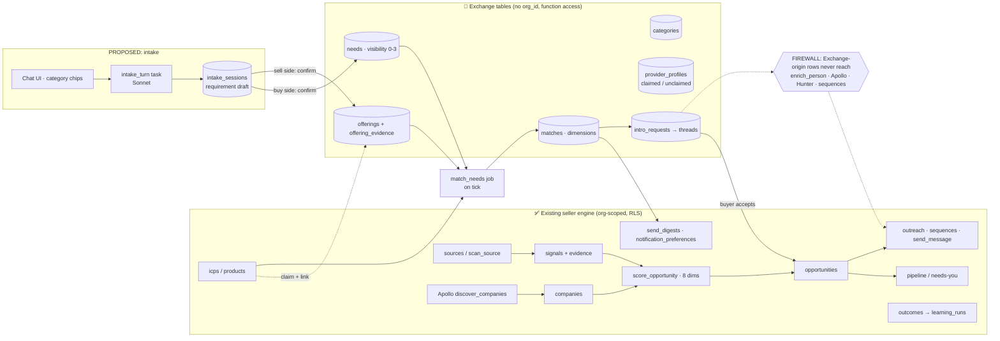
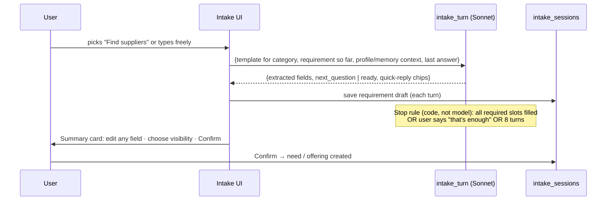

# HuntLoop as a two-way discovery network: exploration

> **Layer:** Product · **Status:** 📝 Exploration. **Everything labelled PROPOSED is not built and not decided.**
> Written 2026-11-23 from branch `feat/pass-19-debt`, migrations through `0057`.
> Brief and inventory: [discovery-network-brief.md](discovery-network-brief.md).
> Baseline: [marketplace-spec.md](marketplace-spec.md) (Exchange), [decisions/exchange.md](../decisions/exchange.md).

**Labels.** ✅ built · 🟡 built but not proven live, or partial · 📝 planned in an existing doc · ❌ missing · **PROPOSED** = new in this document.

---

## 0. Executive summary

**Recommendation.** Don't build a second product. Build **one new front door and one new
table family** on top of what exists:

1. **PROPOSED: Intake.** A conversational questionnaire that turns "what do you want?" into a
   structured, consented **Requirement**. It reuses the existing model client, structured
   output, prompt caching and saved conversations.
2. **📝 Exchange's `needs` / `offerings` / `matches` / `intro_requests`** as the data model.
   The Requirement becomes a `need` (buy side) or an `offering` (sell side).
3. **The existing seller engine stays as it is** and keeps finding *companies* from public
   signals. A stated need becomes the strongest "why now" fact it can receive, which is what
   the Exchange spec already argues.

The questionnaire should accept **any** request from day one but only **promise matches** in
1–2 launch categories. Everything else gets the honest answer: "we've saved this and will look,
but we don't cover this category yet". Being "universal" is a promise about intake. Matching has
to start narrow, because a marketplace without enough buyers and sellers in a category produces
nothing.

**The three biggest risks**

| # | Risk | Why it is serious |
|---|---|---|
| 1 | **Contacting people who never signed up** (unregistered suppliers about a buyer's need; individuals with "inferred demand") | It's cold outreach about someone else's personal data. It breaks the Exchange trust promise (spec §6) and exposes us under GDPR/PECR, CAN-SPAM and India's DPDP Act. |
| 2 | **Cold start / liquidity** | Two empty sides. Eight categories × B2B and B2C × every region means nearly every need gets zero matches. |
| 3 | **Supply data we don't have** | Stock, price, authorised-distributor status, counterfeits. Apollo (`packages/providers/src/adapters/apollo.ts:413`) searches companies. It knows nothing about products or availability. |

**First thing to do on Monday.** Run the existing hand-run demand test
([exchange-demand-test.md](exchange-demand-test.md)) with one change: replace the form with a
**chat transcript run by a person using a Claude prompt**. That one test checks the conversational
intake and the willingness to accept intros, for almost no cost and with no code.

---

## 1. Inventory: what exists and what we can reuse

| Capability | Status | Evidence | Reuse here? |
|---|---|---|---|
| Single model client, Anthropic SDK, behind a 4-field `ModelClient` interface ("the swap seam") | ✅ | `packages/ai/src/client.ts:1-12`, `:46-48` | **Yes.** Intake tasks run here. |
| Structured JSON output enforced by schema (`output_config.format`) | ✅ | `packages/ai/src/client.ts:25`, `:153`, `:212` | **Yes.** It's the Requirement extraction. |
| Prompt caching (stable system prefix, ephemeral breakpoint) | ✅ | `packages/ai/src/client.ts:23`, `:149` | **Yes.** It keeps the cost of multi-turn intake down. |
| Allow-listed `web_fetch` | ✅ | `packages/ai/src/client.ts:30-37`, `:104` | **Yes.** It handles supplier verification reads. |
| Untrusted-content rule (pages are data, not instructions) | ✅ | `packages/ai/src/untrusted.ts:22-28` | **Yes.** Needed for user text and supplier pages. |
| Task → model routing + price list (Opus $4/$20, Sonnet $2/$10, Haiku $0.10 in, per MTok) | ✅ | `packages/ai/src/models.ts:53-106`, `:156-163` | **Yes.** Add `intake_*` and `explain_match` routes. |
| Cost recorded per AI run | ✅ | `packages/ai/src/runs.ts`, `ai_runs` (`0004`) | **Yes.** |
| Multi-turn assistant with cited claims, `unresolved` field, actions | ✅ ⚠️ | `packages/ai/src/tasks/workspace-assistant.ts:35-102`, `sales-agent.ts:1-30` | **With change.** It answers questions. It doesn't fill slots or ask its own. |
| Saved conversations + messages (org-scoped, tied to an opportunity) | ✅ | `0004_outreach_memory_learning.sql:178-201`, `0045` | **With change.** Intake needs a conversation that isn't tied to an opportunity. |
| Fixed onboarding step "What do you want to get done first?" (research / import / explore / hunt) | ✅ | `apps/web/lib/onboarding/steps.ts:215-245` | **Yes.** It's the natural place to add the intent categories. |
| **Personal workspaces** (one person, no company) | ✅ | `0044_personal_learning.sql:30-50` (`workspace_kind`) | **Yes.** It's how an individual buyer or freelancer gets a workspace without a company. |
| **Just-in-time questions, asked once** | ✅ | `0044_personal_learning.sql:37`, `:234`; `apps/web/lib/data/questions.ts:13` | **Yes.** It's the pattern for "ask optional questions later, never twice". |
| Profile goals per person | ✅ | `0044_personal_learning.sql:52-54` | Yes, as intake context. |
| Website → product + ICP draft, each field citing a sentence | ✅ | `packages/ai/src/tasks/draft-icp.ts:1-45`, `research-company.ts` | **Yes.** The seller side of intake ("what do you sell?") already exists. |
| Products table (name, description, value props, proof points) | ✅ | `0002_icp_sources_evidence.sql:20-31` | **With change.** No category, price, MOQ, regions, stock. Needs `offerings`. |
| ICPs, versioned | ✅ | `0002`, `0013` | **Yes.** Run them against open needs (spec §9). |
| Evidence: `claim_kind` fact / inference / unknown | ✅ | `0002_icp_sources_evidence.sql:10`, `:113-114`; `0020` | **Yes.** Subject types are `company/opportunity/contact/signal` only. |
| 8-dimension explainable score; unknown = null, never 0 | ✅ | `packages/jobs/src/handlers/score-opportunity.ts:293-336` | **The pattern, yes.** Match scores copy it. |
| Discovery via Apollo company search | ✅ 🟡 | `packages/providers/src/adapters/apollo.ts:402-453` | **Limited.** It only finds B2B companies. |
| Provider call guard (configured? creds? breaker? budget?) | ✅ | `packages/providers/src/call.ts:9-13`, `:108` | **Yes.** It's also where the Exchange-origin refusal check would go (spec §6). |
| Entity resolution / merge candidates | ✅ | `resolve_entity`, `0012_entity_identity.sql` | **Yes.** It dedupes suppliers. |
| Signal scanning (news, jobs, funding) | ✅ 🟡 | `scan_source`, `packages/ai/src/tasks/extract-signals.ts` | **Yes**, for company-level demand. |
| Prospect demand themes (clustering what prospects asked for) | ✅ | `packages/ai/src/tasks/cluster-demand.ts:1-40`, `0042` | **The clustering logic, yes.** It's not market demand. |
| Email threads + messages (org ↔ prospect, via a mailbox) | ✅ | `0004_outreach_memory_learning.sql:115-142` | **With change.** Intro threads are in-app and run between two parties. |
| Outcomes (`reply / positive / meeting / proposal / won / lost`) | ✅ | `0004_outreach_memory_learning.sql:291-302` | **Yes.** Intro outcomes go here and into learning. |
| Notification preferences: digest on/off, hour, timezone; digest only when something needs you | ✅ | `0040_brief_value_notifications.sql:22-52` | **With change.** Add per-type and per-category opt-ins. |
| Email via Resend; daily digest job | ✅ | `packages/jobs/src/email/resend.ts`, `handlers/send-digests.ts` | **Yes.** |
| Safety: suppressions, caps, frequency, SPF/DKIM, unsubscribe, kill switch | ✅ | `0017`, `0033`, `0048`, `0050`–`0053` | **Yes.** It's the same pattern for notification throttling. |
| Job runner on a tick, backpressure, fair claiming | ✅ 🟡 | `packages/jobs/src/runner.ts`, `0038`, `0056`; `.github/workflows/tick.yml:6-28` (5-minute GitHub cron) | **Yes.** Re-matching runs here. |
| Data rights: retention, erase, audit log | ✅ | `0029`, `purge_contact_data`, `audit_logs` | **Yes.** |
| Billing | ❌ | README ("no payment path") | Blocks paid provider plans. |
| Buyer role with no org membership | ❌ (partly avoidable) | spec §4 | A **personal workspace** may be enough (see §3). |
| Categories, offerings, needs, matches, intros | 📝 | spec §7 | Core of this work. |
| Embeddings / vector search | ❌ | no `pgvector` or `embedding` in `packages/db/migrations`, `packages/ai/src` | Not needed until there are thousands of offerings. |
| Any non-Anthropic model | ❌ | grep finds no `openai` in `packages/` or `apps/web/lib` | See §5. |

---

## 2. Gap analysis (questions A–H)

| Question | What exists | What's missing | Recommendation |
|---|---|---|---|
| **A. Intake** | Fixed onboarding step, website → ICP drafting, chat with cited answers, ask-once questions | Slot-filling conversation, per-category question templates, a Requirement object, an "enough information" rule | **PROPOSED** `intake_turn` task: deterministic slot templates per category, with the LLM choosing and phrasing the next question and extracting answers. See §4. |
| **B. LLM** | Claude-only, with caching, structured output and routing | No comparison data, no second provider | **Stay on Claude.** Haiku classifies, Sonnet runs the turns, Opus is not used in intake. Revisit only with measured evidence. See §5. |
| **C. Supply discovery** | Apollo company search, website research, evidence, dedupe | Offerings, categories, availability, authorised-distributor lists, individual providers | Registered `offerings` first, then the public catalogue (📝 spec §4), then Apollo as a candidate *company* source only. Availability is UNKNOWN unless the supplier states it. |
| **D. Demand discovery** | Company signals, the 8-dimension score, ICPs | Consented needs, aggregate demand | Companies: the existing signals engine. People: **only** stated needs at visibility ≥ 1. **No inferred consumer intent.** |
| **E. Routing** | Digest, preferences, caps | Per-category opt-in, instant alerts, policy for unregistered suppliers | Registered suppliers: opt-in alerts with caps. Unregistered: **buyer-initiated invites only.** See §7.2. |
| **F. Matching** | Score pattern, rules, rescoring jobs | Match table, retrieval, intent dimensions | Hard filters → keyword/trigram → LLM rerank of the top 20. `pgvector` later. See §3.3. |
| **G. Connection** | Email threads, outcomes, learning loop, pipeline | Two-party in-app threads, intro state machine | 📝 spec §8 as written, plus a "responses" step for many-supplier needs (RFQ-lite). |
| **H. Scope** | n/a | n/a | No checkout, inventory sync, escrow, reviews marketplace or logistics. HuntLoop ends at an accepted intro plus a reported outcome. |

---

## 3. Proposed architecture (PROPOSED)

### 3.1 System diagram



### 3.2 New pieces, and why each one is needed

| PROPOSED piece | Why it can't reuse something | Smallest version |
|---|---|---|
| `intake_sessions` (+ messages) | `conversations.opportunity_id` is `not null` (`0004:181`), so intake happens before any opportunity exists | `id, user_id, org_id (personal or company), direction (buy/sell), category_id, requirement jsonb, status, created_need_id / created_offering_id` |
| Requirement JSON schema | A new contract | §4.1 |
| `categories.question_template jsonb` | Category attributes are 📝 in the spec. This adds which ones are required, optional, and in what order | A column on the 📝 `categories` table, not a new table |
| `match_needs` job | New. Uses the existing runner | Runs when a need or offering is created or changed, plus a daily sweep |
| `explain_match` task | Same as `explain_why_now`, but for a pair | Sonnet, cites only offering evidence and need fields |
| `supplier_invites` | Buyer-initiated invites to unregistered suppliers (§7.2) | `need_id, domain, invited_by, sent_at, state`, with a cap per need |
| `notification_preferences` columns | Today it's digest-only (`0040:44-52`) | `exchange_alerts ('off','digest','instant')`, `alert_categories uuid[]` |

**Buyer identity: a possible simplification of the spec.** The spec (§4) proposes a buyer
with no org membership. The repo already has **personal workspaces** (`0044:44-50`). A
proposed alternative: every buyer gets a personal workspace (individual) or uses their company
workspace (B2B), and Exchange tables reference `user_id` plus an optional `org_id`. That removes
the "every action needs a membership" blocker without a new auth model. The firewall still
applies: seller orgs can't read those rows except through the §5 functions. *Needs a decision
(new **EX-6**, §9).*

### 3.3 Matching pipeline

```
need ──► hard filters  (category · region/ships-to · open status · budget overlap if both known)
     ──► candidate recall  (Postgres full-text + pg_trgm over offering text and evidence; top 50)
     ──► rerank + explain  (Sonnet, top 20 → dimensions + one-line reason each, cites evidence ids)
     ──► store in matches  (score, dimensions jsonb, explanation, computed_at)
```

`pg_trgm` and full-text search ship with Supabase, so recall needs no new infrastructure. Add
`pgvector` only when recall quality is measurably the bottleneck, probably beyond about 5–10k
offerings.

**Match dimensions** (extends spec §9, with unknown = null as in `score-opportunity.ts:293`):

| Dimension | Source | UNKNOWN when |
|---|---|---|
| Category fit | category tree | never (hard filter) |
| Requirement fit | must-haves ∩ offering evidence | no evidence for a must-have |
| Quantity fit (PROPOSED) | need qty vs. offering MOQ/capacity | either side silent |
| Budget fit | price bands | either side has no price |
| Geography fit | ships-to / serves region | no region |
| Availability (PROPOSED) | supplier-stated stock/lead time, with date | not stated, or older than 30 days |
| Authenticity (PROPOSED) | authorised-partner evidence, verified domain | no evidence |
| Timing | decide_by | no date |
| Trust | claimed, verified, outcome history | unclaimed |

**Intent score** (a separate score on the *need*, PROPOSED). It separates browsing from buying.
Each part is a named, explainable dimension, never a black-box number:

| Signal | Kind | Weight direction |
|---|---|---|
| Stated decision date within 30/90 days | fact | ↑ |
| Budget stated (any band) | fact | ↑ |
| Quantity and spec precise (exact SKU vs. "a GPU") | fact | ↑ |
| Verified company domain (EX-4) | fact | ↑ |
| Need re-confirmed / edited after creation | fact | ↑ |
| Visibility level 3 chosen | fact | ↑ |
| Past outcomes (intros attended) | fact | ↑ |
| "Just exploring" chosen | fact | ↓ (show as WATCH, don't alert suppliers instantly) |
| Urgency read from wording | **inference** | shown as a guess, never alone above threshold |

A need alerts suppliers **instantly** only when intent is HOT. Lower-intent needs go into the
digest or the aggregate counts. That's the main protection against browsing being sold as
buying.

---

## 4. Intake: Requirement schema and example conversations

### 4.1 Requirement object (PROPOSED)

```jsonc
{
  "direction": "buy",                 // buy | sell | partner
  "category": { "id": "…", "path": ["Electronics","Compute","GPUs & accelerators"], "kind": "inference" },
  "summary":  { "value": "200 NVIDIA H200 NVL PCIe cards for a datacentre build", "kind": "fact" },
  "item":     { "value": "NVIDIA H200 NVL", "kind": "fact" },
  "attributes": {
    "form_factor": { "value": "PCIe", "kind": "fact" },
    "condition":   { "value": "new", "kind": "fact" },
    "warranty":    { "value": null, "kind": "unknown" }
  },
  "quantity":   { "value": 200, "unit": "units", "kind": "fact" },
  "budget":     { "min": null, "max": null, "currency": "USD", "kind": "unknown" },
  "location":   { "deliver_to": "Frankfurt, DE", "kind": "fact" },
  "decide_by":  { "value": "2027-01-31", "kind": "fact" },
  "buyer_type": { "value": "company", "kind": "fact" },
  "must_haves": [ { "value": "authorised distributor only", "kind": "fact" } ],
  "nice_to_haves": [],
  "open_questions": ["warranty terms", "budget"],
  "visibility": 2,
  "completeness": { "required_filled": 6, "required_total": 6, "ready": true }
}
```

Every field carries `kind`. The model may *propose* a category (an inference), and the user
confirms it before it becomes a fact. This is the repo's rule #1 applied to intake.

### 4.2 How the questionnaire works (PROPOSED)



The design choices that keep it reliable and cheap:

- **The template decides *what* to ask, and the model decides *how*.** Each category has 3–6
  required slots and up to 6 optional ones (EX-5 already asks for 3–6 attributes per leaf).
  Code checks completeness, so the model can't "decide" it's done with required fields still
  empty.
- **Never ask what's already known.** The context includes profile goals (`0044:52`), workspace
  product/ICP, memories, and past needs. Pre-filled values appear as chips the user confirms
  with one tap.
- **Skip and "not sure" are first-class answers.** They set `kind: "unknown"` and add an item to
  `open_questions`. "Not sure" on a spec triggers *one* helper question ("What will you use it
  for?"), never a chain.
- **Group small questions.** Quantity + location + timeline is one turn with three chips.
- **Optional questions come later.** They go through the existing ask-once mechanism
  (`user_questions`, `0044:234`), asked when a match needs them ("Two suppliers need your
  warranty requirement. Add it?").
- **Free text first, if the user prefers.** "Describe what you need" sends one Haiku
  classification call to pick direction and category, then the template takes over.

### 4.3 Example conversations

**(1) B2B bulk: Company B wants 200 NVIDIA chips**

> **HuntLoop:** What do you want to do today? *[Find products] [Find services] [Find suppliers / manufacturers] [Find customers] [Find buyers] [Find partners] [Sell something] [Describe what you need]*
> **User:** Find suppliers. We need 200 NVIDIA chipsets.
> **HuntLoop:** Got it: 200 units. NVIDIA makes several. Which one? *[H200 / H100 datacentre GPU] [RTX consumer/workstation card] [Jetson module] [Not sure. I'll describe the use]*
> **User:** H200, PCIe version.
> **HuntLoop:** Three quick ones: **deliver to** *[Frankfurt — from your profile] [Elsewhere]*, **condition** *[New only] [New or refurbished]*, **decide by** *[This month] [This quarter] [Later] [Just exploring]*
> **User:** Frankfurt, new only, this quarter.
> **HuntLoop:** Any must-haves? Many buyers at this quantity require an **authorised NVIDIA partner** and an export-compliance check. *[Authorised only] [Any reputable supplier] [Skip]*
> **User:** Authorised only.
> **HuntLoop:** Here's your request. Edit anything. **Who can see it?** *[Count me only] [Show an anonymous card to matching suppliers] [Let me choose suppliers to talk to]*. Budget is left blank. Suppliers will quote.

*Result:* a need with intent HOT (exact SKU, quantity, date, must-have). Matching looks at
claimed provider profiles in "GPUs & accelerators" that serve DE. It reports
**availability: UNKNOWN** for every supplier until they reply, and says so.

**(2) Consumer one-off: one laptop**

> **User:** I need a laptop for video editing, around ₹1.2 lakh.
> **HuntLoop:** *(classified: buy · Electronics › Laptops · individual)* Got it. New or refurbished, and do you need it delivered or would you rather pick it up locally? *[New, delivered] [New, pick up locally] [Refurbished OK]*
> **User:** New, local pickup, Pune.
> **HuntLoop:** I'm not connected to retailers in Pune for laptops yet. I've saved your request. I'll tell you if a store that matches joins, and I won't share your details with anyone unless you choose to.

*The honest result for a category with no supply.* B2C single-item buying is where Google
and Amazon already work well. HuntLoop should **not** try to compete there in early phases.

**(3) Service buyer: an accountant**

> **User:** Find services. I need an accountant for my 6-person startup.
> **HuntLoop:** What do you need help with? *[Bookkeeping] [Tax filing / GST] [Payroll] [Fundraising readiness] [All of it]* · and **remote is fine?** *[Yes] [Must be local]*
> **User:** Bookkeeping and GST, remote fine.
> **HuntLoop:** Monthly budget? *[Under ₹10k] [₹10–25k] [₹25k+] [Not sure]*
> **User:** Not sure.
> **HuntLoop:** No problem. Most firms quote ₹8–20k for this scope *(inference — shown as a guide, not a fact)*. Start date? *[ASAP] [Next month] [Just exploring]*

**(4) Seller reversing the flow: "find me customers"**

> **User:** Sell something. We make custom aluminium enclosures.
> **HuntLoop:** I read your website earlier: *"CNC-machined enclosures, MOQ 50, ships EU/UK"* (from your product page). Is that your main offering? *[Yes] [Edit]*
> **User:** Yes.
> **HuntLoop:** I can find buyers two ways: **(a)** people who've *told* HuntLoop they need enclosures (3 open requests match you right now, anonymous), and **(b)** companies whose public signals suggest they'll need some, like hardware startups that just raised money or are hiring for production roles. *[Show both] [Only stated needs]*

*(b) is the existing seller engine (ICP → discovery → signals → 8-dimension score). (a) is
Exchange. The reply never offers "individuals who might want an enclosure".*

---

## 5. LLM approach comparison

Prices for Claude are from the repo's own price list (`packages/ai/src/models.ts:141-163`,
"Anthropic first-party, 2026-10"). **Other providers' prices were not checked for this
document. Verify current list prices before deciding.**

### 5.1 Options

| Criterion | Claude (current) | OpenAI GPT family | Open-weight model, self-hosted or via a host | Rules/form + small model |
|---|---|---|---|---|
| Structured output | Schema-constrained JSON already in use (`client.ts:153`) | Strong (JSON schema "structured outputs") | Varies. Needs constrained decoding (e.g. grammar) | Perfect (it's a form) |
| Tool use / web fetch | In use, allow-listed (`client.ts:104`) | Strong | Weaker, depends on the host | n/a |
| Prompt caching | In use (`client.ts:149`); cache read $0.20/MTok | Automatic prefix caching | Depends on host | n/a |
| Multi-turn slot filling quality | Good. Already does cited, "unresolved"-aware answers | Good | Adequate for classification, weaker at nuanced follow-ups | Rigid, poor for "describe what you need" |
| Cost per completed intake (est.) | **≈ $0.02–0.05** on Sonnet (see 5.2) | Similar order of magnitude (verify) | Lowest marginal cost, but ops cost is real | ~0 |
| Integration cost **here** | **0**: existing seam, tests, cost ledger | New adapter behind `ModelClient` (~a few hundred lines + tests + price table + `ai_runs` attribution), plus a second data-processing agreement and privacy review | Highest: hosting, eval, ops | Low |
| Data handling | One processor already in privacy pages | Second processor to disclose | Data stays in-house | In-house |

### 5.2 Cost estimate (Claude, per completed intake)

Assume 6 turns. Per turn: about 2.5k-token cached system prompt + template, about 1.5k tokens
of uncached context and history, and about 250 output tokens.

- Sonnet ($2 in / $10 out / $0.20 cache read per MTok):
  per turn ≈ 2.5k×$0.20 + 1.5k×$2 + 0.25k×$10 per M ≈ $0.0005 + $0.003 + $0.0025 ≈ **$0.006**;
  × 6 turns ≈ **$0.036**, plus one Haiku classification (< $0.001) and one `explain_match`
  rerank for 20 candidates (≈ $0.02–0.04). **Total ≈ $0.06–0.08 per need, end to end.**
- Using Opus for intake would roughly double that, with no quality case for it: intake is
  extraction and phrasing, not judgement.

### 5.3 Recommendation

**Stay on Claude for every step. Don't add a second provider now.** The seam exists
(`client.ts:1-12`), so adding one later is a contained change, but only if a measured problem
calls for it: cost at scale, latency, or a quality gap on an eval set. A per-step plan, added to
`ROUTES` (`models.ts:53`):

| PROPOSED task | Model | Effort | Why |
|---|---|---|---|
| `intake_classify` (free text → direction + category) | Haiku | low | Closed-set classification, exactly what the routing rule reserves Haiku for (`models.ts:5-11`) |
| `intake_turn` (extract answers + phrase next question) | Sonnet | low/medium | High volume, short outputs, user-facing but low stakes. The template does the reasoning |
| `explain_match` (rerank top 20 + reasons) | Sonnet | medium | Reads evidence, writes a short reason |
| `verify_supplier` (read site, authorised-partner evidence) | Opus | high | Same tier as `research_company`. A wrong "verified" badge is expensive |

Keep a **form fallback**: if the AI isn't configured or refuses, the same template renders as
a plain form. The onboarding already reports "AI is not configured" honestly instead of hiding
it, so the fallback follows existing practice.

---

## 6. User journeys

### 6.1 B2B buyer (Company B, 200 GPUs)

| Stage | What happens | Built on |
|---|---|---|
| Before | Signs up, picks "Find suppliers". Company workspace already exists or is created from the website | ✅ onboarding, `steps.ts:219` |
| During | 5-turn intake → summary → visibility 2 → need saved | PROPOSED intake, 📝 `needs` |
| Match | `match_needs` finds claimed GPU suppliers serving DE. Availability UNKNOWN. Authorised status from evidence | 📝 matches, PROPOSED dimensions |
| Alert | Company M (registered, opted into "GPUs & accelerators") gets an **instant** alert because intent is HOT | ✅ notification infra + PROPOSED columns |
| Connect | M requests an intro. B sees "Company M would like to quote" and accepts. An in-app thread opens. Contact details are shared only if B chooses | 📝 spec §8 |
| Many replies | B gets 4 responses and compares them on the dimensions side by side | 📝 compare view |
| After | Outcome reported (won/lost/no decision). The need closes or expires at decide_by + 14 days | ✅ `outcomes`, 📝 expiry |

### 6.2 Individual consumer

The path is the same through a personal workspace (`0044:30-50`). The difference is the **supply
check before promising anything**: if the category has fewer than N active providers in the
region, the user is told so straight away. Default visibility is 1 (counted only). Phase 1
doesn't cover consumers. Phase 3 at the earliest, and only for *services* (local professionals),
not retail products.

### 6.3 Manufacturer (aluminium enclosures)

Onboarding already reads the site and drafts product and ICP (✅ `draft-icp.ts`). New:
**"Publish as an offering"** turns the product into a claimed `offering` with MOQ, regions and
price band. After that it gets two feeds. (a) Matched stated needs, labelled "Stated need"
in Opportunities (📝 spec §9). (b) The existing signal-based opportunities (✅). Both land in
one pipeline.

### 6.4 Distributor / reseller

The same as a manufacturer, plus **authorised-brand evidence** (partner-portal page or
certificate) attached to `offering_evidence`, which feeds the Authenticity dimension. The
distributor sets **brand-level** alert categories ("NVIDIA datacentre"). This is the main
reason `alert_categories` should be finer than the top-level category.

### 6.5 Service provider / agency

An offering with "capacity" (next available start date) instead of stock. It matches on
skills must-haves, budget band and remote/local. Intent HOT needs reach them instantly. The
rest arrive in the digest.

### 6.6 Freelancer

A personal workspace offering. Without a company domain, EX-4 verification can't apply, so
the proposal is **verified-email + portfolio evidence** and a "Freelancer, unverified business"
badge. Freelancers can respond to level-2/3 needs but can't be shown as "verified supplier".
*New decision EX-7.*

### 6.7 Business seeking leads, not tied to a need

This is today's product (✅): ICP → discovery → signals → score → outreach. The new part is
**Market demand** (📝 spec §10): "23 teams in DE looking for GPU capacity this month" (k ≥ 10).
It shows demand that exists without any direct search from that business, and without exposing
anyone.

### 6.8 Same user as buyer and seller

One login. The workspace switcher already exists. A company can post needs *and* hold
offerings. Rule: a user's own needs are never shown to their own org's seller views as leads.
Matching skips need/offering pairs that belong to the same org.

---

## 7. Risks, limitations and mitigations

### 7.1 Risk register

| Risk | Kind | Mitigation | Owner |
|---|---|---|---|
| Unregistered suppliers contacted about a need | Legal / trust | §7.2 pattern; no automated cold contact | Product + counsel |
| Inferring individuals' intent from scraped data | Legal / ethics | **Out of scope, permanently.** Company-level signals only | Product |
| Buyer data leaking into enrichment or sequences | Trust (fatal) | 📝 spec §6 firewall + CI gate before P1; refusal in `call.ts` guard | Engineering |
| Cold start: needs with zero matches | Liquidity | 1–2 launch categories; honest "not covered yet"; seed supply from existing seller customers (EX-5 step 1) | Founder |
| Availability / price data stale or invented | Data quality | Availability UNKNOWN by default; supplier-stated values expire after 30 days | Engineering |
| Counterfeit / grey-market electronics | Trust / legal | Authenticity dimension from evidence only; "authorised only" must-have; report button; no "verified" badge without evidence | Trust & safety |
| Export-controlled goods (high-end GPUs) | Legal | Category flag `regulated = true`: no anonymous matching, an explicit notice, buyer verification required | Counsel |
| Fake buyers spamming suppliers | Abuse | Verified email; rate limit per account; intent threshold for instant alerts; low-intent needs digest-only | Engineering |
| Suppliers spamming buyers | Abuse | 📝 weekly intro caps + decline-rate throttle; existing platform pause (`0053`) | Engineering |
| Notification fatigue | Retention | Per-category opt-in; digest by default; instant only for HOT; existing "only when something needs you" rule (`0040:24-26`) | Product |
| LLM cost runaway | Cost | Sonnet/Haiku routing; 8-turn cap; existing per-run cost ledger and budgets | Engineering |
| Prompt injection via user text or supplier pages | Security | Existing `UNTRUSTED_CONTENT_RULE` + `wrapUntrusted` (`untrusted.ts:22`) | Engineering |
| Engine not proven live | Delivery | Do blockers #1–#3 (master guide Part 14) before Exchange code | Owner |
| No billing | Revenue | Phases 1–2 free for providers; billing before Phase 3 | Owner |
| Turning into e-commerce | Scope | §2-H boundary: no checkout, escrow or logistics, ever in this plan | Product |

### 7.2 Unregistered suppliers: a compliant pattern (PROPOSED)

The prompt's example (discover and notify businesses that aren't on HuntLoop) is the riskiest
step in the whole idea.

1. **Discovery is fine.** Showing the *buyer* a list of public suppliers found from public
   sources ("not on HuntLoop yet") is research, not outreach. It reuses `research_company` and
   the 📝 public catalogue.
2. **Contact is buyer-initiated.** The buyer clicks **"Invite this supplier to quote"**. HuntLoop
   sends **one** email to the supplier's *published business contact address* (sales@ or a contact
   form, never an enriched personal email). The email names the buyer only if the buyer chose
   level 3. It contains the need summary at the buyer's chosen detail level, a claim-your-listing
   link, and an unsubscribe link that suppresses the domain.
3. **Caps.** At most 5 invites per need. One invite per supplier domain per 30 days across all
   needs. Uses the existing suppressions and frequency tables.
4. **Never through the seller outreach stack.** No sequences, no Apollo/Hunter lookups for these
   addresses (keeps spec §6 intact).
5. **Legal check before launch.** B2B-to-business-address mail has different rules from
   consumer mail under PECR/GDPR, CAN-SPAM and DPDP. Counsel must sign off per launch region
   (ties into EX-2).

---

## 8. Phased plan (extends Exchange P0/P1/P2)

| Phase | Ships | Reuses | Blocked by | Exit metric |
|---|---|---|---|---|
| **Phase 0 · No code** (2–3 weeks) | The existing demand test, with the form replaced by a person-run chat using one Claude prompt and the §4.1 schema. Also measure how many turns intake takes and how often people pick "not sure" | Demand test doc | EX-1 (working name), EX-5 (one category) | Pass bar in demand test §7, **plus** median ≤ 6 turns to a complete requirement |
| **Phase 1 · Make the engine real** | Production migrations, live-key run, tick cron (master guide blockers #1–#3) | Everything ✅ | Owner access | One full live loop: discover → score → send → reply |
| **Phase 2 · Exchange P0 + intake** | Categories (1–2 leaves), `needs`/`offerings`/`provider_profiles`/`matches`, **intake chat with form fallback**, visibility levels, firewall + CI gate, `match_needs` with full-text recall, `explain_match` | `client.ts`, `models.ts`, conversations pattern, ask-once questions, evidence, personal workspaces, resolve_entity | EX-1..EX-5, EX-6 (buyer = personal workspace?) | 50 open needs; ≥ 80% with an eligible match; firewall e2e green |
| **Phase 3 · Two-way loop (Exchange P1)** | Supplier alerts (per-category opt-in, HOT instant), intro requests + in-app threads, outcomes into learning, Market demand (k ≥ 10), ICP → needs matching, buyer-initiated supplier invites (§7.2), intent score | `send_digests`, `notification_preferences`, suppressions/caps, `outcomes`, `learning_runs`, pipeline | Billing decision (#1), counsel sign-off on invites, EX-7 | 20 accepted intros; outcome rate ≥ 50%; alert unsubscribe rate < 5% |
| **Phase 4 · Breadth (Exchange P2+)** | More categories (only those with ≥ 5 providers), freelancer offerings, services for individuals, RFQ-lite (one need → many responses side by side), `pgvector` if recall is the bottleneck, CRM push of intros | All of the above | Phase 3 metrics | Decided per item |
| **Not planned** | Checkout, payments between parties, inventory sync, escrow, logistics, consumer retail products, inferred consumer targeting | n/a | n/a | n/a |

---

## 9. New open decisions (format of `decisions/exchange.md`)

### EX-6 · Is a buyer a personal workspace, or a new membership-less role?

**Status:** ❓ Open · **Blocks:** auth, RLS for Exchange tables

| Option | For | Against |
|---|---|---|
| **A · Personal workspace** (`workspace_kind = 'personal'`, `0044:44-50`) | No new auth model; existing preferences, memory and questions all work | Every buyer becomes an "org"; analytics must filter them out |
| **B · New buyer role (spec §4)** | Clean separation | Every existing server action assumes a membership |

**Recommendation: A**, with an `organizations.purpose` flag if analytics need it.

### EX-7 · How are providers without a company domain verified?

**Status:** ❓ Open · **Blocks:** freelancer and individual-provider offerings

**Recommendation:** verified email + evidence (portfolio, marketplace profile link), shown with
a distinct "individual, unverified business" badge. Not eligible for regulated categories.

### EX-8 · Policy for contacting unregistered suppliers

**Status:** ❓ Open · **Blocks:** Phase 3 invites

| Option | For | Against |
|---|---|---|
| **A · Never** | Zero risk | Supply grows slowly |
| **B · Buyer-initiated, capped, business address only (§7.2)** | Grows supply with a clear purpose and consent from the buyer | Needs counsel sign-off per region |
| **C · Automatic notification of every matching public supplier** | Fastest supply growth | It's cold outreach at scale. Conflicts with spec §6 |

**Recommendation: B**, after counsel review. **C is rejected.**

### EX-9 · Intent threshold for instant supplier alerts

**Status:** ❓ Open · **Recommendation:** instant only when ≥ 3 of {decide-by ≤ 90 days, budget
stated, exact spec, verified domain, level ≥ 2} are facts. Everything else goes in the digest.
Tune it with Phase 3 data.

### EX-10 · Which categories are "regulated"?

**Status:** ❓ Open · e.g. export-controlled compute, medical devices, chemicals, financial
services. Regulated categories need verified buyers, no anonymous cards, and a notice.

---

## 10. Things we may have missed

1. **Requests become a free market-research product.** Aggregate needs (k ≥ 10) are valuable
   to providers even without intros. That might be the first thing providers pay for, before
   intros.
2. **Needs go stale quickly.** A "re-confirm in one tap" email at 50% of decide-by keeps
   intent data honest. That's the "why now" rule applied to buyers.
3. **Lost deals are demand.** The existing `/demand` themes (prospects' objections such as
   "needs SSO") can show a seller's *own* lost prospects as matching other providers. Only with
   consent, and probably never. Worth a deliberate "no".
4. **Supplier response SLAs.** Buyers judge the platform by response time. Record "median time
   to first response" per provider and show it, as a trust signal.
5. **Reverse matching on onboarding.** Every new seller who finishes onboarding is
   instantly matched against open needs. That's continuous matching triggered by the existing
   `finishOnboarding`.
6. **A buyer's chat can't double as cold-email copy.** It must never be fed to
   `personalize_message` for seller outreach. Add that to the firewall gate's checks.
7. **Multiple languages.** Intake in Hindi or German is cheap with an LLM. Matching across
   languages needs the category tree to carry the meaning, not the free text.
8. **Evaluation set.** Before Phase 2, build 50 real transcripts from Phase 0 as fixtures for the
   existing scripted-client task tests (`packages/ai/scripts/verify-tasks.ts`). That's how prompt
   changes get tested without spending money.
9. **Duplicate needs.** The same buyer posting the same need twice, or two colleagues at one
   company, should merge (reuse the `merge_candidates` pattern), or suppliers get double-alerted.
10. **Exit when a deal happens off-platform.** Most deals will close by email or phone. The
    outcome prompt (📝 spec §8, 30-day stale) is the only signal, so it needs to be very easy to
    answer.

---

*This document changes no code. When any part is decided, record it in
[decisions/exchange.md](../decisions/exchange.md). When any part ships, move it into the
relevant product page and mark it built there.*
