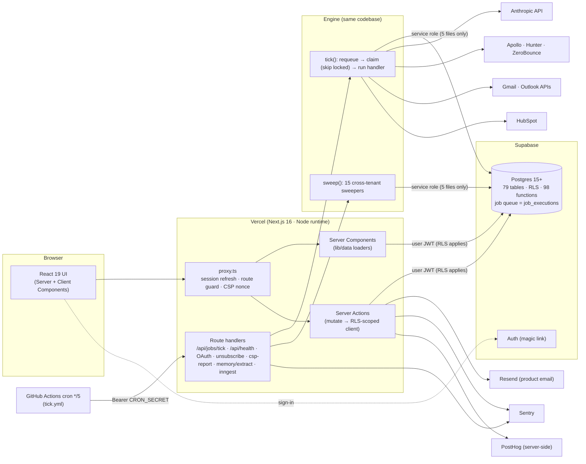

# 2 · Technical Requirements Document (TRD)

> **As of 2026-10-08** · code at `feat/personal-learning` @ `4c8576a`.
> Companions: [PRD](01-product-requirements.md) · [App Flow](03-app-flow.md) ·
> [Design Brief](04-design-brief.md) · [Schema](05-backend-database-schema.md) ·
> [Plan](06-implementation-plan.md) · [Gap Report](07-specification-gap-report.md).
>
> **No secret values appear here.** Variables are named only. Deeper narrative lives in
> `docs/architecture/*`, `docs/operations/*`, `docs/security/*`; where those disagree with this
> page, this page (derived from code on the as-of date) wins — see CON-03.
>
> Labels: **CURRENT** = implemented; **DESIRED** = intended or recommended, *not* implemented.

---

## 1 · Architecture overview

### 1.1 CURRENT

**One deployable unit** (`apps/web`) hosts the UI, Server Actions *and* the engine's HTTP entry
point. There is no separate worker service: the queue lives in Postgres and is drained by
`/api/jobs/tick` invocations (≤ 60 s each, `maxDuration = 60`).

### 1.2 Monorepo (npm workspaces)

| Workspace | Role | Depends on |
|---|---|---|
| `apps/web` | Next.js app: routes, actions, loaders, proxy | all packages |
| `packages/ui` | Tokens (`tokens.css`, `theme.css`), 29 components, `cn`, link adapter | — |
| `packages/db` | Typed Supabase clients, row types, pure domain logic (`rules`, `icp`, `identity`, `activity`, `memory`, `preferences`, `style`, `needs-you`), **all SQL migrations**, verification scripts | `@supabase/*` |
| `packages/ai` | 16 typed AI tasks, model routing and prices, claim validation, untrusted-input wrapper, run recorder | `db`, `@anthropic-ai/sdk` |
| `packages/jobs` | Queue, runner, sweepers, 34 handlers, mailbox adapters (Gmail/Outlook), email templates + Resend | `db`, `ai`, `providers`, `crm` |
| `packages/providers` | Capability → vendor adapters (Apollo, Hunter, ZeroBounce) with cache, budget, circuit breaker, ledger | `db` |
| `packages/crm` | HubSpot client (company/contact/deal push; deal-stage read-back) | — |

Boundary rules enforced mechanically: the service-role client is importable only through
`@huntloop/db/admin` and confined to **5 named files** (`check-admin-imports.ts`: 344 files in
`apps/` and 162 in `packages/` scanned); no vendor name outside its adapter (`PRV-CHK`).

## 2 · Frontend

| Aspect | CURRENT |
|---|---|
| Framework | **Next.js 16.3.5** (App Router, Turbopack builds), **React 19.2.8**, TypeScript 5.9 |
| Styling | **Tailwind CSS 4.3** with design tokens as CSS custom properties (`packages/ui/src/tokens.css`, 769 lines) and a theme layer (`theme.css`, 137 lines) |
| Fonts | Geist and Geist Mono via `next/font/google` |
| Icons | `lucide-react` |
| Component model | Server Components by default; Client Components for interactivity; Server Actions for mutations (39 `"use server"` files, 137 exported functions) |
| Validation | Zod 4.4.3 at every action boundary (audit `SEC-VAL`) |
| State | No global client store; local state + `router.refresh()`/`revalidatePath`; `localStorage` only for conveniences (sidebar state, nudge dismissals, onboarding furthest-step); theme in cookie `hl-theme` |
| Route groups | `(marketing)`, `(auth)`, `(onboarding)`, `(app)/[org]`, plus top-level `invite`, `unsubscribe`, `auth`, `api` |
| Loading/error | `loading.tsx`, `error.tsx`, `global-error.tsx`, `not-found.tsx` |
| Demo mode | When Supabase env is absent (or schema absent) every loader returns fixtures and `DataSourceBanner` announces it; production instead answers 503 |

*Why:* Server Components keep the tenant boundary on the server (RLS-scoped client per request);
Server Actions remove a hand-written API layer for ~137 mutations at the cost of coupling UI to
action signatures. *Depended on by:* every screen.

## 3 · Backend

| Aspect | CURRENT |
|---|---|
| Request pipeline | `proxy.ts`: (1) 404 `/kitchen-sink` & `/dev/onboarded` in production; (2) if Supabase unset/schema missing in production → 503; (3) refresh Supabase session cookies; (4) anonymous → 307 `/login?next=` for protected shapes, 404 otherwise; (5) mint CSP nonce; (6) remember last workspace in cookie `huntloop.org` |
| Loaders | `apps/web/lib/data/*` — one per screen, each with a live and a demo branch; request-cached where shared (e.g. Needs-you count shared between shell and dashboard) |
| Mutations | `mutate(org, name, fn, { minRole })` (`lib/data/org.ts`): checks DB, membership, role, then runs `fn({ db, orgId })` with the **user-scoped** client; plain-language failures; `recordAudit` for sensitive changes |
| AI wrappers | `apps/web/lib/ai/*` (`qualify`, `research`, `why-now`, `agent`, `workspace-assistant`, …) all go through `budget.ts` (rate limit → quota → spend guard → `ai_runs`) |
| Pure domain logic | In `packages/db/src` so engine and UI share one implementation (e.g. `rules.ts`, `needs-you.ts`, `preferences.ts`) |
| Language/runtime | TypeScript (ESM), **Node ≥ 22.6** (`engines`); CI uses Node 24; local verified on 24.19 |

## 4 · Database

| Aspect | CURRENT |
|---|---|
| Engine | PostgreSQL via **Supabase** (hosted); **PGlite 0.2.17** (Postgres-in-WASM) for the migration/isolation test suite |
| Access | `@supabase/supabase-js` 2.112.3 + `@supabase/ssr` 0.5.2; **no ORM** (typed row interfaces + PostgREST queries + RPC) |
| Schema | 45 ordered migrations → 79 tables, 9 views, 98 public functions, 10 enum types, 140 RLS policies, 233 indexes, 75 triggers — see [Schema](05-backend-database-schema.md) and [generated reference](generated/schema-reference.md) |
| Tenancy | `org_id` on 75 of 79 tables; the four without are `organizations`, `plans`, `profiles`, `public_research` |
| Migrations | Plain SQL, applied manually (Supabase SQL editor or `DATABASE_URL` with `pg`); `npm run db:doctor` probes which are applied and can emit a paste-ready bundle (`--bundle`, gitignored `pending-migrations.sql`). **No automated migration runner in CI/CD.** |
| Scheduling | `pg_cron` (when available) schedules exactly two jobs — `prune-rate-limits` (`0006`) and `prune-provider-cache` (`0011`); skipped under PGlite; "never run on a live project" caveat in `0006` header — operator must confirm with `select * from cron.job` |
| Extensions | `pg_cron` optional; `gen_random_uuid()` from core (no `pgcrypto`) |

## 5 · Authentication

CURRENT: Supabase Auth, **email magic link** (OTP). Session cookies refreshed in `proxy.ts`.
Google OAuth wired behind `NEXT_PUBLIC_AUTH_GOOGLE === "true"`. `?next=` redirect is path-only and
re-validated. Sign-out is `POST /auth/signout` (303 → `/login`).
DESIRED / not implemented: password login, MFA, SSO/SAML, SCIM, session listing/revocation UI
(MIS-05).

## 6 · Authorization

| Layer | Mechanism |
|---|---|
| **Boundary (authoritative)** | Postgres RLS. Helpers `user_org_ids()`, `co_member_ids()`, `has_org_role(org, role)`; 140 policies; RLS enabled on **79/79** tables |
| Typical pattern | `tenant_read` = member of org; `tenant_write` = `has_org_role(org,'member')` on ordinary tables; `admin` on org/membership/invitation/integration/audit tables; personal tables restricted to `user_id = auth.uid()` |
| Server tier | `mutate(minRole)` rejects early with friendly text (16 call sites pass `admin`, 1 `owner`, 4 admit `viewer`; the rest default to member) |
| UI tier | `canWrite / canSpend / canAdmin / canOwn` choose what to render |
| Non-members | `/{org}/*` returns **404** (not 403) |
| Service role | Bypasses RLS; used only by the job engine and a few named SECURITY DEFINER-adjacent paths; confined to 5 files |
| Hardening | `0031` made engine-written tables read-only to sessions; tenant writes constrained by triggers |
| Special | `public_research` has RLS on with **no policy** (service-role only, intentional); `plans_read` is `USING (true)` (public price list) |

## 7 · APIs

### 7.1 HTTP endpoints (route handlers)

| Route | Method | Caller | Auth | Behaviour |
|---|---|---|---|---|
| `/api/health` | GET | monitors | none | JSON booleans about configuration (never values): commit, schema state, service key present, cron secret, Inngest, encryption, 8 integrations |
| `/api/jobs/tick` | GET, POST | scheduler | `Authorization: Bearer $CRON_SECRET` (constant-time compare) | 503 if secret unset; 404 on mismatch; runs `sweep()` then `tick({limit 5, deadline 55 s})`; `no-store` |
| `/api/inngest` | GET, POST | Inngest | HMAC signature | 404 unless both `INNGEST_*` keys set; same tick semantics |
| `/api/csp-report` | POST | browsers | none (public of necessity) | Always 204; forwards to Sentry |
| `/api/mailboxes/[provider]/start` | GET | signed-in writer | session + nonce cookie (10 min, httpOnly) | Redirect to Google/Microsoft consent; refuses without credentials/encryption key/role |
| `/api/mailboxes/[provider]/callback` | GET | provider | state + cookie | Exchange code, encrypt tokens, upsert mailbox, redirect to Outreach |
| `/api/memory/extract` | POST | signed-in writer | session | PDF/DOCX → text (magic-byte typing, zip-bomb bounded, stores nothing) |
| `/api/unsubscribe/[token]` | POST (RFC 8058), GET→303 | mail clients | signed token | Records unsubscribe |
| `/api/notifications/unsubscribe` | GET/POST | email link | signed token | Digest off switch |
| `/{org}/performance/export` | GET | signed-in member | session | CSV (`funnel / segments / reasons / stalled`); formula-injection neutralised |
| `/auth/callback`, `/auth/signout` | GET / POST | browser | — / session | Session exchange / sign-out |
| `/dev/onboarded` | GET | dev | dev only | 404 in production |

### 7.2 Server Actions
~137 exported functions across 39 files; catalogue in `docs/developer/server-actions.md` (that page
predates several modules — treat as incomplete). All validate with Zod and go through `mutate`
unless they are personal/public (`snoozeAttentionAction`, `unsubscribeAction`, auth).

### 7.3 Versioning / external API
No public API, no API keys for tenants, no webhooks *out*. DESIRED: none specified.

## 8 · Internal services (packages) and the engine

### 8.1 The job queue (CURRENT)

- Table `job_executions`, claimed by `claim_job_executions` using `FOR UPDATE SKIP LOCKED`; stalled `running` rows requeued after 10 minutes (`requeue_stalled_jobs`); default 3 attempts; permanent-failure short-circuit; dead letters surfaced by view `job_dead_letters`; idempotent enqueue via `idempotency_key` (unique among queued+running).
- Semantics: **at-least-once**. Every handler is written to tolerate re-execution.
- `tick()` is sequential (no in-process parallelism) with a deadline; `sweep()` enqueues the cross-tenant sweepers.

### 8.2 Handlers (34, `JobName` is a closed union; registry is a total map)

| Group | Handlers | Reachability (grep of `enqueue` sites) |
|---|---|---|
| Sweepers (no org) | `schedule_scans`, `schedule_syncs`, `schedule_sends`, `advance_enrollments`, `schedule_learning`★, `schedule_discovery`, `enforce_retention`†, `schedule_recomputes`, `schedule_signal_fetches`, `schedule_followups`, `send_notifications`, `send_digests`★, `schedule_demand`★, `schedule_preferences`★ | from `sweep()` — ★ hourly, † daily |
| Per-org work | `scan_source`, `research_company`, `score_opportunity`, `sync_mailbox`, `send_message`, `analyze_performance`, `discover_companies`, `enrich_company`, `rank_contacts`, `research_competitor`, `resolve_competitor_mentions`, `recompute_scores`, `fetch_company_signals`, `sync_hubspot`, `prospect_competitor_customers`, `cluster_demand`, `learn_preferences` | all have a producer |
| **Unreachable** | **`enrich_person`, `resolve_entity`, `purge_contact_data`** | **no caller anywhere** (DEF-04/05/06) |

### 8.3 AI tasks (16, `packages/ai/src/models.ts`)

| Task | Model | Effort | Purpose |
|---|---|---|---|
| research_company | Opus | high | Website → structured understanding |
| recommend_sources | Opus | medium | Sources for an ICP |
| extract_signals | Haiku | medium | Normalise fetched pages to events |
| qualify_opportunity | Opus | high | Verdict + 8 dimensions |
| explain_why_now | Opus | medium | Timing rationale |
| personalize_message | Opus | medium | Outreach copy citing evidence ids |
| classify_reply | Haiku | low | Reply label + extracted objections/requests |
| sales_agent | Opus | medium | Per-opportunity Q&A |
| draft_scoring_rules | Opus | high | Proposed (inactive) rules |
| analyze_performance | Opus | high | Learning findings |
| research_competitor | Opus | high | Competitor profile with evidence |
| draft_icp | Opus | high | ICP draft |
| explain_performance | Sonnet | medium | Narrative over computed facts |
| workspace_assistant | Sonnet | medium | Ask Huntloop |
| cluster_demand | Sonnet | medium | Demand themes |
| infer_preferences | Sonnet | medium | Personal preferences from notes |

Model ids: `claude-opus-5`, `claude-sonnet-5`, `claude-haiku-4-5`; Haiku 4.5 is capability-gated (no
adaptive thinking/effort/web fetch). Prices in `PRICES` are list prices; the Sonnet introductory
rate noted in the file expired 2026-08-31 and the standard rate is already used.
**Never observed against the live API in a verified environment** (DEF-02).

Safety design: closed-set citations (ids from the call's input), numbers in narratives only from
computed metrics, user text wrapped as untrusted, per-call run record, HMAC "live seal" so worked
examples cannot be stored as live.

## 9 · Third-party services

| Service | Use | Config | Failure mode designed |
|---|---|---|---|
| Supabase | DB + Auth | publishable/secret keys, `DATABASE_URL` (ops only) | Prod: 503; dev: demo |
| Anthropic | AI | `ANTHROPIC_API_KEY`, `HUNTLOOP_AI_TIMEOUT_MS` (default 55000) | Worked example, unsaveable |
| Apollo / Hunter / ZeroBounce | Company & contact data, verification | 3 keys | Typed refusals: `no_provider`, `credentials_invalid`, `budget_exhausted`, `breaker_open`, `capability_unsupported` |
| Google / Microsoft | Mailbox OAuth + send/sync | client id/secret ×2, encryption key | Button disabled with reason |
| HubSpot | CRM push | per-org token (encrypted) | Inline error |
| Resend | Product email | `RESEND_API_KEY`, `EMAIL_FROM`, `EMAIL_REPLY_TO` | No-op if unset; action still succeeds |
| Sentry | Errors | `SENTRY_*`, `NEXT_PUBLIC_SENTRY_DSN` | No-op SDK; **Replay excluded on purpose** |
| PostHog | Server-side product events | `NEXT_PUBLIC_POSTHOG_KEY/HOST` | No-op |
| Inngest | Optional engine driver | `INNGEST_EVENT_KEY/SIGNING_KEY` | 404 unless both set |
| GitHub Actions | CI + engine heartbeat | repo secret `CRON_SECRET`, variable `HUNTLOOP_URL` | Does nothing until both exist |

## 10 · Email

- **Product email** (CURRENT, PR#2): Resend through `sendEmail` — invitations, join-request notices, join-approved, daily "Needs you" digest (signed unsubscribe token). Templates in `packages/jobs/src/email/templates.ts`.
- **Auth email**: Supabase-sent; can be routed through Resend SMTP (instructions in `.env.example`) to lift the built-in rate limit.
- **Outreach email**: customer mailbox only (Gmail/Outlook APIs), never Resend.
- **Deliverability**: no MX/SPF/DKIM/DMARC record was observed for the apex in the last recorded DNS check (2026-09-28, project notes) — **UNCLEAR now** (MIS-04, DEC-05).

## 11 · Payments

**MISSING.** `STRIPE_SECRET_KEY`, `STRIPE_WEBHOOK_SECRET`, `NEXT_PUBLIC_STRIPE_PUBLISHABLE_KEY` are
documented in `.env.example` and **read by no code**. `subscriptions` exists since `0001` with no
writer or reader other than a comment. Plans are metered and enforced but cannot be purchased
(MIS-01, DEC-03). DESIRED architecture is unspecified.

## 12 · Analytics

PostHog via `posthog-node`, **server-side only** (`lib/analytics.ts`); a documented list of things
never sent. Events include `onboarding_step_*`. No client-side tracking, no cookies for analytics.
Product metrics for the owner: AI spend (`ai_runs`), provider ledger, job health views.

## 13 · Background jobs, cron, queues, webhooks, caching, storage

| Concern | CURRENT |
|---|---|
| **Engine driver** | One of: `GET /api/jobs/tick` with bearer secret from a scheduler, or Inngest. **Committed driver: `.github/workflows/tick.yml` — GitHub Actions cron every 5 minutes**; needs repo secret `CRON_SECRET` + variable `HUNTLOOP_URL` (GitHub scheduled runs can lag and pause after 60 days of inactivity). `apps/web/vercel.json` contains **no** `crons` block (it was removed because Vercel Hobby rejects sub-daily schedules). |
| **Production status** | `/api/health`: `cronSecret:false`, `inngest:false` → **nothing drives the engine in production** (DEF-01) |
| pg_cron | Housekeeping only (prune); not the engine driver |
| Webhooks in | None except Inngest. No Stripe, no Resend, no Gmail push — mailbox sync is **polling** (`sync_mailbox`) |
| Webhooks out | None |
| Caching | Postgres tables: `provider_cache` (vendor responses, TTL, pruned), `public_research` (anonymous reads, claimable once); Anthropic prompt caching (cache read/write cost tracked); React `cache()` request memoisation. **No Redis/KV, no CDN configuration beyond Vercel defaults, no ISR except `force-static` for `robots`/`sitemap`.** |
| Rate limiting | Postgres fixed-window `consume_rate_limit` per user/action (`rate_limits`); anonymous research limited per salted IP hash and global daily cap |
| Storage | **No object storage.** Uploaded PDF/DOCX are parsed in memory and discarded; Memory stores extracted text. Avatars unused. |

## 14 · Hosting, deployment, domain/DNS

| Item | CURRENT / last known |
|---|---|
| App hosting | **Vercel** (Next.js). Production serves `main`; verified: `/api/health` reports commit `14cf749` |
| Database | Supabase hosted project (ref visible in `.env.example` and health host) |
| Domain | Production origin `https://seefluence.com` (reported `siteUrl`); the product name is "Huntloop" (DEC-14: confirm brand/domain pairing). Last recorded DNS (2026-09-28 project notes): GoDaddy nameservers, apex A → Vercel, `www` CNAME → Vercel, apex 307 → `www` while `NEXT_PUBLIC_SITE_URL` is the apex — **unverified now** |
| Vercel topology (last known 2026-09-28) | The serving project is team `huntloop` / project `huntloop-web` (Git-connected). A second Git-connected project `huntloop` **fails every build** and a personal `huntloop-web` is CLI-deployed with stale code. **Unverified now** (DEC-06) |
| Deployment procedure | Git push to `main` → Vercel build. Migrations are **applied by hand before deploying code that needs them** (no gate in CD). `proxy.ts` refuses to serve app routes in production if the schema probe (`LATEST_TABLE` in `lib/schema.ts`) finds a partial schema |
| Release | `CHANGELOG.md` + local tag `v0.1.0` (not pushed); `COMMAND.md` claims "on main" (CON-01) |
| Preview deploys | Supported by Vercel; CI builds with empty Supabase env to prove nothing reads credentials at build time |

## 15 · Environment variables (names only)

Status column = what `/api/health` shows for production on 2026-10-08 (✔ present, ✘ absent, — not observable).

| Variable | Scope | Purpose | Prod |
|---|---|---|---|
| `NEXT_PUBLIC_SUPABASE_URL`, `NEXT_PUBLIC_SUPABASE_PUBLISHABLE_KEY` | public | Supabase client (legacy alias `NEXT_PUBLIC_SUPABASE_ANON_KEY` read as fallback) | ✔ |
| `SUPABASE_SECRET_KEY` (alias `SUPABASE_SERVICE_ROLE_KEY`) | server | Service role; also HKDF source for the live seal | ✔ (`serviceKey:true`) |
| `DATABASE_URL` | ops | Direct Postgres for migrations/EXPLAIN (not used by the app at runtime) | — |
| `NEXT_PUBLIC_SITE_URL` | public | Canonical origin, OG, sitemap | ✔ |
| `NEXT_PUBLIC_FEEDBACK_URL`, `NEXT_PUBLIC_HELP_URL` | public | Top-bar links (hidden if unset) | — |
| `NEXT_PUBLIC_AUTH_GOOGLE` | public | Show Google button | — |
| `CSP_ENFORCE` | server | `"true"` → enforcing CSP (else report-only) | — |
| `ANTHROPIC_API_KEY`, `HUNTLOOP_AI_TIMEOUT_MS` | server | AI | ✘ |
| `APOLLO_API_KEY`, `ENRICHMENT_API_KEY`, `EMAIL_VERIFICATION_API_KEY` | server | Data providers | ✘ ✘ ✘ |
| `GOOGLE_CLIENT_ID/SECRET`, `MICROSOFT_CLIENT_ID/SECRET` | server | Mailbox OAuth | ✘ ✘ |
| `MAILBOX_ENCRYPTION_KEY` | server | AES key for stored third-party credentials (32 bytes hex) | ✘ (`credentialEncryption:false`) |
| `RESEND_API_KEY`, `EMAIL_FROM`, `EMAIL_REPLY_TO` | server | Product email | — (not in health) |
| `CRON_SECRET` | server | Authenticates `/api/jobs/tick` | ✘ |
| `INNGEST_EVENT_KEY`, `INNGEST_SIGNING_KEY` | server | Optional driver (both required) | ✘ |
| `SENTRY_DSN`, `NEXT_PUBLIC_SENTRY_DSN`, `SENTRY_ORG/PROJECT/AUTH_TOKEN` | server/public | Errors + sourcemaps | ✘ |
| `NEXT_PUBLIC_POSTHOG_KEY`, `NEXT_PUBLIC_POSTHOG_HOST` | public | Analytics | ✘ |
| `PUBLIC_RESEARCH_ENABLED`, `PUBLIC_RESEARCH_DAILY_LIMIT`, `PUBLIC_RESEARCH_SALT` | server | Anonymous `/discover` (off unless `"true"`); the salt is derived from `SUPABASE_SECRET_KEY` when unset (since 2026-10-09) | — |
| `STRIPE_SECRET_KEY`, `STRIPE_WEBHOOK_SECRET`, `NEXT_PUBLIC_STRIPE_PUBLISHABLE_KEY` | — | **Unused** | n/a |
| `NEXT_PUBLIC_HUNTLOOP_DEV_BYPASS` | public | Dev-only onboarding gate bypass (dead-code-eliminated in production builds) | n/a |
| `VERCEL_ENV`, `NEXT_PUBLIC_VERCEL_ENV`, `VERCEL_GIT_COMMIT_SHA`, `VERCEL_REGION`, `VERCEL_PROJECT_PRODUCTION_URL`, `NODE_ENV`, `NEXT_RUNTIME`, `CI` | platform | Environment detection | platform |

Audit `REPO-02` enforces that every env var the code reads appears in `.env.example`. `.env.local`
and `.env*` are gitignored. `docs/developer/environment-variables.md` predates `RESEND_*`,
`PUBLIC_RESEARCH_*` and may be incomplete.

## 16 · Security

| Control | CURRENT | Evidence |
|---|---|---|
| Tenant isolation | RLS on 79/79 tables; isolation suite runs as a **non-superuser** role | `verify-migrations.ts` (341 checks) |
| Service-role confinement | 5 files; build fails otherwise | `check-admin-imports.ts`, audit `SEC-ADMIN` |
| Input validation | Zod at every action | audit `SEC-VAL` |
| Spend abuse | rate limit + quota + spend guard on every model wrapper | audit `SEC-SPEND/RATELIMIT/QUOTA` |
| Headers | HSTS (2 y, includeSubDomains, no preload), nosniff, `X-Frame-Options: DENY`, `frame-ancestors 'none'`, strict-origin-when-cross-origin referrer, Permissions-Policy denies camera/mic/geo/FLoC | `next.config.ts` |
| CSP | Per-request nonce `script-src` built in `proxy.ts`/`lib/csp.ts`; **Report-Only unless `CSP_ENFORCE="true"`**; reports to `/api/csp-report` → Sentry | DEF-09 |
| CSRF | Server Actions (Next origin checks) + sign-out via POST form | — |
| Open redirect | `safeNext` path-only validation | `safe-next.test.ts` |
| Open relay | Sentry `tunnelRoute` deliberately not enabled | `next.config.ts` |
| SSRF | Fetcher blocks private addresses (`packages/jobs/src/fetch.ts`); Node runtime only on tick | tick route comment |
| Secrets at rest | Third-party tokens AES-encrypted in-app; connect refused without key | `crypto.ts` |
| Prompt injection | User/page text wrapped as untrusted; closed citation sets; no tool can write durable state | `packages/ai/src/untrusted.ts` |
| CSV injection | Export neutralises `= + - @` | `csv-write.ts` |
| Upload handling | PDF/DOCX ≤ 4 MB, magic-byte typing, zip-bomb bounds | `document-text.ts` |
| Enumeration | Magic-link response enumeration-safe; non-member = 404 | — |
| Dependency advisories | CI: `npm audit --audit-level=high` (blocking on `main`, non-blocking on PRs). **2026-10-09: 0 vulnerabilities** after `npm audit fix` + `vitest` 4.1.11 (was 9: 3 critical, 4 high, 2 moderate, incl. `next` 16.3.5's critical `next/og` RCE). Floors raised: `next` ^16.4.0, `undici` ^8.11.2 | `npm audit` · DEF-16 (resolved) |
| Dev routes | `/kitchen-sink`, `/dev/onboarded` return 404 in production | `proxy.ts` |
| Repo hygiene | `.env*`, `pending-migrations.sql` gitignored. GitHub repo is **public**; last-known state: no branch protection, no Actions secrets (2026-09-28) | **UNCLEAR now** (REC-11) |
| Secrets in history | **Not audited in this task** | — |

## 17 · Data protection

| Topic | CURRENT |
|---|---|
| Personal data held about non-users | People (name, title, employer), contact points (email/phone/LinkedIn), message bodies, replies — acquired from providers and via mail sync |
| Lawful basis | Recorded as `lib/legal.ts → prospectLawfulBasis` = **PENDING** (DEF-08) |
| Subject rights | Export (`export_contact`) and erase (`erase_contact`, admin-gated wrapper) from the UI; retention sweep (`enforce_retention`, daily) if a retention number is set; `purge_contact_data` job unreachable (redundant to UI path) |
| Suppression | `suppressions` keyed by hash; checked by `can_contact` before every send; unsubscribe page + RFC 8058 |
| Minimisation | Sentry Replay excluded; PostHog server-side with documented exclusions; AI inputs cap size |
| Personal learning data | Private to subject (RLS); 180-day signal retention; export + reset + pause |
| Data residency / processors list | **UNCLEAR** — processors (Supabase, Vercel, Anthropic, vendors, Resend, Sentry, PostHog) are enumerable; region choices and DPAs are not recorded in the repo (DEC-04) |
| Backups / PITR | Not configured in the repo; Supabase plan-level (**UNCLEAR**, MIS-03) |

## 18 · Performance

| Item | CURRENT |
|---|---|
| Bundle budget | `scripts/bundle-budget.mjs`: shared client JS ≤ **275 kB gzipped** (measured 244.6 kB when set) — run in CI after build |
| Query discipline | Bounded loaders (e.g. Needs-you reads ≤ 150 items; lists capped at 500); `scripts/check-queries.mjs`; 233 indexes, many partial |
| Serverless limits | `maxDuration = 60`; AI call timeout 55 s; tick deadline 55 s |
| Rendering | RSC with streaming `loading.tsx`; marketing `robots`/`sitemap` force-static |
| Observed Web Vitals | **Not measured** (no RUM; Sentry tracing excluded) — UNCLEAR |
| Details | `docs/operations/performance.md` |

## 19 · SEO

`robots.ts`, `sitemap.ts` (`/`, 4 × `/for/*`, 4 × `/compare/*`), `metadataBase`, Open Graph (`opengraph-image`, `apple-icon`), per-page metadata. `/discover`, `/invite/*`, `/unsubscribe/*`, legal-while-incomplete are `noindex`. Audit `SEO-*` checks pass; `LEGAL-02` verifies incomplete legal pages are noindex + disallowed + unlinked. Structured data (JSON-LD): **not verified**.

## 20 · Accessibility

- Lint: `eslint-plugin-jsx-a11y` (lint exit 0).
- Test: `@axe-core/playwright` in `e2e/a11y.spec.ts`; contrast was governed by explicit rules (design-decision memory: step up the ramp, never loosen the test).
- Patterns: skip link; `<main tabIndex=-1>`; `aria-current`, `aria-pressed`, `role=status/alert`; focus-trapped native `<dialog>` modals; ConfirmButton live-region; `pending` controls are `aria-disabled` with `title` reason; priority never colour-only; `prefers-reduced-motion` zeroes durations.
- **Not verified:** screen-reader walkthroughs, WCAG conformance statement, keyboard-only pass of every screen. Target level is not declared (UNCLEAR — DEC-12).

## 21 · Responsive, browser and device support

- Breakpoints: Tailwind defaults; app shell switches at `lg` (drawer below), tablet/desktop layouts shift at `md`/`xl`/1440 px (Needs-you rail).
- E2E projects: **Desktop Chrome** and **Pixel 7** (mobile) only.
- Browser matrix: **not declared**; no `browserslist`; Chromium is the only engine in tests (Firefox/Safari unverified).
- Print: shell hidden and scroll container flattened for the Share report.

## 22 · Error handling, logging, monitoring, recovery

| Concern | CURRENT | DESIRED/gap |
|---|---|---|
| UI errors | boundaries (§PRD 12); Sentry capture with digest | Sentry unconfigured in prod |
| Action errors | Plain-language results; no stack leakage | — |
| Job errors | `job_executions.error` verbatim, retries, dead letters, Retry/Cancel UI | Engine undriven in prod |
| AI | `ai_runs` per call (status, tokens, cost, latency, error) | — |
| Providers | `provider_calls` ledger, `provider_health` view | — |
| Email | `message_events` (delivered/failed/bounced…) | — |
| Audit trail | `audit_logs` (admin-readable) via `recordAudit` | Coverage not enumerated |
| App logging | `console.*` to Vercel logs; **no structured logger or log drain** | MIS-06 |
| Uptime/alerting | None configured; `/api/health` exists as a probe target | MIS-06 |
| Backups & recovery | Supabase platform only; **no documented restore procedure or drill** | MIS-03 |

## 23 · Testing and CI/CD

| Layer | Tooling | Result 2026-10-08 |
|---|---|---|
| Types | `tsc --noEmit` ×7 workspaces | exit 0 |
| Lint | ESLint 9 + jsx-a11y + typescript-eslint | 0 errors, **0 warnings** (2026-10-09) |
| Schema/RLS | PGlite harness | 344 checks pass (incl. `0046`) + schema-reference drift check |
| Rules engine, pure logic | custom scripts | 59 + 148 pass |
| Jobs | custom harness | 304 pass (incl. job reachability and IP-hash salt) |
| AI tasks (mocked) | custom harness | 227 pass |
| Providers / CRM | custom harnesses | 81 / 20 pass |
| Web unit | Vitest | 267 pass (25 files) |
| UI components | Vitest 4 + Testing Library | 42 pass (6 files) |
| Repository audit | `scripts/audit.mjs` | 44 checks, 0 fail, **1 warn (LEGAL-01)** |
| Browser E2E | Playwright (desktop + mobile), demo mode | **316 passed, 4 skipped, 0 failed** (2026-10-09; includes "never scrolls sideways" on six screens) |
| Bundle | `bundle-budget.mjs` | 244.4 kB of 275 kB shared client JS |
| Live-vendor integration | none | **never executed** (DEF-02) |

**CI state:** the last six runs on `main` failed (latest: *Audit — dependency advisories*; one earlier run failed *Test — browser*); the PR #2 branch's last CI run succeeded. The scheduled `Engine tick` workflow fails on every run because no secret/variable is set (DEF-01). **2026-10-09:** every CI step passes locally on the patched tree (`npm run verify`, `npx playwright test`, `npm audit --audit-level=high`); `main` stays red until the patch is pushed there.

CI (`ci.yml`, on push to `main` and every PR): `npm ci` → typecheck → lint → `npm test` → `audit:site` → `npm audit --audit-level=high` → build (empty Supabase env) → bundle budget; plus a parallel Playwright job (Chromium). `verify` npm script runs the same locally.
**CD:** Vercel Git integration only; no migration step, no post-deploy smoke test, no staging environment. `tick.yml` is a scheduled workflow, not a deploy.

## 24 · Major technical decisions

| Decision | What | Why (stated in code/docs) | Depends on it |
|---|---|---|---|
| Postgres is the queue | `job_executions` + `skip locked` | Transactional with the data; backups with it; jobs are seconds-long | Entire engine; `ops` screen |
| Postgres rate limiter, no Redis | `consume_rate_limit` | Not a hot path; one fewer service | `lib/rate-limit.ts` |
| RLS is the boundary | UI/proxy are conveniences | Bugs in app code must not cross tenants | All data access |
| Service role fenced to 5 files | Build-time check | Make the dangerous import greppable | Engine only |
| Server Actions, no REST layer | 137 mutations | Less code, type-safe | UI |
| Fact/inference/unknown in schema | CHECK constraints | Convention fails under deadlines | Evidence, claims, UI badges |
| Nullable score dimensions | NULL = UNKNOWN | "Zero" is a measurement | Scoring, UI |
| Closed-set AI citations | Ids from call input | Un-fabricatable references | Agent, assistant, learn, performance narrative |
| HKDF-derived live seal | No new env var | Worked examples must not be saved as live | Onboarding, Analyze, Discover |
| Provider seam (cache→budget→breaker→ledger) | before first vendor call | Discover unit economics before the invoice | Discovery, enrichment |
| Own-mailbox sending | Gmail/Outlook | No shared sending infra / deliverability burden | Outreach |
| App-layer credential encryption | one key | Tokens leak via backups/logs | Mailboxes, HubSpot |
| GitHub Actions as heartbeat | `tick.yml` | Vercel Hobby forbids sub-daily cron | Engine (once secrets exist) |
| No ORM | typed rows + PostgREST/RPC | SQL-defined invariants live in the DB | `packages/db` |
| Report-only CSP first | switch `CSP_ENFORCE` | A wrong CSP half-breaks pages silently | Security |

## 25 · CURRENT vs DESIRED architecture

| Area | CURRENT | DESIRED (explicitly stated somewhere) | Gap |
|---|---|---|---|
| Engine driver | GH Actions `*/5`, unconfigured | Minute-level Vercel Cron (plan upgrade) **or** Inngest (`tick.yml` header says retire it then) | DEC-02 |
| CSP | Report-only | Enforcing after a quiet week of reports | needs Sentry/report stream |
| Billing | None | Stripe (variables reserved) | DEC-03 |
| Migrations | Manual paste | (not specified) | REC-04 |
| Dedup | Built, dormant | Runs before provider volume (`0012` header calls it a hard ordering constraint — currently inverted) | DEC-07 |
| Sync of replies | Polling | (not specified) | — |
| Multi-region/HA | Single region | (not specified) | UNCLEAR |

## 26 · Known technical defects and risks (summary; full register in the Gap Report)

DEF-01 engine undriven · DEF-02 no live vendor call ever observed · DEF-03 prod behind branches ·
DEF-04/05/06 unreachable handlers · DEF-07 schema objects with no reader · DEF-08 legal facts pending ·
DEF-09 CSP report-only · **DEF-16 vulnerable dependencies and red CI on `main`** · CON-01 release state ·
CON-02 cron documentation · MIS-03 backups · MIS-06 observability.

## 27 · Recommendations (RECOMMENDED — not requirements)

REC-01 … REC-14 in the [Gap Report](07-specification-gap-report.md#9--recommendations-register);
technical ones: REC-02 (choose and configure one engine driver), REC-03 (provision production
environment in dependency order), REC-04 (add a migration step + post-deploy smoke to CD),
REC-07 (flip CSP after reports), REC-09/11 (repository hygiene), REC-10 (CI schema-reference drift check).
