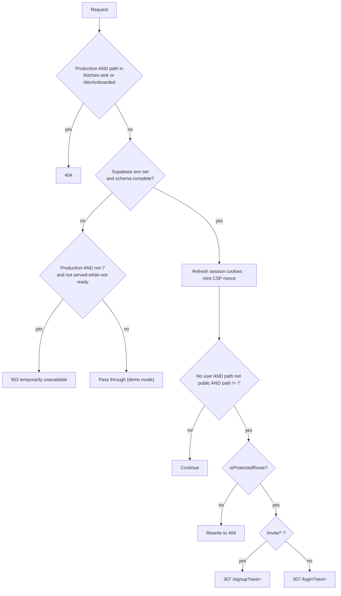
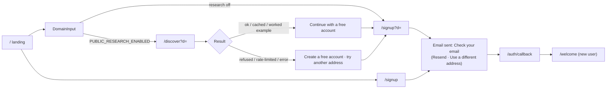
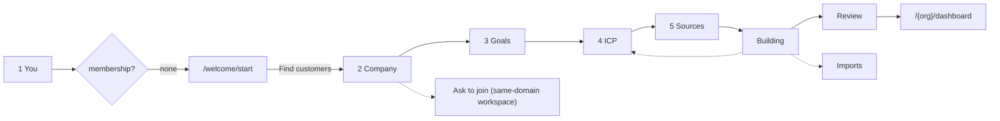
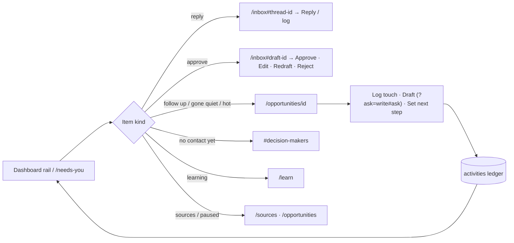

# 3 · App Flow / User Flow

> **As of 2026-10-08** · code at `feat/personal-learning` @ `4c8576a`.
> Companions: [PRD](01-product-requirements.md) · [TRD](02-technical-requirements.md) ·
> [Design Brief](04-design-brief.md) · [Schema](05-backend-database-schema.md) ·
> [Plan](06-implementation-plan.md) · [Gap Report](07-specification-gap-report.md).

## 0 · How to use this document with COMMAND.md

[COMMAND.md](../../COMMAND.md) §0–§15 is the **element-level** record: every button, link, field,
modal, branch, message and endpoint, screen by screen (≈ 1,200 lines of interaction tables). It is
the normative detail layer and is **not duplicated here**. This document adds what COMMAND.md does
not give in one place:

1. §1 — **global behaviour contracts** (unauthenticated, unauthorized, loading, failure, missing-data, demo) so each route needs only its exceptions;
2. §2 — the **gate and destination logic** every journey passes through;
3. §3 — the **route inventory** (R-nn) with who may see it and what it leads to;
4. §4 — the **journeys / flows** (FL-nn) as diagrams;
5. §5 — an **interaction → outcome catalogue** naming the exact Server Action / endpoint, data changed, success and failure result;
6. §6 — the **reachability matrix**; §7 — **recovery paths**; §8 — **known flow defects**; §9 — **drift found in COMMAND.md**.

Spot-checks of COMMAND.md against code for this pack found five drifts (§9) — plus one internal contradiction
about Resend/change-address in the sign-in state — none affecting interaction mechanics; they have been corrected in COMMAND.md
except the release-state claims (CON-01/CON-11), which wait on DEC-01. Code on the as-of date wins over both.

Notation: `{org}` = workspace slug · **SA** = Next.js Server Action · **RSC** = server render ·
**Ships in**: **main** (production code) / **PR#2** (pushed, unmerged) / **local** (unpushed).

---

## 1 · Global behaviour contracts

These apply to **every** route and interaction unless a row in §3/§5 says otherwise.

### 1.1 Identity and access

| Situation | Behaviour | Source |
|---|---|---|
| Anonymous → public route | Renders | `proxy.ts PUBLIC_PREFIXES` |
| Anonymous → protected shape (`/orgs`, `/welcome*`, `/invite*`, `/api*`, `/{org}/{section}`) | **307 → `/login?next=<path>`**; `/invite/*` → **`/signup?next=`** | `isProtectedRoute` |
| Anonymous → any other unknown path | **404 page** (never a login wall) | `proxy.ts` |
| Signed in, **not a member** of `{org}` | **404** (not 403; no existence leak) | `[org]/layout.tsx` |
| Signed in **viewer** | Page renders; every write control is hidden, disabled with a Note, or `aria-disabled` with a tooltip giving the reason. If it reached an action anyway: *"Your role is read-only, so this change was not saved."* | `mutate`, `canWrite` |
| Member trying admin-only control | Hidden/disabled with "Only an owner or an admin can…"; action refuses with the same sentence | `mutate(minRole)` |
| Session expired mid-action | Action returns *"Your session expired. Sign in again."* / *"You are no longer signed in."* — **no automatic redirect**; user must navigate | action results |
| Demo mode (no Supabase env or no schema), non-production | Fixture data; `DataSourceBanner` on every workspace page; `DemoFigures` on lists; privacy/destructive controls disabled; `/orgs` → `/demo/dashboard` | `lib/demo.ts` |
| Production with DB missing/partial | **503** plain page for every path except `/` and `SERVED_WHILE_NOT_READY` | `proxy.ts` |
| `/kitchen-sink`, `/dev/onboarded` in production | 404 | `HIDDEN_IN_PRODUCTION` |

### 1.2 Loading

| Case | Pattern |
|---|---|
| Route segment | `[org]/loading.tsx` skeleton (title + 6 rows); `opportunities/loading.tsx`; `welcome/loading.tsx` |
| Button action | Label changes while pending ("Saving…", "Sending…", "Starting…"); control is disabled |
| AI waits | Named skeleton ("Researching…", "Counting matching companies…", "Reading {url}…"); no cancel |
| Background work | Not streamed; the user is told when it will happen ("on the next engine run") — **which is only true if the engine is driven** (DEF-01) |

### 1.3 Failure

| Failure | Pattern |
|---|---|
| Validation | Field error under the field; `role=alert` for general errors |
| Rate limit (AI/provider) | `RateLimited` block with the absolute time to retry; **no retry button** |
| Plan quota | Plain sentence naming the metric and limit ("waiting changes nothing") — deliberately different copy from rate limits |
| Model/provider unavailable | Worked-example label (AI) or typed refusal sentence (providers) — never a fabricated result |
| Server render throws | `[org]/error.tsx` inside the shell: *"This screen failed to load. Nothing was changed."* + reference digest + **Try again** (`reset()`) + **Go to the home page** |
| Root/layout throws | `app/error.tsx` / `global-error.tsx` |
| Unexpected action exception | Surfaced as a message; Sentry capture (if configured) |

### 1.4 Success and destructive confirmation

- Success: inline `FormMessage` next to the control; panels that unmount on success hand their message to the parent (so it is not lost). Toasts are **not** used by any product screen.
- Destructive: **ConfirmButton** — first click arms (danger style + live-region text), second within 4 s confirms; Esc/blur/timeout disarm. Exceptions: Sources *Remove* (single click + **Undo**), Sources *Dismiss recommendation* (single click, no undo), Privacy erase/delete (type-to-confirm).

### 1.5 Missing data

Every list has an `EmptyState` with a reason and (where an action exists) a next action; every
unknown id renders `notFound()`; unmeasured score dimensions render **UNKNOWN**; absent counts are
omitted rather than shown as zero when "zero" would be a claim (e.g. reach counter).

### 1.6 Global affordances on every workspace page

Skip link · top bar (workspace switcher → `/orgs`, Jump-to ⌘K/Ctrl K — **pages only**, Feedback if
configured, account menu) · sidebar rail/panel (or drawer < `lg`) · `SetupCard` while onboarding is
incomplete · `DataSourceBanner` when not live · keyboard shortcuts (`?`).
Account menu: What Huntloop knows about you, Account & privacy, Workspace settings, Integrations,
Switch workspace, Theme, Keyboard shortcuts, Help (if configured), Home, **Sign out**.

---

## 2 · Gate and destination logic

### 2.1 Request pipeline (`apps/web/proxy.ts`)



### 2.2 Post-authentication destination (`lib/data/destination.ts → resolveDestination`)

| Condition | Destination |
|---|---|
| No database | `/demo/dashboard` |
| Not signed in | `/login` |
| Signed in, **zero** memberships | `/welcome` |
| One membership **or** remembered workspace (`huntloop.org` cookie) | `/{slug}/dashboard` (or the unfinished onboarding step via `stepPath`) |
| Several memberships, no remembered one | `/orgs` |

Used by `/auth/callback` (when `next` is `/`), the landing CTA (`continueTarget`), `/discover`, and the dev jump.
`stepPath(org, step)`: `you → /welcome?org=` · `company → /welcome/company?org=` · `goals → /welcome/goals?org=` · `icp → /welcome/icp?org=` · `sources → /welcome/sources?org=` · `building → /welcome/building?org=` · `review → /welcome/review?org=` · `done → /{org}/dashboard`.

---

## 3 · Route inventory

Columns: **Auth** (Pub = public, Sess = session, Mem = workspace member, Adm = admin+) · **Ships in** · COMMAND ref. Role-specific control differences are in PRD §13.3.

### 3.1 Public and auth

| ID | Route | Auth | Ships in | What it is | Leads to | Exceptions (beyond §1) | COMMAND |
|---|---|---|---|---|---|---|---|
| R-01 | `/` | Pub | main | Landing: hero, loop, pricing, DomainInput, mobile menu | `/signup`, `/login`, `/discover?d=`, `/for/*`, `/compare/*`, legal (if complete), `continueTarget` | Signed-in visitors see one "Continue setup / Open workspace" CTA; "Talk to us about {Plan}" is `mailto:` only if contact email set, else inert | §2.1 |
| R-02 | `/discover?d=` | Pub (redirects signed-in) | main | Anonymous company read | `/signup?d=`, `/login`, `/` | Flag `PUBLIC_RESEARCH_ENABLED`; free-mail refused; cached/ rate-limited/ over-budget/ no-model variants; `noindex` | §2.3 |
| R-03 | `/for/{useCase}` ×4 | Pub | main | Use-case page | DomainInput, `NavActions` | Other slugs 404 (`dynamicParams=false`) | §2.4 |
| R-04 | `/compare/{approach}` ×4 | Pub | main | Comparison page | same | `hiring-an-sdr`, `doing-it-manually` reachable only from other compare pages/sitemap | §2.4 |
| R-05–07 | `/privacy`, `/terms`, `/acceptable-use` | Pub | main | Legal | `/` | "Draft — not in force" until `legalIsComplete()`; `noindex`; unlinked | §2.5 |
| R-08 | `/login` | Pub | main | Magic-link sign-in | email → `/auth/callback` | Not configured → note + demo link; `?error=` codes explained; Resend / change address | §3.1 |
| R-09 | `/signup` | Pub | main | Magic-link sign-up | same | `?d=` → "Keep going" variant; `?next=` precedence; agreement line only if legal complete | §3.2 |
| R-10 | `/auth/callback` | Pub | main | Code exchange | `next` or `resolveDestination` | Failures → `/login?error=` | §3.3 |
| R-11 | `/auth/signout` | POST only | main | Sign out | 303 `/login` | GET returns 405 (M-16 fixed: invite page now uses a POST form) | §3.4 |
| R-12 | `/orgs` | Sess | main | Workspace picker | `/{slug}/dashboard`, `stepPath`, `/welcome?new=1` | 0 memberships → `/welcome`; **1 → straight to dashboard**; demo → `/demo/dashboard` | §5 |
| R-13 | `/invite/{token}` | Sess (anon → `/signup?next=`) | main | Accept invitation | `/{slug}/dashboard` or `/welcome` | Expired/invalid/other-address → inline RPC message; `noindex`, `no-referrer` | §12.1 |
| R-14 | `/unsubscribe/{token}` | Pub | main | One-click unsubscribe confirmation | terminal | Invalid token → message; no DB → "reply to ask to be removed" | §12.2 |

### 3.2 Onboarding (all require a session; steps 3–7 require `?org=`)

| ID | Route | Ships in | Purpose | Next | Back / exit |
|---|---|---|---|---|---|
| R-15 | `/welcome` | main | Step 1: name + role | existing membership → `/{slug}/dashboard` or `/welcome/company?org=`; none → `/welcome/start` | `?edit=1` re-shows form |
| R-16 | `/welcome/start` | **local** | First-job fork (4 jobs) | Research → `/{org}/analyze?url=&run=1`; Import → `/{org}/imports`; Look around → `/{org}/dashboard`; Find customers → `/welcome/company` | ← Back to You |
| R-17 | `/welcome/company` | main | Research + review "what we understood"; join-existing panel | `/welcome/goals?org=` | **Start over**; **Ask to join** |
| R-18 | `/welcome/goals` | main | ≤ 2 goals + channel | `/welcome/icp?org=` | ← Company |
| R-19 | `/welcome/icp` | main | Draft/edit ICP, reach bar, look-alikes | `/welcome/sources?org=` | ← Goals |
| R-20 | `/welcome/sources` | main | Recommend/accept sources | `/welcome/building?org=` | ← ICP; *Carry on without sources* |
| R-21 | `/welcome/building` | main | Six first-run stages | `/welcome/review?org=` (auto 900 ms after success) | *Skip*, *Adjust my profile*, *Import my own list* |
| R-22 | `/welcome/review` | main | Top 3 + proposed rules | `/{org}/dashboard` (finish) | Connect a mailbox → `/{org}/outreach`; Import; Invite |

Cross-cutting: progress dots, "Finish later — open workspace", resumable via `organizations.onboarding_step`; see COMMAND §4.

### 3.3 Workspace (`/{org}/…`; all **Mem**; `canWrite` for writes)

| ID | Route | Ships in | Purpose | Key outbound links | Role notes |
|---|---|---|---|---|---|
| R-23 | `dashboard` | main | Command Center | opportunities (pre-filtered), companies, outreach, inbox, pipeline, sources, analyze, learn, settings/icp, settings/scoring, imports | **Hunt now** & **Analyze** need `canSpend`; PersonalStartCard (local) for personal workspaces |
| R-24 | `needs-you` | main | Ranked queue | inbox anchors, opportunity (`?ask=write#ask`, `#decision-makers`), learn, sources, performance#goals | Snooze allowed to viewers |
| R-25 | `opportunities` | main | List/filter/bulk | detail, analyze, sources, outreach (enrol) | Archive/enrol need `canWrite` |
| R-26 | `opportunities/{id}` | main | Brief + actions | list, external domain, inbox thread, learn | Panels exclusive; viewers see read-only badge |
| R-27 | `companies` | main | Company list/add/edit/remove | `/companies/{id}`, `/opportunities?company=` | `canWrite` |
| R-28 | `companies/{id}` | **PR#2** | One company across profiles | opportunity detail | read |
| R-29 | `analyze` | main | Paste a URL | detail ("Open it") | `canSpend` else `PermissionDenied (member)` |
| R-30 | `imports` | main | CSV import | companies | `canWrite` |
| R-31 | `outreach` | main | Campaigns, sequences, mailboxes | `/api/mailboxes/*/start`, outreach log | `canWrite` |
| R-32 | `outreach/log` | **local** | Cross-channel touches | opportunity, inbox thread, needs-you | Got a reply: `canWrite` |
| R-33 | `inbox` | main | Threads + approval queue | opportunity | approve/edit/reject/reply: `canWrite` |
| R-34 | `pipeline` | main | Board | opportunity | Stage select: `canWrite` |
| R-35 | `performance` | main | Funnel/insights/CSV | opportunity, analytics, report | Summary: `canSpend`; Goals: admin |
| R-36 | `performance/report` | **local** | Printable share report | back to performance | read; always light theme |
| R-37 | `assistant` | **PR#2** | Ask Huntloop | cited records, memory, settings/you | viewers may ask (personal) |
| R-38 | `intelligence` | main | Evidence/triggers/decisions (read-only) | — | read |
| R-39 | `learn` | main | Findings | opportunity, company, sources, competitor, demand, scoring, memory | Run/Accept/Decline: `canWrite` |
| R-40 | `memory` | main | Workspace knowledge | external sources | `canWrite` |
| R-41 | `demand` | **PR#2** | Themes | — | `canWrite` |
| R-42 | `settings` | main | Org settings, voice/limits | — | admin |
| R-43 | `settings/you` | **local** | Personal preferences | `/settings/icp` (targeting proposals) | all roles (own data); promote: admin |
| R-44 | `settings/product` | main (cards **local**) | Products | `/opportunities?product=`, `/settings/icp` | `canWrite` |
| R-45 | `settings/icp` | main | ICP, personas, preview | — | `canWrite` |
| R-46 | `settings/scoring` | main | Rules | — | `canWrite` |
| R-47 | `settings/integrations` | main | HubSpot | — | admin |
| R-48 | `settings/privacy` | main | Subject requests, exports, deletes | `/orgs`, `/login` | admin; delete workspace owner |
| R-49 | `sources` | main | Sources | `/opportunities`, `/settings` | `canWrite` |
| R-50 | `competitors` | **PR#2** | Competitors | detail | `canWrite` |
| R-51 | `competitors/{id}` | **PR#2** | Profile, positioning, research | list | `canWrite` |
| R-52 | `team` | main | Members/invites/join requests | — | admin |
| R-53 | `team/assignments` | main | Ownership | opportunity | owner select: `canWrite` |
| R-54 | `ops` | main | Engine | — | retry/cancel admin |
| R-55 | `analytics` | main | AI spend (read-only) | — | read |

### 3.4 Machine endpoints and assets

| ID | Route | Caller | Behaviour (detail in TRD §7.1) |
|---|---|---|---|
| R-56 | `/api/health` | monitors | Config booleans |
| R-57 | `/api/jobs/tick` | scheduler | 503 no secret · 404 wrong secret · runs sweep + tick |
| R-58 | `/api/inngest` | Inngest | 404 unless configured |
| R-59 | `/api/csp-report` | browsers | 204 |
| R-60/61 | `/api/mailboxes/{provider}/start`, `/callback` | OAuth | see FL-10 |
| R-62 | `/api/memory/extract` | Memory form | PDF/DOCX → text |
| R-63 | `/api/unsubscribe/{token}` | mail client | POST one-click; GET → 303 page |
| R-64 | `/api/notifications/unsubscribe` | digest email | signed token |
| R-65 | `/{org}/performance/export` | Performance | CSV |
| R-66 | `/robots.txt`, `/sitemap.xml`, `/opengraph-image`, `/apple-icon`, `/icon.svg` | crawlers | static/generated |
| R-67 | `not-found`, `error`, `global-error`, 503 | — | see §1.3 |
| R-68 | `/kitchen-sink` | dev | component gallery (404 in prod) |
| R-69 | `/dev/onboarded` | dev | jump into the onboarded workspace (404 in prod) |

---

## 4 · Flows

### FL-01 · Visitor → account (domain-first funnel)


Data: `public_research` row (service role); on signup `claimResearch` re-uses the reading if the domain matches. Failure: any step returns to an explanatory page with a path forward.

### FL-02 · Returning user sign-in

`/login` → `sendMagicLink` (`shouldCreateUser:false`) → email → `/auth/callback?code&next` → `exchangeCodeForSession` → `next` (if not `/`) else `resolveDestination` → dashboard | `/orgs` | `/welcome`.
Failure: `/login?error=missing_code|invalid_link|oauth` → explained on page (M-01 fixed).

### FL-03 · Company onboarding


Data written per step: `profiles` (name, role) → `organizations`+`memberships` via `create_organization` RPC, `products`, `icps`/`icp_versions`, `sources`, `discovery_queries`, first-run jobs/opportunities, `organizations.onboarding_step` advancing; `completed_at` on finish; cookie `huntloop.org`.
Failure: each stage degrades independently; a failed stage does not stop the next; a failed finish shows its note (M-06 fixed).

### FL-04 · First-job (personal) entry — local

`/welcome/start` → `startFirstJob({job,url})` → workspace "{First name}'s workspace" at `/{firstname}` (suffix on collision; reused if existing) → `makePersonalWorkspace` (`workspace_kind='personal'`, `profiles.goals`, step `done`) → cookie → `/{org}/analyze?url=&run=1` (runs once, then `router.replace`) | `/imports` | `/dashboard`. Dashboard **PersonalStartCard** offers *Find customers for me* → `/welcome/company?org=` which converts the workspace to a company one on save.

### FL-05 · Join an existing workspace (same domain)

Company step shows `discoverable_workspaces()` matches → **Ask to join** (`requestJoinAction`) → `join_requests` row → admins see it on `/team` (and get email if Resend is configured) → **Approve** (`approve_join_request` → member) or **Decline** → requester is emailed `join_approved` (if configured) and finds the workspace at next sign-in.

### FL-06 · Invitation

Admin `/team` → **Invite** (`inviteMemberAction`: seat quota, revoke earlier pending, insert, audit, email if configured) → success panel with **Copy link** → recipient opens `/invite/{token}` → (anon → `/signup?next=`) → signed in → **Accept** (`accept_invitation` RPC) → `/{slug}/dashboard` or `/welcome`. Failure: expired / different address / already accepted → inline message. Admin can **Revoke** or **Resend**.

### FL-07 · The daily loop


Mechanics: ranking is pure and free; a resolved item leaves the queue on revalidation; **Snooze** hides until a chosen time (≤ 30 days).

### FL-08 · Decide on an opportunity

From `/opportunities/{id}`: Assign (`assignOpportunityAction` → owner, status `assigned`) · Add to campaign (`enrollOpportunitiesAction`) · Disagree (`overridePriorityAction` → band change + correction stored for learning, optional reason becomes a `score_override` signal) · Not a fit (`disqualifyAction` → `outcomes(kind=disqualified, reason)`, band Ignore, status `archived`, next step cleared, sequences stop) · Log activity (`logActivityAction`) · Set/Done/Clear next step · Set deal value (`setDealValueAction`) · Research this (`askResearchAction`) · Push to HubSpot (`requestCrmPushAction`) · Ask (AgentPanel `askAgentAction`).

### FL-09 · Outreach lifecycle

```mermaid
sequenceDiagram
  participant U as User
  participant O as Outreach UI
  participant E as Engine
  participant M as Mailbox (Gmail/Outlook)
  participant I as Inbox UI
  U->>O: Connect mailbox (FL-10); create campaign (autonomy 0), sequence, steps
  U->>O: Opportunities → Add to campaign (enrol)
  E->>E: advance_enrollments → personalize_message (cites evidence ids) → draft
  alt autonomy ≤ 2 (first message) / 1
    E->>I: draft waits in approval queue
    U->>I: Approve / Edit / Redraft with note / Reject
  end
  E->>E: send_message gates: sent? → can_contact → postal address → mailbox cap → send → record
  E->>M: send
  M-->>E: sync_mailbox (polling) → inbound reply
  E->>E: classify_reply → thread, outcome, demand statements; sequence stops; status → replied
  E->>I: Reply appears; Needs you shows it
  U->>I: Queue reply → engine sends on next run
```
Every transition that depends on "the engine" requires `/api/jobs/tick` to be called (DEF-01).

### FL-10 · Mailbox OAuth

`GET /api/mailboxes/{provider}/start?org=` → refuse (not member · demo · read-only · provider not configured · no encryption key) → set 10-minute httpOnly flow cookie → 302 to consent → `/callback` → verify state/cookie/membership → exchange code → encrypt tokens → upsert `mailboxes` (unique `(org,email)`) → `/{org}/outreach?mailbox_connected={email}` (message shown once, then the query string is stripped). Disconnect wipes stored tokens.

### FL-11 · Discovery and signals → opportunities (engine)

ICP saved/activated → `followActiveIcp` builds `discovery_queries` → `schedule_discovery` (respects backlog cap, credit budgets) → `discover_companies` → `companies` → `research_company` → `score_opportunity` (checks `opportunities` quota at creation) → `opportunities` + `opportunity_scores` + `evidence` → Needs you / dashboard. Parallel path: `schedule_scans` → `scan_source` → `source_events`/`evidence`/`company_triggers` → rescoring. **Dedup (`resolve_entity`) is not in this chain** (DEF-04).

### FL-12 · Import → qualify

`importCsvAction` (≤ 1,000 rows, domain required, no overwrite) → companies → next `schedule_followups` enqueues `research_company` for companies with no opportunity (≤ 5 per tick, daily) → score → opportunity.

### FL-13 · Analyze a URL

`analyzeUrlAction` (rate-limit → quota → spend guard → `qualify_opportunity`) → verdict → optional `whyNowAction` → `saveQualificationAction` (requires live seal; upserts company + opportunity + score + evidence) → **Open it**.

### FL-14 · Learning loop

Disagree/overrides, outcomes, ratings → `requestAnalysisAction` (or hourly `schedule_learning`) → `analyze_performance` → `learning_findings` (closed citations) → **Accept** (`approveFindingAction`) → **inactive** scoring rule (human turns on in Settings → Scoring) or memory note; **Decline** (`rejectFindingAction`) → nothing applied.

### FL-15 · Personal learning (local)

`recordSignal` (pause-aware) on draft edit/reject/redraft, assistant correction, override-with-reason, ruled-out-with-reason → hourly `schedule_preferences` → `learn_preferences` → low-risk items active & labelled ("Written with N preferences" + **Not here**/**Stop using it**), high-risk items **Waiting for you** (Settings → You) → Dashboard LearningNewsCard; **QuestionCard** asks ≤ 1 question per screen when needed (`answerQuestionAction`/`declineQuestionAction`).

### FL-16 · Data-subject request and unsubscribe

Settings → Data & privacy: `exportContactAction` (JSON download) · `eraseContactAction` (retype address; five tables; redaction; suppression hash kept; audited). Recipient side: footer link → `/unsubscribe/{token}` → `unsubscribeAction` → suppression; or one-click `POST /api/unsubscribe/{token}`; scheduled follow-ups stop.

### FL-17 · Workspace/account deletion

Owner: type slug → `deleteOrganizationAction` → `/orgs` (→ `/welcome` if none left). Any user: type "delete my account" → `deleteOwnAccountAction` (refused for sole owner, naming workspace) → `/login`.

### FL-18 · Engine failure recovery

Ops shows dead letters with verbatim error → admin **Retry once** (`retryJobAction`) or **Cancel** (`cancelJobAction`); undriven engine shows "Nothing is running the queue"; Sources/Learn disable *Scan now*/*Run an analysis* with the reason.

### FL-19 · Billing — **MISSING**
No flow exists. Pricing buttons: Free → `/signup`; paid plans → `mailto:` (if contact email set) or inert "Not available yet"; "There is no checkout yet." is stated on the page.

---

## 5 · Interaction → outcome catalogue

Format: **Action** (control) · **From** · **Backend** · **Data changed** · **Success** · **Failure / refusal** · **Role**.
Unauthenticated and unauthorized outcomes follow §1.1 unless stated. All SA names are exact exports.

### 5.1 Authentication and workspace entry

| Action | From | Backend | Data | Success | Failure | Role |
|---|---|---|---|---|---|---|
| Email me a sign-in link | R-08 | `sendMagicLink(mode=login)` | Supabase OTP | "Check your email…" (enumeration-safe) | invalid email inline; provider error generic | Pub |
| Create account | R-09 | `sendMagicLink(mode=signup)` | Supabase user on first click | same | same | Pub |
| Continue with Google | R-08/09 | `signInWithGoogle` | OAuth | callback | `?error=oauth` | env flag |
| Resend / Use a different address | check-email state | `sendMagicLink` / local state | — | new link / form | rate-limited by Supabase | Pub |
| Sign out | account menu | `POST /auth/signout` | session | 303 `/login` | — | Sess |
| Ask to join | R-17 | `requestJoinAction` | `join_requests` | "✓ Asked" | inline error | Sess |
| Accept invitation | R-13 | `acceptInvitationAction` → `accept_invitation` | `memberships`, invitation accepted | dashboard / welcome | expired/not valid/different address | Sess |

### 5.2 Onboarding

| Action | From | Backend | Data | Success | Failure | Role |
|---|---|---|---|---|---|---|
| Continue (You) | R-15 | `saveYou` | `profiles` | next per membership | field errors | Sess |
| Research it / Continue (first job) | R-16 | `startFirstJob` | org (personal), membership, goals, cookie | route per job | "doesn't look like a website address" | Sess |
| Research my company | R-17 | `researchCompanyAction` → `createWorkspace` (RPC) + `research()` | `organizations`, `memberships`, `public_research` claimed | review phase | `RateLimited` / ErrorState | Sess |
| Looks right — continue | R-17 | `saveCompanyAction(org, understanding, liveSeal)` | `products`, evidence, `onboarding_step` | → goals | message, stays | Sess |
| Continue (Goals) | R-18 | `saveGoals` | `organizations.goals`, channel | → ICP | inline | Sess |
| (auto) draft ICP / Try again | R-19 | `draftIcpAction` | none until save | ready | RateLimited / "We couldn't draft your profile" | Sess |
| (auto, 900 ms) reach bar | R-19 | `estimateReachAction` | none | count or "no provider connected" | error line | Sess |
| Preview what these add | R-19 / R-45 | `previewLookAlikesAction` | none (reads ≤ 5 domains) | result card | inline | Sess/Mem |
| Continue to sources | R-19 | `saveIcp` | `icps`, `icp_versions` | → sources | field list "Still needed…" | Sess |
| (auto) recommend sources | R-20 | `recommendSourcesAction` | none | list | RateLimited/Error; *Carry on without sources* | Sess |
| Start hunting | R-20 | `saveSources` | `sources` | → building | inline | Sess |
| (auto) stages | R-21 | `runStageAction(org, stage)` ×6, then `advanceStep` | companies, opportunities, scores, contacts, rules | → review | stage ⚠ failed, next continues | Sess |
| Skip — I'll wait in the workspace | R-21 | `continueInBackgroundAction` | marks the saved search due (`followActiveIcp runNow`), sets step `review` | → `/{org}/dashboard`; says when nothing runs the engine | — | Sess |
| Take me to my workspace | R-22 | `finishOnboarding` | `onboarding_completed_at`, cookie | `/{org}/dashboard` | note shown (M-06 fixed) | Sess |

### 5.3 Hunt

| Action | From | Backend | Data | Success | Failure | Role |
|---|---|---|---|---|---|---|
| Hunt now | R-23 | `huntNowAction` (rate-limit `first_run_stage`) → `followActiveIcp(runNow)` | `discovery_queries` due now | "Hunting. New companies arrive on the engine's next run…" | "There is no search to run yet…" / rate-limit text | spend |
| Analyze | R-29 | `analyzeUrlAction` | `ai_runs`, usage | verdict | RateLimited / "That didn't work" / worked example | spend |
| Check timing | R-29 | `whyNowAction` | `ai_runs` | urgency + claims | inline | spend |
| Save as an opportunity | R-29 | `saveQualificationAction` | companies, opportunities, scores, evidence | "Saved" + Open it | refused if worked example / ignore | write |
| Import N companies | R-30 | `importCsvAction` | companies, people, contact_points | "What happened" card | no rows / no domain column / over 1,000 | write |
| Add / Save company | R-27 | `saveCompanyAction` | `companies` | row appears, message above list | duplicate domain / field errors | write |
| Remove company | R-27 | `deleteCompanyAction` (soft) | `companies.deleted_at` | removed | — | write |
| Archive N | R-25 | `archiveOpportunitiesAction` | status → archived (pre-contact only), next step cleared | "Archived n. m … left as they were." | ≤ 200 | write |
| Add N to campaign | R-25/26 | `enrollOpportunitiesAction` | `enrollments` | "{n} enrolled" | campaign gone / no email step / batch too large | write |
| Assign / Owned by | R-26/53 | `assignOpportunityAction` | `opportunities.owner_id`, status | message | — | write |
| Disagree → Record my correction | R-26 | `overridePriorityAction` | `opportunities.priority`, `human_overrides`, signal | updated band | "already {band}" no-op | write |
| Not a fit → Mark not a fit | R-26 | `disqualifyAction` | `outcomes`, status archived | stops sequences | — | write |
| Log it | R-26/24/32 | `logActivityAction` | `activities` (+ outcomes), stage forward-only | "Logged. Moved to {stage}." | date range/field errors | write |
| Remove (own manual activity) | R-26 | `deleteActivityAction` | soft delete | row gone | — | write |
| Save next step / Done / Clear | R-26 | `setNextStepAction` / `clearNextStepAction` | `opportunities.next_step*` (+ note on Done) | message | ≤ 280 chars | write |
| Set deal value | R-26 | `setDealValueAction` | `estimated_value_cents` | shown in pipeline & performance | validation | write |
| Research this | R-26 | `askResearchAction` | request column | queued | engine undriven → refused/ pending | write |
| Push to HubSpot | R-26 | `requestCrmPushAction` | `crm_sync_requested_at` | "Queuing…" | "HubSpot isn't connected…" | write |
| Send (AgentPanel) | R-26 | `askAgentAction` | `conversations`, `conversation_messages`, `ai_runs` | answer + Based on | RateLimited/read-only | spend |

### 5.4 Engage

| Action | From | Backend | Data | Success | Failure | Role |
|---|---|---|---|---|---|---|
| Snooze | R-23/24 | `snoozeAttentionAction` | `attention_snoozes` | hidden; "comes back on its own" | demo: "no database connected" | viewer ok |
| Bring snoozed back | R-24 | `clearSnoozesAction` | deletes own snoozes | items return | — | viewer ok |
| Create / Save / Archive campaign | R-31 | `saveCampaignAction` / `deleteCampaignAction` | `campaigns` | cards | name/field errors | write |
| Add sequence / step / remove step | R-31 | `createSequenceAction` / `saveStepAction` / `deleteStepAction` | `sequences`, `sequence_steps` | listed | validation | write |
| Show who's enrolled / resume / stop | R-31 | `listEnrollmentsAction` / `setEnrollmentStatusAction` | `enrollments` | list/state | — | write |
| Connect Gmail/Outlook | R-31 | `GET /api/mailboxes/{p}/start` | cookie → consent | FL-10 | `?mailbox_error=` reasons | write |
| Disconnect mailbox | R-31 | `disconnectMailboxAction` | tokens wiped, mailbox disabled | row updated | — | write |
| Thread status / Who handles | R-33 | `setThreadStatusAction` / `assignThreadAction` | `threads` | "Moved to {status}" | — | write |
| Queue reply | R-33 | `replyToThreadAction` | outbound `messages` queued | "Queued" | no inbound yet → disabled | write |
| Approve | R-33 | `approveMessageAction` | `messages.approved_*` | "Queued to send" | no recipient → disabled | write |
| Edit → Save changes | R-33 | `editDraftAction` | message (+ original preserved), `draft_edited` signal | "Saved. It still waits for your approval." | — | write |
| Redraft | R-33 | `redraftAction` | `enrollments.redraft_note`, draft withdrawn | "Redrafting… within a few minutes" | refused without `0044` | write |
| Reject draft | R-33 | `rejectDraftAction` | soft delete + reason; enrollment parked | "Its sequence is paused" | — | write |
| Stage select | R-34 | `setOpportunityStatusAction` | `opportunities.status` (+ `outcomes` if lost with reason) | card moves | — | write |
| Mark lost | R-34 | `setOpportunityStatusAction` with reason | `outcomes(kind=lost,reason,competitor)` | column Closed | Skip / Cancel | write |
| Got a reply | R-32 | `logActivityAction` (inbound) | `activities`, outcome reply, stage replied, sequences stop | row reads Replied | — | write |

### 5.5 Learn and company settings

| Action | From | Backend | Data | Success | Failure | Role |
|---|---|---|---|---|---|---|
| Summarise this period | R-35 | `explainPerformanceAction` | `ai_runs` (not persisted) | narrative + sources | no key → worked example | spend |
| Set goals | R-35 | `saveGoalsAction` | `organizations.settings.goals` | pace markers | validation | admin |
| CSV | R-35 | `GET /{org}/performance/export` | none | file | non-member 404 | member |
| Run an analysis | R-39 | `requestAnalysisAction` | `learning_runs` (requested) | "Queued…" | disabled if running / engine undriven | write |
| Accept / Decline finding | R-39 | `approveFindingAction` / `rejectFindingAction` | inactive `scoring_rules` or `memories`; finding decided | link to Scoring/Memory | — | write |
| Store it (ingest) | R-40 | `ingestMemoryAction` (+ `/api/memory/extract`) | `memories` | listed | unreadable/scanned PDF → "Paste the text" | write |
| Add / Edit / Remove memory | R-40 | `saveMemoryAction` / `deleteMemoryAction` | `memories` | listed / "agent will stop using it" | personal memory about colleague refused | write |
| Ask (assistant) | R-37 | `askAssistantAction` | `conversations`, `conversation_messages`, `ai_runs` | answer + Based on | no key → worked example | viewer ok |
| Delete conversation | R-37 | `deleteConversationAction` | soft delete | `?c=new` | — | viewer ok |
| Group new statements / Accept / Rename / Merge / New theme / Add to theme | R-41 | `requestGroupingAction` / `setThemeStatusAction` / `renameThemeAction` / `mergeThemeAction` / `createThemeAction` / `assignStatementAction` | `demand_*` | themes update | — | write |
| Add competitor / Accept / Dismiss / Save positioning / Research / Delete | R-50/51 | `addCompetitorAction` / `setCompetitorStatusAction` / `updateCompetitorAction` / `requestCompetitorResearchAction` / `deleteCompetitorAction` | `competitors` | status | research refused when nothing drives the engine | write |
| Save changes / Create product / Draft it / Remove | R-44 | `saveProductAction` / `draftProductFromWebsiteAction` / `deleteProductAction` | `products` | "Product saved." | no key → worked example | write |
| Save / Make active / Remove ICP; Add persona | R-45 | `saveIcpAction` / `activateIcpAction` / `deleteIcpAction` / `savePersonaAction` / `deletePersonaAction` | `icps`, `icp_versions`, `personas`; rebuild search + rescore on active change | message | — | write |
| Apply ICP proposal | R-45 | `applyIcpProposalAction` | additions to ICP from decisions | applied | — | write |
| Write / Draft / Turn on / Test / Remove rule; Rescore all | R-46 | `saveRuleAction` / `draftRulesAction` / `setRuleActiveAction` / `previewRuleAction` / `deleteRuleAction` / `recomputeScoresAction` | `scoring_rules`, `score_recompute_requests` | "Starting…" | "A rescore is already running…" | write |
| Add source / Pause / Remove (Undo) / Interval / Scan now / Suggest | R-49 | `saveSourceAction` / `setSourceEnabledAction` / `deleteSourceAction` + `restoreSourceAction` / `setScanIntervalAction` / `scanSourceNowAction` / `suggestSourcesAction` | `sources`, jobs | messages | Scan now disabled when engine undriven | write |
| Save organisation / voice & limits | R-42 | `saveOrgSettingsAction` / `saveOrgProfileAction` | `organizations`, settings | "saved" | field errors | admin |
| Connect / Disconnect HubSpot | R-47 | `connectHubspotAction` / `disconnectHubspotAction` | `hubspot_connections` (token encrypted) | "HubSpot connected." | encryption key missing | admin |
| Export / Erase contact | R-48 | `exportContactAction` / `eraseContactAction` | download / redaction | "Downloaded {file}." | address mismatch | admin |
| Export workspace / Delete workspace / Delete account | R-48 | `exportOrganizationAction` / `deleteOrganizationAction` / `deleteOwnAccountAction` | download / cascade | reload to `/orgs` / `/login` | sole owner refusal | admin / owner / self |
| Notification preference | settings | `saveNotificationPreferencesAction` | `notification_preferences` | saved | — | self |
| Role / Remove member / Invite / Resend / Revoke / Approve / Decline | R-52 | `setMemberRoleAction` / `removeMemberAction` / `inviteMemberAction` / `resendInvitationAction` / `revokeInvitationAction` / `approveJoinAction` / `declineJoinAction` | `memberships`, `invitations`, `join_requests` | row updates | last-owner & owner-grant refusals; seat quota | admin |
| Retry once / Cancel | R-54 | `retryJobAction` / `cancelJobAction` | `job_executions` | queued/cancelled | "no longer failed" | admin |
| Pause/Resume learning, Export, Reset | R-43 | `setLearningPausedAction` / `exportMyLearningAction` / `resetLearnedAction` | `profiles.learning_paused`, signals, memories | per action | — | self |
| Yes do this / No / Pause / Forget / Share / Promote / Add preference | R-43 | `setPreferenceStatusAction` / `forgetPreferenceAction` / `sharePreferenceAction` / `promotePreferenceAction` / `savePreferenceAction` | `memories` | updated | promote needs admin | self/admin |
| Not here / Stop using it | Inbox, Assistant | `dismissAppliedAction` / `setPreferenceStatusAction` | contradiction + signal / paused | disclosure updates | — | self |
| Got it (learning card) | R-23 | `acknowledgeLearningAction` | `preference_state.reviewed_at` | card hides | — | self |
| Answer / Not now / Don't ask again | QuestionCard | `answerQuestionAction` / `declineQuestionAction` | `user_questions`, preference | "Thanks — Huntloop will work that way…" | — | self |
| Unsubscribe me | R-14 | `unsubscribeAction` → `record_unsubscribe` | `suppressions` | confirmation | invalid link | Pub |

---

## 6 · Reachability

Every nav destination has a route (audit `NAV-01`); `scripts/audit.mjs NAV-02/03` forbid placeholder hrefs and dead buttons. The full "reached from → leads to" matrix is COMMAND.md §15.1 (covers all 33 workspace pages). Orphans: **none** — except that `/companies/{id}` is reachable only through company names on Companies, and `/hiring-an-sdr`, `/doing-it-manually` compare pages are linked only from sibling compare pages and the sitemap.

## 7 · Recovery paths

| Failure | Recovery |
|---|---|
| Expired/used magic link | `/login?error=…` explanation → request a new link |
| Lost invite link | Admin copies from pending list or revokes/re-issues |
| Wrong autonomy / unwanted draft | Reject (parks the sequence) or pause the campaign |
| Mistaken source removal | **Undo** on the confirmation strip (only undo in the app) |
| Wrong ICP/score | Disagree / edit ICP / Rescore all |
| Rule too aggressive | Turn off / remove rule; Rescore all |
| Dead job | Ops → Retry once / Cancel |
| Learning went wrong | Settings → You → Pause / Forget / Reset |
| Accidentally archived (pre-contact) opportunity | No dedicated *Restore* control; per COMMAND §8.3 the Pipeline stage select offers all 11 statuses and archived rows sit in the Closed column, so the status can be set again there (not exercised in this task) |
| Erased contact | Irreversible by design |
| Deleted workspace | Irreversible; export first |

## 8 · Known flow defects and gaps

COMMAND.md §14.1 reports **no open FLOW MISMATCHes**. Verified for this pack:

| ID | Flow | Finding | Status |
|---|---|---|---|
| DEF-01 | FL-09/11/12/14/18 | Every "next engine run" promise is false in production: nothing calls `/api/jobs/tick` | BROKEN (prod) |
| DEF-04 | FL-11 | Dedup never runs while discovery does | PARTIALLY EXISTS |
| DEF-05 | FL-11/12 | `enrich_person` has no producer. It is the **only** caller of Hunter email-finding (`person.match`) and ZeroBounce verification (`email.verify`), so `ENRICHMENT_API_KEY` and `EMAIL_VERIFICATION_API_KEY` currently have no effect. Contacts still arrive via `rank_contacts` (Apollo `person.search`) with provider-reported verification only | PARTIALLY EXISTS |
| — | FL-02 | After session expiry, actions fail with a message but do not redirect | UNCLEAR whether acceptable (DEC-12) |
| — | FL-07 | Archived pre-contact opportunities have no one-click restore | MISSING (low) |
| — | FL-17 | Account deletion is a full reload with no cooling-off or export prompt | UNCLEAR |

## 9 · Drift found in COMMAND.md (spot-check)

| # | COMMAND.md says | Code says | Ref |
|---|---|---|---|
| 1 | Header/§16.0/§16.8: 0.1.0 "on `main`"; "applied to production" | `main` = `14cf749`; 0.1.0 is on an unpushed local branch; prod runs `14cf749` | CON-01, CON-11 |
| 2 | §0.1 protected sections list omits `assistant`, `competitors`, `demand`, `needs-you`, `performance` | `lib/protected-routes.ts WORKSPACE_SECTIONS` has 21 sections incl. those | CON-05 |
| 3 | §11.1 "**No email is sent** — the admin must deliver the link" | `inviteMemberAction` calls `emailInvitation` → Resend when configured (always returns the copyable link) | CON-04 |
| 4 | §16.7 decision 1: "Huntloop sends no product email today" | Resend integration implemented (`0040`) | CON-04 |
| 5 | §3 intro: Google button "not rendered (temporarily hidden)" | Rendered when `NEXT_PUBLIC_AUTH_GOOGLE === "true"` (§14.2 of the same file agrees with code) | CON-06 |
| 6 | §1.1.3 "No item uses `unbuilt` today" ✔ | verified | — |
