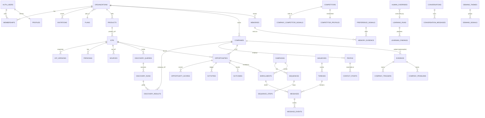

# 5 · Backend / Database / Data Schema

> **As of 2026-10-08** · migrations `0001`–`0045` (45 files) applied to an in-memory Postgres
> (PGlite) and introspected. **Column-level truth is
> [generated/schema-reference.md](generated/schema-reference.md)** (3,456 lines: every column, type,
> default, constraint, index, policy, trigger, function). This document gives the interpretation:
> what each table is for, who owns and may touch it, how it relates, and where it is inconsistent.
> Companions: [PRD](01-product-requirements.md) · [TRD](02-technical-requirements.md) ·
> [App Flow](03-app-flow.md) · [Design Brief](04-design-brief.md) ·
> [Plan](06-implementation-plan.md) · [Gap Report](07-specification-gap-report.md).
>
> **Nothing in the database was modified to write this.** "Required changes" below are findings, not edits.

## 1 · Totals and method

| | |
|---|---|
| Tables | **79** (RLS enabled on **79/79**) |
| Views | 9 (`angle_performance`, `discovery_performance`, `persona_performance`, `pipeline_throughput`, `spend_by_period`, `provider_health`, `queue_pressure`, `job_health`, `job_dead_letters`) |
| Public functions | **98** (71 `SECURITY DEFINER`; every one of the 83 definer definitions across the migrations pins `search_path`) |
| Enum types | 10 (`claim_kind`, `confidence`, `memory_scope`, `opportunity_priority`, `opportunity_status`, `org_role`, `rule_effect`, `rule_intent`, `source_kind`, `source_status`); all other vocabularies are `text` + CHECK |
| RLS policies | 140 |
| Indexes | 233 (many partial) · Triggers 75 |
| Tenant column | `org_id` on 76 tables; absent on `organizations`, `plans`, `profiles`, `public_research`, `public_research_attempts` |
| Provider | Supabase Postgres; schema is plain SQL, **no ORM** |
| How verified | `packages/db/scripts/verify-migrations.ts` (341 checks pass) + the generator `packages/db/scripts/schema-reference.ts` |

## 2 · Conventions

| Convention | Rule | Exceptions / notes |
|---|---|---|
| Keys | `id uuid primary key default gen_random_uuid()` | Composite PKs: `attention_snoozes`, `demand_state`, `notification_preferences`, `memory_evidence`, `preference_state` |
| Tenancy | Every tenant row has `org_id uuid not null references organizations(id) on delete cascade` | Four tables above |
| Timestamps | `created_at`, `updated_at` (`touch_updated_at` trigger) on mutable tables | Append-only tables have no `updated_at`: `audit_logs`, `human_overrides`, `provider_calls`, `rate_limits`, `preference_signals`, `evidence_citations`, `icp_versions`, `memory_evidence`, `discovery_results`, `company_merges`, `competitor_evidence`, `contact_fit_scores` |
| Soft delete | `deleted_at timestamptz` on **31 tables** (`activities, campaigns, companies, company_gaps, company_problems, company_triggers, competitors, contact_points, conversations, discovery_queries, enrollments, evidence, icps, learning_runs, mailboxes, memberships, memories, messages, opportunities, organizations, people, personas, products, provider_accounts, scoring_rules, sequence_steps, sequences, sources, subscriptions, threads`) | **No RLS policy filters on `deleted_at`** — hiding deleted rows is application-side (S-06). Hard deletes happen in erasure, account/workspace deletion, and prune functions |
| Vocabularies | `text` + `CHECK (x = ANY (ARRAY[…]))` rather than Postgres enums, except the 10 above | Six status columns have **no** CHECK (S-02) |
| Money | integer cents (`cost_cents numeric(…)` for AI; `value_cents bigint`; `estimated_value_cents bigint` + 3-letter currency CHECK) | Provider credits are not money (tracked as `credits int`) |
| JSON | `jsonb` for criteria, payloads, traces, settings | `plans.limits` and `organizations.settings` are unvalidated shapes (S-03) |
| Polymorphic refs | `*_type` + `*_id` with **no FK** | `evidence`, `ai_runs`, `ai_decisions`, `enrichment_records`, `external_ids`, `human_overrides`, `provider_calls`, `activities (ref_type/ref_id)`, `demand_signals (source_type/id)` — S-05 |
| Identity of users | `auth.users(id)` (Supabase) mirrored to `public.profiles` by trigger `handle_new_user` | `profiles` is a projection; `auth.users` wins |
| Naming | snake_case plural tables; `*_at` timestamps; `*_by` actor ids; `is_*` booleans | |
| RLS pattern | `tenant_read` = `org_id IN (select user_org_ids())`; `tenant_write` = `has_org_role(org_id,'member')` (admin on org-level tables) | Personal tables key on `user_id = auth.uid()` |
| Engine-only writes | `0031` made engine-written tables read-only to sessions (`job_executions`, `provider_*`, `usage_counters`, `rate_limits`, `message_events`, `evidence_citations`, `subscriptions`, `audit_logs`, …); writes via service role or SECURITY DEFINER functions | |

## 3 · Entity catalogue

Legend: **Own** = who creates/owns the rows · **Acc** = effective access (R = read by members, W = write by member+, A = admin+, E = engine/service-role only, P = personal to `user_id`). Column lists are abridged to what matters; see the generated reference for all.

### 3.1 Identity, tenancy, plans, accounting — `T-100`

| Table | Purpose | Key columns | Own / Acc | Lifecycle |
|---|---|---|---|---|
| `organizations` | Tenant root (a "workspace") | `slug` UNIQUE (immutable by convention), `plan_id→plans`, `settings jsonb`, outreach caps `min_days_between_contacts=2`, `max_sends_per_contact_30d=6`, `max_contacts_per_company=3`, `max_sends_per_day`, `contact_retention_days` (≥30), `onboarding_step` (8 values), `onboarding_completed_at`, `goals text[≤2]`, `primary_domain`, `is_discoverable`, `workspace_kind` (`company / personal`) | Created by `create_organization` RPC. R members; UPDATE admin; DELETE via `delete_organization` (owner) | Soft `deleted_at`; owner deletes; cascades to every tenant row |
| `profiles` | Readable identity per auth user | `role` (7 values), `goals`, `onboarded_at`, `learning_paused` | Self. R self + co-members; UPDATE self | Cascade from `auth.users` |
| `memberships` | User↔org with role | `role org_role`, `invited_by`, UNIQUE(org,user) | Admin. R members; ALL admin | Soft delete; trigger `memberships_guard_owner` forbids removing/demoting the last owner |
| `invitations` | Pending invites | `email`, `role`, `token uuid` UNIQUE, `expires_at` (14 d), `accepted_at/by`, `revoked_at` | Admin ALL | Token is the credential; accepted via `accept_invitation` |
| `join_requests` | Same-domain "ask to join" | `status pending/approved/declined`, `admins_notified_at`, `requester_notified_at` | Admin ALL; created via `request_to_join` | |
| `plans` | Catalogue | `id` (`free / growth / scale`), `price_cents`, `limits jsonb` {opportunities, ai_runs, emails, enrich, seats} | Seeded; R **everyone** (`USING true`) | Static |
| `subscriptions` | Stripe link | `stripe_sub_id` UNIQUE, `status`, `current_period_end` | Intended: engine from Stripe webhooks. R members | **No writer, no reader** (S-01) |
| `usage_counters` | Monthly metering | UNIQUE(org, period `YYYY-MM`, metric), `used`, `limit` | Written only through SECURITY DEFINER `increment_usage` / `increment_usage_internal`; R members | Monthly rows accrue |
| `audit_logs` | Admin-visible trail | `actor_id`, `action`, `target_type/id`, `meta`, `ip` | Written only through SECURITY DEFINER `write_audit_log` / `write_audit_log_internal`; R admin | Append-only |
| `rate_limits` | Fixed-window counters | `(org,user,action,window_start)`, `count` | Written only through SECURITY DEFINER `consume_rate_limit`; R members | Pruned by pg_cron `prune-rate-limits` |
| `notification_preferences` | Digest on/off, hour, timezone | PK (org,user) | P | |
| `attention_snoozes` | Per-user Needs-you snoozes | PK (org,user,item_key), `snoozed_until` ≤ 30 d | P | |

### 3.2 Product definition, discovery, scoring configuration — `T-200`

| Table | Purpose | Key columns / rules | Acc |
|---|---|---|---|
| `products` | What the customer sells (many per org) | `name`, `website`, `value_props jsonb`, `proof_points jsonb`, `research jsonb` (object CHECK), `research_is_live` | W |
| `icps` | Ideal-customer profile ("profile"), many per org | `product_id?`, `criteria jsonb`, `negative_criteria jsonb` (both: object + **known-keys CHECKs**), `is_active`, `version`, `current_version_id`, `quality_score`, `addressable_estimate/_source/_at` | W |
| `icp_versions` | Immutable snapshots | UNIQUE(org,icp,version), `diff`, `quality` | R; E/definer writes (`bump_icp_version`) |
| `personas` | Buyer personas per ICP | `title_patterns[]`, `seniority[]`, `departments[]`, `exclude_titles[]`, `is_primary`, `priority` | W |
| `scoring_rules` | User rules | `expression jsonb`, `effect rule_effect` (adjust/veto/floor), `intent`, `weight` (bounded), `floor_priority`, `origin` (proposed by model vs user), `approved_by/at`, `is_active` | W; CHECK `effect_arguments` |
| `sources` | Monitored feeds/pages | `kind source_kind`, `url`, `is_enabled`, `status`, `scan_interval_minutes`, `next_scan_at`, `recommended_by`, `failure_count`, `icp_id?` | W |
| `discovery_queries` | Saved provider searches | `filters jsonb`, `filters_hash` UNIQUE per org, `unmappable`, `credit_budget`, `max_pages`, `next_run_at`, `interval_minutes` | W |
| `discovery_runs` | One execution | `channel provider / source / import`, `status` (6), `stop_reason`, counters, `credits_spent` | W (engine writes) |
| `discovery_results` | Per-hit outcome | UNIQUE(run,provider,provider_id), `outcome` new/matched/excluded/suppressed/invalid | R |
| `score_recompute_requests` | "Rescore all" with cursor | `reason`, `status` (5), `cursor`, counts | R; member may cancel |
| `provider_accounts` | Per-org capability→vendor choice, budget | UNIQUE(org,capability), `monthly_credit_limit`, `credential_status` | **A** |

### 3.3 Companies, people, contactability — `T-300`

| Table | Purpose | Key columns / rules |
|---|---|---|
| `companies` | One row per domain per org | UNIQUE(org, `canonical_domain`) (**not** partial on `deleted_at`, S-07), `name`, firmographics, `tech_stack[]`, `funding jsonb`, `leadership jsonb`, `discovered_via`, `parent_company_id`, `merged_into_id`, request/last-checked markers (`research_requested_at`, `last_enriched_at`, `last_signal_checked_at`). Policies: insert/select/update (no delete policy — soft delete is an UPDATE) |
| `company_domains` | Alternate domains | UNIQUE(org,domain), `kind`, `asserted_by` |
| `external_ids` | Provider ids → entity | UNIQUE(org,provider,provider_id), polymorphic `entity_id` |
| `merge_candidates` | Proposed duplicates | UNIQUE(org,a,b), `matched_on` (5), `status` pending/merged/rejected — **never written (resolver unreachable)** |
| `company_merges` | Audit of merges | `winner_id`, `loser_id`, `moved jsonb`, `method`, `reverted_at` — **never read or written by the app** |
| `people` | Contacts | `company_id`, `title`, `seniority_rank`, `is_decision_maker`, `employment_status`, `last_verified_at`, `persona_id` |
| `contact_points` | Email/phone/LinkedIn | UNIQUE(org,kind,value), `verification_status`, `confidence`, `provider` |
| `enrichment_records` | Append-only provider answers | `entity_type/id`, `provider`, `field`, `value`, `cost_cents`, `raw` |
| `contact_fit_scores` | Per-person fit vs ICP version | `score`, `dimensions`, `rule_trace`, `reason` |
| `contact_frequency` | Cadence counters per address | UNIQUE(org,email), `sends_30d`, `last_sent_at`, `last_reply_at` (maintained by SQL only) |
| `suppressions` | Do-not-contact | `kind email / domain`, `value`, `value_hash`, `is_erasure_residue` |

### 3.4 Evidence and intelligence — `T-400`

| Table | Purpose | Key rules |
|---|---|---|
| `evidence` | **One row per claim** (the epistemic core) | `kind claim_kind`; CHECKs `evidence_fact_needs_source`, `evidence_unknown_has_no_confidence`; `subject_type ∈ company / opportunity / contact / signal / competitor` + `subject_id` (no FK); `source_id?`, `source_url`, `excerpt`, `event_date`, `observed_at`, `superseded_by→evidence`, `reliability`, `field`, `contradicted`, `claim_hash`, `live_source_key`; soft delete |
| `evidence_citations` | Extra citations of one claim | Read policy only — **no code references** (S-01) |
| `source_documents` | Fetched pages | UNIQUE(org,content_hash), `url_hash` |
| `source_events` | Normalised events (§33) | `event_type`, `kind claim_kind`, `company_id?` |
| `company_triggers` | Why-now triggers | `trigger_type`, `event_date`, `strength` CHECK; soft delete |
| `company_problems`, `company_gaps` | Researched problems / gaps with evidence | soft delete; both read by `company-intel.ts` |
| `competitors` | Named competitors | `origin user / onboarding / discovered / mention`, `status proposed / active / dismissed`, `tier`, `our_advantage`, `their_advantage` (human-owned), `research_requested_at`, `prospect_customers` |
| `competitor_profiles` | Researched profile | UNIQUE(org,competitor); jsonb fields; `ai_run_id` |
| `competitor_evidence` | Join: profile field → evidence | UNIQUE(org,competitor,evidence,field) |
| `company_competitor_signals` | Prospect↔competitor relationship | UNIQUE(org,company,competitor,relationship); `relationship` check (uses/evaluating/former/partner/mentions) |

### 3.5 Opportunities, decisions, history — `T-500`

| Table | Purpose | Key rules |
|---|---|---|
| `opportunities` | **The unit of the product** | UNIQUE NULLS NOT DISTINCT (org, company, icp); `priority` + **mandatory `priority_reason`**; `status` (11); `owner_id→auth.users`; narrative fields; `confidence`; `priority_set_by system / user`; contact selection markers; `next_step` (≤280) + `_due_at/_set_by/_set_at`; `estimated_value_cents` (0…1e11) + currency; sync/seek markers; soft delete; trigger `opportunities_project_activity` |
| `opportunity_scores` | Score history | Eight nullable `0–100` dimensions; `score`, `model_score`, `rule_trace`, `prompt_version`, `icp_version_id`, `rules_version`, `computed_reason`, `explanation` |
| `ai_decisions` | Stored AI outputs + human override + quality rating | `decision_type`, `output`, `human_override`, `quality_rating` |
| `human_overrides` | Corrections for learning | `subject`, `system_value`, `human_value`, `reason`, `score_id`, `consumed_at/by→learning_runs` |
| `outcomes` | What happened | `kind reply / positive / meeting / proposal / won / lost / disqualified`, `value_cents`, `reason`, `reason_category`, `competitor_id`, `recorded_by` |
| `activities` | **Append-only relationship ledger** | `kind` (17), `channel` (7), `direction` (3), `actor_type`, `origin trigger / manual / backfill`, `ref_type/ref_id` (idempotent projection), `product_feedback`; CHECKs `manual_shape`, `has_subject`, `ref_pair`; manual rows insertable/updatable by author; system rows projected by triggers `project_*_activity` |

### 3.6 Outreach — `T-600`

| Table | Purpose | Key rules |
|---|---|---|
| `mailboxes` | Connected sender | `provider gmail / outlook / smtp`, `oauth_token_enc`, `refresh_token_enc` (**encrypted in app**), `daily_limit`, `sent_today(_on)`, `warmup_*`, `health_score`, `sync_cursor`, `status` (**no CHECK**); UNIQUE(org,email) |
| `campaigns` | Outreach program | `status` (**no CHECK**; draft/active/paused/archived in UI), `autonomy_level` CHECK 0–5, `icp_id?`, `product_id?`, `schedule`, `sending_config` |
| `sequences` / `sequence_steps` | Steps | `kind email / wait / condition`, `delay_hours`, `template jsonb`; UNIQUE(org,sequence,position) |
| `enrollments` | Opportunity in campaign | UNIQUE(org,campaign,opportunity); `status` (**no CHECK**), `current_step`, `next_action_at`, `parked_reason`, `redraft_note` (≤ length CHECK), `mailbox_id` |
| `threads` | Email conversations | `status` (**no CHECK**; open/snoozed/closed), `classification` (reply label), `assignee_id`, `provider_thread_id`, `participants[]` |
| `messages` | Drafts, sent, inbound | `direction`, bodies, **`evidence_ids uuid[]`** (claims a draft may rest on), `ai_generated`, `approved_by`, `scheduled_at`, `sent_at` + `provider_message_id` (**CHECK `messages_sent_has_provider_id`**), unsubscribe token in `message_unsubscribe_tokens` since `0047`, edit trail (`edited_by/at`, `original_subject/body_text`), reject trail, `applied_memory_ids[]` |
| `message_events` | delivered/bounced/replied/… | `kind` (8; includes `opened`,`clicked` — no tracking implemented, S-04) |

### 3.7 Memory, learning, assistant — `T-700`

| Table | Purpose | Key rules |
|---|---|---|
| `memories` | Knowledge at five scopes `organization / team / user / account / opportunity` | `scope_id` presence CHECK; `kind durable / conversational`; `source user / derived`; `origin stated / learned / promoted`; `risk low / high`; `status proposed / active / paused / rejected`; `category`; `applies_to[]`; `support`, `contradicts`; `shared_at`; `promoted_from`. **RLS:** user-scope rows visible only to their subject (or admins once `shared_at` set); `memories_write_own` for the subject; `memories_write_shared` member+ for other scopes |
| `memory_evidence` | Links a learned memory to the signals it rests on | PK (memory,signal) |
| `preference_signals` | Observed own-actions | `kind` (9), `note`, `features jsonb`; insert/select/delete by owner only |
| `preference_state` | Per-person learner/ack markers | PK (org,user) |
| `user_questions` | Just-in-time questions | UNIQUE(org,user,question_key); `status asked / answered / dismissed / snoozed`; `answer jsonb`; `memory_id?` |
| `learning_runs` | Analysis runs | `status requested / running / ready / insufficient / failed`, window, counts, `targets[]` |
| `learning_findings` | Proposals | `kind` (10), closed citation arrays (opportunities, companies, sources, people, queries, competitors, themes), `proposal jsonb`, `status pending / approved / rejected`, `applied_type/id`; CHECK `decision` ties status to decider |
| `conversations` / `conversation_messages` | Agent & assistant chats | `scope opportunity / workspace` with CHECK `scope_subject`; `product_id?`; UNIQUE(org,opportunity,user); messages hold `citations jsonb`, `actions jsonb`, `applied_memory_ids[]`; **owner-only RLS** |

### 3.8 Demand — `T-800`
`demand_signals` (statement per source; UNIQUE(org,source_type,source_id,statement)), `demand_themes` (status proposed/open/planned/shipped/wont/rejected/merged; origin model|user), `demand_state` (one row per org; grouping request/last-run).

### 3.9 Engine, providers, misc — `T-900`

| Table | Purpose | Notes |
|---|---|---|
| `job_executions` | The queue | `org_id` nullable (sweepers); `job_name`, `status` (**no CHECK**), `attempts/max_attempts=3`, `run_at`, `locked_at/by`, `idempotency_key`, `payload`, `result`, `error`. R members (org's own); writes E |
| `ai_runs` | One row per model call | `task`, `model`, `prompt_version`, `input_hash`, token counts, `cost_cents`, `latency_ms`, `status` (**no CHECK**), `error`, `entity_type/id` |
| `events` | Product event store | Single writer (`analyze_performance`), **no reader** (S-01) |
| `provider_cache` | Vendor response cache | UNIQUE(org,request_hash), TTL `expires_at`; pg_cron prune |
| `provider_calls` | Append-only ledger | `credits`, `outcome` (7), `latency_ms`, `attempts` |
| `provider_breakers` | Circuit breaker state | UNIQUE(org,provider) |
| `hubspot_connections` | CRM link | UNIQUE(org); `access_token` (**encrypted in app**); `hub_id`; **admin** write |
| `public_research` | Pre-tenant anonymous reads | **RLS on, zero policies by design** (service role only); `ip_hash`, `claimed_by/_org_id`, `expires_at` default now()+30 days (purged daily by pg_cron `purge-expired-research`, `0047`) |
| `public_research_attempts` | One row per paid anonymous lookup, reserved before the model call (`0047`) | RLS on, zero policies (service role only); written by `reserve_public_research`, which serialises with an advisory lock |
| `message_unsubscribe_tokens` | The unsubscribe token per outbound message (`0047`, moved off `messages`) | Policy `no_session_access` refuses every session; read by `send_message` (service role) and resolved by `record_unsubscribe` |

### 3.10 Functions that carry business logic

| Family | Functions (all in `public`) |
|---|---|
| Authorization helpers | `user_org_ids`, `co_member_ids`, `has_org_role` |
| Identity/tenancy | `handle_new_user`, `create_organization`, `accept_invitation`, `request_to_join`, `approve_join_request`, `discoverable_workspaces`, `delete_organization`, `delete_own_account`, `guard_membership_owner`, `guard_invitation_owner` |
| Metering | `usage_limit`, `check_quota`, `check_quota_internal`, `increment_usage`, `increment_usage_internal`, `consume_rate_limit` |
| Audit | `write_audit_log`, `write_audit_log_internal` |
| Queue | `claim_job_executions`, `requeue_stalled_jobs`, `retry_job`, `cancel_job` |
| Outreach safety | `can_contact`, `is_suppressed`, `record_unsubscribe`, `record_contact_send`, `record_contact_reply`, `claim_mailbox_send`, `mailbox_remaining_today` |
| Data rights | `erase_contact`, `erase_contact_for_org`, `export_contact`, `export_contact_for_org`, `export_organization`, `export_my_learning`, `prune_stale_contacts`, `purge_expired_research`, `demand_forget_erased` |
| Discovery/scoring | `claim_due_discovery_queries`, `finish_discovery_run`, `provider_budget_for_org`, `provider_budget_state`, `request_score_recompute`, `claim_due_recomputes`, `advance_recompute`, `fail_recompute`, `active_rules_version`, `bump_icp_version(_for_org)`, `record_override` |
| Backpressure | `backlog_cap`, `backlog_state`, `backlog_state_for_org`, `open_opportunity_count`, `saturated_org_ids` |
| Identity resolution | `resolve_company`, `merge_companies`, `merge_companies_for_org` (**no caller**), `merge_duplicate_evidence` |
| Activity projection | `project_message_activity`, `project_message_event_activity`, `project_opportunity_activity`, `project_outcome_activity`, `project_override_activity`, `backfill_activities`, `message_opportunity` |
| Demand | `demand_from_activity`, `demand_from_outcome` |
| Hygiene | `touch_updated_at`, `jsonb_keys_within`, `prune_rate_limits`, `prune_provider_cache`, `flag_contradictions`, `memories_origin_from_source` |
| Migration probes | `migration_0031_applied … migration_0045_applied` (15 RPCs used by `db:doctor`) |

## 4 · Relationship model

Cascade behaviour: deleting an `organizations` row cascades to all tenant tables; `companies → opportunities` cascades (hence soft-delete for companies); user deletions set `*_by`/`owner_id` to NULL.

## 5 · Roles, permissions and data-level access

| Rule | Where | Notes |
|---|---|---|
| Roles | enum `org_role`: owner > admin > member > viewer; `has_org_role(org, min)` compares by rank | Unknown role degrades to viewer in app code |
| Read | `org_id IN user_org_ids()` | Non-members get empty results (and 404 in UI) |
| Write (default) | `has_org_role(org,'member')` | |
| Admin-only | `organizations` UPDATE, `memberships`, `invitations`, `join_requests`, `audit_logs` (read), `hubspot_connections`, `provider_accounts` | |
| Owner-only | `delete_organization`; granting owner (UI + trigger) | |
| Personal | `memories` (user scope), `preference_*`, `user_questions`, `conversations*`, `attention_snoozes`, `notification_preferences` | Admins **cannot** read another user's personal rows unless the owner set `shared_at` (memories only) |
| Service-role | job engine; confined to 5 files in `apps/`+`packages/` | Bypasses RLS |
| Public | `plans` (SELECT true) | |
| No-policy | `public_research`, `public_research_attempts` | Intentional |
| Admin access to data subjects | `export_contact_for_org`, `erase_contact_for_org` wrappers are admin-gated | |
| Team/member access to opportunities | All members see all opportunities; **ownership is a workflow field, not an access boundary** | Intent: confirm (DEC-15) |
| Public/private data | Everything except `plans` is private to its org or person | |
| Sensitive data | Prospect PII (people, contact_points, message bodies), mailbox tokens (encrypted), HubSpot token (encrypted), IP hashes | See §8 |

## 6 · Data ownership and lifecycle

| Data | Created by | Changes | Ends |
|---|---|---|---|
| Workspace, memberships | Onboarding / invite / join | Admin | Soft delete; owner delete cascades |
| Products / ICP / rules / sources / competitors | Users (some drafted by AI then accepted) | Versioned (`icp_versions`) | Soft delete |
| Companies / people / contact points | Engine (providers/sources/import) or users | Re-enrichment appends `enrichment_records`; merges (dormant) | Soft delete; contact erase = delete/redact; retention prune (opt-in) |
| Evidence | Engine/AI/user | Superseded, never silently overwritten; dedup by claim hash | Soft delete |
| Opportunities & scores | Engine (`score_opportunity`) or Analyze | New score row per computation; human overrides recorded | Archive (status) / soft delete |
| Activities | Triggers (system) + users (manual) | Append-only (manual rows editable by author, soft-deletable) | Retained; text redacted on contact erasure |
| Messages | Engine drafts / sync / users | Edit keeps original; approve → send | Retained; bodies redacted on erasure |
| Jobs | Engine/users | attempts/status | Not pruned automatically (no retention on `job_executions`/`ai_runs`/`provider_calls`/`audit_logs`) — S-08 |
| Rate limits, provider cache, public research | Engine | — | pg_cron / purge functions |
| Personal learning data | The person's own actions | Pause/reset/forget/export | Signals kept 180 days; reset deletes; deleted with account |
| Audit logs | `recordAudit` | Append-only | Retained |

## 7 · Existing schema vs required changes

### 7.1 Inconsistencies and gaps found (S-nn) — no change has been made

| ID | Finding | Evidence | Severity | Required change (if confirmed) |
|---|---|---|---|---|
| S-01 | **Tables with no reader or no writer:** `company_merges` (never touched by app), `evidence_citations` (no code), `subscriptions` (no code), `events` (one writer, no reader); `merge_candidates` is written only by an unreachable handler | grep of `apps/` and `packages/` | Medium | Wire or drop (DEC-07/DEC-03); do not leave "decorative" tables |
| S-02 | **Status columns with no CHECK:** `mailboxes.status`, `campaigns.status`, `enrollments.status`, `threads.status`, `ai_runs.status`, `job_executions.status`, `subscriptions.status` | `0004`; constraint lists | Medium | Add CHECKs matching the values code writes (needs an inventory of values; additive but must not reject existing rows) |
| S-03 | **Quota fail-open:** `organizations.plan_id` is nullable (default `'free'`); `plans.limits` is unvalidated JSON; `usage_limit()` returns NULL for an absent key and NULL means unlimited | `0007`; `lib/data/plans.ts` comments | Medium | `NOT NULL` on `plan_id`; CHECK that `limits` has the five keys |
| S-04 | **Vocabulary wider than implementation:** `mailboxes.provider='smtp'` (no adapter — only `gmail.ts`, `outlook.ts`), `message_events.kind` `opened`/`clicked` (appear only as TypeScript union members in `lib/data/inbox.ts`; nothing emits them) | CHECKs vs `packages/jobs/src/mailbox/*` | Low | Narrow or document as reserved |
| S-05 | **Polymorphic references without FK** (list in §2) — orphans possible if a subject is hard-deleted | schema | Low–Medium | Accept (documented) or add deferred integrity checks in tests |
| S-06 | **Soft-deleted rows remain visible to any member through PostgREST/RLS**; hiding relies on every query adding `deleted_at IS NULL`. Exports and any new loader that forgets the filter will leak "removed" records | 0 of 140 policies reference `deleted_at` | Medium | Add `deleted_at IS NULL` to `tenant_read` for soft-deleted tables, or views; verify with the isolation suite |
| S-07 | **Unique keys include soft-deleted rows:** `companies (org_id, canonical_domain)` is not partial, and `deleteCompanyAction` is a soft delete → **re-adding a removed company's domain fails** with "already on your list… the existing one is the one to edit", while the list hides it. *Derived from reading the code and constraint; not reproduced in a browser* | `companies/actions.ts`; constraint `companies_org_id_canonical_domain_key` | Medium (probably BROKEN) | Restore-on-re-add, or partial unique index `WHERE deleted_at IS NULL` (affects merge/identity logic — design needed) |
| S-08 | **No retention** on `job_executions`, `ai_runs`, `provider_calls`, `audit_logs`, `message_events`, `events`, `source_events`, `source_documents`; unbounded growth | no prune functions beyond rate limits/provider cache/public research | Low now, Medium at scale | Define retention per table |
| S-09 | **Ownership not tied to membership:** `opportunities.owner_id`, `threads.assignee_id`, `approved_by` reference `auth.users`, not `memberships`; a removed member can remain an owner | FKs | Low | App check exists in `assignOpportunityAction`? (not verified) — add DB guard or a cleanup on member removal |
| S-10 | **Schema gate sentinel lags code:** `LATEST_TABLE` is a *single* table — `hubspot_connections` (0028) on `main` though `main` needs through 0039; `user_questions` (0044) on the branch though 0045 is needed. A partially migrated database can pass the gate | `apps/web/lib/schema.ts` | Medium | Probe per-migration RPCs (`migration_00NN_applied`) as `db:doctor` already does |
| S-11 | **Weak default salt:** `public_research.ip_hash` uses `PUBLIC_RESEARCH_SALT ?? "huntloop-public-research"`; an unset salt makes IPv4 hashes brute-forceable if the table leaks (service-role-only table) | `packages/jobs/src/public-research.ts:225` | Low | Require the env var when the feature is on |
| S-12 | **Duplicate bundle file** `COMBINED-0024-0027.sql` sits beside numbered migrations (verified equal to the four by the test) | migrations dir | Low | Keep verification; consider moving to `docs/` |
| S-13 | **Migrations applied by hand**, no ledger table in the database (only `migration_00NN_applied` probe RPCs from 0031) | `db:doctor` | Medium | Adopt a migration ledger/tool (REC-04) |
| S-14 | `profiles.avatar_url` has no writer/reader in UI | grep | Low | Remove or use |
| S-15 | `docs/architecture/database.md` & `data-model.md` describe 69 tables / 28 migrations | docs | Doc | Replace with this pack (CON-03) |

### 7.2 Missing tables / fields (relative to specified or implied needs)

| ID | Need | Evidence | Status |
|---|---|---|---|
| MIS-01 | Billing: payment method, invoices, webhook event log, entitlement history | `subscriptions` only | MISSING |
| — | Notification inbox | PRD §11 | MISSING (not required unless DEC) |
| — | Migration ledger | S-13 | MISSING |
| — | API keys / webhooks-out for tenants | none specified | N/A |
| — | MFA/SSO factors | provided by Supabase Auth if enabled | UNCLEAR |
| — | Backups metadata | platform-level | UNCLEAR |

### 7.3 Deprecated / superseded structures
`organizations.settings -> 'voice' -> 'competitors'` (free-text competitor names) predates `competitors`; still read by the message writer as "don't claim to be a tool they use" — PARTIALLY superseded (COMMAND §10.1 still edits it). `conversations_workspace_idx` (one workspace conversation per person) dropped in `0045`. `COMBINED-0024-0027.sql` is a convenience bundle. `docs/architecture/data-model.md` is out of date.

### 7.4 Potential security issues (database layer)

| ID | Issue | Severity | Note |
|---|---|---|---|
| S-06 | soft-deleted rows readable | Medium | above |
| S-11 | default salt | Low | above |
| S-16 | **71 SECURITY DEFINER functions** bypass RLS by design; each must authorise its caller internally. All pin `search_path`; the isolation suite exercises many, but a full per-function authorisation review was **not** performed here | Medium (review gap) | REC-13 |
| S-17 | Message bodies and prospect PII are stored in clear text at the application layer (platform disk encryption only); mailbox/CRM tokens are app-encrypted | Info | Acceptable if documented in the privacy notice (DEF-08) |
| S-18 | `plans_read USING (true)` is intentional public price data | Info | — |
| S-19 | Members (not only admins) can write most tenant tables, including `scoring_rules`, `sources`, `campaigns` — consistent with "member = operator" but broader than the admin-only org tables | Info | Confirm (DEC-15) |

### 7.5 Migration requirements before the code can be trusted in production

| Requirement | Detail |
|---|---|
| Production must have `0040`–`0045` before `feat/personal-learning` is deployed | `CHANGELOG.md` says applied 2026-10-08; **not verifiable from the repo** (CON-11). Verify with `npm run db:doctor` against production |
| Ordering | `0044` before the first sign-in on the new code (new RPC `export_my_learning`, `user_questions`); `0045` drops an index and adds `conversations.product_id` (code tolerates absence by dropping focus) |
| Process | Apply in a single transaction via the generated `pending-migrations.sql` (gitignored), by someone with `DATABASE_URL` |
| Gate | Bump `LATEST_TABLE` in the same change that adds a migration (currently inconsistent, S-10) |
| Rollback | None provided — migrations are forward-only; take a backup/PITR point first (MIS-03) |

## 8 · Sensitive-data handling

| Data | Handling |
|---|---|
| Magic-link / sessions | Supabase Auth |
| Mailbox OAuth tokens, HubSpot token | AES-encrypted by the app with `MAILBOX_ENCRYPTION_KEY` (32-byte hex); connect refused if unset; **rotating the key forces reconnect** |
| Prospect PII | RLS-scoped; export/erase/retention; suppression keeps only a hash |
| Message bodies | Stored in clear; erased/redacted on contact erasure (both directions) |
| Personal learning data | RLS to subject; export, reset, pause |
| IP addresses | `audit_logs.ip` (inet) and hashed `public_research.ip_hash` |
| Secrets in the repository | `.env*` ignored; `.env.example` has names only. History not scanned in this task |

## 9 · Audit and history requirements

`audit_logs` for member/invitation/settings/privacy actions (coverage not enumerated); `activities` for relationship history (ledger, trigger-projected, idempotent on `(org, ref_type, ref_id, kind)`); `icp_versions` for profile history; `opportunity_scores` for scoring history with provenance; `ai_runs` + `provider_calls` for spend; `human_overrides` + `outcomes` for learning labels; `evidence.superseded_by` for claim history. No generic row-version history exists.

## 10 · Recommendations (RECOMMENDED — not requirements)
REC-04 (migration ledger), REC-10 (CI drift check against the generated reference), REC-13 (definer-function authorisation review), plus fixes for S-02/S-03/S-06/S-07/S-10/S-11 once the owner confirms them (see Gap Report).
