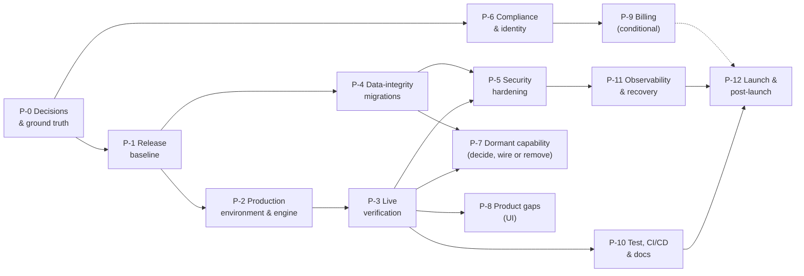

# 6 · Implementation Plan

> **As of 2026-10-08.** This plan covers **what remains**, not what is built. The product is
> feature-rich; the dominant risk is that **none of it has been proven in production** and the
> release itself is in an inconsistent state. The plan is therefore ordered by *dependency and risk
> first, user impact second, feature breadth last*.
>
> Companions: [PRD](01-product-requirements.md) · [TRD](02-technical-requirements.md) ·
> [App Flow](03-app-flow.md) · [Design Brief](04-design-brief.md) · [Schema](05-backend-database-schema.md) ·
> [Gap Report](07-specification-gap-report.md) (holds the `DEF/MIS/CON/DEC/REC` registers cited here).
>
> **Nothing here is started.** Phases marked *needs DEC-nn* must not begin until the owner decides.
> Product roadmap items (COMMAND.md §16) are separate and mostly **Shipped**; this plan does not
> restate them. Sizes are relative floors (S ≤ 3 days · M ≤ 2 weeks · L ≤ 4 weeks, one engineer,
> excluding review and excluding waiting on third-party accounts).

## 0 · Reading the plan

Two phases from the generic list do not need work and are recorded as **complete / maintenance
only**: *Architecture* (P-A) and *Design system* (P-D).

## 1 · Milestone table

| Phase | Objective | Deliverables | Dependencies | Acceptance criteria | Status |
|---|---|---|---|---|---|
| **P-0** Decisions & ground truth | Remove ambiguity that blocks work | DEC-01…DEC-06 answered; production facts verified (migrations, Vercel/GitHub/DNS); one written release policy | none | Every blocking DEC has an owner answer recorded in the Gap Report; `db:doctor` output for prod captured | **PLANNED** |
| **P-1** Release baseline | Make `main` = the code described by the docs, **green in CI**, and the only deployed code | Dependencies patched (DEF-16); branches merged/pushed per DEC-01; tag on remote; docs corrected (CON-01); duplicate Vercel projects retired (DEC-06) | P-0 (DEF-16 patch may start immediately) | CI green on `main`; `origin/main` contains 0.1.0; `/api/health.commit` = release commit; `COMMAND.md` header true | **PLANNED** |
| **P-2** Production environment & engine | Make production able to do the product's work | Env provisioned in dependency order; engine driver chosen and running; migrations 0040–0045 confirmed | P-1, DEC-02 | `/api/health` ok:true; a tick has run (`job_executions` rows); Engine page shows no "nothing is running the queue" | **PLANNED** |
| **P-3** Live verification | Observe, once, each vendor integration actually working | Scripted live smoke (AI, Apollo, mailbox send to own address, HubSpot push, Resend) with spend caps; results recorded | P-2 | Each integration has a dated pass/fail record; defects raised as `DEF` | **PLANNED** |
| **P-4** Data-integrity migrations | Close schema inconsistencies without behaviour change | Migration `0046+` for S-02, S-03, S-06, S-07 (per DEC-16), S-10 gate, retention (S-08), migration ledger | P-1 | `verify-migrations` extended and green; production backup point taken before apply; no failing rows on apply | **PLANNED** |
| **P-5** Security hardening | Move defence-in-depth from "built" to "on" | CSP enforced; Sentry on; branch protection; salt required; definer-function review; MFA decision applied | P-3, P-4 | CSP report stream quiet ≥ 7 days then `CSP_ENFORCE=true`; review checklist closed | **PLANNED** |
| **P-6** Compliance & identity | Be able to publish legal text and send mail lawfully | `lib/legal.ts` facts; DPAs/processors list; SPF/DKIM/DMARC; privacy notice matches data held | DEC-04, DEC-05 | `LEGAL-01` passes; legal pages linked and indexable; mail-auth records verified | **PLANNED** (needs DEC) |
| **P-7** Dormant capability | Decide, then wire or remove built-but-unreachable code | Per DEC-07/08: dedup wired (+ review UI) or retired; `enrich_person` wired or retired; `purge_contact_data` wired or retired | P-3, P-4, DEC-07, DEC-08 | `grep enqueue` shows every handler reachable or the handler is deleted; unused tables dropped/wired | **PLANNED** (needs DEC) |
| **P-8** Product gaps | Close user-visible holes | Record search; soft-delete restore/re-add (S-07); toast-or-delete; session-expiry UX; archived-restore; tablet pass | P-4 | Acceptance per item in §3 P-8; e2e added | **PLANNED** |
| **P-9** Billing | Let a customer pay | Stripe checkout, portal, webhook→`subscriptions`, entitlement sync, plan gating | P-6, DEC-03 | A test-mode purchase upgrades `organizations.plan_id` and limits change | **PLANNED** (conditional; do not start without DEC-03) |
| **P-10** Test, CI/CD & docs | Make regressions loud | CD migration step + post-deploy smoke; signed-in e2e on a seeded DB; schema-reference drift check; docs book reconciled | P-3 | CI fails on drift; `docs/status/*` regenerated or retired; COMMAND.md drifts fixed | **PLANNED** |
| **P-11** Observability & recovery | Know when it breaks; be able to restore | Uptime probe on `/api/health`; alert routes; log drain; **restore rehearsal**; cost alerts | P-2, P-5 | A restore from backup is performed and timed; an induced failure alerts a human | **PLANNED** |
| **P-12** Launch & post-launch | Controlled exposure and learning | Staged rollout, runbook, weekly review of cost/engine/CSP | P-10, P-11 | Launch checklist (§4) all green | **PLANNED** |
| **P-A** Architecture | Monorepo, boundaries, queue, RLS | — | — | Boundary checks pass | **EXISTS** (maintenance only) |
| **P-D** Design system | Tokens, 29 components, themes | — | — | a11y/e2e pass in both themes | **EXISTS** (maintenance; fix CON-07 text) |

## 2 · Prioritisation rationale

1. **Truth before features.** The pack found `main` ≠ the documented release (CON-01), production ≠ `main`'s needs unknown (CON-11), and docs describing a heartbeat that does not exist (CON-02). Any new work stacked on that is unverifiable → P-0/P-1 first.
2. **Make the engine run before polishing what it feeds.** Most of the product's value (discovery, scoring, drafts, learning) is *asynchronous*; with no driver (DEF-01) production shows empty states regardless of code quality → P-2.
3. **Observe live vendors once.** 1,480 passing assertions are all against fakes. The cost of the first real call failing in front of a customer exceeds the cost of a scripted smoke → P-3.
4. **Integrity before scale.** Soft-delete visibility, fail-open quotas and the gate sentinel are cheap now, expensive after data exists → P-4.
5. **Compliance gates outreach.** CAN-SPAM/GDPR text and mail authentication must precede real sending → P-6 before any non-test send.
6. **Decide dormant code** (dedup, enrich_person) *after* the engine is observed, so the decision uses real data volumes → P-7.
7. **Billing last**, because it is the only phase that can charge people and depends on legal identity → P-9.

## 3 · Phase detail

> Common fields for every phase: **Current status** is in the milestone table; **Dependencies on
> previous phases** are in the "Dependencies" row. Files named are *likely* areas, not a design.

### P-0 · Decisions and ground truth
| | |
|---|---|
| **Objective** | Unblock everything that currently needs an owner answer or an out-of-band fact |
| **Build** | Nothing. Answer DEC-01 (release strategy), DEC-02 (engine driver), DEC-04 (legal identity), DEC-06 (Vercel cleanup), DEC-03 (billing yes/no/when). Verify: `npm run db:doctor` against production; Vercel project/domain/env; GitHub secrets/protection; DNS records |
| **Dependencies** | owner access to Vercel, Supabase, GitHub, DNS |
| **Deliverables** | Updated Gap Report §5 with answers and dates; a one-page "production facts" note (no secrets) |
| **Files/areas** | `docs/spec/07-…`; `CHANGELOG.md` |
| **DB / API / UI** | none |
| **Tests** | n/a |
| **Acceptance / DoD** | All blocking DECs answered or explicitly deferred with a date; prod migration state known |
| **Risks** | Decisions deferred indefinitely → every later phase stalls |

### P-1 · Release baseline
| | |
|---|---|
| **Objective** | `main` contains exactly what is documented and deployed |
| **Build** | **First (done 2026-10-09, uncommitted):** `npm audit fix` (non-major) — `next` ≥ 16.3.8, `undici`, `sharp`, `source-map-js`, `brace-expansion`, `fast-uri` — then `npm run verify` and `npx playwright test`; dev-only `vitest` major bump as a separate change. **Then** per DEC-01: push `feat/personal-learning`, merge PR #2 and the branch (they are stacked; 11 commits), tag on remote or retag; correct `COMMAND.md` header/§16.0/§16.8 and `CHANGELOG.md` dates to the real merge; retire duplicate Vercel projects (DEC-06) |
| **Dependencies** | P-0; **migrations 0040–0045 must be confirmed applied to production before the merge deploys** (code probes `user_questions`) |
| **Deliverables** | Merged `main`; remote tag; Vercel shows one Git-connected project building `main` |
| **Files/areas** | git, `CHANGELOG.md`, `COMMAND.md` header, `.github/workflows/*`, Vercel settings |
| **DB** | none (apply 0040–0045 first if absent — **outward-facing, owner-run**) |
| **Tests** | CI green on the merge; `/api/health` shows the new commit and `schema: complete` |
| **Acceptance / DoD** | `git rev-parse origin/main` = release commit; docs say so; no failing Vercel project |
| **Risks** | Deploying code before its migrations → proxy 503 on app routes (the gate exists for this); merge conflicts between the two stacked branches (low: linear stack) |

### P-2 · Production environment and engine
| | |
|---|---|
| **Objective** | Production can run jobs, call a model, search providers, connect mailboxes, send product email |
| **Build** | Provision env in this order (each unlocks the next verification): `CRON_SECRET` + driver (DEC-02) → `ANTHROPIC_API_KEY` → `MAILBOX_ENCRYPTION_KEY` (generate once; never rotate casually) → `APOLLO_API_KEY` → Google/Microsoft OAuth apps (redirect URIs `/api/mailboxes/{gmail,outlook}/callback`) → `RESEND_API_KEY`+`EMAIL_FROM` (after P-6 DNS) → `SENTRY_*`, PostHog. Driver options: (a) GitHub Actions `tick.yml` — set repo secret `CRON_SECRET` and variable `HUNTLOOP_URL`; (b) Vercel Cron on a plan that allows sub-daily and add the `crons` block; (c) Inngest keys |
| **Dependencies** | P-1; DEC-02; vendor accounts |
| **Deliverables** | `/api/health`: `ok:true`, `cronSecret:true`, integrations true as provisioned; a recorded tick |
| **Files/areas** | Vercel env, `.github/workflows/tick.yml` or `apps/web/vercel.json`, `docs/operations/heartbeat.md` |
| **DB/API/UI** | none |
| **Tests** | Call `/api/jobs/tick` manually once (expect JSON report, not 503/404); Engine page shows last tick |
| **Acceptance / DoD** | Within 10 minutes of provisioning, `job_executions` shows sweeper rows succeeding; Sources "Scan now" enabled |
| **Risks** | Spend: discovery and AI run on real credits — set `monthly_credit_limit`, backlog cap, plan limits first; GitHub cron lag/60-day pause (mitigate: P-11 uptime probe on last-tick age) |

### P-3 · Live verification
| | |
|---|---|
| **Objective** | Replace "tested against fakes" with "observed working" for each integration |
| **Build** | A manual or scripted checklist, run against a **throw-away workspace** with low caps: onboarding research (Anthropic); ICP draft; reach counter + discovery (Apollo); qualification + why-now; mailbox connect + send to an address the owner controls + reply sync + classification; HubSpot push to a sandbox portal; invitation + digest email (Resend); unsubscribe link end to end |
| **Dependencies** | P-2 |
| **Deliverables** | Dated pass/fail table in the Gap Report; any failure → `DEF-nn` |
| **Files/areas** | `scripts/` (new smoke script, optional), docs |
| **DB** | seeded test workspace only; `db:seed` refuses production by design — create via UI |
| **Tests** | This phase *is* the test |
| **Acceptance / DoD** | Each of 8 integrations has a recorded result; zero unexplained failures |
| **Risks** | Real mail to real people — use own addresses only; provider cost — enforce caps |

### P-4 · Data-integrity migrations (additive)
| | |
|---|---|
| **Objective** | Close S-02, S-03, S-06, S-07, S-08, S-10, S-13 without changing behaviour a user can see |
| **Build** | New migration(s) `0046+`: CHECK constraints for status columns (after inventorying values actually written); `organizations.plan_id NOT NULL` + `plans.limits` shape CHECK; `deleted_at IS NULL` in `tenant_read` for soft-deleted tables **or** views (design needed, test the isolation suite); resolve company re-add (S-07) per DEC-16; retention functions for operational tables; per-migration gate (replace single `LATEST_TABLE` with the `migration_00NN_applied` probes, or add a `schema_migrations` ledger) |
| **Dependencies** | P-1; backup point (MIS-03); DEC-16 |
| **Deliverables** | Migration files, updated `verify-migrations.ts`, regenerated schema reference, updated `doctor.ts` and `lib/schema.ts` |
| **Files/areas** | `packages/db/migrations/`, `packages/db/scripts/*`, `apps/web/lib/schema.ts`, `apps/web/lib/data/*` (remove now-redundant filters only after tests) |
| **API/UI** | none intended; company re-add message/behaviour changes (S-07) |
| **Tests** | New negative cases for each CHECK; RLS test that a soft-deleted row is invisible; apply-on-copy dry run |
| **Acceptance / DoD** | `npm test` green; production dry-run on a restored copy succeeds; `db:doctor` all applied |
| **Risks** | CHECK on existing rows fails apply → inventory first; RLS change hides rows an admin screen needs (e.g. Undo) → audit every `restore*` path |

### P-5 · Security hardening
| | |
|---|---|
| **Objective** | Turn on the protections that are built but off |
| **Build** | Sentry DSN set → watch `/api/csp-report` ≥ 7 days → `CSP_ENFORCE=true`; require `PUBLIC_RESEARCH_SALT` when the feature is on (S-11); GitHub branch protection + required CI; secret scan of git history (not done in this pack); SECURITY DEFINER authorisation review of the 71 functions (REC-13); MFA/SSO decision (MIS-05) |
| **Dependencies** | P-3, P-4 |
| **Deliverables** | Config changes; review checklist with per-function disposition; scan report |
| **Files/areas** | Vercel env, GitHub settings, `packages/jobs/src/public-research.ts`, migrations if a function needs a guard |
| **Tests** | `e2e/csp.spec.ts` under `CSP_ENFORCE=true`; isolation tests for any changed function |
| **Acceptance / DoD** | Enforcing CSP in prod with no new report class; zero open definer findings; protection rules active |
| **Risks** | Enforcing CSP breaks a page silently (hence the report-first design) |

### P-6 · Compliance and identity (needs DEC-04, DEC-05)
| | |
|---|---|
| **Objective** | Be able to publish the legal pages and send mail within the product's own stated policy |
| **Build** | Supply `IDENTITY` and lawful-basis facts in `lib/legal.ts`; decide EU/UK representative (Art. 27); record processors and regions; SPF/DKIM/DMARC for the sending domain used for product email (and guidance for customers' own domains); confirm the postal-address requirement flows (org setting is already required before send); update privacy text to say message bodies are stored in clear |
| **Dependencies** | owner/legal input |
| **Deliverables** | Filled `lib/legal.ts`; DNS records; `LEGAL-01` green |
| **Tests** | `scripts/audit.mjs` LEGAL-01/02/03; manual: unsubscribe & erase flows |
| **Acceptance / DoD** | Legal pages linked from footer/pricing/signup, indexable; mail from `EMAIL_FROM` passes DMARC alignment |
| **Risks** | Publishing invented legal facts — the code deliberately refuses to render unknowns |

### P-7 · Dormant capability (needs DEC-07, DEC-08)
| | |
|---|---|
| **Objective** | No built-but-unreachable code remains |
| **Build** | **Dedup:** enqueue `resolve_entity` after `discover_companies`/import (as `0012`'s header demands), add a merge-review screen calling `merge_companies_for_org`, surface `merge_candidates`; **or** delete handler, SQL, tables. **`enrich_person`:** enqueue from `rank_contacts` for people lacking a verified email (activates Hunter/ZeroBounce); **or** retire both adapters. **`purge_contact_data`:** wire from erase UI as a job, or delete (UI path already works). Decide `subscriptions`, `evidence_citations`, `company_merges`, `events` |
| **Dependencies** | P-3 (see real volumes), P-4 |
| **Deliverables** | Code + COMMAND.md + PRD F-35/F-36 status updates |
| **Tests** | `verify-jobs.ts` cases; a reachability check script (grep-based) in CI so this cannot regress |
| **Acceptance / DoD** | Every `JobName` has a producer or is removed; every table has a reader and a writer or is dropped |
| **Risks** | Auto-merge corrupting data (merge only `high` confidence; reversible via `company_merges.reverted_*`) |

### P-8 · Product gaps (UI)
| Item | Acceptance |
|---|---|
| Record search (MIS-02) — *only if owner wants (DEC)* | ⌘K finds companies/opportunities by name/domain within RLS; no new data leaves tenant |
| Re-add / restore removed company (S-07) | Re-adding a removed domain restores or replaces it with a clear message |
| Toast: adopt or delete (REC-08) | `useToast` used consistently or component removed; kitchen-sink updated |
| Session expiry UX | Expired session on an action redirects to `/login?next=` with a message (DEC-12) |
| Restore archived opportunity | One-click *Restore* from list/detail (low) |
| Tablet pass | 768–1023 px reviewed; e2e project added |
| In-app notification centre (MIS-12) | Only if email digests prove insufficient |
Dependencies: P-4. Files: `apps/web/app/(app)/[org]/*`, `packages/ui`. Risks: scope creep — each item independent.

### P-9 · Billing (conditional; needs DEC-03)
| | |
|---|---|
| **Objective** | Charge for Growth/Scale |
| **Build** | Stripe Checkout + Customer Portal; webhook route (new, public with signature) writing `subscriptions` and updating `organizations.plan_id`; entitlement refresh; downgrade behaviour for seats/limits; invoices via Stripe; pricing buttons switch from `mailto:` to checkout; decide Free `emails = 0` (BR-29, CON-13) |
| **Dependencies** | P-6 (legal identity, tax), DEC-03 |
| **DB** | possible columns on `subscriptions` (customer id, price id); webhook event ledger for idempotency |
| **Tests** | Stripe test mode end-to-end; webhook replay idempotency; RLS on `subscriptions` stays read-only to tenants |
| **Acceptance / DoD** | Test-mode upgrade changes limits within one request; failed payment path defined |
| **Risks** | Plan packaging (Master Context §56 vs `plans` seed) unsettled; tax/VAT |

### P-10 · Testing, CI/CD and documentation
| | |
|---|---|
| **Objective** | Make drift and regressions fail loudly |
| **Build** | CD: migration status check before promote + post-deploy smoke on `/api/health` and one signed-in route; staging project; signed-in Playwright against a seeded staging DB (today E2E runs in demo mode only); CI step that regenerates `docs/spec/generated/schema-reference.md` and fails on diff; reachability script (P-7); generate counts in `docs/README.md` from the code; correct CON-01…CON-10; retire or banner `docs/status/*` |
| **Dependencies** | P-3 |
| **Acceptance / DoD** | A PR that adds a migration without regenerating the reference fails CI; a deploy to staging runs the smoke; docs book has no stale numbers |
| **Risks** | Flaky browser tests; staging data cost |

### P-11 · Observability and recovery
| | |
|---|---|
| **Objective** | Know and recover |
| **Build** | Uptime probe (alert if `/api/health` non-200 **or** last tick age > N min — GitHub cron can lag/pause); Sentry alert rules; log drain; AI/provider spend alert thresholds from `ai_runs`/`provider_calls`; Supabase backup/PITR configuration confirmed; **restore rehearsal** with timing; runbook update (`docs/OPERATIONS.md` DB-02 still "not yet verified") |
| **Dependencies** | P-2, P-5 |
| **Acceptance / DoD** | Induced failure pages a human; restore completed to a scratch project within a stated RTO |
| **Risks** | Alert fatigue |

### P-12 · Launch and post-launch
Launch checklist: P-1…P-6 and P-10/P-11 green; capped pilot workspaces; weekly review of engine health, AI/provider spend, CSP reports, dead letters, quota usage; measure activation (`onboarding_step_*` events once PostHog is on). Roll back = revert deploy (migrations are forward-only, so rollback of code must remain schema-compatible — keep additive).

## 4 · Launch checklist (derived)

- [ ] DEC-01 release merged; tag remote; docs true
- [ ] Prod migrations ≥ 0045 verified by `db:doctor`
- [ ] `/api/health` ok:true; tick running; last-tick alert exists
- [ ] Live verification table complete (P-3)
- [ ] Legal facts supplied; `LEGAL-01` green; mail auth verified
- [ ] CSP enforcing
- [ ] Backup restore rehearsed
- [ ] Spend caps set (plan limits, provider budgets, AI timeout)
- [ ] Billing decision recorded (live or explicitly "contact us")

## 5 · Traceability: requirement → document → phase

| Gap | Documented in | Phase |
|---|---|---|
| DEF-01 engine undriven | PRD §18, TRD §13, Flow §8 | P-2 |
| DEF-02 no live vendor call observed | PRD §16, TRD §8.3 | P-3 |
| DEF-03 prod behind branches | PRD §18 | P-1 |
| DEF-16 vulnerable dependencies / red CI — **resolved 2026-10-09** | TRD §16, §23 | P-1 |
| DEF-04/05/06 unreachable handlers | PRD F-35/36, TRD §8.2, Flow §8 | P-7 |
| DEF-07 unread schema objects | Schema S-01 | P-7 |
| DEF-08 legal pending | PRD F-37, TRD §17 | P-6 |
| DEF-09 CSP report-only | TRD §16 | P-5 |
| DEF-10 company re-add | Schema S-07 | P-4/P-8 |
| DEF-11 gate sentinel lags | Schema S-10 | P-4 |
| MIS-01 billing | PRD F-38 | P-9 |
| MIS-02 record search | PRD F-39 | P-8 |
| MIS-03 backups | TRD §17/§22 | P-11 |
| MIS-04 mail DNS | TRD §10 | P-6 |
| MIS-05 MFA/SSO | PRD F-40 | P-5 |
| MIS-06 observability | TRD §22 | P-11 |
| CON-01…CON-13 | Gap Report §3 | P-1, P-10 |
